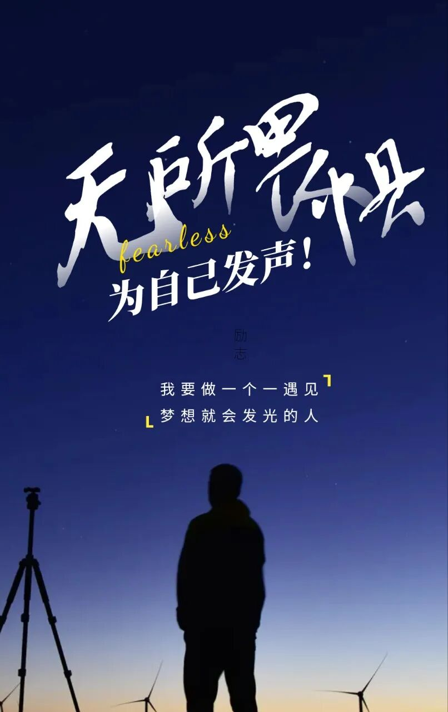
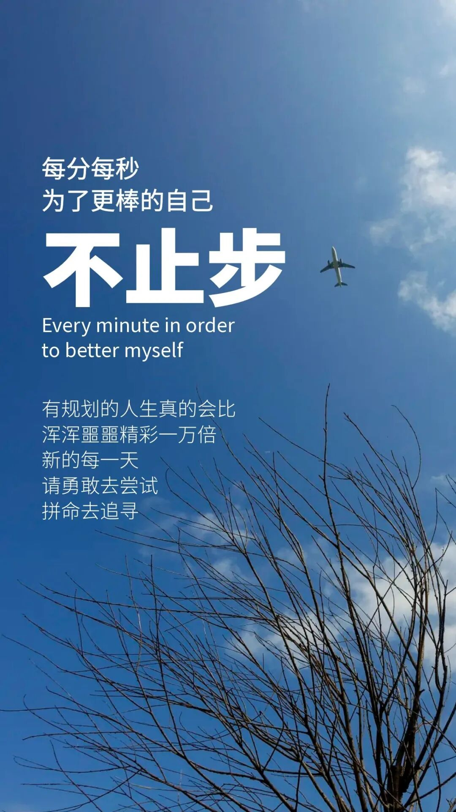
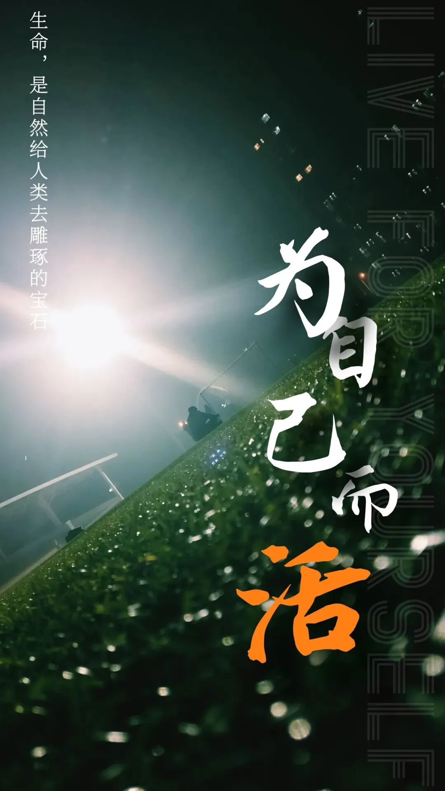
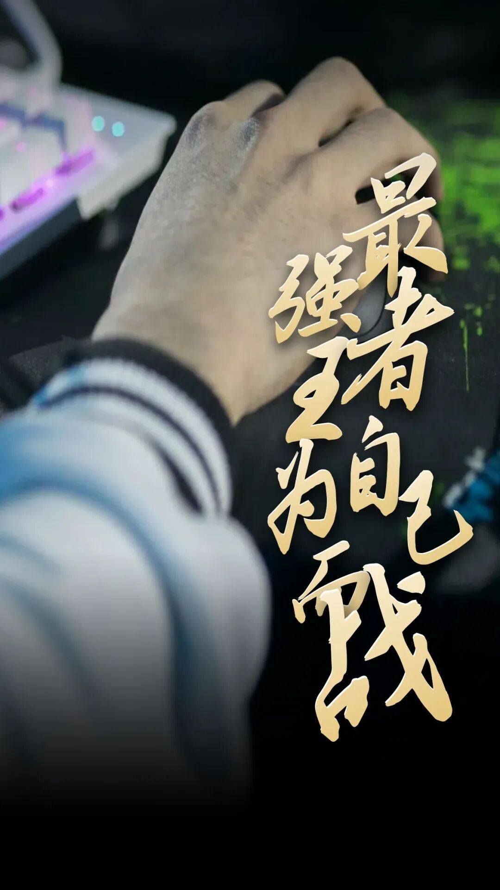
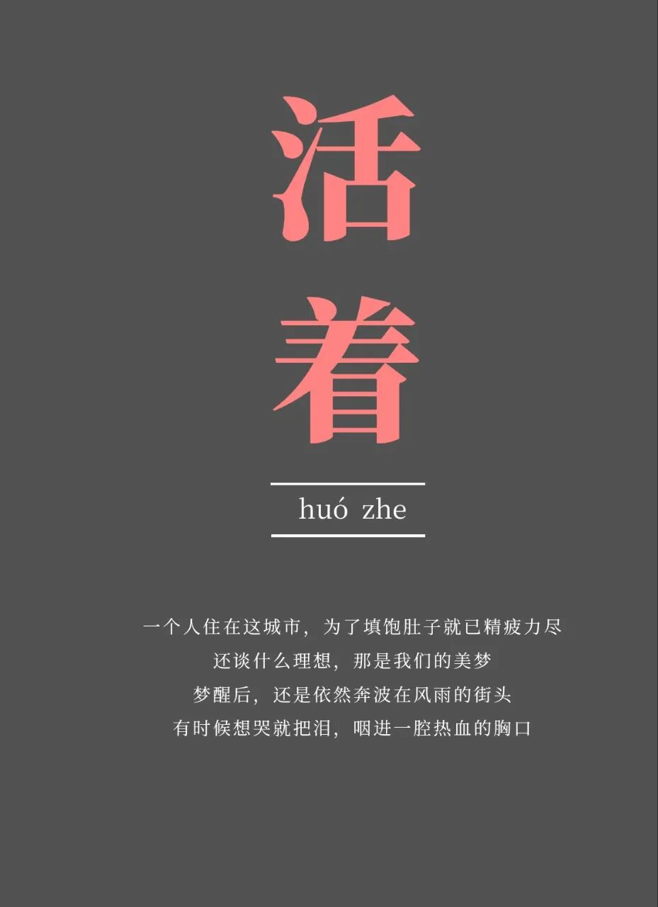

# 七位老同学，六人离世一人脑梗：人到中年，你还要为别人扛到什么时候？
> 💡 备注属性未写入，可能是备注属性名称或者类型被修改了，建议将字段类型设置为 rich_text，可以在小程序-操作-修改文章数据库页面进行调整
> 原文链接:[https://mp.weixin.qq.com/s/BYtbnJVR4WwEKSa0Vxq4rw](https://mp.weixin.qq.com/s/BYtbnJVR4WwEKSa0Vxq4rw)
前几天搬家，我翻出一张旧照片。
照片上七个人，站在一棵老榕树下，笑得特别亮眼。那是我们初中同学聚会时照的。那时候，大家都还在上班，头发没白多少，腰也还直，嘴里说的全是退休以后的计划。
有人要去自驾，有人要学摄影，有人要回乡下种菜，有人要带老伴去海边住一个月。
我们举杯的时候，老雄还说：“再熬几年，等退了休，谁也别拦我，我要把年轻时没玩过的，都补回来。”
我们都笑了。
可谁能想到，几年之后，七个人里，六个已经走了。
剩下的老海，脑梗后走路一瘸一拐，话也说不利索。我们去看他，他拉着我的手，半天才挤出一句：“本来……说好一起出去的。”
那一刻，我鼻子发酸。
我们70后的这一代人，太能扛了。
年轻时扛工作，中年扛家庭，老了还想扛儿女。好像只要自己不倒下，家里就还能撑住。可人到五十岁以后才明白，身体不是铁打的，心也不是永远能补的。

**老廖：一辈子省吃俭用，最后把养老钱都给了儿子**
老廖是我们当中条件最好的。
他在体制内干了一辈子，做事稳，话不多，家里也算体面。他最大的愿望，就是退休后开着车，带着老伴到处走走。
他还买了一件冲锋衣，挂在衣柜里，吊牌都没拆。
他说：“等退了休，穿它去西北。”
可后来，他儿子创业失败，欠了八十多万。
老廖没犹豫，把半辈子攒的钱都拿出来了。老伴哭着劝他：“你也给自己留点啊。”
他说：“我就这一个儿子，我不帮，谁帮？”
后来儿子失败了，又想东山再起，再拼一次，又开口要钱。老廖把城里的房子卖了，把钱给了儿子，两老一起回乡下住老屋。
从那以后，他再也不提旅行。
我们问他，他就笑笑：“等孩子缓过来就好了。”
再后来，一个清晨，他出门散步，走着走着就倒下了。急性心梗，没救回来。
整理遗物时，他老伴打开存折，当场哭得站不住。
一个干了一辈子体面工作的人，最后卡里只剩八百多块。
那件冲锋衣，还挂在衣柜里，干干净净，根本就没动过。

**老猛：身体最好的人，也倒在了放纵里**
老猛和我们不一样。
他爱健身，浑身有劲，走路带风。四十多岁还能跟年轻人一起爬山。我们谁要是说累，他就拍着胸脯：“我这身子骨，没问题。”
可他有个毛病，管不住嘴，也舍不得放下牌桌。
晚上聚餐，他总坐主位，喝酒痛快，吃肉也痛快。烧烤、卤味、啤酒，一样不落。打牌常常到半夜，回家倒头就睡。
我们劝他：“少喝点，别老熬夜。”
他不以为然：“我天天锻炼，怕什么？”
人有时候就是这样，越觉得自己底子好，越敢透支。
那年冬天，他去市场买年货，刚走到门口，半边身子突然麻了，整个人栽在地上。
脑出血。
他在ICU躺了两个月。我去看他时，几乎认不出他。那个曾经能把杠铃轻松举起来的男人，瘦得只剩一把骨头。
他看见我，眼睛动了动，眼泪从眼角滑下来。
他没说出话。
我也没敢多问。
因为我知道，那一刻他大概也后悔了。后悔那些深夜的酒，后悔那些没听进去的劝，后悔总以为身体永远扛得住。

**老马：最老实的人，累到最后一刻**
老马是最让人心疼的一个。
他不抽烟，不喝酒，不赌博，生活简单得像一张白纸。每天上班，下班，回家吃饭，饭后散步。我们都觉得，他肯定能安安稳稳活到退休。
可他女儿在县城开了家小店，人手不够。老马心疼女儿，下了班就去店里帮忙。
卸货、搬菜、收银、打扫卫生，他什么都干。
我们劝他：“你都这把年纪了，别那么累。”
他总是笑：“闲着也是闲着，孩子不容易。”
他这一辈子，好像从来没为自己说过一句“我不行”。
直到有一天，他在店里晕倒。
查出来是结肠癌晚期。
短短两个月，人就瘦成了皮包骨。临走前，他握着我的手，声音很轻：“早知道，我该为自己多活几年。”
这句话，我记到现在。
不是因为他说了什么大道理，而是那种遗憾太真实了。一个人忙了一辈子，到最后才发现，自己好像从来没真正活过。

**剩下的四个人，也没能逃过**
后来几年，另外三个同学也相继走了。
有的因为长期加班，心脏出了问题；有的因为常年焦虑，身体一点点垮掉；还有的明明不舒服，总想着“忍一忍”，结果一忍就晚了。
最后只剩下老海。
老海本来身体也不算差，可看着老同学一个个离开，他心里一直堵着。加上平时劳累，突然脑梗。命是救回来了，人却不像从前利索了。
他常坐在村头发呆。
我们去看他，他偶尔会提起当年的约定。
“不是说好了吗？”他问。
我们只能沉默。
有些约定，不是不想兑现，是人还在但身体已经等不到了。

**中年以后，最贵的不是钱，是还能好好活着**
看完他们，我有很长一段时间睡不着。
我也曾差点走上同样的路。
前两年，女儿、女婿工作忙，想让我过去全职帮他们带孩子。我心疼他们，也心疼外孙，心里犹豫了很久。
可一想到老廖的存折，老猛的病床，老马临终前的那句话，我就怕了。
我不是不爱孩子。
只是我终于明白，爱孩子，不等于把自己全部交出去。
我跟他们认真谈了一次。
我说：“外孙我疼，你们我也很爱。可我年纪大了，身体经不起天天熬。我能帮，但不能把自己熬没了。”
他们一开始不太高兴，后来慢慢理解了。
从那以后，我开始学着把日子往回拉一点。
早上出去走走，看看路边的花花草草。还报了个摄影班，学构图，学调色。周末有空，就出去拍几张。偶尔和老同学喝杯茶，聊聊近况，不再什么都往心里扛。
虽然日子没有突然变富裕，但心里轻松了一些。
**人到中年，别再把自己活成“备用电池”**
我们70后的这一代人，习惯了付出。
对父母，想尽孝；对伴侣，想撑住；对儿女，想托底；对工作，想负责。
我们总说：“等孩子大了就好了。”
“等退休就好了。”
“等忙完这阵就好了。”
可人生最怕的，就是所有好日子都放在“以后”。
以后身体还好吗？
以后还有力气吗？
以后人还在吗？
中年以后，真的要学一点“自私”。
不是不管家人，不是不负责任，而是别再把自己当成永远用不完的备用电池。
儿女的路，让他们自己走一段。
家里的活，别一个人全扛。
身体不舒服，别硬撑。
心里难受，也别总憋着。
存款重要，但命更重要。
体面重要，但健康更重要。
儿女过得好当然欣慰，可你不能为了让他们轻松，就把自己的人生提前花光。
**前半生，我们为别人活，是责任。**
**后半生，为自己活，是清醒。**
别等到衣柜里的新衣服还没穿过，别等到说好的旅行只剩照片，别等到想见的人已经见不到，才想起自己还没好好活过。
中年以后，愿我们都学会一句话：
尽力，但不拼命。
付出，但不掏空。
爱家人，也别忘了爱自己。
如果你身边也有这样一个总把“没事”挂在嘴边的人，请把这篇文章转给他。也许他正硬撑着，正需要有人提醒一句：别太累了。
也欢迎在评论区说说，你见过哪些“明明该歇一歇，却还在硬扛”的中年人？你觉得自己现在最该放下的一件事是什么？
点个赞，收藏一下，转发给那个总说“我没事”的人。愿我们都能平安等到退休，也能在退休前后，先把自己照顾好。
[为什么越善良、越有本事的男人，婚姻反而越不幸福？是天道不公，还是另有玄机？](https://mp.weixin.qq.com/s?__biz=MzkzMDIwNzg1MQ%3D%3D&mid=2247487582&idx=1&sn=d3e6676e7e5dcf9003b8cdea5182f11f&scene=21#wechat_redirect)
[12生肖各有克星，读懂动物的软肋，何尝不是看懂人性？](https://mp.weixin.qq.com/s?__biz=MzkzMDIwNzg1MQ%3D%3D&mid=2247487594&idx=1&sn=8fb35cdf84c7dc4d442eb7e89aeeafa8&scene=21#wechat_redirect)

## 摘要

（待补充）

## 我的笔记

（待补充）
