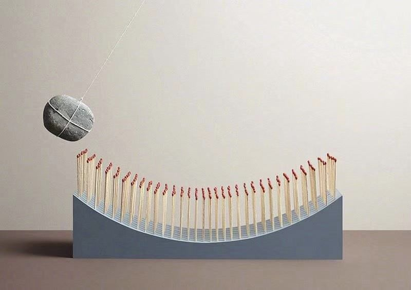
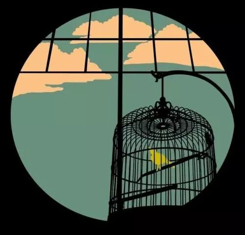
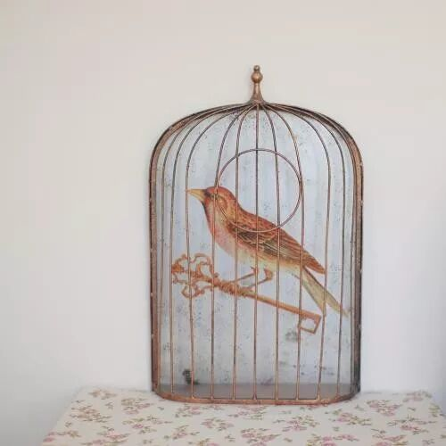
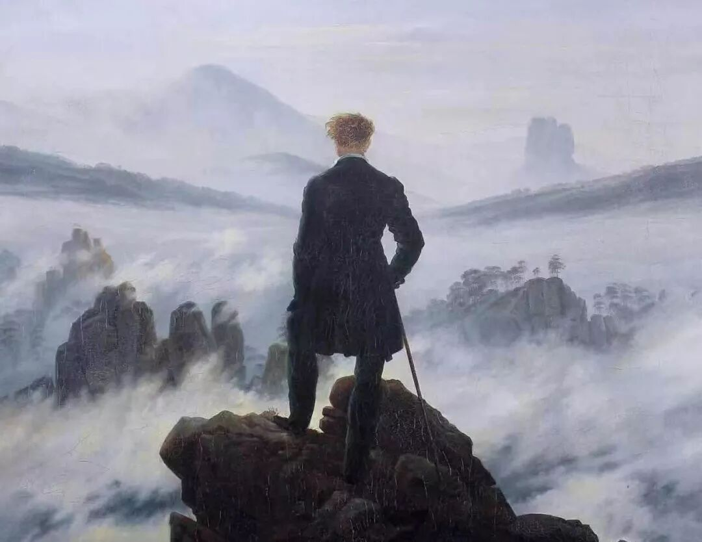
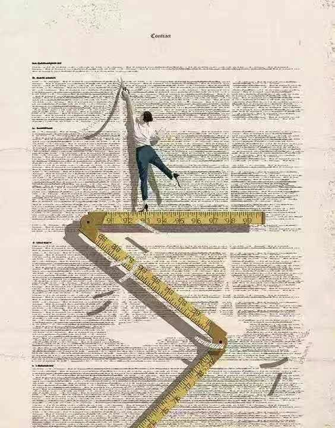
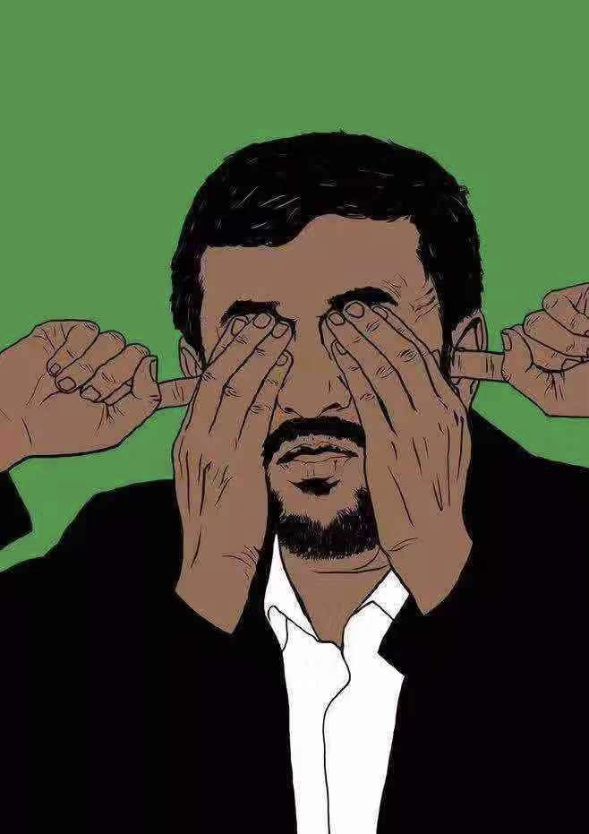
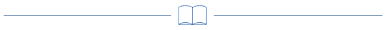

# 七大经典心理学效应，教你越活越智慧
> 💡 备注属性未写入，可能是备注属性名称或者类型被修改了，建议将字段类型设置为 rich_text，可以在小程序-操作-修改文章数据库页面进行调整
> 💡 原文链接:[https://mp.weixin.qq.com/s?__biz=MzAwNDM0ODE0OA==&mid=2247620772&idx=1&sn=b5244f0801c186047646b74b07a72770&chksm=9a6a7c2929a291def9b50f4ecc539584631024b3571969e0dd9ab47166c46dadb0d246196a43#rd](https://mp.weixin.qq.com/s?__biz=MzAwNDM0ODE0OA%3D%3D&mid=2247620772&idx=1&sn=b5244f0801c186047646b74b07a72770&chksm=9a6a7c2929a291def9b50f4ecc539584631024b3571969e0dd9ab47166c46dadb0d246196a43#rd)

——

**01**
**飞轮效应**

面对工作，总觉得提不起精神，效率降低，甚至还会焦虑和神经衰弱？
有人说，这是万事开头难的体现，“飞轮效应”的理论正支持了这一点。
为了使静止的飞轮转动起来，一开始你必须使很大的力气，一圈一圈反复地推。达到某一临界点后，飞轮的重力和冲力会成为推动力的一部分。这时，你无须再费更大的力气，飞轮依旧会快速转动，而且不停地转动。
飞轮开始转动时需要的能量，其实是每次痛苦的突破拓展和积累。这是在为了形成属于自己的体系而做准备。一旦体系能够彼此支撑，那么它的运作就会变得越来越容易。
正如科学家富兰克林说的，**“如果有什么需要明天做的事，最好现在就开始。”**

写作文，最难的是开头；造房子，最难的是打地基；准备迎接新的挑战，过了心理的难关，之后的问题总会迎刃而解。
有人不信，说“反正万事开头难，然后中间难，最后结尾难”。可若是开头不奋力一搏，连看到中间的机会都没有。
相信“飞轮效应”不是追求一劳永逸，而是在一开始，和自己打退堂鼓的心理打个架，别让它拖住你前进的步伐。
**02**
**蘑菇效应**

踏出“舒适圈”很难。

很多刚刚开始工作的年轻人，总觉得自己不受重视。打杂跑腿，端茶送水，还会受到很多指责、批评，甚至代人受过，或者干脆被无视，任其自生自灭。
指导和提携，似乎总是落不到自己头上。这种失落和碰壁感，如同被放置在阴暗角落里的蘑菇一样。而“蘑菇定律”说的就是如此：蘑菇生长必须经历这样一个过程，人的成长也肯定会经历这样一个过程。
“前途茫然”的感觉，会持续在整个蘑菇时期——直到长得够高够壮，才会被人重视。
只有用现在每一秒的努力萌生，才能换取未来每一秒的不后悔。
所有的停滞不前和怯懦担忧，都会延长成为“蘑菇”的时间。终有一日，因为平日的碌碌无为，而错过一个又一个机会，无法对未来形成改变。
**03**
**鸟笼效应**

1907年，心理学家詹姆斯从哈佛大学退休，同时退休的还有他的好友——物理学家卡尔森。
两位学者围绕着一个有趣的赌约争论起来。詹姆斯说：“我有个办法，一定会让你不久就养上一只鸟。”
卡尔森不信：“不可能，我压根没想过要养鸟。”
于是，詹姆斯为卡尔森送上一只精致漂亮的鸟笼。从那天开始，到卡尔森家里的访客总会在看到空的鸟笼之后，关切地问他，“你养的鸟去哪里了？”
卡尔森一次次的解释只能换来客人更加困惑的眼光。久而久之，卡尔森不胜其烦，无奈只好买了一只鸟。
他被詹姆斯的“鸟笼”完完全全地控制住了，自我的意识消失，陷入了被别人操控的结果。
因为别人送了一只鸟笼，所以养了一只鸟。这就是鸟笼效应。

在我们的生活中，这样无意识被其他事物操控的情况，也是鸟笼效应的体现。
人们常常说自己要“剁手”，却仍不停地买着本不需要的东西。为了凑单买的衣服，却常常要再花费金钱和精力，为了搭配而大费周折。
鸟笼效应于生活的影响具有双面性，关键在于如何利用。一位心理学家曾经说过：敞开的书比合上的书更容易让人想读。
这样一来，人们看到打开的书页便想拿起来翻翻，就更容易养成读书的习惯。
不要让“鸟笼”束缚你的生活。
减少不必要的，增加有效的，这才是鸟笼效应的真正启迪所在。
**04**
**野马结局**

管理情绪就是管理人生的开始。
学会管理情绪的人，已经领先了那些容易情绪失控的人一大步。
在非洲草原上，有一种吸血蝙蝠，常叮在野马的腿上吸血。就像在豹子耳边不停烦扰的蚊子，它们能吸饱血之后黯然离开，而不少野马却因为它被生生折磨死。
动物学家说，蝙蝠吸的血量非常少，远不足致死。而这些野马的真正死因是暴怒和狂奔。它们的剧烈情绪反应是造成死亡的直接原因，而吸血蝙蝠只是一种外界的挑战。
因为一件小事而暴跳如雷，大动肝火，这样的人往往难成大事，也难有大成就。

他们常常用别人的错误惩罚自己，造成了像这群野马一样伤害自己的结局。
如果不能学会管理自己的情绪，那么人生也会变得无法掌控。
当发现所有事情都不如意，先反思一下自己是否陷入了情绪的困境。
冷静一下，总没错。
**05**
**凡勃伦效应**

虽然生活中，一般越贵的东西，购买的人越少，但美国经济学家托斯丹·凡勃伦曾经提出：商品价格定得越高，越能畅销。
随着经济的发展和消费观念的进步，人们更愿意花更贵的价格，购买更加好的服务和享受。
其实，这一理论在职场中也能体现。如果想要得到“好价钱”，就要思考如何把自己变得更加“值得”，放在更合适的地方待价而沽。
而自己的“身价”，有时候却并不是外界的物质赋予的。提升自己真正的身份感，靠的是内修。
在工作生活中，提升修养才是拥有好口碑的根本，才能让自己的存在价值得到提升，从而变得“抢手”。
**06**
**南风效应**

法国作家拉·封丹写了这样一则寓言：北风和南风比威力，看谁能把行人身上的大衣脱掉。
北风使出浑身解数，狂风呼啸，试图吹掉行人的衣服。结果行人为了抵御寒冷，便把大衣裹得更紧了。
而南风徐徐吹动，使天气温暖起来，行人因为觉得暖和，相继脱掉大衣。
这场比赛，南风获得了胜利。
这就是有名的“南风效应”，也说明了在处理人与人之间关系时，一旦方法错误，那么不但不会有效果，反而适得其反。

我们都很清楚“见人下菜”的社交法则。其实，不仅是在人际关系间，在工作上也是如此。
“世事洞明皆学问，人情练达即文章”。聪明的人需要拥有一定的“弹性”，温柔灵活比极端刻板更有效果。
允许别人比自己优秀，是一种聪明的处世法则。
因为花太多精力在这些看似狂风与暗涌的斗争上，势必导致工作不精和事业发展缓慢。
但是，如果学会灵活地和自己的竞争对手相处，各取所长，互相合作，相处的方法一旦转变，正面的效果就会有所体现。
**07**
**毛毛虫效应**

为什么觉得自己在去年明明很努力，却依然没长进？
法国心理学家约翰·法伯做过一个实验：将毛毛虫首尾相接，围成一圈放在花盆边缘，在不远的地方撒一些松叶作为它们的食物。
然而，毛毛虫夜以继日地不停绕着盆转圈，没有因为饥饿转向食物，最终精疲力竭，相继死亡。
很多人总是用“做了多少”来评价工作质量的优劣，并不关注结果。
**他们盲目地跟随着既定的路线，从未想过重新思考“重生”的方向。**
这是“埋头拉车”，一味追求前进，但大多方向不明。终有一天倾尽所有才发现，做的都是无用功，而满足感全都来自自我感动。
在新的工作生活来临之际，每个人也需要寻找到自己的突破口。

**如果觉得停滞不前，不要再埋头苦干，试着抬起头，看看周围是否有更广阔的天地、更开阔的视野。**
个体心理学创始人阿尔弗雷德说，**“我们的烦恼和痛苦都不是因为事情的本身，而是因为我们加在这些事情上的观念。”**
全新的开始，认清自己的心，聪明前行。

。
**推荐关注**
**上方公号内回复 999 有惊喜**
——
