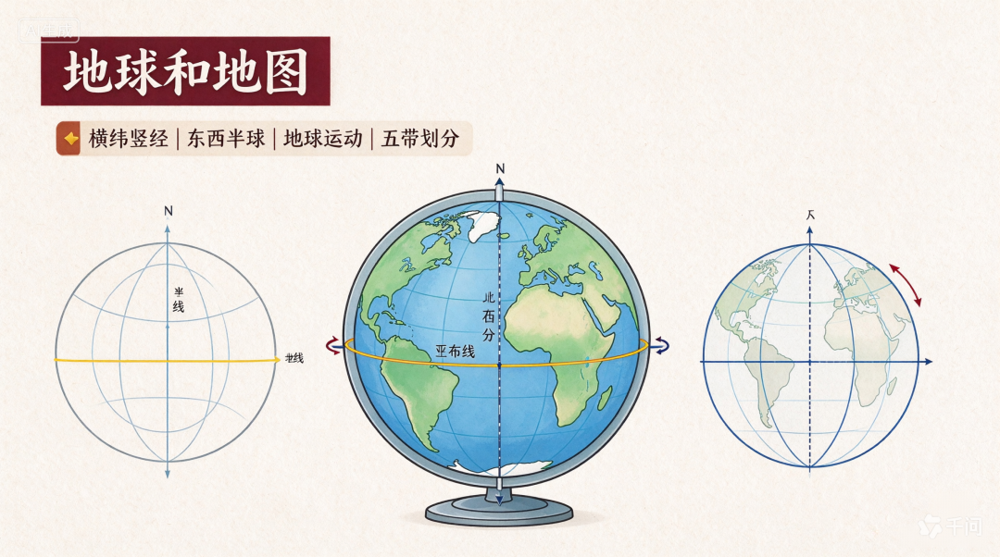
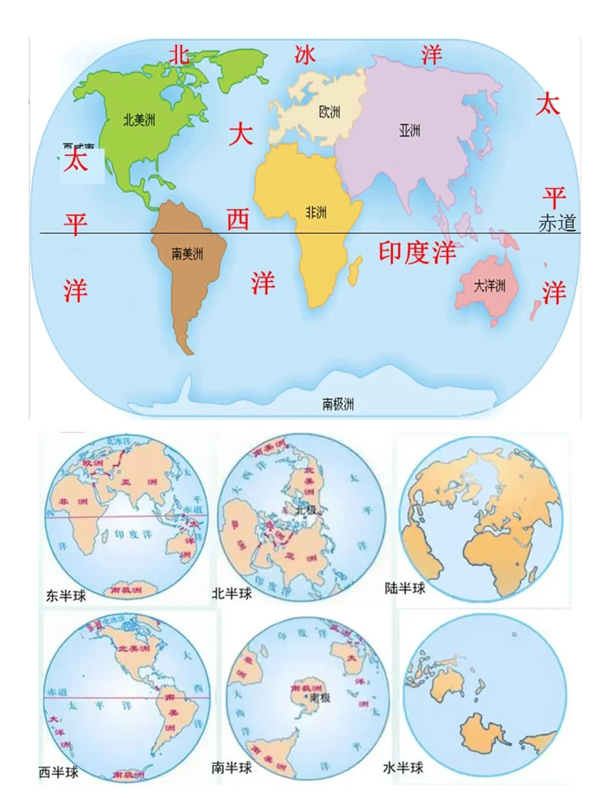
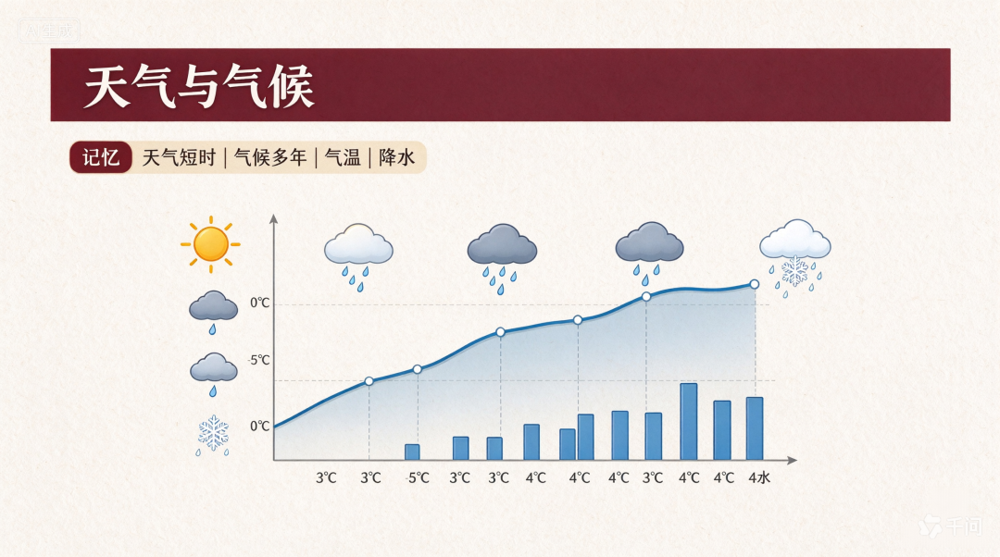
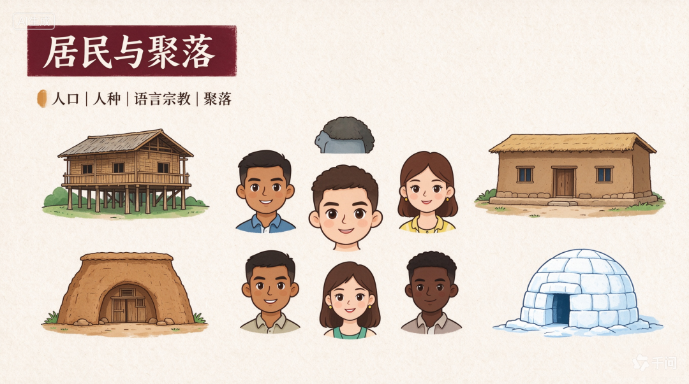
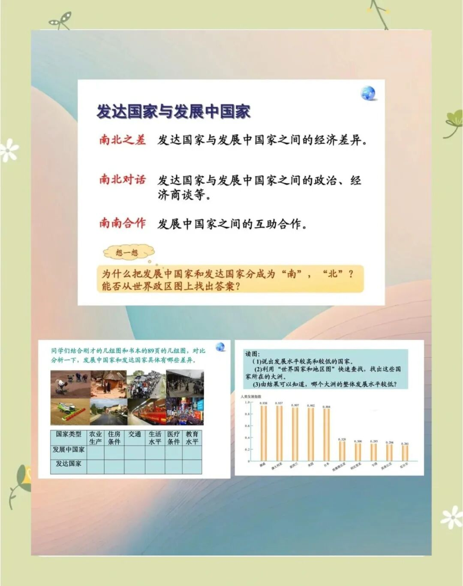

# 七年级地理押韵速记口诀｜全书考点整理，朗读就能背
> 💡 备注属性未写入，可能是备注属性名称或者类型被修改了，建议将字段类型设置为 rich_text，可以在小程序-操作-修改文章数据库页面进行调整
> 原文链接:[https://mp.weixin.qq.com/s/GHXseETm39bSmJL0KgERQg](https://mp.weixin.qq.com/s/GHXseETm39bSmJL0KgERQg)
## 一、🌍地球和地图
## 

地球模样要记牢，两极稍扁赤道凸。 平均半径六三七，赤道周长四万余。
横纬竖经要分清，纬线东西绕圈行。 赤道最长向极缩，经线南北半圆通。 N北S南E为东，W西符号记心中。
东西半球分界线，西二零来东百六。 小小在东大大西，判断半球不迷糊。 南北半球看赤道，北北半球南半球。
地球自转自西东，昼夜更替时区冲。 公转地轴总倾斜，一年四季由此生。 春分秋分直射赤，夏至北回冬至至。
五带划分看极圈，回归两条分界线。 热带有光直射现，寒带极昼极夜见。 温带寒暑轮流转，无直无极四季显。
### 
### 二、🗺️地图三要素
### 

地图三要记心间，比例方向图例全。 比例尺分三类样，线段数字文字详。 分母越大范围广，图上细节看不清。 分母越小范围小，细节丰富看得明。
判方向，有三法，指向标上指北方。 经纬网把方位判，无标就用上北南。 上北下南左西右东，牢记心中不慌乱。
图例符号辨景观，山河道路一一看。 等高线，判地貌，线密坡陡线疏缓。 凸高为谷凸低脊，线重相交是陡崖。 中高周低是山地，中低周高为盆洼。
### 
### 三、🌊陆地和海洋

七分海洋三分陆，海陆分布要记熟。 亚非北南美居前，南极欧洋排后边。
太平最大北冰寒，大西弯曲S形。 印度大洋居南边，四大洋名记完全。
亚欧分界乌乌土，亚非沟通苏伊士。 南北美洲巴拿马，亚白令峡隔两洲。
六大板块要记全，亚欧非美南极洲， 印度洋加太平洋，板块运动不停休。
板块内部多安稳，交界地震火山频。 张裂拉开成峡谷，碰撞挤压高山存。 两大地震带记牢，环太平洋，地‑喜道。
### 
### 四、🌤️天气与气候
### 

天气短时多变幻，气候多年总状态。 天气符号认分明，阴晴雨雪一眼辨。
气温分布有规章，纬度越高气温降。 夏陆温热冬陆凉，海陆差异不能忘。 海拔抬升一百米，气温约降零点六。
降水分布有诀窍，赤道多雨两极少。 大陆东岸雨水旺，西岸内陆雨寥寥。 山地迎风降水足，背风坡地雨稀少。
世界气候类型繁，气温降水做判断。 热雨终年雨绵绵，热草干湿两季换。 热沙常年烈日烤，滴雨难得土地干。
亚季夏季雨水旺，地中海区夏干爽。 温季夏雨忙奔忙，温海终年湿凉凉。 温陆冬寒夏日烫，全年降水并不强。
气候成因四样看，纬度海陆地形洋。
### 
### 五、👨‍👩‍👧‍👦居民与聚落
### 

世界人口七十多，增长快慢看家国。 非洲人口增最快，欧美增速缓许多。
人口稠密四大片，亚东亚南欧北美。 干冷湿热环境差，人烟稀少少人家。
人口问题分两面，过快负担堆成山。 增长过慢劳力缺，老龄化来要防范。
三大人种黄白黑，分布地域记心扉。 黄种东亚北美落，白种欧非西北挪。 黑种非洲中部多，各人种类无优劣。
汉语使用人数广，英语通行遍八方。 联合国里六语言，汉英俄法阿西讲。
基督伊斯兰佛教，三大宗教要记牢。 基督欧美大洋洲，伊斯兰居亚非郊。 佛教源起古印度，东亚东南亚飘摇。
聚落城乡分两样，建筑顺应地域貌。 湿热地区高架房，厚墙隔热避骄阳。 黄土高原窑洞藏，北极冰屋御寒霜。 文化遗产多珍贵，古建保护不能忘。
### 
### 六、🤝发展与合作
### 

世界国家二百余，面积人口各相异。 俄加中巴澳居前，大国顺序要熟记。
领土国界主权守，领土领陆领海有。 国家分作两大类，发达发展两阵营。
发达多国北半球，欧美大洋洲相逢。 发展国家居南方，亚非拉美占大宗。
南北对话促发展，发达对接发展邦。 南南合作手拉手，发展国家互帮忙。
联合国护和平岗，全球经济互来往。
## 
💡更多初中各科复习资料，欢迎持续关注！
#七年级地理 #地理押韵口诀 #初中地理 #会考复习 #初中备考
