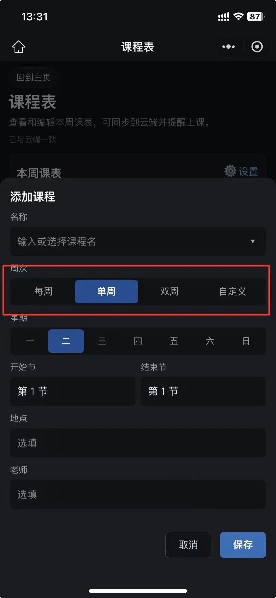
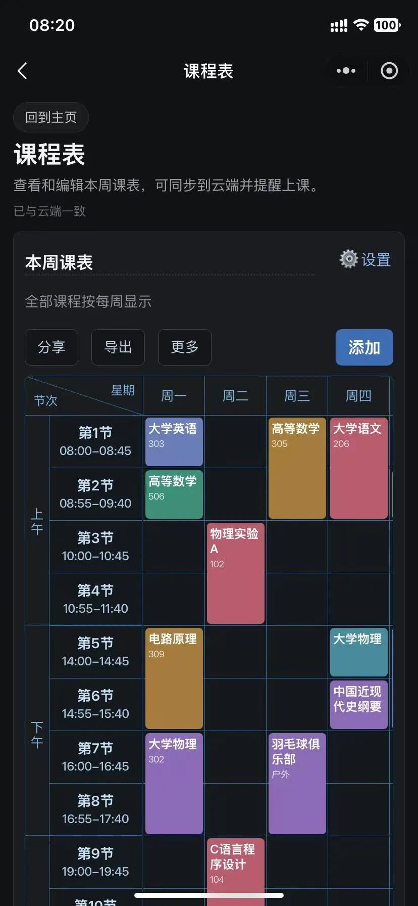
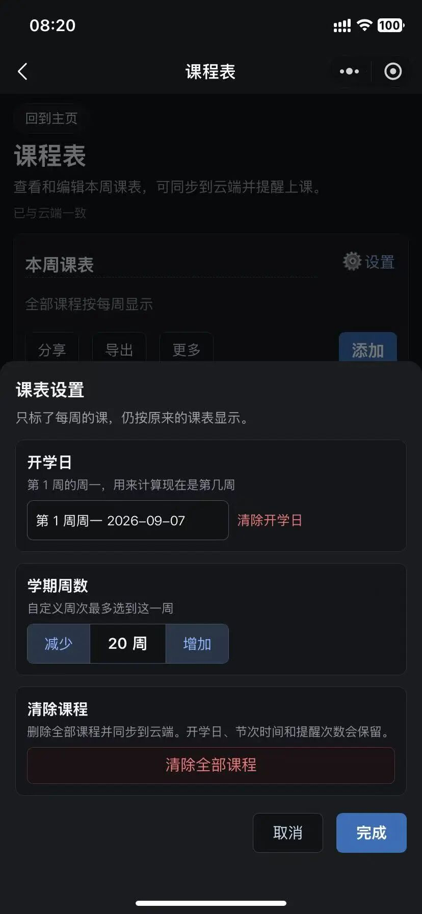
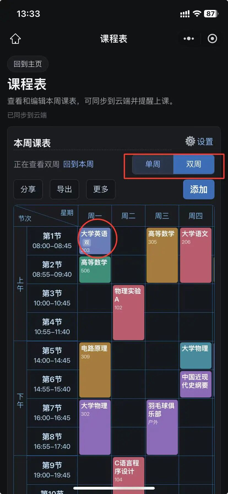
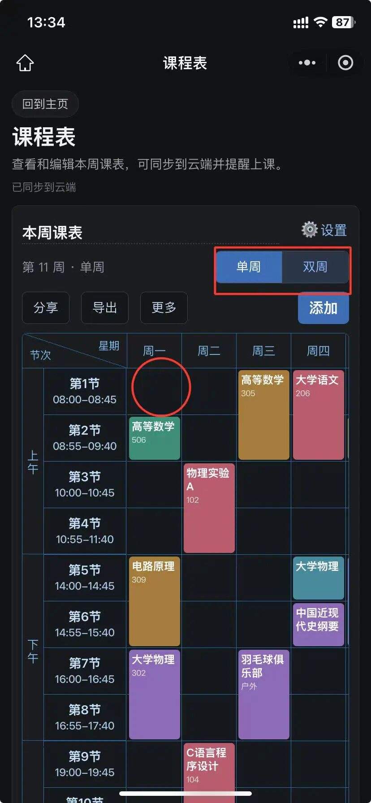
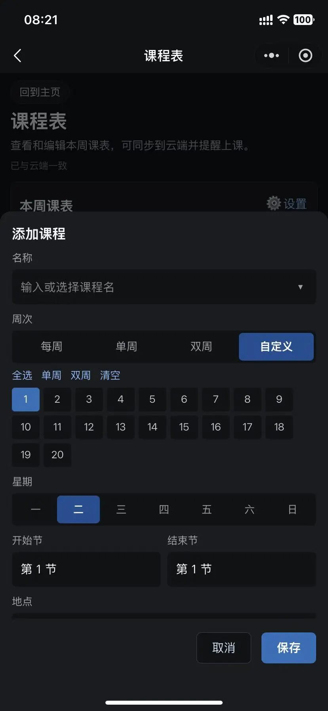
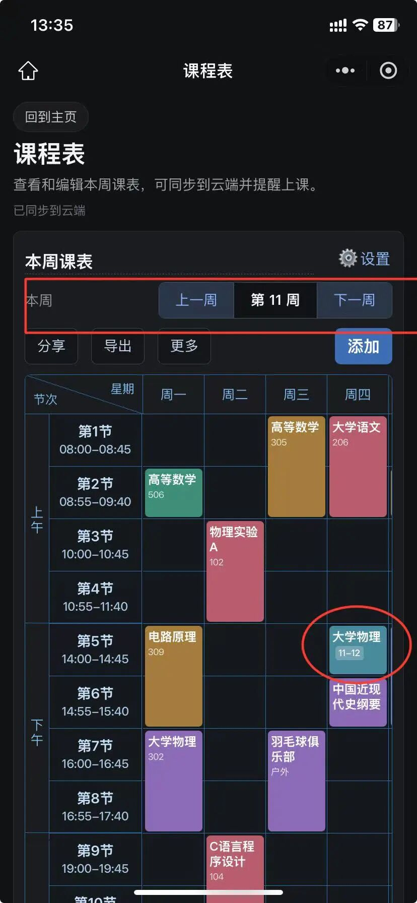

# 万能的课程表详细教程来了！
> 💡 备注属性未写入，可能是备注属性名称或者类型被修改了，建议将字段类型设置为 rich_text，可以在小程序-操作-修改文章数据库页面进行调整
> 💡 原文链接:[https://mp.weixin.qq.com/s?__biz=MzY5NTQ1ODIyNw==&mid=2247483929&idx=1&sn=e3440882d9b06f4a25fd9d3909ff0243&chksm=f56a87007d22766829346596cfa78268834d9028770337bd2e45786ea0b70454b6a44bd1ce0b#rd](https://mp.weixin.qq.com/s?__biz=MzY5NTQ1ODIyNw%3D%3D&mid=2247483929&idx=1&sn=e3440882d9b06f4a25fd9d3909ff0243&chksm=f56a87007d22766829346596cfa78268834d9028770337bd2e45786ea0b70454b6a44bd1ce0b#rd)
之前有用户问课程表有没有单双周模式，第一版没有考虑到这种场景就没做，但是用户提出了这个需求我就一直记在心里，后来经过认真的研究思考后，决定要做而且要做好，一番思考之后我又进行了拓展，不仅可以设置单双周模式，而且还能根据需要自定义课程周，下面我就详细介绍一下具体如何使用。万能课程表
首先，课程表支持四种模式：**每周模式，单双周模式、自定义模式和混合模式**，具体操作是在添加和编辑弹框里的周次里切换；

这四种模式的介绍如下：
1.每周模式
这个是最常用的课程表模式，基本上小学、初中、高中和很多大学课程都是这种模式，特点就是每周的课程都一样，设置一周的课程，后面每周都不会变化，进入课程表默认就是最这个模式，如果每周课程都一样，就选这种模式，这种模式不用设置开学日期，因为每周都一样。

2.单双周模式
顾名思义，这个模式就是课程有单双周的区别，单周和双周的课程不一样，按照单周和双周交替使用，那单周和双周又是怎么算的呢？要使用单双周就必须设置一个开学日期，这个开学日期可能和实际的开学日期不是同一天，这个日期的核心作用就是计算单双周的起点日期，你的课程表从什么时候开始算起，这个开学日期就是什么时候，严格来说是课程开始日期。

当然，这个计算开学日当周的周一并不需要你手动推算，点一下课程表右上角的设置按钮，在弹出的设置开学日的选择框中选择你的课程表开始日期，系统会自动推算和展示这个日期所在周的周一，设置了单双周之后，课表的上方可以切换分别查看单周和双周的课程，而且可以根据需要来分别分享单周或双周的课程给朋友同学，导出到相册也同样如此。

3.自定义周模式
自定义周模式就比较灵活了，可以分别设置不同周的课程，如果你的课程表在某些周的范围是一个，在另一些周的范围又是另一个，又或者某几周的课程和另外的某几周又不一样，就可以使用这种灵活的模式，使用这个模式之前，同样要设置开学日期，目的是推算第一周和当前日期所在周的周数；

设置了自定义模式之后，在课程表的上方可以切换查看具体某一周的课程，还能一键切回当前周，非常的好用。

4.混合模式（更炸裂）
如果上面都不能够很好的满足你，还有一种更炸裂的使用方式，就是上面的三种模式的混合模式，具体来说就是，你可以设置一周的课程里既包含每周模式的课，也可以包含单双周模式的课，还可以包含自定义课，这种就看你怎么玩了，可以有很多的选择。**简单来说，就是一个课表上可以同时包含上面的三种模式的课程。**
这四种模式基本上可以满足大部分用户对于课程表随着不同周的变化而变化的需求，这个课程表还会持续不断的更新更多实用好用的功能，也会不断优化用户的体验，如果你还有什么需求和问题，欢迎私信或留言，我们会认真研究和考虑你的需求和建议。当然，这个小程序的工具箱中还包含各种日常实用工具，而且还在不断的新增，大家可以转发收藏给身边的朋友。
欢迎大家关注，后续有更新会第一时间看到 👀
好的产品一定是要经过持续不断细致的打磨，好用的产品别自己独享，
记得分享给你身边那个需要的TA 💙
—— 课程表使用指南
