# 三个免费英语图书阅读平台的使用方式！
> 💡 备注属性未写入，可能是备注属性名称或者类型被修改了，建议将字段类型设置为 rich_text，可以在小程序-操作-修改文章数据库页面进行调整
> 💡 原文链接:[https://mp.weixin.qq.com/s?__biz=Mzg2OTg2NTEyMg==&mid=2247508656&idx=1&sn=1975dcac0a8a775c4e9ad9933e2abab9&chksm=cf16d9a752f909471428c9cfc45285e036d1690fdffe8941c47dff25437503a310bc438878a3#rd](https://mp.weixin.qq.com/s?__biz=Mzg2OTg2NTEyMg%3D%3D&mid=2247508656&idx=1&sn=1975dcac0a8a775c4e9ad9933e2abab9&chksm=cf16d9a752f909471428c9cfc45285e036d1690fdffe8941c47dff25437503a310bc438878a3#rd)
昨天和大家分享了三个免费英语图书阅读平台，有些可以PDF下载，有些可以中英互译：[**除了Epic， 这些网站也可以免费阅读绘本， 还可以直接保存PDF。**](https://mp.weixin.qq.com/s?__biz=Mzg2OTg2NTEyMg%3D%3D&mid=2247508616&idx=1&sn=d6ff80592cee97dca7e76841388eb81f&scene=21#wechat_redirect)
后台有家长私信问具体如何使用，这篇来和大家简单分享下。
**Story Weaver**

先来看既可以PDF保存又可以中英互译的**Story Weaver**，在浏览器里搜索Story Weaver或者直接输入网址进入。
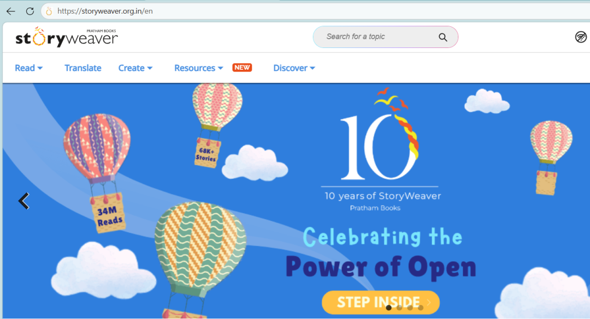
正值10周年纪念，进入后可能会直接跳转到纪念日页面，点击右上角**Back to Home**就可以回到首页。
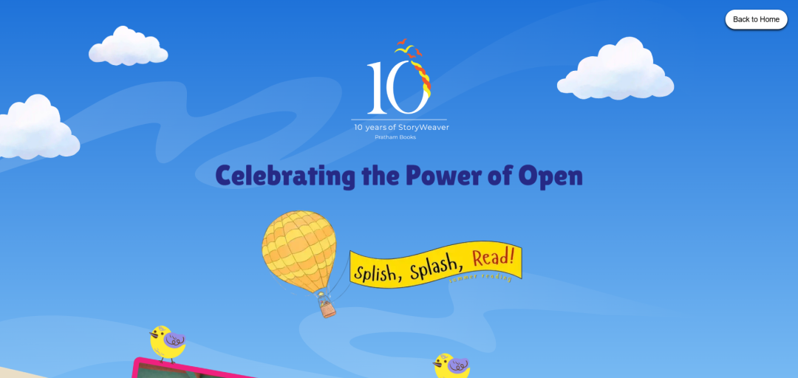
在首页右上角注册登录后，就可以根据导航栏筛选图书了。
点击**Read**旁的向下箭头，就可以看到**主题，语言和难度等级**，按自己的需求筛选即可。
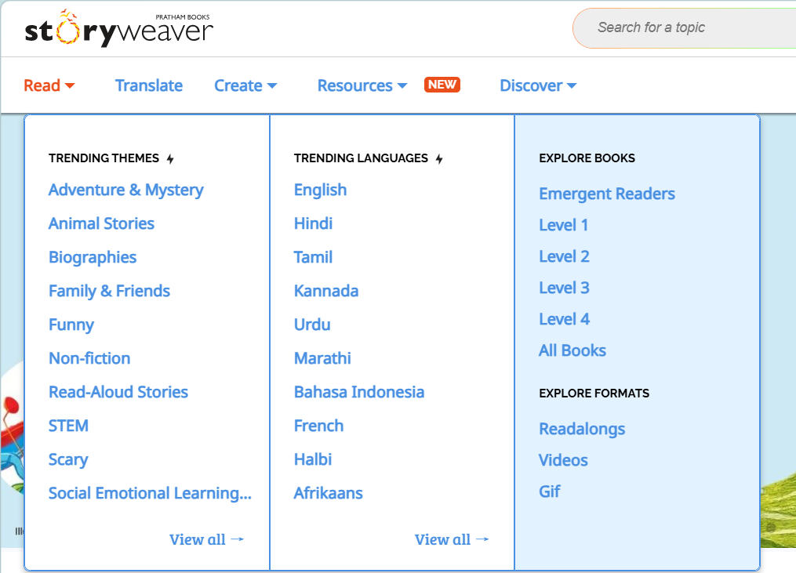
比如，我在主题栏里选择了**Non-fiction**，就会跳转到Non-fiction的页面，
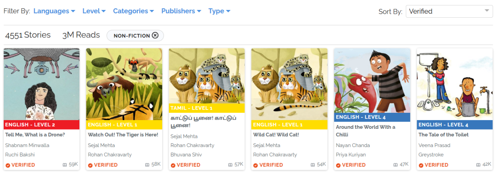
继续选择**语言和难度等级**，右上角还可以选择排列顺序，我选了按阅读量排序，
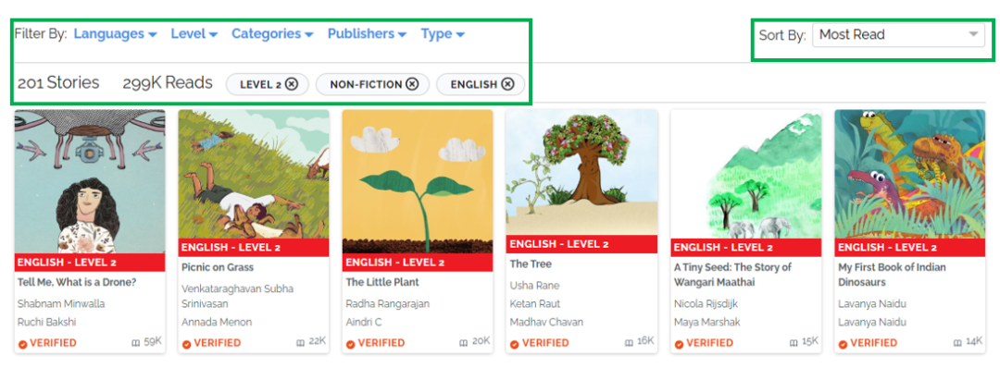
把鼠标移动到某本书的封面上，就可以选择直接阅读，加入书架或者离线阅读图书馆。
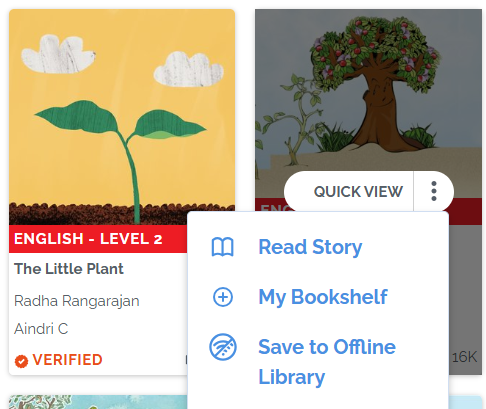
点击**Read Story**，就是直接在线阅读。
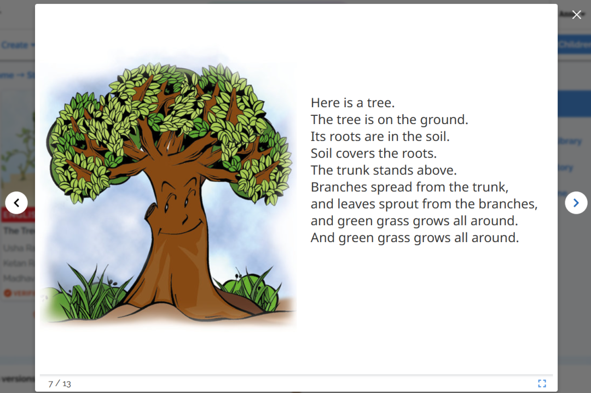
点击图书进入，就可以看到更多选项，翻译或者下载。
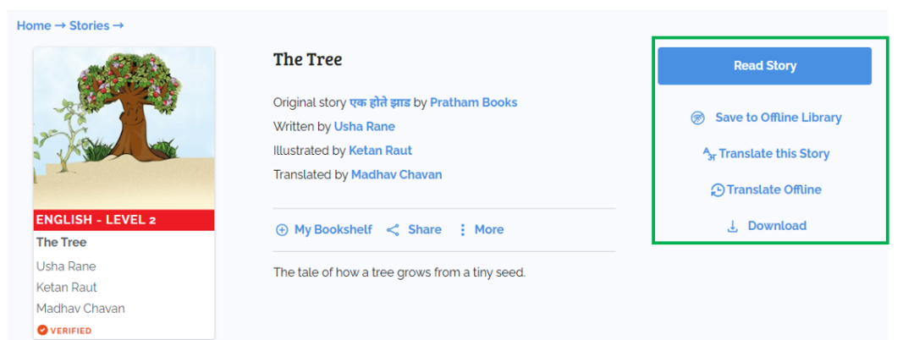
点击**Translate this Story**，选择好想要翻译的语言，
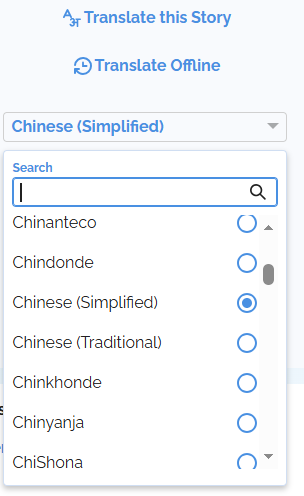
就可以进行在线翻译了，在右侧输入中文即可。
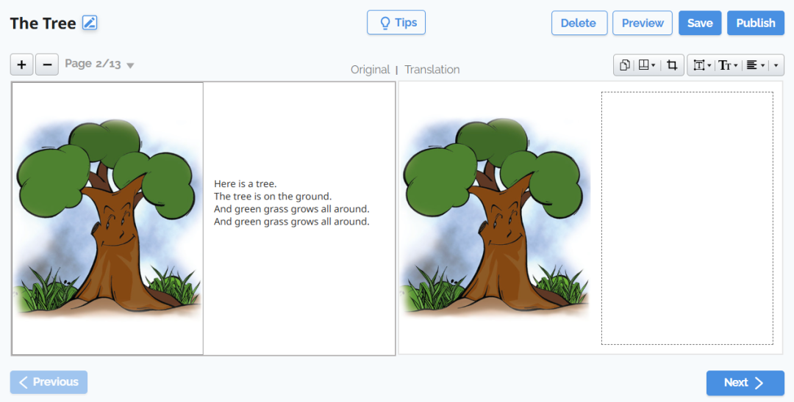
点击**Download**，
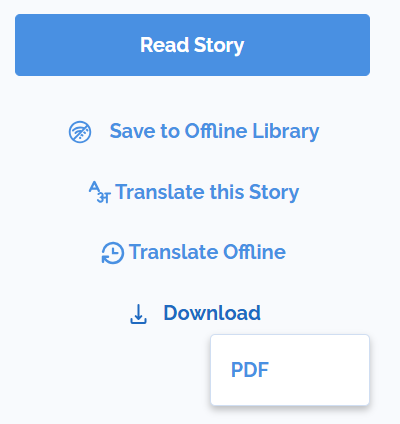
就可以直接保存该图书的PDF文档。
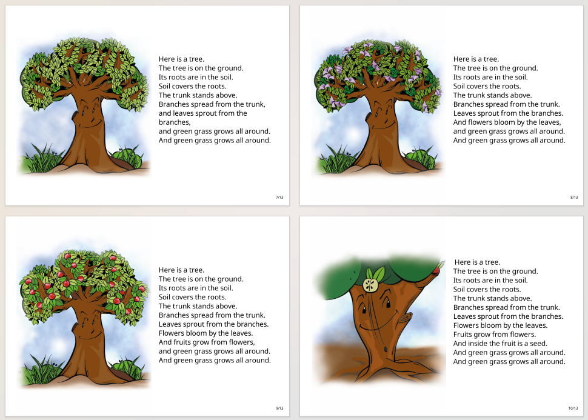
家里有打印机可以直接打印成小册子进行纸质阅读。
导航栏里的**Translate**就是图书翻译，
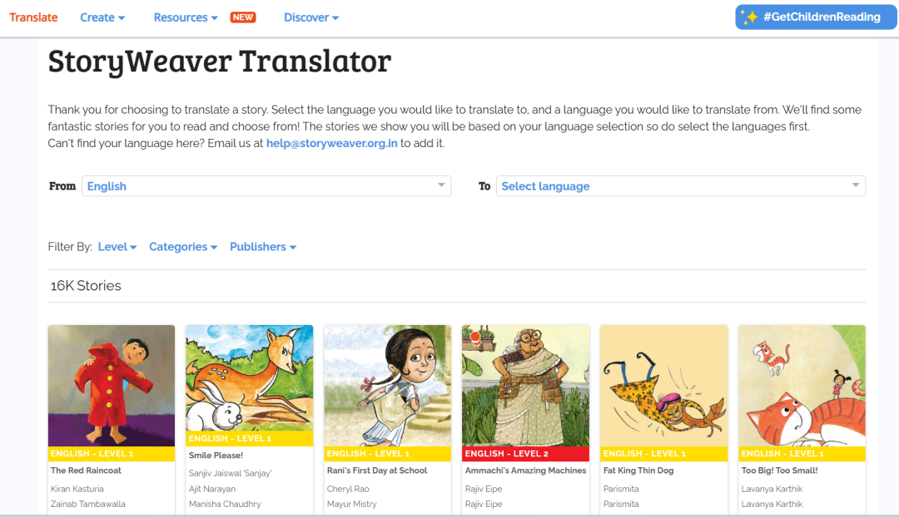
**Creat**是让孩子自己编辑绘本，创造故事。
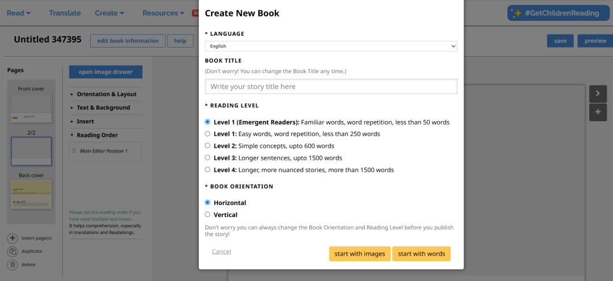
可以带着孩子探索下。
**Free Kids Books**

Free Kids Books比较简单，输入网址进入网站后，
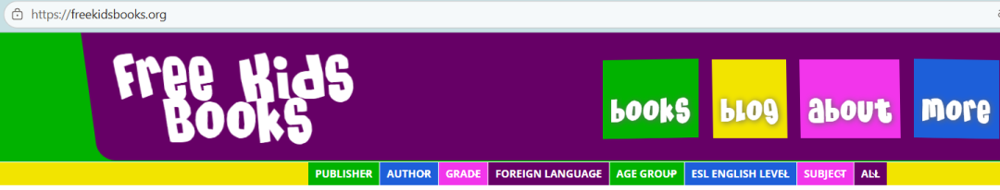
在导航栏里根据**年级、英语水平、主题等**筛选图书。
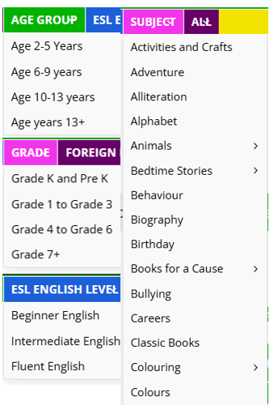
点击图书信息的右下角的**Download Free PDF**，
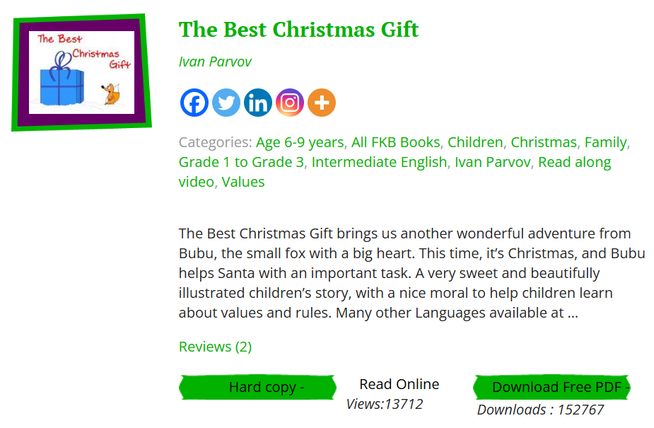
就可以直接保存该本图书了。
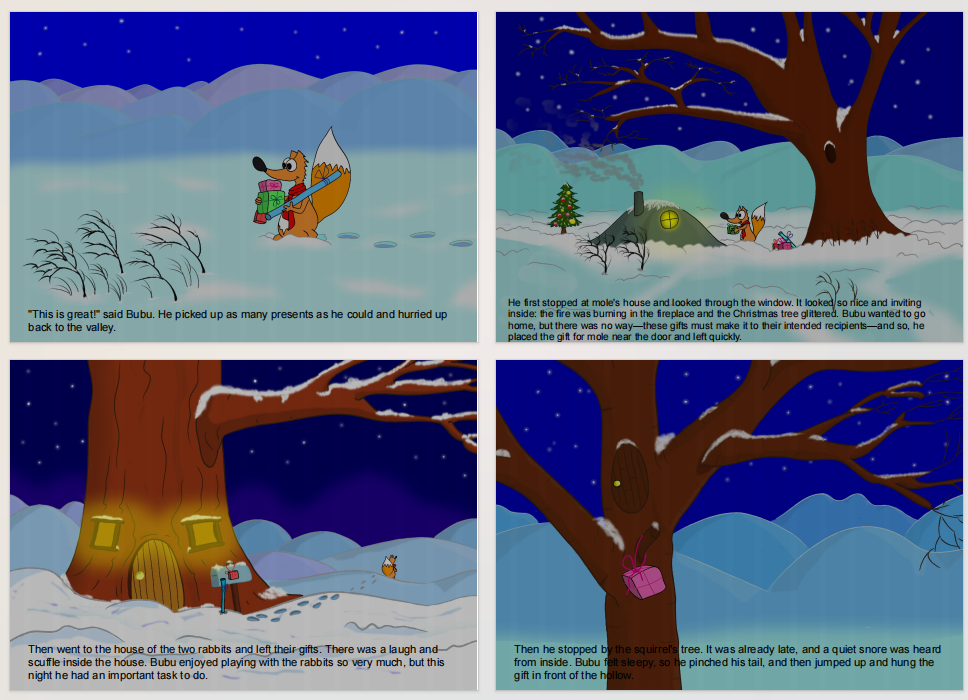
** Literacy Cloud**

Literacy Cloud同样很简单，输入网址进入网站后，

根据**主题，难度等级、语言**进行筛选图书，根据**收藏量、阅读量或者字母**进行排序，

选择好图书后，

直接在线阅读或者保存到离线图书馆。

以上就是这三个免费阅读平台的使用，三个里最推荐的是**Story Weaver**，既可以保存PDF，也可以锻炼孩子的翻译能力。自己创造故事绘本，还能培养孩子的想象力和创造力。
大家可以根据孩子的英文能力和使用需求使用。
**E**
**N**
**D**
感谢阅读 期待你的
分享
点赞
在看
你的小小点击，是对我大大的鼓励！

