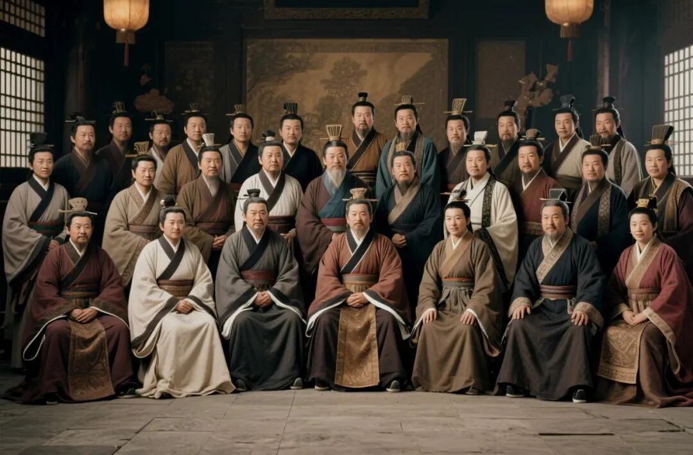

# 三国时期12大世家大族
> 💡 备注属性未写入，可能是备注属性名称或者类型被修改了，建议将字段类型设置为 rich_text，可以在小程序-操作-修改文章数据库页面进行调整
> 💡 原文链接:[https://mp.weixin.qq.com/s?__biz=MzcwODI3NTQxMQ==&mid=2247484723&idx=1&sn=c279ff6a34d5ca57a712ab18db6ee047&chksm=f435db3ba9d0d5db8fe6096203db8834e5fb4ca6c3142616a0aca36a39ff74b301edfd8b74eb#rd](https://mp.weixin.qq.com/s?__biz=MzcwODI3NTQxMQ%3D%3D&mid=2247484723&idx=1&sn=c279ff6a34d5ca57a712ab18db6ee047&chksm=f435db3ba9d0d5db8fe6096203db8834e5fb4ca6c3142616a0aca36a39ff74b301edfd8b74eb#rd)

图源 / AI自制
**1.汝南袁氏**｜四世三公
代表人物：袁安（东汉奠基人）、袁绍、袁术、袁谭、袁尚、袁熙。自袁安起四代人出任三公，门生故吏遍布天下，是汉末声望第一的世家。董卓乱政后，袁绍成为关东讨董联军盟主；占据冀、青、幽、并四州，是北方最强势力。袁术割据淮南，率先称帝。袁氏代表了汉末士族门阀的巅峰力量，凭借门第就能一呼百应，也让汉末群雄争霸拉开大幕。
官渡之战袁绍败给曹操；袁绍死后，袁谭、袁尚兄弟内讧，曹操逐个击破。207年，辽东公孙康斩杀袁尚、袁熙。袁绍、袁术嫡系子孙几乎被杀尽。汝南袁氏主支覆灭，旁支后人在魏晋还能做官，但再也达不到四世三公的地位，顶级门阀地位不复存在。
**2. 弘农杨氏**｜四世三公
代表人物：杨震（关西孔子，东汉奠基人）、杨彪、杨修。关西儒学巨族，世代传《欧阳尚书》。杨彪是汉献帝时期太尉，始终忠于汉室；杨修才学出众，担任曹操主簿。杨氏是汉室忠臣的代表，坚守儒学正统，在士族圈子声望极高。
杨修因卷入曹植、曹丕夺嫡之争，被曹操处死。杨彪保全自身，活到魏初。杨氏主支没有被灭族，但政治上主动淡出权力核心。家族并未灭绝，后世一直延续，隋唐杨坚（隋文帝）就自称弘农杨氏后裔（有争议），属于家族长期延续，只是三国阶段失去朝堂最高权柄。
**3. 颍川荀氏**
代表人物：荀彧、荀攸、荀谌、荀衍。颍川士族领袖。荀彧是曹操 “王佐之才”，为曹操制定 “奉天子以令不臣” 战略，举荐大批颍川人才（郭嘉、钟繇、陈群等），是曹魏政权早期总设计师；荀攸是曹操首席随军谋主，平定吕布、官渡之战多奇策；荀谌早年为袁绍谋臣。荀氏是连接曹操与颍川士族的纽带，深刻奠定曹魏根基。
荀彧因反对曹操进魏公，被迫自尽。荀攸早逝。荀氏子弟在魏朝仍有人做官，但失去政治核心地位。西晋时家族尚有人才，没有族灭，只是在魏晋禅代之后，家族权势逐步下滑，不再是顶级政治家族。
**4. 颍川陈氏**
代表人物：陈寔（东汉名士，家族奠基人）、陈群、陈泰。陈群是曹魏重臣，创立九品中正制，这一制度直接塑造魏晋南北朝门阀政治。陈群主持制定曹魏律法《魏律》；陈泰是魏国后期名将，镇守雍凉，对抗姜维。陈氏是士族与皇权妥协的代表，把士族做官特权制度化。
陈泰在高贵乡公曹髦被杀后悲愤而死。陈氏后人在西晋继续显贵，家族没有被诛杀。永嘉之乱后，颍川本土宗族残破，家族南迁，慢慢失去顶级门阀地位。
**5. 颍川钟氏**
代表人物：钟繇、钟会、钟毓。钟繇，曹魏三公，大书法家，镇守关中，安抚西北；钟毓，曹魏大臣；钟会，青年名士，司马氏心腹，伐蜀统帅，灭蜀汉。钟氏是颍川士族里偏向司马氏的一支。
263年灭蜀之后，钟会在成都谋反，兵败被杀。钟会养子及同党被诛杀；但钟毓一脉因为提前提醒司马氏提防钟会，得以保全。钟氏主支（钟会一支）覆灭，钟毓后人得以延续，不过家族权势大幅衰落。
**6. 河内司马氏**
代表人物：司马懿、司马师、司马昭、司马炎。司马懿熬死曹操、曹丕、曹叡，在高平陵之变一举铲除曹爽集团，掌握曹魏大权；司马师、司马昭巩固权力，平定淮南三叛；司马炎代魏建立西晋，统一三国。司马氏是士族夺权的终极范本，依靠士族支持，完成禅代。
西晋建立后，爆发八王之乱，皇族自相残杀；紧接着永嘉之乱，匈奴攻破洛阳。司马氏大宗几乎被屠戮殆尽。东晋是司马睿南迁建立，但皇权衰弱，刘裕代晋建宋后，将司马宗室大量诛杀，河内司马氏皇室支系基本消亡。
**7. 范阳卢氏**
代表人物：卢植、卢毓。卢植是东汉大儒，刘备、公孙瓒的老师，平定黄巾的名将。卢毓在曹魏历任高官，主持人才选举。范阳卢氏是北方儒学世家，坚守经学，在北方士族中声望厚重。
三国时期没有覆灭。卢氏在魏晋、北朝持续为顶级高门，一直显赫到隋唐。三国这一段只是家族上升期，消亡要等到唐末五代才彻底衰落。
**8. 清河崔氏**
代表人物：崔琰、崔林。崔琰是河北名士，袁绍下属，后归曹操，负责人才选拔，风骨凛然；崔林，曹魏高官，位列三公。清河崔氏是河北士族代表，重视家风礼法。
崔琰被曹操赐死。但家族没有株连。清河崔氏在魏晋、北朝极为显赫，到北魏更是第一流门阀，直到隋唐之后，在唐末战乱才衰落，三国阶段无损。
**9. 太原王氏**
代表人物：王允、王凌。王允，东汉司徒，策划诛杀董卓；王凌，曹魏淮南重臣，镇守淮南。王允设计除掉董卓，但随即被董卓部将李傕郭汜杀害。王凌发动淮南第一叛，反对司马懿，兵败自杀。
王允全家在长安大乱时几乎被杀；王凌叛乱失败，被夷三族。太原王氏这两支重创，但太原王氏还有其他分支，在魏晋继续显贵，后续成为中古顶级门阀，同样延续到隋唐。
**10. 吴郡陆氏**
代表人物：陆绩、陆逊、陆抗、陆凯。江东吴四姓之首。陆逊，夷陵之战大败刘备，石亭大破曹休，官至东吴丞相；陆抗是东吴最后名将，镇守荆州对抗西晋。陆氏是东吴政权的支柱，孙氏必须依靠陆氏等江东大族统治江南。陆氏代表江东本土士族力量。
陆抗死后，家族子弟仍在东吴做官。东吴灭亡后，陆氏没有被屠杀，家族迁洛阳。吴郡陆氏在两晋南朝依然是江东顶级大族，一直延续到隋唐，三国阶段没有消亡。
**11. 琅琊诸葛氏**
代表人物：诸葛瑾（吴）、诸葛亮（蜀）、诸葛诞（魏）。一门三方为冠盖。诸葛亮为蜀汉丞相，治国北伐；诸葛瑾东吴重臣；诸葛诞魏国征东将军。三兄弟分仕三国，是汉末名士家族的特例。
诸葛亮之子诸葛瞻、孙诸葛尚，在绵竹战死，蜀汉诸葛一脉凋零；诸葛瑾长子诸葛恪东吴专权，被孙峻诛杀，夷三族；诸葛诞发动淮南三叛，兵败，夷三族。三支几乎全部重创。琅琊诸葛旁支还有少量后人留存，但再也没有顶级政治人物，家族跌落。
**12. 沛国夏侯氏**
代表人物：夏侯惇、夏侯渊、夏侯尚、夏侯玄。与曹氏世代联姻，曹魏元勋宗族。夏侯惇镇守后方；夏侯渊平定凉州；夏侯玄，玄学领袖，曹魏宗室后期核心。
夏侯渊战死汉中。夏侯玄参与推翻司马师的密谋，事泄被杀，夷三族。夏侯氏核心支系覆灭。旁支尚存，但失去军政大权，不再是顶级家族。
您的点赞关注会使我写得更来劲~3Q！
