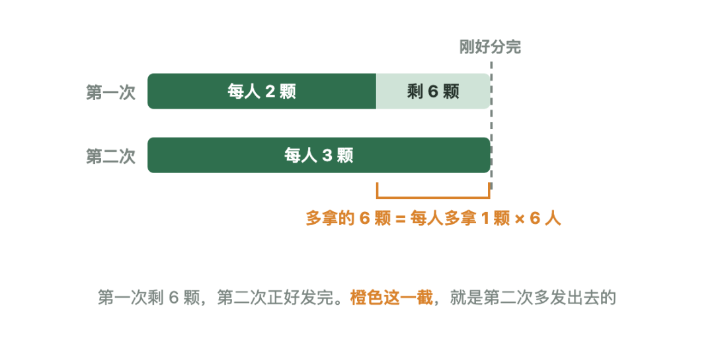
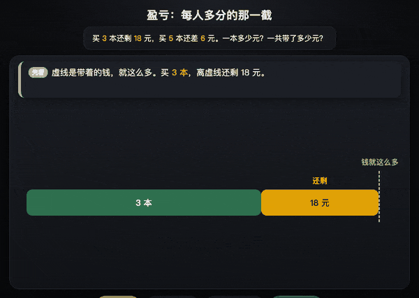
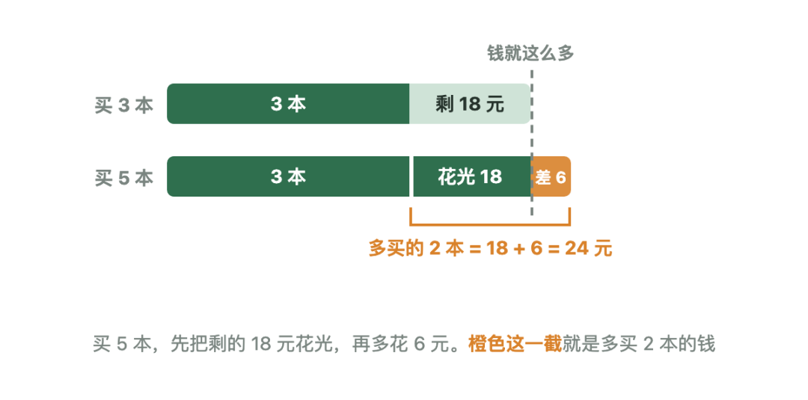
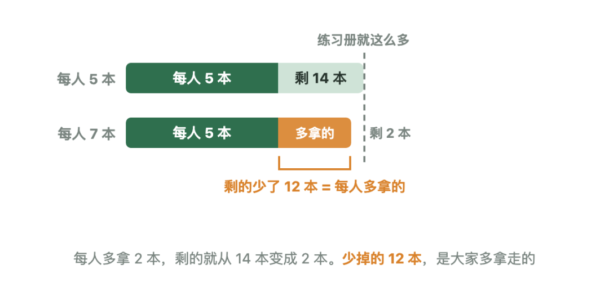
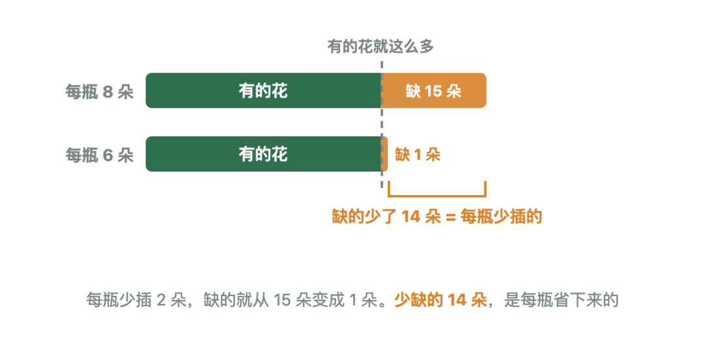
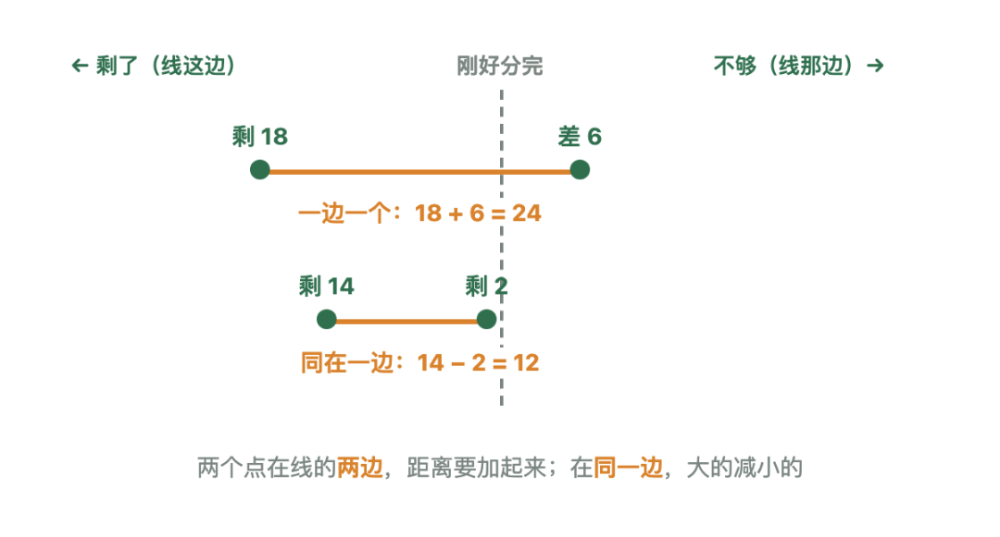
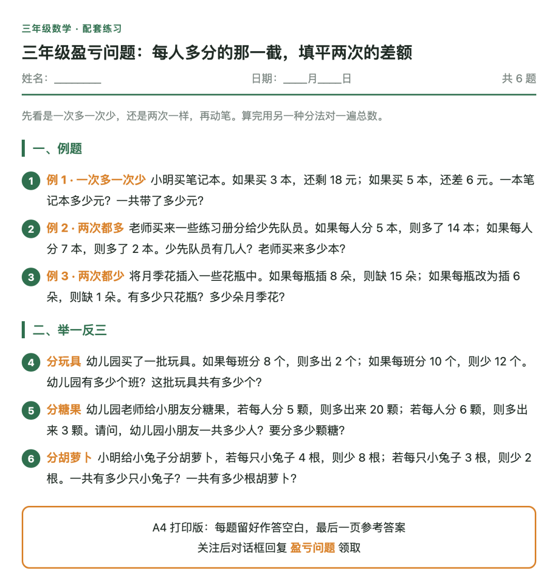

# 三年级奥数思维：盈亏问题一文说透
> 💡 备注属性未写入，可能是备注属性名称或者类型被修改了，建议将字段类型设置为 rich_text，可以在小程序-操作-修改文章数据库页面进行调整
> 💡 原文链接:[https://mp.weixin.qq.com/s?__biz=MzUxOTUwMDE2OQ==&mid=2247484280&idx=1&sn=c5c6beb4977ce25d5d4ce853ddc83315&chksm=f83cb3b4d5ecc93800be031969f0b341ef7629d1a465aa1501dcdddeb4a7ee3ea29daad2ef04#rd](https://mp.weixin.qq.com/s?__biz=MzUxOTUwMDE2OQ%3D%3D&mid=2247484280&idx=1&sn=c5c6beb4977ce25d5d4ce853ddc83315&chksm=f83cb3b4d5ecc93800be031969f0b341ef7629d1a465aa1501dcdddeb4a7ee3ea29daad2ef04#rd)
专题攻克 · 盈亏
**适合**　三年级，会乘除法。看到「还多」「还少」，不知道该加还是该减。
**目标**　孩子能说出：两次差了多少，是每人多拿的合在一起。再除一下，就是人数。
### 01知识点核心：为什么这样算
> 东西就这么多，分两次。每人多拿一点，剩下的就少一点。少掉的这一截，就是每人多拿的合在一起。
> 
**本质在考什么**　总数没变，变的是分法。两次剩的不一样，差出来的那一截，全是每人多拿的合起来的。题只考一件事：孩子能不能看出，这一截是从哪来的。看出来了，除一下就是人数。
分糖：每人分 2 颗，多出 6 颗；每人分 3 颗，正好分完。有几个小朋友？

橙色这一截 6 颗，每人多拿 1 颗，6 ÷ 1 = 6 人。两种分法各算一遍：2 × 6 + 6 = 18，3 × 6 = 18，一样多才对。
**训练孩子什么**
**•盯住不变的量。** 东西没多没少，变的只是每人几个。
**•把变化归到每一份。** 总共差了多少，是每人多拿几个合起来的。
**•用图定加减。** 剩了和不够站在线的两边，不背口诀，画出来看。
**这类题一张图说清**

多买的 2 本，是剩的和差的拼起来的
| **题里说** | **两次在哪** | **差多少** |
| 一次多一次少 | 一边一个 | 两数相加 |
| 两次都多 | 同在一边 | 大数减小数 |
| 两次都少 | 同在一边 | 大数减小数 |
差的这一截，除以每人相差几，就是人数。总数用两种分法各算一遍。
### 02例题精讲
三道题，走同一条路：每人差几个，两次差了多少，相除得人数。
**拿到题，问孩子三句**　第一次是剩了，还是不够？第二次呢？两次是在线的两边，还是同一边？说清这三句，再动笔。
#### 例 1 · 一次多一次少：买笔记本
> 小明买笔记本。如果买 **3** 本，还剩 **18** 元；如果买 **5** 本，还差 **6** 元。一本笔记本多少元？一共带了多少元？
> 

#### 第 1 步先看多买了几本
买 5 本比买 3 本，多买了 2 本。
**5 − 3 = 2（本）**
#### 第 2 步再看多花了多少钱
剩的 18 元要先花光，还不够，又差 6 元。两截合起来，都是这 2 本的钱。
**18 + 6 = 24（元）**
#### 第 3 步一本多少，一共多少
2 本是 24 元，一本就是 12 元。带的钱，是 3 本的钱，再加上没花的 18 元。
**24 ÷ 2 = 12（元）**
**3 × 12 + 18 = 54（元）**
**5 × 12 − 6 = 54（元）**
**答案：一本 12 元，一共 54 元。**
**54 ÷ 3，或者 54 ÷ 5。** 54 元是算完才有的，题里并没告诉我们一共多少元。
#### 例 2 · 两次都多：练习册
> 老师买来一些练习册分给少先队员。如果每人分 **5** 本，则多了 **14** 本；如果每人分 **7** 本，则多了 **2** 本。少先队员有几人？老师买来多少本？
> 

#### 第 1 步先看每人多拿几本
每人从 5 本改成 7 本，多拿了 2 本。
**7 − 5 = 2（本）**
#### 第 2 步再看剩的少了多少
剩的从 14 本变成 2 本，两次都在线这边，用大的减小的。
**14 − 2 = 12（本）**
#### 第 3 步12 本里有几个 2 本
12 本是每人多拿的 2 本合在一起。有几个 2，就有几个人。
**12 ÷ 2 = 6（人）**
**5 × 6 + 14 = 44（本）**
**7 × 6 + 2 = 44（本）**
**答案：6 人，44 本。**
**(14 + 2) ÷ 2 = 8 人。** 那 2 本还留在桌上，没有被拿走，不能算进去。
#### 例 3 · 两次都少：月季花
> 将月季花插入一些花瓶中。如果每瓶插 **8** 朵，则缺 **15** 朵；如果每瓶改为插 **6** 朵，则缺 **1** 朵。有多少只花瓶？多少朵月季花？
> 

#### 第 1 步先看每瓶少插几朵
每瓶从 8 朵改成 6 朵，少插了 2 朵。
**8 − 6 = 2（朵）**
#### 第 2 步再看缺的少了多少
缺的从 15 朵变成 1 朵，两次都在线那边，用大的减小的。
**15 − 1 = 14（朵）**
#### 第 3 步14 朵里有几个 2 朵
14 朵是每瓶少插的 2 朵合在一起。有几个 2，就有几只花瓶。
**14 ÷ 2 = 7（只）**
花不够插，总数要比「每瓶插 8 朵」少，所以要减掉缺的。
**7 × 8 − 15 = 41（朵）**
**7 × 6 − 1 = 41（朵）**
**答案：7 只花瓶，41 朵。**
**7 × 8 + 15。** 这是把缺的当成多出来的了。不够，要减掉。
### 03归纳：四步与考点
不管哪一类，都走这四步：
**1.画线。** 把「刚好分完」当成一条线，看两次分别站在哪一边。
**2.求差。** 一边一个，两数相加；同在一边，大数减小数。这就是两次差的总量。
**3.相除。** 差的总量，除以每人相差几，得到人数。
**4.验算。** 用两种分法各算一遍总数，要一样多。
第 1、2 步看这张图：

| **例题** | **哪一类** | **差多少** |
| 笔记本 | 一次多一次少 | 18 + 6 |
| 练习册 | 两次都多 | 14 − 2 |
| 月季花 | 两次都少 | 15 − 1 |
如果有一次「正好分完」，那一次就在线上，距离是 0。直接用另一次的数字，除以每人相差几就行。
### 04易错清单
| **错法** | **错因** |
| 两次都多也相加 | 留着的算了两遍 |
| 两次都少也相加 | 缺的算了两遍 |
| 缺的当成剩的 | 不够要减掉 |
| 拿总数去除 | 总数还不知道 |
### 05举一反三
先看是一次多一次少，还是两次一样，再动笔。算完用另一种分法对一遍总数。
**分玩具**　幼儿园买了一批玩具。如果每班分 8 个，则多出 2 个；如果每班分 10 个，则少 12 个。幼儿园有多少个班？这批玩具共有多少个？
一次多、一次少，两截加起来。
**(2 + 12) ÷ (10 − 8) = 7（个班）**
**8 × 7 + 2 = 58（个）**
**分糖果**　幼儿园老师给小朋友分糖果，若每人分 5 颗，则多出来 20 颗；若每人分 6 颗，则多出来 3 颗。请问，幼儿园小朋友一共多少人？要分多少颗糖？
两次都有剩，用大的减小的。
**(20 − 3) ÷ (6 − 5) = 17（人）**
**5 × 17 + 20 = 105（颗）**
**分胡萝卜**　小明给小兔子分胡萝卜，若每只小兔子 4 根，则少 8 根；若每只小兔子 3 根，则少 2 根。一共有多少只小兔子？一共有多少根胡萝卜？
两次都不够，也是用大的减小的。缺的要减掉。
**(8 − 2) ÷ (4 − 3) = 6（只）**
**4 × 6 − 8 = 16（根）**
### 08配套练习

共 6 题，长按保存
---
学方法，悟技巧，高质量伴学。
