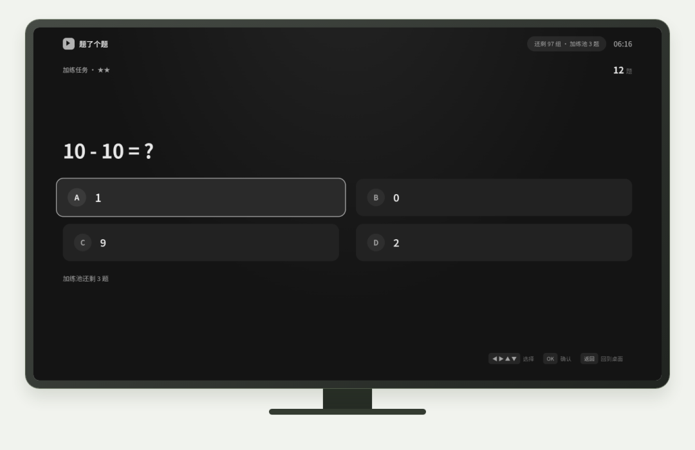
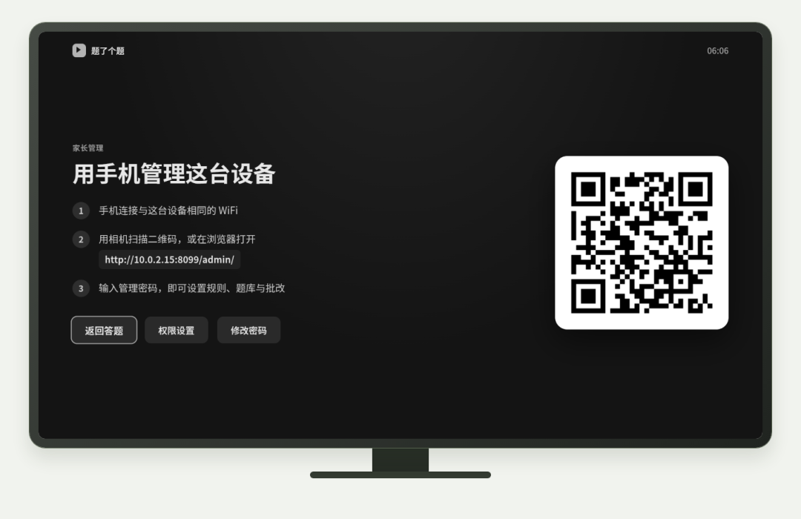
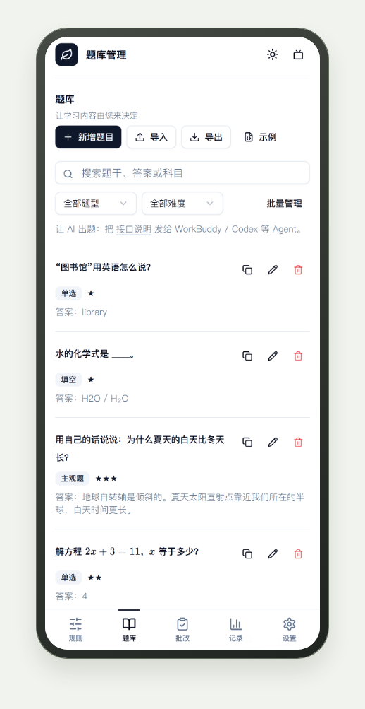
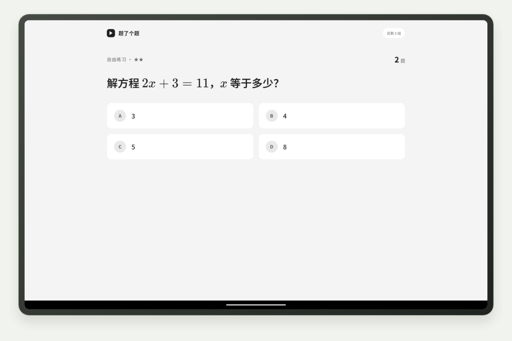
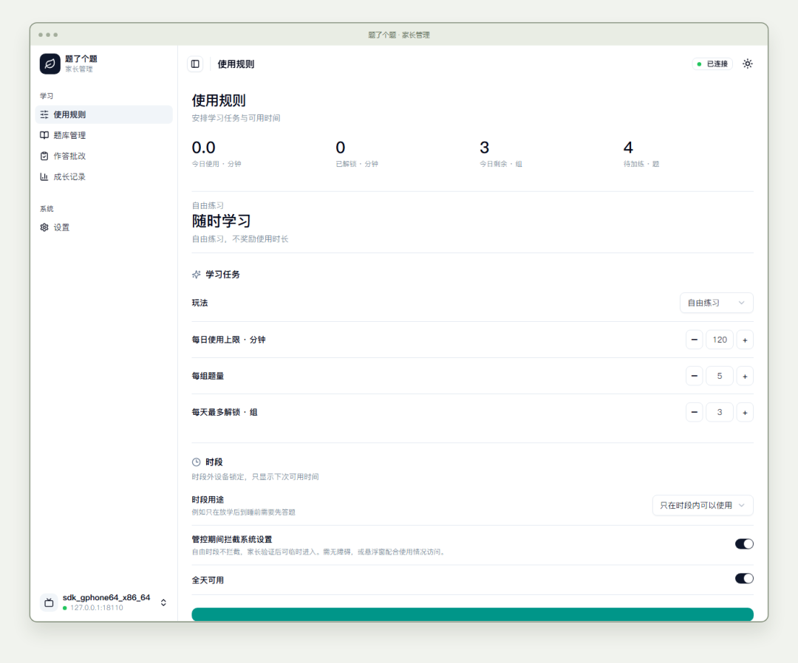

# 上央视的魔改看电视答题系统StudyOnTV安装部署教程来了
> 💡 备注属性未写入，可能是备注属性名称或者类型被修改了，建议将字段类型设置为 rich_text，可以在小程序-操作-修改文章数据库页面进行调整
> 💡 原文链接:[https://mp.weixin.qq.com/s?__biz=MzI0MzM4NzQ1Nw==&mid=2247483886&idx=1&sn=baf47b87d2acfa7c773716ab1bb4251a&chksm=e88378dcfdf2c45dfc292ffc4163736f79ce2291b18a76b9d8562eafc00dfa5b169f58b9fb92#rd](https://mp.weixin.qq.com/s?__biz=MzI0MzM4NzQ1Nw%3D%3D&mid=2247483886&idx=1&sn=baf47b87d2acfa7c773716ab1bb4251a&chksm=e88378dcfdf2c45dfc292ffc4163736f79ce2291b18a76b9d8562eafc00dfa5b169f58b9fb92#rd)

吃灰数码研究室 · 第 8 期
## 上央视的魔改看电视答题系统StudyOnTV安装部署教程来了
先自我打脸一下。
上一期讲到那个魔改电视的爸爸，我在结尾清清楚楚写了：**这套系统没有开源，没有教程，想抄作业的家长只能干等。**
结果刚过 48 小时，就有人把作业本整个搬上了 GitHub。
时间线摆在这，比任何文案都有说服力：
· **10 月 30 日**：蛋哥的视频爆火，400 万播放，评论区一水儿「求教程」；
· **11 月 1 日**：一位开发者把「答题看电视」做成了正经 App，传上 GitHub；
· **11 月 4 日**：v0.2.1 发布；
· **11 月 5 日**：v0.3.0 发布，手机、平板、电视三个版本齐活。
项目叫「题了个题」（StudyOnTV），安卓应用，Kotlin 写的，今天上午刚查：**193 人收藏，38 人 fork**——数字不大，但这是个只活了四天的项目，增速自己感受一下。
先说清楚一件事，免得误会：**它不是蛋哥放出来的原版**。蛋哥那边到发稿前还在评估合规，没有开源。这个项目是社区里的独立开发者的实现——名字、思路、功能都对着那个爆火的视频，但代码是另起的炉灶。这也正是开源圈最帅的地方：一个想法火了，不等原作者，48 小时就有人把它变成所有人都能装的东西。
### 它能干什么
一句话：**把孩子电视上的「观看时长」，变成需要用题目兑换的货币。**
电视版长这样（官方实拍）：

▲ 电视答题实拍：遥控器选 ABCD，答完给对错和解析（图源项目官方）
到时间了，电视上弹出题卡，遥控器选 ABCD，答完下面直接给对错、正确答案和解析。答错了也别慌——慌的应该是孩子，因为答错会计入「加练池」，攒够了就加题，重启都消不掉。
细节多到离谱，挑几个最戳的：
📌 **手机扫码管理**。电视上显示二维码，家长手机扫码输密码，题库、规则、使用记录全在手机上管（同一 WiFi）——不用对着电视按遥控器一个字一个字戳：

▲ 家长扫码配对实拍：同一 WiFi 下手机即管理台（图源项目官方）
📌 **规则细到能治各种娃**。每天最多看几分钟、一组几道题、答对比例多少算过关、每天最多解锁几组，全都可以设。还有个「时段用途」开关特别懂中国家庭：选「仅时段内需要答题」，白天老人开电视自由看，晚上 6 点到 9 点才启动管控，互不打架：

▲ 手机规则页实拍：每日上限、每组题量、时段管控（图源项目官方）
📌 **题库自己定，AI 帮你出**。内置 50 道底子题（唐诗填空、100 以内加减法、英语单词），支持导入导出——你可以把 JSON 发到家长群，别人导入直接用。官方界面里甚至写着「让 AI 出题：把接口说明发给 AI 助手」，题库不用你自己想：

▲ 题库管理实操：新增、导入导出、AI 批量出题入口（图源项目官方）
📌 **主观题也能批**。作文、口答题支持家长手动批，也可以接 AI 批改——预置了 DeepSeek、通义、Kimi、智谱，甚至还有**本地 Ollama** 的选项（下期主角提前客串了一下）。平板版支持手写作答和公式显示，解方程这种题也能出：

▲ 平板端实拍：公式渲染、可作答解方程（图源项目官方）
📌 **防破解三件套**。管控期间可以拦截系统设置入口、可选「防卸载」（先解设备管理员才能卸）、开机自动恢复管控。上一期蛋哥儿子「断电重启」那招，在这里开局就被堵死了。
电脑上还能开个管理面板，图表、记录、批改一目了然：

▲ 电脑管理面板实拍：规则、题库、批改、成长记录（图源项目官方）
### 手把手装起来
先认设备，再选路：
**手机 / 平板（最简单）**
下载 APK 直接装，跟装普通 App 一样。首次打开先设管理密码，权限按需开。完事。
**电视 · 路线 A：U 盘（不用电脑）**
1️⃣ APK 下载到 U 盘（U 盘格式化成 **NTFS**）；
2️⃣ 插电视，打开文件管理器，点 APK 安装；
3️⃣ 提示「未知来源」就去设置里允许，再装一次。
注意：部分海信、创维、华为智慧屏**禁止安装第三方应用**，U 盘这条路走不通，只能走路线 B。
**电视 · 路线 B：ADB（通用）**
**第一步，开开发者模式**：设置 → 关于 → 连点「版本号」或「内部版本号」**7 次**（跟手机一个套路）→ 返回，出现「开发者选项」→ 打开「USB 调试」和「网络调试」。
**第二步，电脑上敲四行命令**（`192.168.1.100` 换成你电视的 IP，在 设置→网络 里看）：
```
adb connect 192.168.1.100:5555
adb devices
adb install -r StudyOnTV-Android-TV-v0.3.0.apk
adb shell monkey -p com.studyontv.tv -c android.intent.category.LAUNCHER 1
```
第一次连电视会弹「允许 USB 调试」，**点确定**，不然一直显示未授权。装完记得把 ADB 调试关掉。
各品牌开 ADB 的位置不一样（小米是连点「产品型号」，TCL 是遥控器按「上下左右」，索尼又是连点 7 次），装不上时去项目安装指南里对号入座。
**第三步，首次设置**：打开 App → 设管理密码 → 电视上出现二维码 → 家长手机扫码连上 → 建题库、设规则（建议先设宽松点：每天 60 分钟、每组 3 题，别上来就把孩子逼成破解专家）。
**懒人彩蛋**：项目文档里附了一段现成的提示词，复制发给任何能执行命令的 AI 助手，报错它自己排查——连装 App 这步都可以外包给 AI 了。
**权限怎么开**
悬浮窗、使用情况访问、无障碍、自启动，都是**可选**，不开也能进学习和家长设置。想要「到点弹题+拦截设置」的完整管控，开悬浮窗和使用情况访问基本够用；想防卸载，走设备管理员授权。
### 每期大实话
· **协议不是传统开源**。代码全公开可查阅，但协议写明**仅限个人家庭使用，禁止商用和二次分发**——拿它做生意前先看清，二次分发也不行；
· **四天的项目，佛系使用**。v0.3.0 刚发，193 星，肯定有没踩过的坑（尤其各家电视的后台清理机制），遇到闪退先去 Issue 区报型号；
· **系统门槛**：安卓 5.0 以上；鸿蒙 NEXT、三星 Tizen、LG webOS 暂不支持——这些不是安卓系统，后续再说；
· **别从「地狱模式」开始**。上一期说过的立场不变：这套东西最大的价值是让管控变得可讨论，不是把孩子焊在题海前。规则宽松起步，逐步收紧，孩子才不会把聪明全用在破解上；
· **数据不出门**。题库和记录都存在设备本地，没有云端没有账号；只有你主动开 AI 批改，题目才会发给你自己配的服务——隐私这块它想得挺明白。
下期预告照旧：**不用联网、不用充值，一行命令让你自己电脑上跑大模型。**顺便说一句，今天这期的 AI 批改选项里，已经给下期主角留好了座位。
