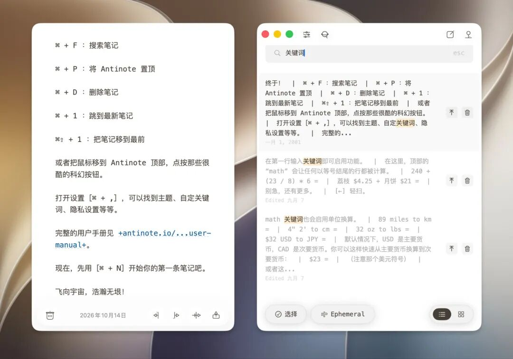
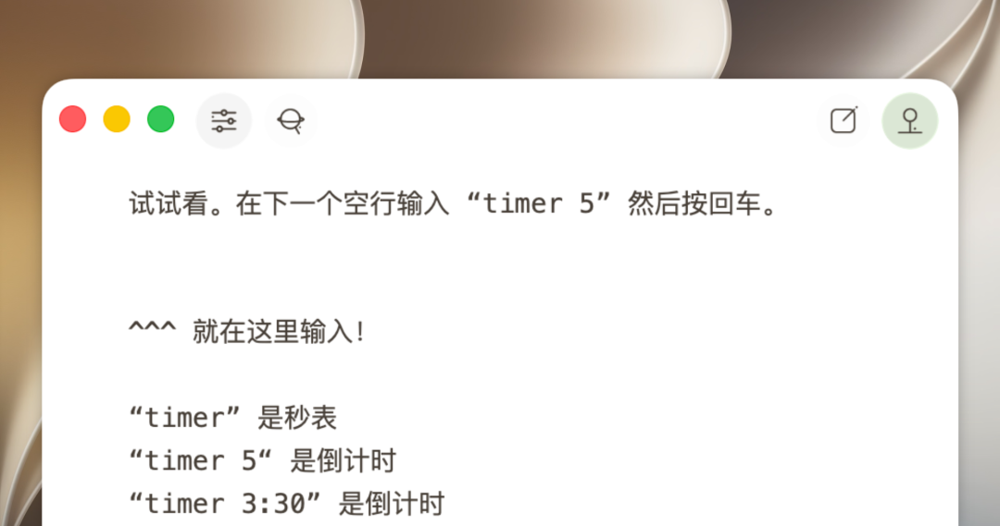
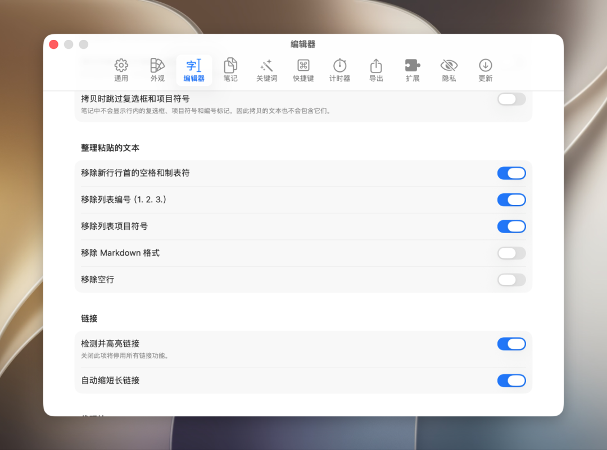
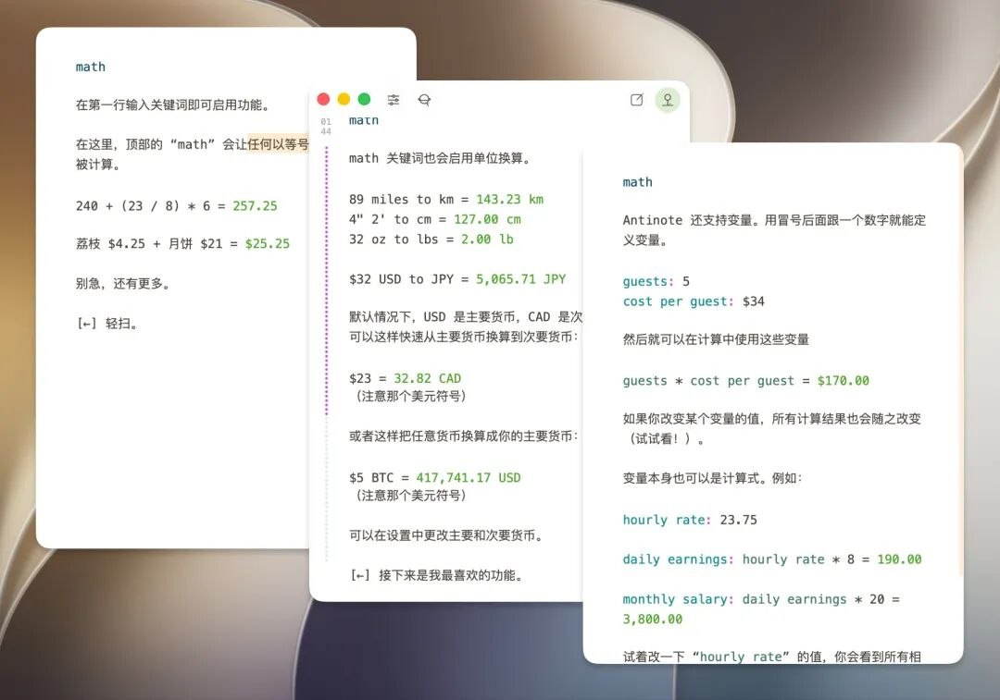
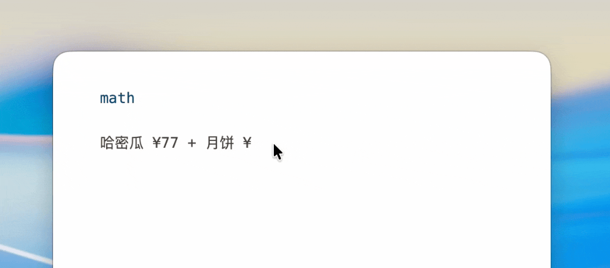
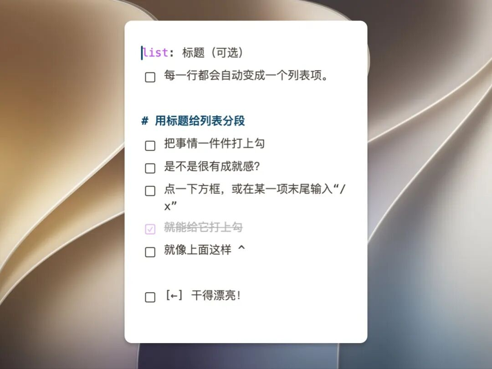
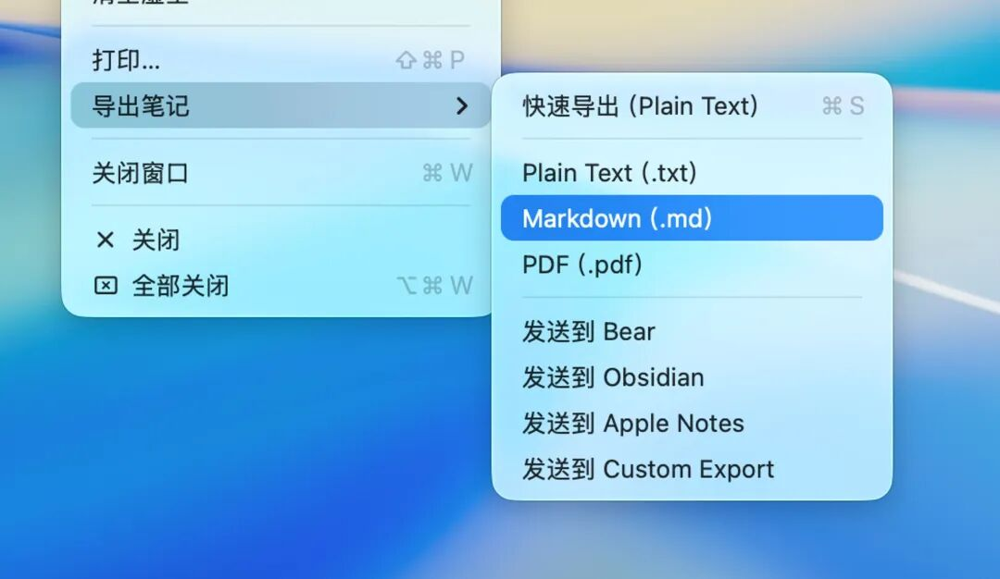
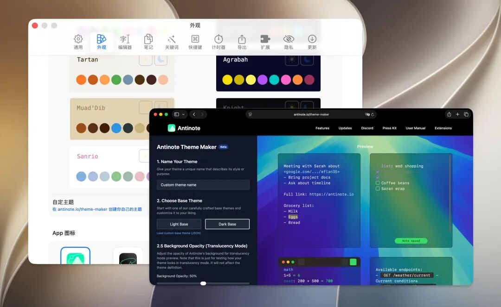
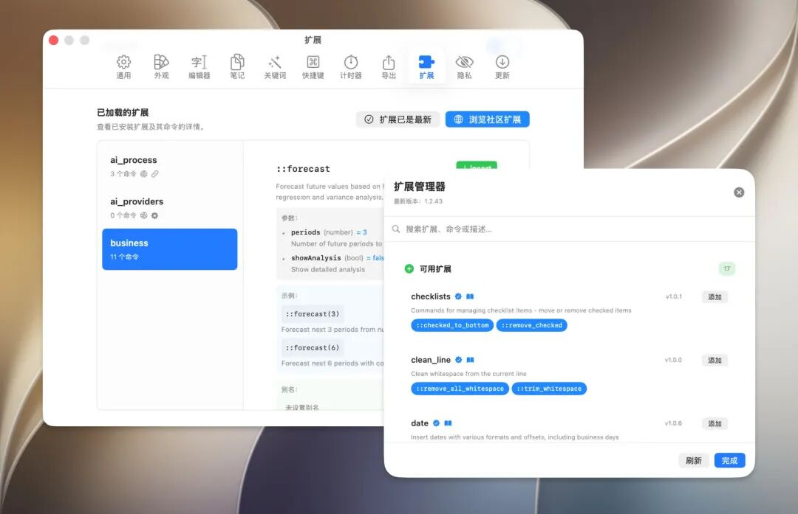

# 上新日 | 会算数、能换汇、可自定义主题的 Mac 便签！Antinote 上架了
> 💡 备注属性未写入，可能是备注属性名称或者类型被修改了，建议将字段类型设置为 rich_text，可以在小程序-操作-修改文章数据库页面进行调整
> 原文链接:[https://mp.weixin.qq.com/s/5vuX94NLd8srzO4ihpWjyw](https://mp.weixin.qq.com/s/5vuX94NLd8srzO4ihpWjyw)

在日常办公中，我们经常会遇到：一个临时算出来的折扣价，一段刚复制的报错信息，一条会议上突然冒出的待办。

它们在当时很重要，但用 Notion、Obsidian 去记未免太重，既要起标题，还要选择存放位置。
数码荔枝软件商店本周上架的 **Antinote**，就是为这类场景设计的 Mac 智能便签，主打随手记录、内容用完即弃。
它能用全局快捷键随时唤出，内置计算、换算、待办、截图转文字等功能，还能自动收集剪贴板内容，并一键导出归档。

78£5d7DTJ6TvRg🗝 https://s.tb.cn/h.jaDdMKK MF168
电脑直接访问链接，手机复制本段所有内容

**全局快捷键，随叫随到**

Antinote 支持通过 Dock 栏 / 菜单栏图标，或快捷键 ⌥ + A 唤出，快速做记录。
需要盯着看的时候，可以把便签窗口置顶显示，用完再收起。

粘贴内容时，它会自动清除多余的格式和缩进，只留下干净的纯文本。
它不追求整理和分类，记完就走，用不上的随手清掉。

**实时计算与单位换算**

在便签里直接写算式，结果会实时显示，修改其中的数字，结果会自动更新。
你还可以写带描述的算式，一眼就能看懂每个数字代表什么。

对于长度、重量等常见单位，输入数字、单位、等于号就能得到换算结果。
汇率换算同样支持，海淘比价、核对账单时不用再打开计算器和网页。
算折扣、比单价都在同一个便签里完成，购物下单不再纠结。

**自动粘贴，告别来回切换**

开启自动粘贴功能后，你复制的文字会自动存入便签。
查资料时，只管在网页上不停复制，不用再 Cmd + Tab 往返切换窗口。
所有内容会按顺序收集在同一篇便签里，思路不会被打断。

资料收集完毕，再统一删减、整理，效率比一条条手动粘贴高得多。
对程序员暂存代码片段、命令和报错信息来说，也特别顺手。

**待办清单与截图转文字**

在便签里写一个清单，再逐项勾选，临时任务随手就能管理起来。
会议中记下的待办，会后就能勾掉已完成的事项。

把截图或图片直接拖进便签，Antinote 会自动识别并提取其中的文字。
网页截图、PPT 照片、聊天记录里的内容，都能快速变成可编辑的文本。
不用再为了几行字，专门打开另一个 OCR 工具。

**一键导出，累积长期资产**

临时记录里真正有价值的部分，可以一键导出保存。
它支持导出 Markdown、PDF 等格式，用得上的内容不会白白丢掉。
你也可以直接发送到 Obsidian 等笔记应用，接入自己已有的知识库。

会议结束后，几秒钟就能完成归档，不用再手动复制粘贴整理。
Antinote 负责快速记录，你的主力笔记负责长期留存，两者配合刚好。

**自定义主题与扩展，越用越顺手**

Antinote 内置 10+ 套主题，还支持原生半透明效果和方格纸背景，可以按自己的喜好换皮肤。
官网提供 Theme Maker 工具，不会写代码也能做出一套专属配色，社区里还有其他用户分享的主题可以直接安装。

快捷键和触发关键词都能自定义，让它更贴合你的使用习惯。
官方还设有扩展页面，安装扩展就能获取更多功能，把便签变成更趁手的小工具。

**写在最后**

以上就是本周上架的 **Antinote**。它轻巧、顺手、不打扰，是 Mac 用户日常记录的得力小帮手。
现在到数码荔枝软件商店下单，到手仅需 **29 元**，就能拥有它。
一次购买，永久使用和更新，从此临时想法再也不怕没处安放。

78£5d7DTJ6TvRg🗝 https://s.tb.cn/h.jaDdMKK MF168
电脑直接访问链接，手机复制本段所有内容
点击**阅读原文**，前往**数码荔枝**购买 Antinote！
广告
---

点「♡」，了解更多实用工具！

## 摘要

（待补充）

## 我的笔记

（待补充）
