# 上线啦！我给孩子做了一个英语学习系统，开放内测，推荐给所有独立英语老师！
> 💡 备注属性未写入，可能是备注属性名称或者类型被修改了，建议将字段类型设置为 rich_text，可以在小程序-操作-修改文章数据库页面进行调整
> 💡 原文链接:[https://mp.weixin.qq.com/s?__biz=Mzg5Njg5NDE3MA==&mid=2247488969&idx=1&sn=9d7f7a080b528d558823170a7154f2b2&chksm=c1858526b895ac2305eda7ef72f378dd6675bc8f90a3af3bcaef619f2819d2cfdb2daa30a2f6#rd](https://mp.weixin.qq.com/s?__biz=Mzg5Njg5NDE3MA%3D%3D&mid=2247488969&idx=1&sn=9d7f7a080b528d558823170a7154f2b2&chksm=c1858526b895ac2305eda7ef72f378dd6675bc8f90a3af3bcaef619f2819d2cfdb2daa30a2f6#rd)
大家好，我是木妈。
我给孩子做了一个英语学习系统，叫「巴斯豆豆英语」。
这个名字是我们家孩子取的。这是他自己的原创IP形象，他给这两个角色做了清晰的人物背景和人设，下次分享 它们的故事

整个网站的配色也是从它俩身上取的：豌豆绿、叶子绿、石头灰，脸蛋上那一点珊瑚粉。
这系统的流程是：孩子每天打开，就知道今天学什么。开口说完一段英语，Buzz Teacher 马上告诉他哪句说得好，哪句可以怎么说。
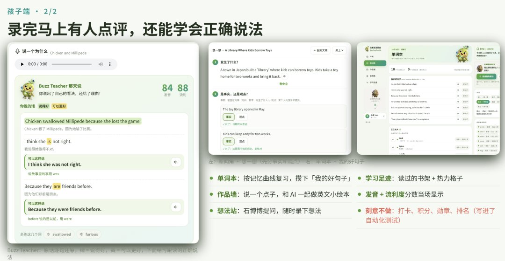
老师有自己的工作台，布置作业、听录音、看 AI 分析。家长打开，就能看到孩子这一周学得怎么样。
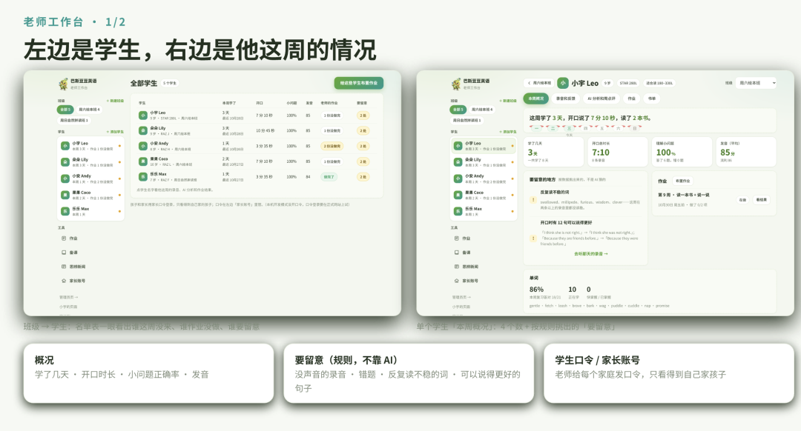
孩子用了一周了，我们也迭代了几个版本。下周开放内测。我先详细说一下这个系统功能。
**1**
**学习系统介绍-学生端**
**一、孩子端：每天打开就知道做什么**
今天页上是今天要做的几件事。先热身，复习几个单词。再读一本泛读的书，做几道小问题。
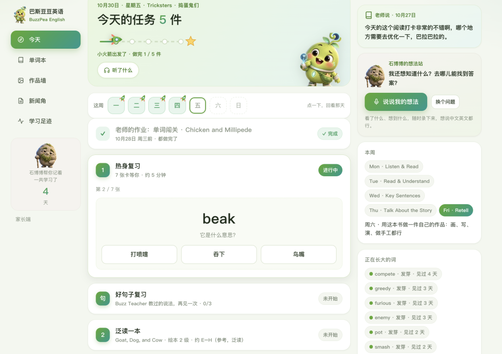
精读是一本书读一周，每天做一件不同的事。周一听读，周二阅读理解，周三学这本书里的 3 个句型，周四和石博博用英语聊这个故事，周五复述。
周六用这本书做一件自己的作品，把孩子的学习和创造变成一个闭环。
**二、录音和AI 点评**
孩子每说完一段，页面上马上出来一张 Buzz Teacher 卡。它把孩子说的话一句一句写出来，英文下面配中文意思。说得好的句子标绿，真正说错的地方标黄。黄句下面给一句**「可以这样说」**，点喇叭能听真人感的英文朗读，跟着读一遍。
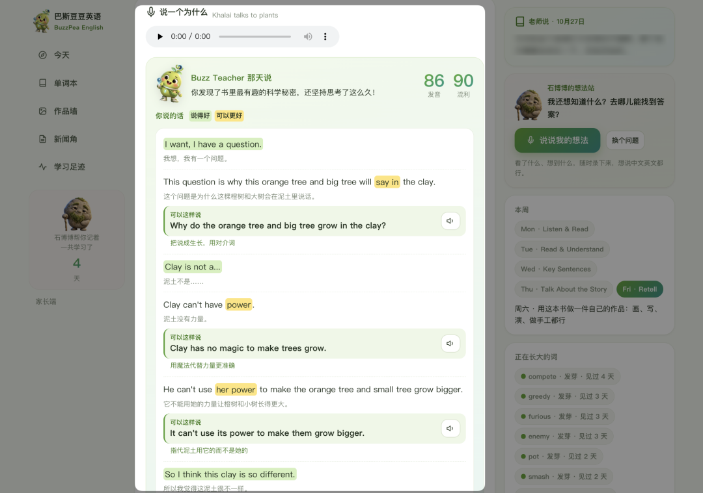
Buzz Teacher 给过的好说法，不会说完就算了。系统把它们攒起来，隔 1 天、2 天、4 天、7 天再拿出来让孩子复习。先看自己当时怎么说的，想一想，再点开正确的说法。
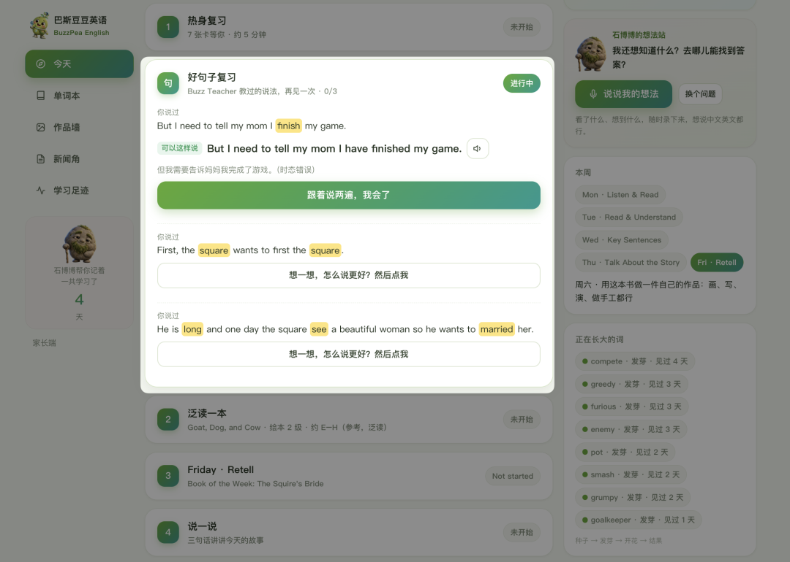
孩子还能回看以前任何一天：那天做了什么，自己的每条录音，Buzz Teacher 当时的点评，老师那天写给他的话。
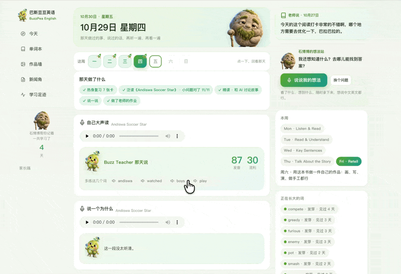
**三、思辨新闻：分清事实和观点**
老师或家长点一下，系统就从 NewsForKids 和 News in Levels 这两个儿童英语新闻网站取回最新的文章。大人看过，觉得适合孩子，再放进孩子的新闻角。
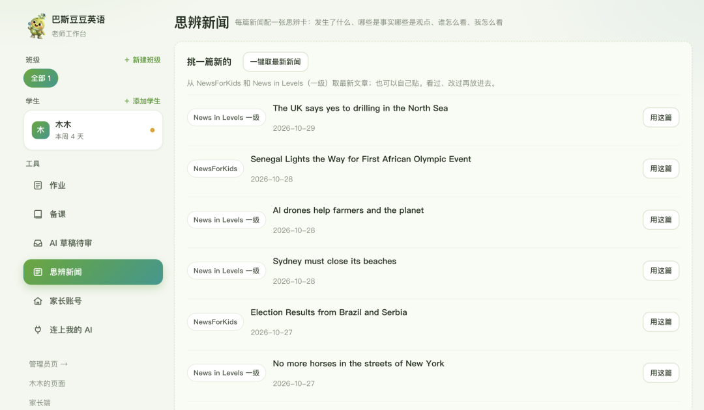
AI 会给每篇新闻做一张思辨卡，分四块：发生了什么，哪句是事实、哪句是观点，谁怎么看，我怎么看。
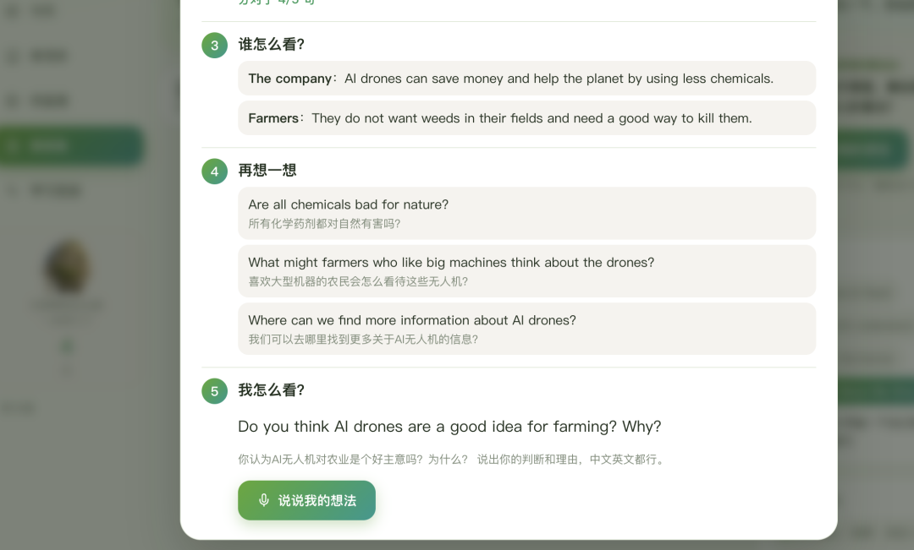
孩子读完新闻，要自己给每句话分一分，是事实还是观点，再看对不对。最后录一段音，说说自己怎么看。
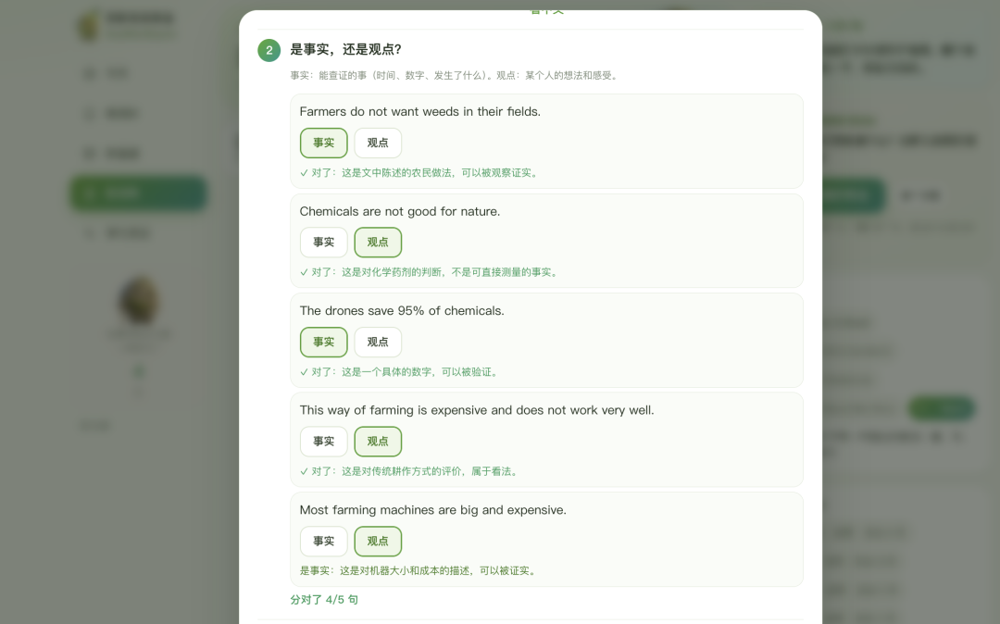
**2**
**学习系统介绍-老师端**
**一、老师端：管学生、备课、写反馈**
老师工作台左边是班级和学生，一位老师可以带好几个班。右边是这个班的名单：这周学了几天，开口说了多久，小问题正确率，发音，作业做没做完，有几处要留意。
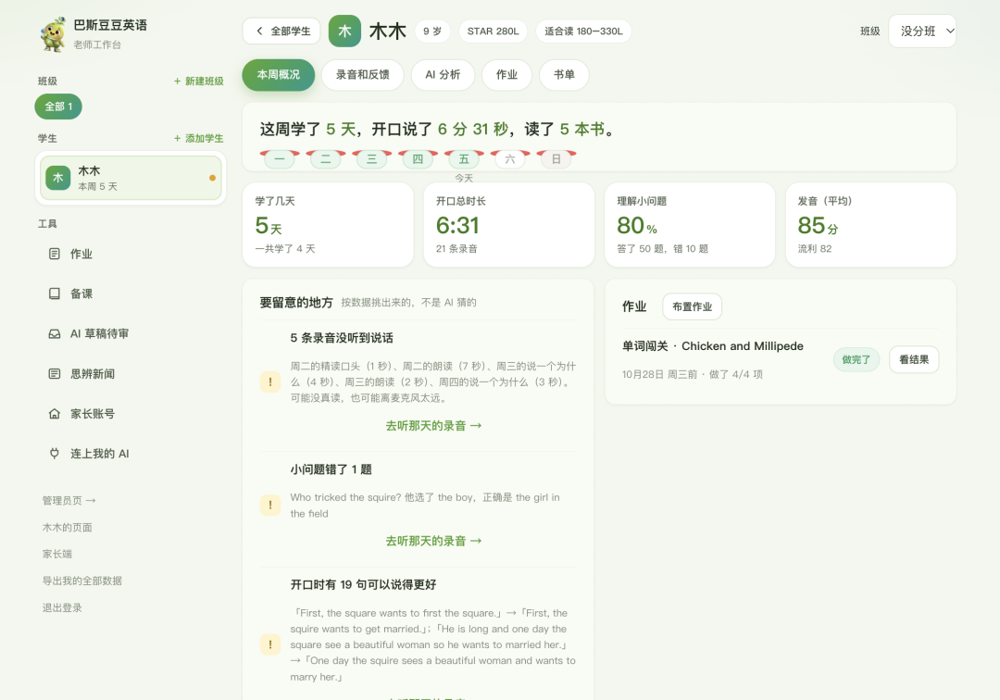
点进一个学生，能听他这周的每一条录音，给他写一句话。他下次打开页面，在「老师说」里就能看到。
AI 分析页给的是本周小结、能力评估和下节课的教学重点。
能力分四项：阅读理解、复述和表达、发音和用词、词汇，评价用老师熟悉的 Excellent、Good、Needs Improvement。每个判断都能展开看依据，是哪道错题、哪条录音。写好的家长反馈，可以一键发到家长端，也可以复制了发微信。
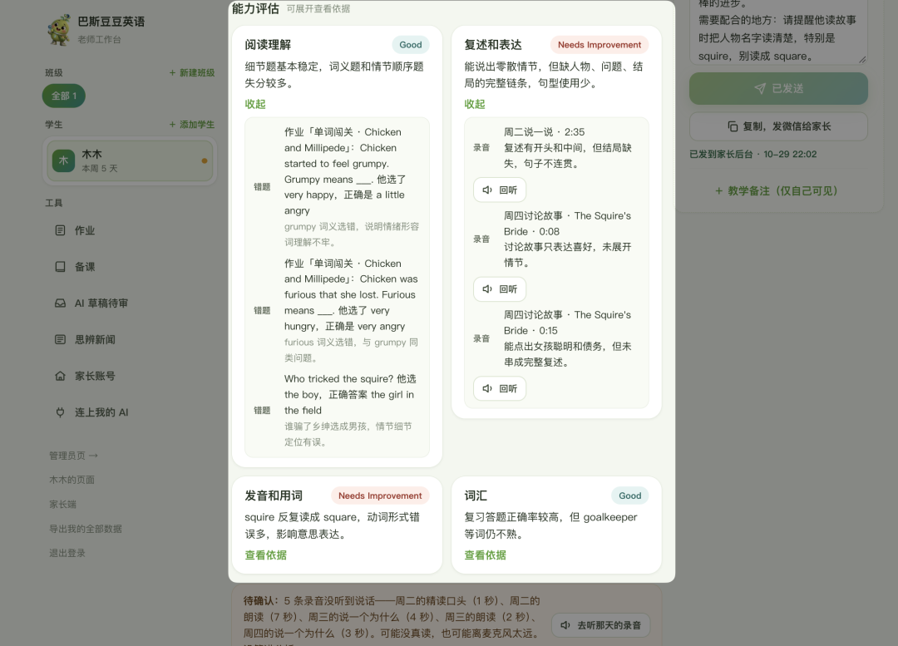
备课这块，老师把自己的教材传上来，PDF 或照片都行，AI 帮着做闪卡和题单，做好直接布置给整个班。题目除了选择题，还有配对、排序、填空、听音选择。
**二、接通了workbuddy，直接在workbuddy里就能完成备课。** 传资料、出题、布置，如果全靠一下一下点，其实很麻烦。所以我们接通了 Skill。
只需要点击连上我的AI，发提示词给你的workbuddy即可。
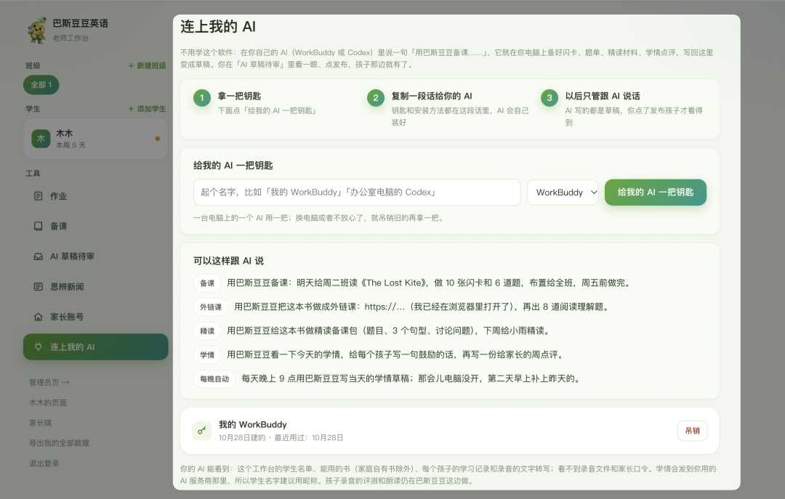
连上后，老师在自己的 WorkBuddy 或 Codex 里说一句话，就能调用这个系统：AI 在老师自己的电脑上备好闪卡、题单、作业，分析孩子的学情，再写回工作台。老师点一下发布，孩子就能看到。
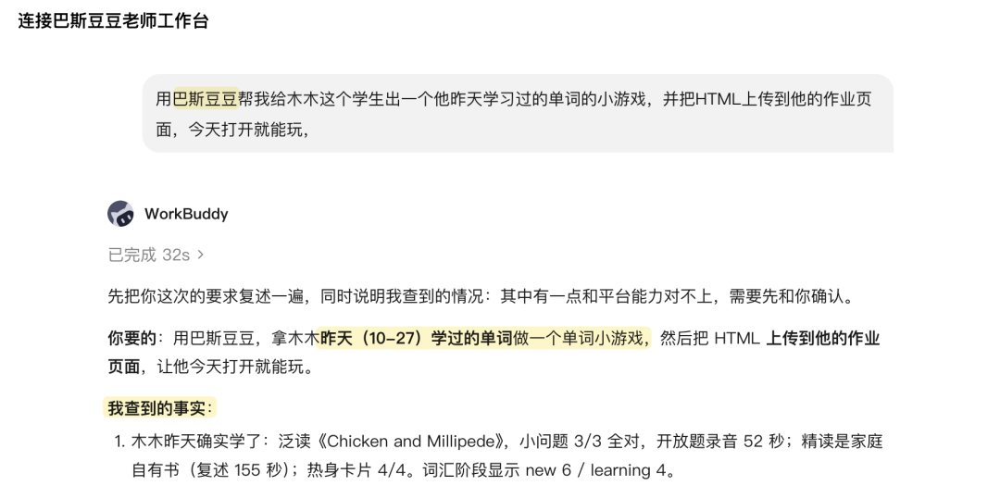
**家长端：了解信息和需要干什么即可**
家长端很简单。打开就是这一周：一句话总结，需要家长配合的地方，在家可以做的一件事，学了几天、开口多久这几个数和上周比，进步在哪，孩子的学习特点，老师的本周反馈。
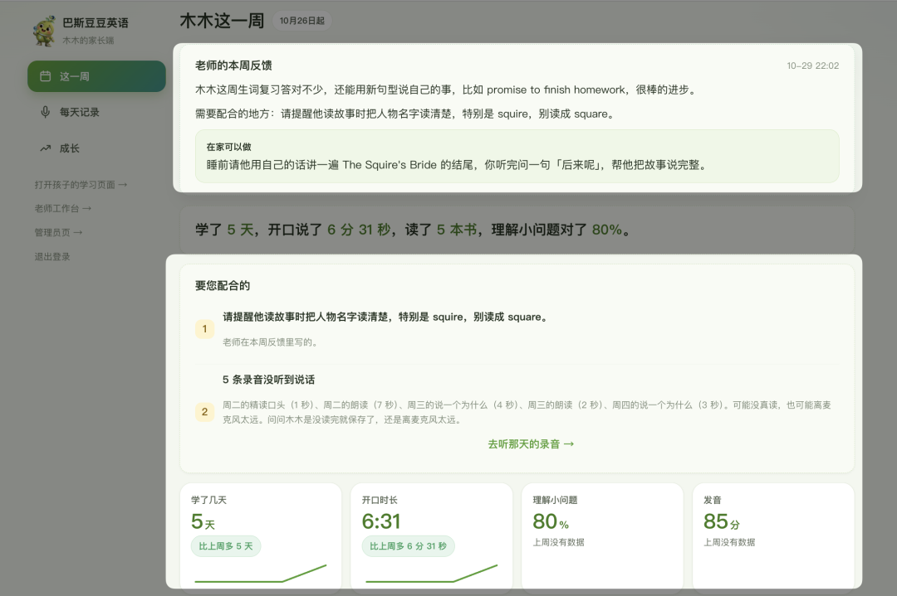
一个家长账号可以切换几个孩子，家长账号由老师来开。
**3**
**这个产品设计的思考**
这个系统，我是按照家长和孩子真正的痛点设计的，其实是我过去设计的skill的产品化[我用Codex给孩子做了一个英语学习闭环系统！Skill已开源，龙虾可用～](https://mp.weixin.qq.com/s?__biz=Mzg5Njg5NDE3MA%3D%3D&mid=2247487100&idx=1&sn=ee19bdcee517144831cf11bf90324a43&scene=21#wechat_redirect)
**以下是这个产品的思考：**
**1-每次开口都有回应，而且能从回应里学到东西**
没有设计和督学的系统不能帮助孩子，所以这个系统会清晰转录孩子的发音，标出错在哪，再给一句正确的说法让他跟着读，他才知道下次怎么说。
只有真正的语法、用词、专有名词错误才标黄。
**2. 有引导，孩子才开得了口**
我觉得，很多时候孩子说不出来，是因为没有引导。每个孩子的水平也不一样。
所以在孩子要开口的地方，都有一个问题带着他。问题跟着他正在读的东西走。泛读读完一本书，问他一个为什么。
中文英文夹着说，都没问题。主要是先开口。
**3. AI 出草稿，人来拍板**
新闻是系统从公开的儿童英语新闻网站上自动取回来的。适不适合给孩子看，要老师和家长自己判断：看过，觉得合适，再放进孩子的新闻角。这一轮筛选由大人来做。
老师的 AI 备的课都是草稿，老师点了发布孩子才看得到。
AI 分析里的数字由系统算，评价由 AI 写，每条都能展开看依据。页面底下写着：AI 不直接听录音，重要结论请回听确认。
**4. 版权有边界**
这一条我想多说几句，因为这是这个系统现在最大的问题：教材的版权。
我家买的 RAZ 只给我们自己家用，不给别的账号，也不交给在线 AI 处理。和孩子讨论故事时，AI 看的是我们自己写的故事梗概，不碰原文。学校的课本也一样，课文原文不会放进系统。
所以系统里自带的书很少，只有一些开放授权的英文绘本。
它更适合家里本来就有学习材料的家长，和手里有自己教材的老师。如果手里没有，也建议花点钱，买一些别人做好的资料。自己买的资料，拿来给自己的孩子和学生备课、出题，我觉得是可以的。老师传上来的材料只在自己的工作台里用，别的老师看不到。
老师的数据是老师的，随时可以整份导出。
**4**
**适合谁？怎么参加内测**
面向独立英语老师、小型英语机构，和想自己带孩子学英语的家长。
在公众号后台留言「内测」，说一下你是老师还是家长，大概带几个孩子。我会联系你，发给你一个邀请码。用邀请码注册，就有了你自己的工作台。
关于收费：从一开始就收费，按学生人数收，具体价格内测时定。
为什么要收费？因为系统里每用一次 AI 功能，都在消耗我的 token。孩子录完音的点评，老师看的 AI 分析，备课时出的闪卡和题单，背后都是我在给大模型付钱。
而且，愿意付费的才是有真的需求，我不打算做免费而无用的东西。因为花费的是大家宝贵的时间和注意力。
**最后**
我家孩子之前自己过一个系统，我那时候说：**AI 原住民的学习应该是这样：学什么、怎么学，由他来定。**
目前我依旧这么认为，但我也不想高估一个小学生的思考深度和自律，毕竟成年人也没办法靠意志力坚持做有难度的事情。
所以，我认为好的学习体验是需要被设计的，需要符合用户的认知特点和学生个性，符合该学科的学习逻辑。领域知识也很重要，英语老师们的 know how依旧是这个系统不可缺少的部分。
因此这系统在老师端，是由老师自由定义的，欢迎有经验的老师一起共创和内测！
以下是我的书，购买后加入 AI+教育 学习群。
