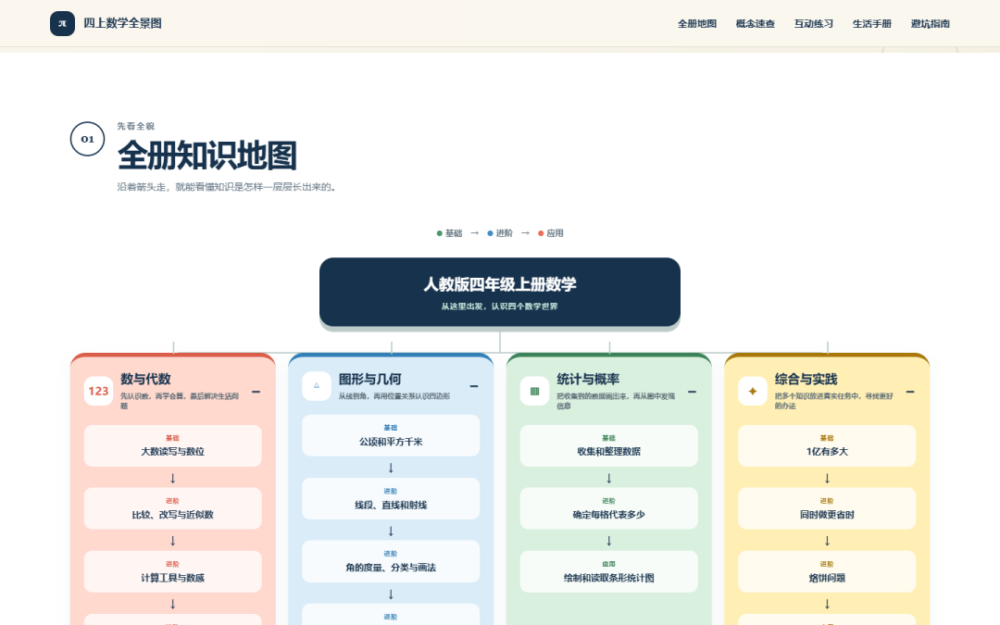
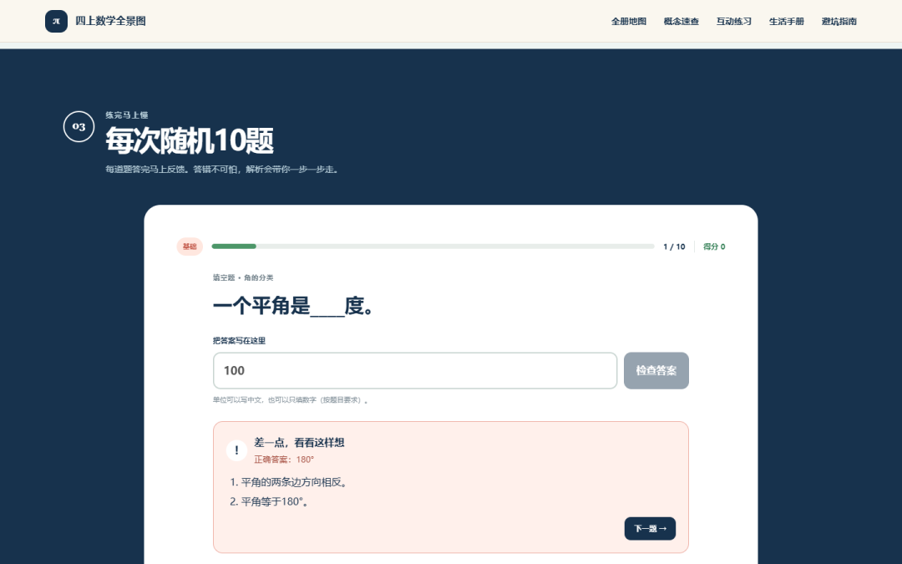

# 不会写代码，我把四年级的数学书做成了一张能点的地图
> 💡 备注属性未写入，可能是备注属性名称或者类型被修改了，建议将字段类型设置为 rich_text，可以在小程序-操作-修改文章数据库页面进行调整
> 💡 原文链接:[https://mp.weixin.qq.com/s?__biz=MzA5MzQ3NjIzMQ==&mid=2447908009&idx=1&sn=ba114e2848624264141f53370bf9fe3b&chksm=85fbc08eb4c5536f5967046c7775a7e3e746f8a2deff08bfbb0ceb04943612bceefcf3dd998b#rd](https://mp.weixin.qq.com/s?__biz=MzA5MzQ3NjIzMQ%3D%3D&mid=2447908009&idx=1&sn=ba114e2848624264141f53370bf9fe3b&chksm=85fbc08eb4c5536f5967046c7775a7e3e746f8a2deff08bfbb0ceb04943612bceefcf3dd998b#rd)
上次开家长会，前排一位妈妈说：我们家孩子不是不努力，每天作业写到十点，可一到考试就现原形。
我问她：你知道这学期数学一共几个知识块吗？
她想了一会儿说，好像……四五个？
人教版四年级上册，18 个。
这个数字差得有点多，但它解释了那个"现原形"——孩子每天在做题，却不知道自己做的题落在这张图的哪个位置。做完就忘，是因为没有位置可以挂住。
后来我把这件事做了一个网页。

### 一、家长最容易忽略的，是"看不见全貌"
人教版四年级上册数学，一共四个板块：数与代数、图形与几何、统计与概率、综合与实践，往下拆是 18 个核心知识点。
它们不是并列的，是一条条链子。
比如"数与代数"这条：大数的读写 → 比较、改写与近似数 → 三位数乘两位数 → 积的变化规律 → 速度、时间和路程 → 两位数除法与试商 → 商的变化规律。
任何一个环节塌了，后面全跟着塌。
但家长在期末看到的往往只是一个分数——"这单元考了 78"。看不到的是：他其实卡在"积的变化规律"，所以"速度时间路程"那类应用题也一直做不对。你让他再刷 50 道应用题，他还是在同一个地方摔。
问题从来不是题不够多，是结构没建立起来。
### 二、所以我没有做题库，只做了三件事
**第一件，让他先看见全貌。**
整册 18 个知识点，按"基础 → 进阶 → 应用"三级串成一张图，四个板块各自往下长。孩子点开就知道：我现在学的这个，是从哪儿来的，接下来要通到哪儿去。

**第二件，把概念压成一张表。**
每个知识点一行：公式、一句话解释、一个数字例子、一个"别踩坑"。
比如"大数的读法"，一句话是"先读高一级，再读低一级"，例子是 35040000 读作三千五百零四万，坑是"每级末尾的 0 不读，中间连续的 0 只读一个零"。
这张表的作用是：写作业卡住的时候，10 秒能查到，不用翻书。
**第三件，练完马上懂。**
随机 10 题，5 道选择 5 道填空，分基础、提高、挑战三档。答完立刻判，错了不是只给正确答案，而是把思路拆成一步一步。

这道题是"一个平角是＿度"，答错之后它给的不是"180"，而是两句：平角的两条边方向相反；平角等于 180°。
差别在哪？前者让孩子记住一个数，后者让他下次能自己推出来。
### 三、几个刻意的取舍
做的过程中砍掉了很多东西，说三个：
**不做账号，不收集作答数据。** 打开就能用，不用注册。这是一台家长辅导用的工具，不是要沉淀用户资产的产品。
**只做一册。** 没做三到六年级，也没做语文英语。一册做透，比六册都做一半有用。
**解析必须写"怎么想"。** 这条最费时间，也最值得。90 道题的解析，每一道都要能让孩子看懂"第一步该看什么"，而不是"答案是 C"。
还有一条是后来才想明白的：**不做打卡、不做排名、不做提醒推送。** 面向孩子的工具，一旦加上这些机制，就变成又一个要逃避的东西。它应该安静地待在那儿，孩子想用的时候打开，用完就关掉。
### 四、我是怎么做的
我不是程序员。
这个网页是我用 WorkBuddy 做出来的：内容来自对人教版教材的逐单元核对，题目和解析自己重写，18 张场景插画是 AI 生成的，代码是 AI 写的，我负责判断"这样讲孩子能不能懂"。
真正花时间的从来不是写代码。是把 18 个知识点的依赖关系理清楚，是把一道题的解析改到第三遍才觉得孩子能读懂。
这件事让我改了一个看法：**AI 把"做出来"的门槛降到了很低，但"做对"的门槛一点没降。** 判断什么该做、什么该砍、哪里讲错了，还是人的活。
### 五、现在它长这样
- 18 个核心知识点，按依赖关系串成知识地图
- 90 道随机练习，分三档难度，答完即时解析
- 一张覆盖全册的概念速查表
- 18 个生活场景卡：商场、公园、厨房、操场，回答"学这个到底有什么用"
- 一份考试避坑指南，标了高频丢分点

链接放在文末"阅读原文"，手机上打开就能用，不需要注册。
### 六、最后，求个支持
我把这个作品投了 WorkBuddy 的「1024 造物挑战」程序员节应用创作大赛。
评选里有一项是人气分，按分享内容的点赞数和收藏数算。如果你觉得这个东西对辅导四年级的家长有点用，**点个赞、点个收藏**，就是最实在的支持。
也欢迎转给正在被四年级数学折磨的家长朋友。
#WorkBuddy #1024程序员节
**【延伸阅读】**
四上数学全景图 · 人教版四年级上册全册知识地图
体验地址见文末「阅读原文」，手机打开即可使用。
如果对你有用，欢迎转发给同样在辅导四年级的家长。
