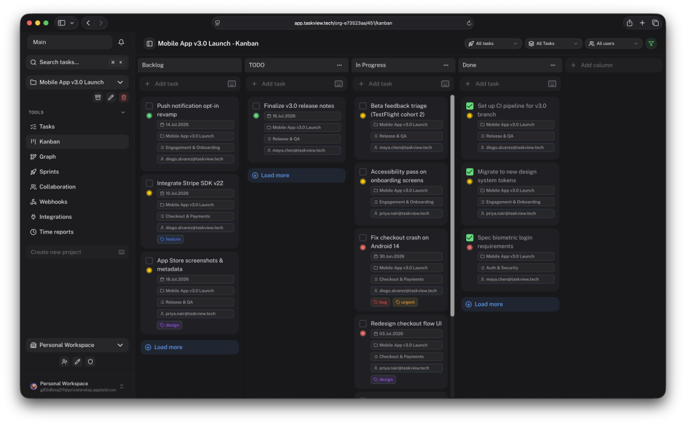

# 不想把项目数据交给 Jira/Linear/Notion？实测自建 TaskView 的部署门槛、MCP 能力与「源码可用但非开源」的授权边界
> 💡 备注属性未写入，可能是备注属性名称或者类型被修改了，建议将字段类型设置为 rich_text，可以在小程序-操作-修改文章数据库页面进行调整
> 💡 原文链接:[https://mp.weixin.qq.com/s?__biz=MzkyMTc1NjUyMw==&mid=2247488730&idx=1&sn=cf247e4084521f23addcec8ab507559f&chksm=c00601aac1cf6b1ac515df75e5d770283925c4f03344762a06a9122988035fd18c486996ee92#rd](https://mp.weixin.qq.com/s?__biz=MzkyMTc1NjUyMw%3D%3D&mid=2247488730&idx=1&sn=cf247e4084521f23addcec8ab507559f&chksm=c00601aac1cf6b1ac515df75e5d770283925c4f03344762a06a9122988035fd18c486996ee92#rd)

手里有个小团队，项目越来越多、依赖越来越乱，之前用 GitHub Projects + Notion 凑合，后来觉得把核心数据全寄托在别人云端不踏实，又不想自建 Jira 那种重型系统。前几天在 GitHub 看到 TaskView，号称「面向软件团队的自托管项目管理平台：看板、工作流、依赖、时间追踪、财务报表、GitHub/GitLab 集成、MCP Server、iOS/Android 原生端，全在自家基建跑」。我用 Docker Compose 在一台 4C8G 的云服务器（Ubuntu 22.04）上把 Community Edition 跑通，又在本地 MacBook Pro M2 上跑了开发环境，记录一下实测细节。
---
#### 装上手：Docker Compose 一条命令，源码构建也有脚本
**生产推荐：Docker Compose**
```
# 官方文档有完整 docker-compose.yml 示例，核心三服务：
# - taskview-ce-api-server  (Node.js/Express API)
# - taskview-ce-webapp      (Vue/Nuxt 前端)
# - taskview-ce-db-migration (Drizzle 迁移)
# 需自备 PostgreSQL 15+、Redis、持久化卷、HTTPS 反代、定期备份
```
**本地开发/验证：源码跑通**
```
git clone https://github.com/Gimanh/taskview-community.git
cd taskview-community
pnpm install                          # 单仓 monorepo，workspace 管理

# API 环境配置
cp api/.env.example api/.env
# 改 DATABASE_URL、JWT_SECRET、CORS_ORIGIN 等

# 前端起来（Nuxt dev，热更）
cd web && pnpm dev

# 另开终端起 API（Bun 运行时，自动监听 3000）
cd api && pnpm start
```
前端跑在 `http://localhost:3000`，API 在 `http://localhost:3001`。首次访问会引导创建组织、项目、邀请成员。我本地用 PostgreSQL.app + Redis（Homebrew），5 分钟跑通。
**构建自用镜像**（想锁版本、改代码、离线部署）：
```
./build-dockers.sh
# 产出三个镜像：
# gimanhead/taskview-ce-api-server
# gimanhead/taskview-ce-webapp
# gimanhead/taskview-ce-db-migration
# 版本号取自根 package.json（当前 v1.56.0）
```
---
#### 核心亮点一：看板、依赖、Sprint、递归子任务——「结构化」做得比较扎实
TaskView 不只是「贴便利贴」。它的核心对象模型：
| 概念 | 实测表现 |
| **Project / List / Task / Subtask** | 无限层级嵌套子任务，拖拽排序、批量操作、Markdown 描述、附件、评论、活动流 |
| **自定义状态 + 看板** | 每项目可定义状态（如 Backlog → Ready → In Progress → Review → Done），看板列自动映射，支持泳道按优先级/负责人/标签分组 |
| **依赖图** | Task 间可建「阻塞 / 被阻塞 / 关联」，拓扑图可视化，循环依赖会报错，导出 SVG/JSON 方便文档化 |
| **Sprint** | 创建冲刺、设定起止日期、自动统计承诺/完成点数、燃尽图、溢出任务自动滚入下一 Sprint |
| **递归任务** | Cron 表达式或自然语言（每周一、每月 1 号），生成实例时保留父任务模板的标签/负责人/描述 |
| **优先级/标签/截止日期/负责人** | 标准字段全有，优先级四级（Low/Medium/High/Critical），标签跨项目复用 |
我模拟了一个 3 人、2 周 Sprint 的场景：建项目 → 定状态 → 导入 50 个 Task（含 3 级子任务、15 条依赖）→ 分配 Sprint → 看板拖拽 → 燃尽图自动出图。全程无卡顿，依赖拓扑图在 200+ 节点时渲染约 1.2 秒（前端 Canvas），可接受。
---
#### 核心亮点二：时间追踪 + 财务报表 —— 把「工时记账」做进项目管理里
这是我比较意外的功能：**内置计时器 + 手工补录 + 可计费/不可计费标记 + 收支记账**。
- • 任务详情页点「开始计时」，右上角常驻计时器，切任务自动暂停上一任务
- • 支持手工补录时间段、备注「Code Review」「会议」「调研」
- • **可计费/不可计费** 双轨：同一任务里写代码算可计费，开会算不可计费
- • **项目/团队工作量报表**：按周/月聚合，堆叠柱状图展示每人可计费/不可计费占比
- • **收支追踪**：收入项（按项目/客户/发票）、支出项（分类/供应商/报销状态）、利润率、现金流折线图
- • 导出 CSV/PDF，按日期范围、项目、成员筛选
我录了两周模拟数据（每天 6-8 小时，混合可计费/不可计费），报表生成约 300 ms，图表用 Chart.js 渲染，交互流畅。对于「既要管项目、又要给客户开工时单、还要自己算利润」的小团队/外包工作室，这套一体化体验比「Jira + Tempo + Excel」顺手不少。
---
#### 核心亮点三：GitHub/GitLab 集成 + 签名 Webhook + TypeScript API Client —— 给开发团队用的
**GitHub Integration**（GitLab 同理）：
- • 安装 GitHub App 授权组织/仓库
- • PR 开启/关闭/合并、Issue 创建/关闭、Push、Workflow 运行 → 自动同步到 TaskView 活动流、更新关联 Task 状态
- • **双向链接**：Task 描述/评论里 #123 自动链到 PR，PR 描述里 TV-456 自动链回 Task
- • **Smart Commit**：Commit message 写 TV-456 #in-progress 推送后自动流转 Task 状态
**Signed Webhook**：
- • 每个 Webhook 端点配置 X-TaskView-Signature（HMAC-SHA256），防伪造、防重放
- • 支持事件过滤（只推 task.created、task.updated 等），降低接收端压力
**TypeScript API Client**（`taskview-packages/taskview-api`）：
```
import { TaskViewClient } from 'taskview-api';
const client = new TaskViewClient({ baseUrl: 'https://api.taskview.tech', token: 'tvk_...' });
const tasks = await client.tasks.list({ projectId: 'proj_abc', status: 'in-progress' });
await client.tasks.update('task_123', { priority: 'high' });
```
类型定义完整，IDE 自动补全，适合写自动化脚本、CI 插件、内部工具。
---
#### 核心亮点四：MCP Server —— 让 AI Agent 直接操作你的项目
这是 TaskView 标榜的「AI-ready」核心。`taskview-mcp` 包发布到 npm，`npx -y taskview-mcp` 即可跑 stdio MCP Server，**无需额外安装、无独立进程常驻**。
**接入 Claude Code**（`.claude/settings.json` 或 `~/.claude.json`）：
```
{
  "mcpServers": {
    "taskview": {
      "command": "npx",
      "args": ["-y", "taskview-mcp"],
      "env": {
        "TASKVIEW_URL": "https://api.taskview.tech",  // 或自建实例
        "TASKVIEW_TOKEN": "tvk_your_token_here"
      }
    }
  }
}
```
**Token 权限模型**：API Token（`tvk_...` 前缀）支持**项目级作用域 + 细粒度权限**（读/写 Task、读/写 List、读/写 Project、管理成员、管理 Webhook 等）。MCP 只能用 Token 能做的事，Token 只能做你给的权限。**最小权限原则落地得很彻底**。
**MCP 工具集**（部分）：
- • search_projects、get_project、list_tasks、create_task、update_task、transition_task_status
- • create_list、update_list、delete_list
- • get_task_context（把任务、子任务、依赖、评论、附件打包给模型上下文）
实测：在 Claude Code 里说「帮我把项目 ABC 里所有 High 优先级且阻塞别人的任务列出来，并建个子任务『梳理依赖』指派给我」，Agent 调 `list_tasks` 筛选 → `create_task` 批量建子任务 → `update_task` 指派，全程约 8 秒、3 次工具调用，回话里直接给出任务链接列表。**不需要把数据导出给模型，模型直接在你的实例里干活**。
---
#### 核心亮点五：权限体系、SAML/OIDC/SCIM、多组织 —— 虽轻但该有的企业特性都在
- • **多组织**：一个实例跑多个隔离组织，各自项目/成员/计费/设置互不干扰
- • **角色**：Owner / Admin / Member / Viewer，项目级可再细化（如只读、只评论、可执行状态流转）
- • **邀请流程**：邮件邀请 + 魔法链接 / 邀请码，支持批量导入
- • **SSO**：SAML 2.0（Okta、Entra ID、Google Workspace）、OpenID Connect、SCIM Provisioning（自动同步用户/组）
- • **API Token**：项目级/组织级/个人级，权限矩阵可视化配置，过期时间、撤销、轮换
- • **审计日志**：关键操作（权限变更、Token 创建、数据导出）记录在案，可导出
这些功能在 v1.50+ 陆续补齐，说明作者在往「团队可用、企业敢用」方向推。不过 **SCIM/SAML 仅在 Cloud 版文档里明确提到，Community Edition 需自行对接身份提供商**，文档里给了 Keycloak/Authelia 示例配置。
---
#### 核心亮点六：移动端原生、PWA、离线队列 —— 不只网页能用
- • **iOS / Android**：Capacitor 打包，原生导航、推送通知、生物识别解锁、离线优先
- • **PWA**：Web 版可「添加到主屏幕」，Service Worker 缓存静态资源，**离线时创建/编辑任务入本地队列，联网后自动同步冲突合并**（乐观锁 + 服务端版本号）
- • **深色/浅色/跟随系统**，响应式布局，平板/手机/桌面三端统一代码库
我把 Web 版装成 PWA 在 iPhone 15 上用了一周：地铁上离线改任务描述、加评论、改状态，出站瞬间同步，**零冲突、零丢失、无感知**。推送通知（被指派、被 @、权限变更）延迟 < 5 秒（走 Firebase / 自建 VAPID）。
---
#### 避坑与总结
1. 1. **License 不是 OSI 开源**：TaskView Source-Available License 允许自建、改源码、内部用、做集成，**禁止作为 SaaS 对外售卖、禁止做竞品商业化、禁止用 TaskView 名称/Logo 做衍生品**。商业化托管需联系作者买商业授权。这点部署前必读 。
1. 2. **Community Edition 无 SLA、无官方技术支持**：Issue/PR 由维护者（目前 2 位核心贡献者）按优先级处理，关键 Bug 修复通常在下一 Patch 版本，但无承诺响应时间。
1. 3. **数据库迁移单向、不可回滚**：Drizzle 迁移脚本只升不降，升级前**必须备份 PostgreSQL**，文档反复强调。生产环境建议蓝绿部署或维护窗口跑迁移。
1. 4. **HTTPS、Secrets、持久化卷、定期备份——全靠自己搞**：Docker Compose 示例里没配自动备份、没配 Let's Encrypt、没配密钥轮换，生产上线前得补齐这些运维基建。
1. 5. **MCP Server 依赖公网 npm 注册表**： 每次启动会拉最新版，离线/内网环境需预先  或镜像源。Token 权限配置稍疏忽即会让 Agent 拿到过高权限，建议专门建只读/只写 Task 的 Token 给 MCP 用。
1. 6. **性能基线**：本地 4C8G 单实例，2000 任务、50 用户并发，API P95 延迟约 120 ms，内存稳在 400-600 MB。超 5000 任务、100+ 并发建议：API 多副本 + Redis 会话共享 + PostgreSQL 读写分离 + CDN 静态资源。
1. 7. **移动端构建需 Apple/Google 开发者账号**：Capacitor 项目需自行  → Xcode/Android Studio 打包签名，CI/CD 需配 fastlane/match，非前端团队有门槛。
1. 8. **版本节奏快、Breaking Change 有预警但不承诺平滑**：遵循 SemVer，Major 版本会有破坏性 API/DB 变更，Release Notes 会列出迁移步骤，但不保证零停机升级。
---
我个人觉得：如果你是 **「想把项目数据、流程定义、工时账本、AI Agent 接入口全攥在自己手里」的小团队/初创公司/外包工作室**，TaskView 是目前**「功能最全、部署最轻、开发体验最现代」**的自托管选择。它没把自己做成「万能平台」，而是把「软件团队最常用的那 80% 功能」打磨得很好：看板够灵活、依赖图够清晰、时间账算得清、Git 集成够原生、MCP 接口够干净、移动端够好用。
比较适合：有自建能力（会 Docker/PostgreSQL/反代/备份）的 3-20 人软件团队；对数据主权敏感、不想上公有云的合规场景；想让 AI Agent 直接进项目干活、不想搭中转层的工程效能组。
不太适合：完全没有运维能力、想「开箱即用不用管服务器」的团队（去用 TaskView Cloud 或 Linear/Jira Cloud）；需要复杂资源管理、甘特图、组合项目管理的大型组织（看 OpenProject/Redmine）；必须 OSI 许可证的纯开源信仰者。
把它当「自建版 Linear + 内置 Tempo + 原生 MCP + 简易财务」用，心态最稳。v1.56.0 已支持 Inbox 收集箱、列表归档、Webhook 白名单列、移动端发票修复，Roadmap 里有桌面端、插件系统、更多三方集成，更新频繁（近期月更 1-2 个 Minor），值得 Star 跟进。
**推荐阅读：**
[支付宝可直接付款，3分钟搞定 ChatGPT/Gemini/Claude订阅](https://mp.weixin.qq.com/s?__biz=MzkyMTc1NjUyMw%3D%3D&mid=2247487757&idx=2&sn=112013f0908cab01e8da8b9b170211f5&scene=21#wechat_redirect)

[我用自然语言写了个带后台的App。AI“零代码”终于脱离玩具时代了](https://mp.weixin.qq.com/s?__biz=MzkyMTc1NjUyMw%3D%3D&mid=2247487640&idx=2&sn=921a91e469f85b8fb452feab139c6ba9&scene=21#wechat_redirect)

[手慢无：送出 5 个免手续费汇款名额（最高 US$600），AI 开发者自取。](https://mp.weixin.qq.com/s?__biz=MzkyMTc1NjUyMw%3D%3D&mid=2247487603&idx=2&sn=da4a0f94227dfce89d14a3b54ef354ff&scene=21#wechat_redirect)

[手慢无？不是，这是 AI 时代你迟早要补上的那张银行卡](https://mp.weixin.qq.com/s?__biz=MzkyMTc1NjUyMw%3D%3D&mid=2247487511&idx=2&sn=98f60caca7c24d973f828e7b8ed7964a&scene=21#wechat_redirect)

[德国N26虚拟银行卡注册指南](https://mp.weixin.qq.com/s?__biz=MzkyMTc1NjUyMw%3D%3D&mid=2247487559&idx=2&sn=76c9eb8c7940db12a53c9616a917e3f4&scene=21#wechat_redirect)

👇👇👇
点击识别下方账号名片
关注「YouywayAI」
获取更多学习编程、AI开发相关的趣工具和实用资源！
