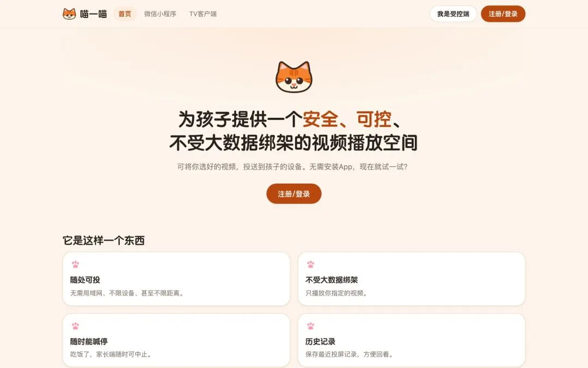
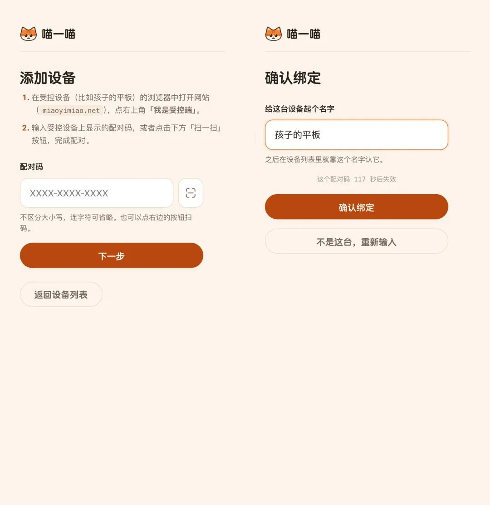
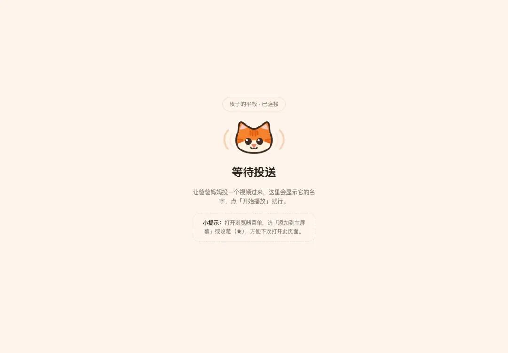
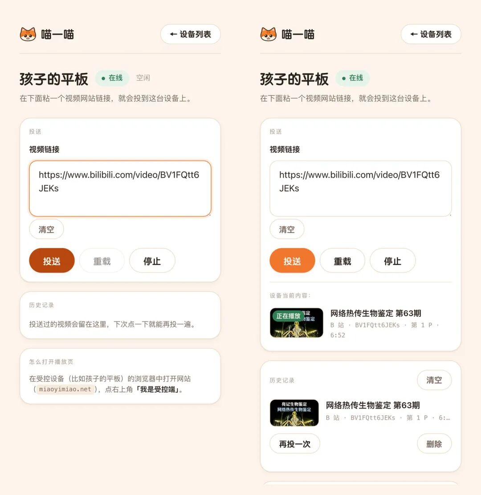
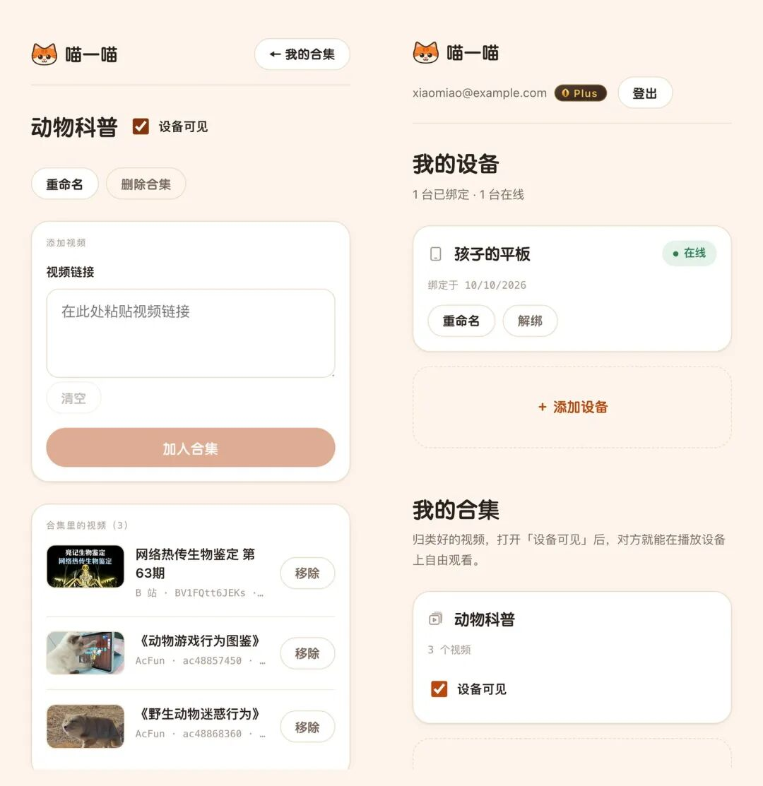
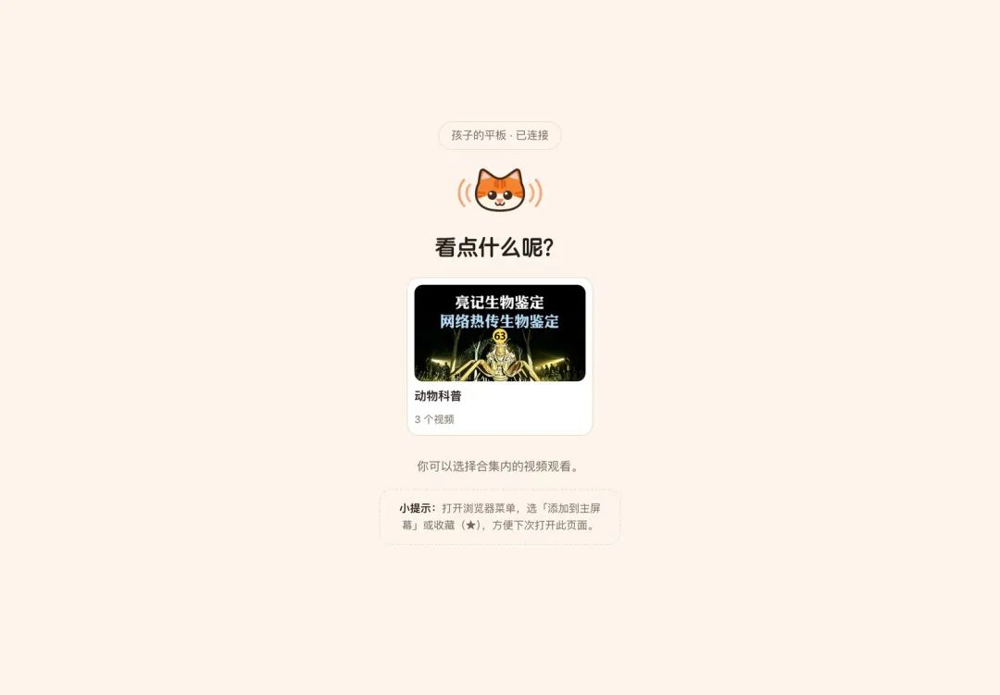
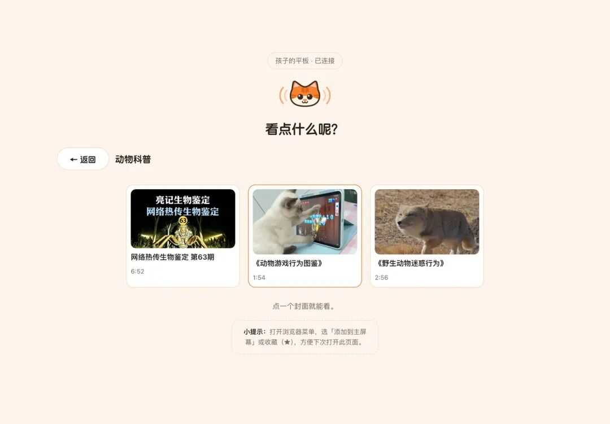

# 不想让孩子被推荐算法带着走？我们做了个「只播你选的视频」的小工具：喵一喵
> 💡 备注属性未写入，可能是备注属性名称或者类型被修改了，建议将字段类型设置为 rich_text，可以在小程序-操作-修改文章数据库页面进行调整
> 💡 原文链接:[https://mp.weixin.qq.com/s?__biz=MzUxNjk1Njg4MQ==&mid=2247485917&idx=1&sn=63ecfddc3d9ca28327cf830b7fdabe07&chksm=f842acd560ddbce46ae2dd18e9ddb9769831952a12ef92c03f9c39a7c31a2ca76ed59560262d#rd](https://mp.weixin.qq.com/s?__biz=MzUxNjk1Njg4MQ%3D%3D&mid=2247485917&idx=1&sn=63ecfddc3d9ca28327cf830b7fdabe07&chksm=f842acd560ddbce46ae2dd18e9ddb9769831952a12ef92c03f9c39a7c31a2ca76ed59560262d#rd)
**导读**
**喵一喵**是一个小工具，家长在手机上挑好视频，一键投到孩子的平板上播放。
孩子那边**只能看到你投过去、或者你放进合集里的视频**，没有推荐流，也看不了「下一个」。
不用装 App，平板打开浏览器就能用。
官网：**miaoyimiao.net**，也有微信小程序（小程序码见下文）

▲ 喵一喵官网首页
**为什么要做这个东西**
PART 01
家里有娃的应该都经历过这个场景：
孩子想看一集无穷小亮的生物鉴定，你把平板递过去，打开 B 站，搜到、点开。十分钟后回来一看，他已经在看第七个游戏解说视频了，内容和你最初点开的那个毫无关系。
**问题不在视频网站上的内容，问题在「推荐」。**
视频网站是为了让人一直看下去而设计的：首页是推荐流，播完自动接下一个，旁边一列「猜你喜欢」。大人都很难扛住，更别说孩子。
我试过几种办法：
**·用儿童模式**：内容是干净了，但片库受限，很多我想给他看的科普、纪录片不在里面；
**·自己下载好再给他看**：麻烦，而且有些平台根本下载不了；
**·用投屏**：DLNA 要同一个局域网，各家 App 的投屏协议还互不相通，我在公司想给家里的平板放个视频就做不到；
**·全程坐在旁边**：理论上最好，现实中做不到。
我想要的其实很简单：**我决定他看什么，他只能看我决定的那些。**

找了一圈没找到顺手的，就自己做了一个。
不得不说，有了AI，搞开发真的很方便。
**喵一喵是什么**
PART 02
**一个「遥控器」，把你选好的视频投到孩子的设备上。**
它分两端：
|  | **谁用** | **在哪打开** |
| **控制端** | 家长 | 手机浏览器打开 miaoyimiao.net，或者微信小程序 |
| **受控端** | 孩子 | 平板、旧手机、电脑的浏览器打开 miaoyimiao.net，点右上角「我是受控端」 |
几个我自己觉得最有用的点：
**·只播你指定的视频。** 受控端上没有搜索框、没有推荐、没有「相关视频」，播完就停在那里。
**·不限距离。** 不需要同一个 Wi-Fi。你在公司、在路上，都能给家里的平板投一个视频过去。
**·随时能喊停。** 吃饭了、该睡觉了，手机上点一下「停止」，平板那边立刻停下。
**·合集：让孩子自己挑，但只能在你划好的范围里挑。** 这个下面细说，是我觉得最省心的功能。
**·不用装 App。** 两端都是网页，平板上用自带浏览器就行。
目前支持的视频平台：**B 站、腾讯视频、优酷、抖音、AcFun、搜狐视频**，复制链接粘进来就能投。
**手把手教程，10 分钟配好**
PART 03
下面用「家长的手机 + 孩子的平板」完整走一遍。
**1在手机上注册账号**
最简单的，直接用**微信小程序**，扫一扫下面的小程序码，微信一键登录。

▲ 微信扫一扫，打开喵一喵小程序
**2在平板上打开受控端**
在孩子的平板上，用浏览器打开 **miaoyimiao.net**，点右上角的 **「我是受控端」**。
平板上会显示一串配对码和一个二维码：

▲ 平板上的配对屏：一串配对码 + 二维码
配对码 2 分钟有效，过期会自动换一批，不用管它。
**小提示**
建议顺手把这个页面「添加到主屏幕」或者收藏一下，以后孩子点图标就能打开，不用再输网址。
**3用手机扫码，完成配对**
回到手机，登录后点 **「＋ 添加设备」**。两种方式任选：
**·** 点输入框右边的**扫一扫**按钮，对准平板上的二维码；
**·** 或者**手动输入**平板上那 12 位配对码。
然后给这台设备起个名字，比如「孩子的平板」，点 **「确认绑定」**。

▲ 左：输入配对码；右：给设备起名并确认绑定
绑定成功后，平板会**自己**切到「等待投送」的界面，不用在平板上做任何操作：

▲ 配对完成，平板进入等待投送
配对只需要做这一次。之后每天的用法，只剩下「粘链接、点投送」。
**4投一个视频过去**
在 B 站（或其他支持的平台）里找到想给孩子看的视频，点「分享」→「复制链接」。
回到喵一喵，点进「孩子的平板」，把链接粘进输入框，点 **「投送」**。

▲ 左：粘贴链接、点投送；右：投送后可以看到设备当前在放什么
**小提示**
App 里分享出来的那一整段文字（带标题、带短链接的那种）可以**整段直接粘进来**，不用自己把链接抠出来。
**5孩子确认后开播**
平板上会先出现一张「内容卡」，写着要播的是什么：封面、标题、UP 主、时长。

▲ 平板收到投送：先看清要播什么，再点「开始播放」
孩子点一下 **「开始播放」**，视频就全屏放起来了。
在手机上，你随时可以看到平板正在放什么，想停就点 **「停止」**。
**进阶：用「合集」让孩子自己挑**
PART 04
上面的方式有个问题：**每看一个视频都得大人投一次。** 孩子想换一集，就得喊你。
合集就是解决这个的：**你先挑好一批视频放进合集，孩子在平板上自己选着看。** 「允许他看什么」仍然完全由你决定，「什么时候看哪一个」交给他。
**▎怎么建一个合集**
**1.** 手机上回到首页，在「我的合集」里点 **「＋ 新建合集」**，起个名字，比如「动物科普」；
**2.** 点进合集，把视频链接一条条粘进去，点 **「加入合集」**；投送历史里的视频也可以一键加入；
**3.** 勾上 **「设备可见」**。

▲ 左：合集里的视频列表；右：首页能看到设备和合集，勾上「设备可见」
「设备可见」默认是**关**的。你可以先慢慢整理，整理好了再放出来。
**▎孩子那边看到的是什么**
勾上「设备可见」之后，平板的等待页会自动变成「看点什么呢？」，列出你开放的合集：

▲ 平板上：先挑合集
点进合集，是一排封面，**点哪个就播哪个**：

▲ 点进合集：只有你放进去的视频
几个细节：
**·合集里的视频顺序是固定的**（按加入的先后），不会变来变去。
**·孩子能播的只有你放进去的那些**，他在平板上没有任何办法加新视频。
**·** 你取消勾选「设备可见」，平板上的合集**立刻**消失。
**·** 孩子自己点播了什么，你在手机上也能实时看到，随时可以停。
你可以建几个合集，比如「动物科普」、「睡前故事」、「英语儿歌」等等，让孩子周末自己挑着看，基本不用管。
**关于安全和隐私，你可能会想知道的**
PART 05
做给孩子用的东西，我自己最在意的是这几条：
**·视频不经过我们的服务器。** 平板是直接加载各视频网站**官方的播放器**，喵一喵只负责传「该播哪个视频」这一句话。
**·孩子的设备和你的账号是两套身份。** 平板上没有你的账号密码，丢了也拿不到你的账号。
**·配对码用一次就作废**，2 分钟过期。
**·投送历史只保留最近 20 条**，可以一键清空。
**·浏览器里不放任何登录凭证**（网页端）。
**免费版和 Plus 有什么区别**
PART 06
毕竟涉及服务器开支，如果用的人多，只有收费了服务才可持续，所以我们设置了免费版和收费版。
日常一台平板，免费版完全够用：
|  | **免费** | **Plus** |
| 绑定设备 | 1 台 | 不限 |
| 每天投送次数 | 12 次 | 不限 |
| 合集 | 1 个，每个最多 20 个视频 | 20 个，每个最多 200 个视频 |
| 价格 | 免费 | ¥5.8 / 月，或 ¥58 / 年 |
新注册送 30 天 Plus，可以先把多个合集、多台设备都试一遍，再决定要不要买。Plus 到期后，多出来的合集会**冻结，不会删除**，续费后原样恢复。
**常见问题**
PART 07
**Q　能在控制端手机上暂停、拖进度条吗？**
不能，这个要说清楚。视频是在各平台**官方播放器**里放的，我们这一侧没办法遥控它内部的暂停、进度和音量。手机上能做的是：**投送、停止、重新播放**。暂停和拖进度，在平板的播放器上直接点就行。
**Q　需要和平板连同一个 Wi-Fi 吗？**
不需要。两边能上网就行，你在哪都能投。
**Q　受控端只能是平板吗？**
不是。任何有浏览器的设备都可以：旧手机、电脑、电视或盒子自带的浏览器都行。平板是最常见的用法。
我们后续可能会推出TV电视端，方便远程投屏。
**Q　会员视频能看吗？**
视频网站的会员内容在站外播放器里一般**只能试看**，这是平台自己的限制。优酷、搜狐视频开头可能有一段广告，那是平台自己投放的，和喵一喵无关。
**Q　iPhone 当受控端，AcFun 的视频放不了？**
是的，iPhone 上的浏览器播放不了 AcFun 的播放器，这种情况平板上会直接提示。换 iPad 或安卓设备就可以。
**写在最后**
PART 08
喵一喵是我作为一个家长，给自己家做的东西，用顺手了就拿出来给大家用。它不打算做成「又一个视频 App」，它想做的恰好相反：**把「下一个看什么」的决定权，从算法那里拿回到家长手里。**
如果你家也有类似的困扰，欢迎试试：
**·** 网页：**miaoyimiao.net**
**·** 微信小程序：微信扫一扫下面的小程序码

▲ 微信扫一扫，打开喵一喵小程序
有什么用得不顺的地方、想支持的平台，欢迎在评论区告诉我。

## 摘要

（待补充）

## 我的笔记

（待补充）
