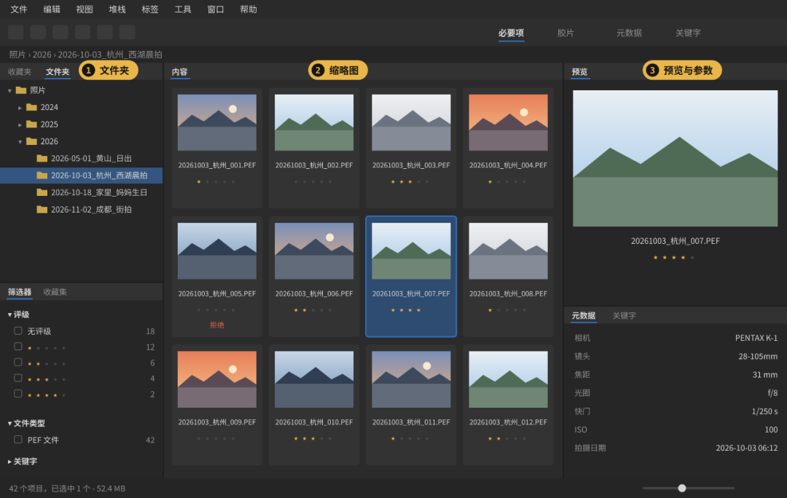
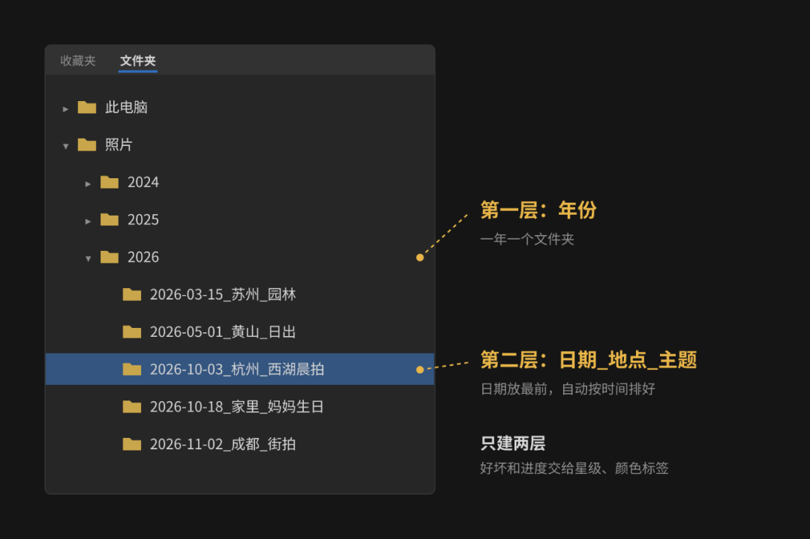
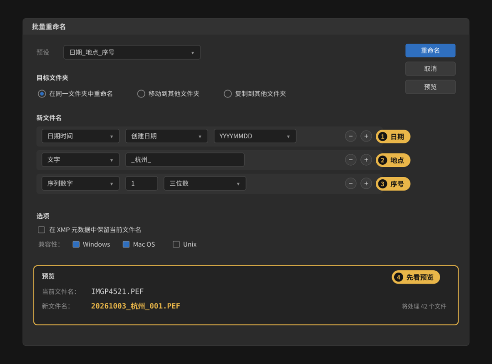
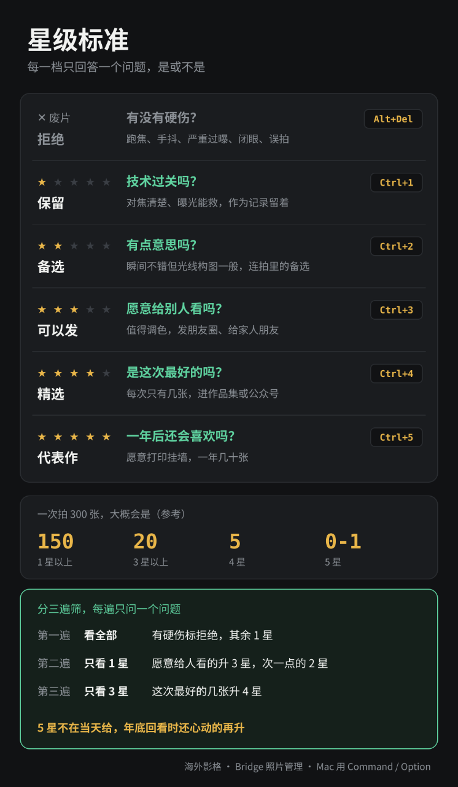
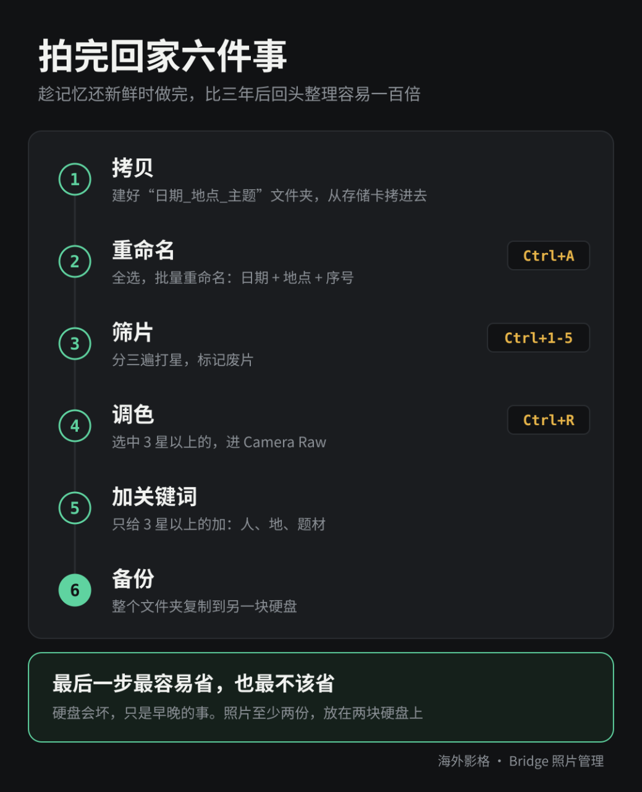

# 不用 Lightroom，也能把几万张照片管理得清清楚楚！
> 💡 备注属性未写入，可能是备注属性名称或者类型被修改了，建议将字段类型设置为 rich_text，可以在小程序-操作-修改文章数据库页面进行调整
> 💡 原文链接:[https://mp.weixin.qq.com/s?__biz=MzI4NzU0Mjc1MA==&mid=2247487272&idx=1&sn=f05a98c72fcfabbbf6f77433d9e56069&chksm=ea37520fcafbe064614bef97f9310578bcb786cb0164d030af8627573a4565b30b784c93ce2c#rd](https://mp.weixin.qq.com/s?__biz=MzI4NzU0Mjc1MA%3D%3D&mid=2247487272&idx=1&sn=f05a98c72fcfabbbf6f77433d9e56069&chksm=ea37520fcafbe064614bef97f9310578bcb786cb0164d030af8627573a4565b30b784c93ce2c#rd)

「拍下来的是风景，留下来的是你看世界的方式」
❤
你有没有过这样的经历：
朋友问你要一张三年前旅行时拍的合影。你打开硬盘，面对的是“新建文件夹”“新建文件夹 (2)”“照片备份”“照片备份-最终”，还有几千个叫 IMG_4521 的文件。翻了半小时，没找到，最后只好说“回头发你”。
照片拍得越多，这个问题越严重。拍了十年，硬盘里有几万张，真正能随时拿出来的却没有几张。
这不是你的问题，只是缺一套管理照片的方法。今天这篇就讲这个：用 Adobe Bridge，从文件夹怎么建，到十秒钟找到任何一张照片。
为什么是 Bridge
它有三个特点，正好适合不想折腾的人：
1. 不用导入，打开就能看
Lightroom 像一座图书馆，每本书要先登记入库才能查。Bridge 像你家的书架，书就摆在那里，走过去就能看。
你硬盘里的文件夹是什么样，Bridge 里看到的就是什么样。不用建目录，不用担心“照片丢失链接”，换电脑也不用迁移。
2. 和 Camera Raw 是一家
在 Bridge 里选中照片，按 Ctrl+R（Mac 是 Command+R），就能直接在 Camera Raw 里打开调色。「Camera Raw 系列」里讲的所有内容，在这里都能接上。
所以 Bridge 管照片，Camera Raw 调照片，这个组合能覆盖 Lightroom 的大部分日常用途。
3. 各种格式都能预览
RAW、JPG、PSD、视频，都能直接看缩略图。我用的宾得 K-1，拍出来的 RAW 文件在这里可以直接预览。

···
第一步：文件夹只用一种建法
软件再好，也救不了乱放的文件夹。管理照片的第一步和软件无关：定一个规则，然后只用这一个规则。
我的建法是两层：
```
照片/
  2026/
    2026-10-03_杭州_西湖晨拍/
    2026-10-18_家里_妈妈生日/
    2026-11-02_成都_街拍/
```
第一层是年份
第二层是“日期_地点_主题”
日期写成“年-月-日”并放在最前面，文件夹就会自动按时间排好。地点和主题写进名字，以后即使不打开任何软件，用电脑自带的搜索也能找到。
不要建第三层，也不要建“精选”“待修”“已修”这样的子文件夹。哪张好、哪张修过，交给后面的星级和标签来标记。

···
第二步：一次改完几百个文件名
相机给照片起的名字，比如 IMGP4521，没有任何信息，过一万张还会重复。Bridge 可以一次把整个文件夹的照片改成有意义的名字。
01在 Bridge 里打开文件夹，按 Ctrl+A（Mac 是 Command+A）全选
02点菜单“工具”→“批量重命名”
03在“新文件名”里组合三项：拍摄日期 + 文字（地点）+ 序列号
04看一眼底部的预览，确认无误后点“重命名”
改完之后，文件名会变成这样：
```
20261003_杭州_001.PEF
20261003_杭州_002.PEF
```
这样的名字，单独拿出任何一张，都知道它是什么时候、在哪里拍的，而且永远不会重名。
第一次用，建议先拿一个复制出来的文件夹试一遍。重命名是直接改硬盘上的文件，先试再用更放心。

···
第三步：给星级定一个标准
很多人打星打着打着就乱了：今天心情好给 4 星，明天觉得只值 2 星。问题不在打星，而在没有标准。
我的建议是：五颗星全部用上，再加一个“拒绝”。关键是每一档都对应一个能用“是”或“不是”回答的问题，而不是凭当天的感觉：
| 档位 | 问自己 | 含义 |
| 拒绝 | 有没有硬伤？ | 跑焦、手抖、严重过曝、闭眼、误拍，定期清理 |
| 1 星 | 技术过关吗？ | 对焦清楚、曝光能救，作为记录留着 |
| 2 星 | 有点意思吗？ | 瞬间或内容不错，但光线、构图一般；连拍里的备选 |
| 3 星 | 愿意给别人看吗？ | 值得调色，可以发朋友圈、给家人朋友 |
| 4 星 | 是这次最好的吗？ | 每次拍摄只有几张，放进作品集或公众号 |
| 5 星 | 一年后还会喜欢吗？ | 愿意打印挂墙的代表作，一年几十张 |
五档看起来多，但每一档只回答一个问题，反而比凭感觉打三档更不容易犹豫。拿不准是 3 星还是 4 星时，就问自己：这是不是这次拍摄最好的那几张？不是，就是 3 星。
一次拍摄大概的比例（仅供参考）：拍 300 张，1 星以上约 150 张，3 星以上约 20 张，4 星约 5 张，5 星可能一张都没有。如果你的 4 星一次就有几十张，说明标准放松了。
快捷键让筛片变得很快：
Ctrl + 1 至 5：打 1 到 5 星（Mac 用 Command）
Ctrl + 0：取消星级
Ctrl + . / Ctrl + ,：升一星 / 降一星，第二遍、第三遍筛片时最常用
Alt + Delete：标记为“拒绝”（Mac 用 Option + Delete）
空格键：全屏预览，用方向键翻片
我的习惯是分三遍筛，每遍只问一个问题：
01第一遍，看全部：有没有硬伤？有的标拒绝，没有的打 1 星
02第二遍，只看 1 星：愿意给别人看吗？愿意的升到 3 星，有点意思但不够好的给 2 星
03第三遍，只看 3 星：哪几张是这次最好的？升到 4 星
还有一条：5 星不在当天给。等年底回头翻一年的 4 星，那时还让你心动的，才升到 5 星。隔了时间再看，才分得清是照片好，还是那天的心情好。
每一遍开始前，用筛选器只显示这一遍要看的星级，就不会被其他照片分心。
— 颜色标签管进度
星级管好坏，颜色管进度，两件事分开，就不会乱。Bridge 默认有五种颜色标签，可以这样分工：
| 颜色 | 含义 | 快捷键 |
| 红 | 待修 | Ctrl+6 |
| 黄 | 修了一半，待确认 | Ctrl+7 |
| 绿 | 已修完 | Ctrl+8 |
| 蓝 | 已发布或已交付 | Ctrl+9 |
| 紫 | 待打印 | 无 |
这就是前面说不用建“待修”“已修”文件夹的原因：一张照片修到哪一步，看一眼颜色就知道。

图17
···
第四步：十秒钟找到一张照片
前三步做好了，找照片就变得很简单。Bridge 里有三种找法，从快到慢：
1. 筛选器面板
左下角的“筛选器”会列出当前文件夹里照片的各种属性：星级、标签、拍摄日期、镜头、ISO 等等。点一下“5 星”，画面里就只剩代表作。想看某支镜头拍的所有照片，也是点一下。
2. 关键词
给照片加上关键词，比如人名、地点、题材。不用每张都加，只给 3 星以上的加就够了，否则坚持不下来。
关键词也要有规则，我建议只分三类：
人：家人和朋友的名字
地：城市或景点
题材：风光、人像、街拍、花鸟、胶片
3. 查找
按 Ctrl+F（Mac 是 Command+F），可以按文件名、关键词、星级、拍摄日期等条件搜索，还可以勾选“包含所有子文件夹”。比如在“照片”这个总文件夹里，搜“关键词包含妈妈，星级大于等于 3 星”，这些年给妈妈拍的好照片就都出来了。
常用的搜索可以存成“智能收藏集”，以后点一下就能看，新拍的照片只要符合条件也会自动出现在里面。
回到开头那个问题。朋友要三年前旅行的合影：打开那一年的文件夹，按地点找到那次旅行，点一下“3 星”，就在眼前了。
【图 4：筛选器面板截图，标出星级和关键词两项】
···
从插卡到归档：每次拍完做这六件事
把上面四步串起来，就是每次拍完回家的固定流程：
01拷贝：建好“日期_地点_主题”文件夹，把照片从存储卡拷进去
02重命名：全选，批量重命名
03筛片：分三遍打星，标记废片
04调色：选中 3 星以上的，Ctrl+R 进 Camera Raw
05加关键词：只给 3 星以上的加
06备份：把整个文件夹复制到另一块硬盘
一次几百张的拍摄，除去调色，前后大约二十分钟。趁着记忆还新鲜时做完，比三年后回头整理容易一百倍。
最后一步备份最容易被省略，也最不该省。硬盘会坏，只是早晚的事。照片至少要有两份，放在两块不同的硬盘上。

图18
···
Bridge 也有短处
说完好处，也说说它不如 Lightroom 的地方：
照片特别多时，搜索会慢。Bridge 没有目录数据库，跨很多文件夹搜索时要现找，第一次打开大文件夹也要等它生成缩略图
硬盘没插上就看不到。Lightroom 即使拔掉硬盘也能浏览预览图，Bridge 不行
没有手机版。想在手机上看和修，还是得用 Lightroom
所以我的建议是：照片在几万张以内、主要在一台电脑上工作，Bridge 完全够用。照片十几万张、经常要跨年份找图，再考虑 Lightroom Classic。
而且，这篇讲的文件夹规则、命名规则和星级标准，换到任何软件都能用。方法是你的，软件只是工具。
···
最后
整理照片这件事，看起来和摄影无关，其实关系很大。
一张找不到的照片，和没拍过没有什么区别。管理照片不是整理癖，而是让你拍过的东西，真的能被再次看见。
不必一次把过去十年的照片都理完。从下一次拍摄开始用这套方法，老照片有空时一年一年慢慢补。
身边有硬盘里一团乱的朋友，可以把这篇发给他。
留言聊聊：你的照片文件夹是怎么命名的？有没有更好的办法？
···
后期和工具系列会持续更新，关注海外影格，不错过下一篇。
筛完片之后怎么调色？可以接着读[《Camera Raw 系列 01｜基本面板 6 个滑块》](https://mp.weixin.qq.com/s?__biz=MzI4NzU0Mjc1MA%3D%3D&mid=2247487257&idx=1&sn=ea7375fb9179834f9e13222c416afef8&scene=21#wechat_redirect)。
参考：Adobe Bridge 版本说明，目前最新为 2026 年 7 月的 16.0.6 版
— 完 —
谢谢你读到这里。觉得有用的话，点个「 👍 」再走。
FILM
**让每一篇文章都成为可以被复用的经验**
影藏万象 · 格见千山
[PS其实没那么难，我当初就是靠这几招入门的](https://mp.weixin.qq.com/s?__biz=MzI4NzU0Mjc1MA%3D%3D&mid=2247486951&idx=1&sn=8b65a1016e972063b4eca06d3c3b6d7c&scene=21#wechat_redirect)
[手机拍的照片，怎么用PS修出胶片感？](https://mp.weixin.qq.com/s?__biz=MzI4NzU0Mjc1MA%3D%3D&mid=2247487069&idx=1&sn=fac59dc00717788b7feb2f7b0b742d0b&scene=21#wechat_redirect)
[从灰片到电影色：照片RAW 转 LOG 全流程](https://mp.weixin.qq.com/s?__biz=MzI4NzU0Mjc1MA%3D%3D&mid=2247486858&idx=1&sn=53dec7b3a94edfc670e9ccedb5cd5ef5&scene=21#wechat_redirect)
[拍的照片颜色总不对？别急换显示器，先看看色彩管理吧](https://mp.weixin.qq.com/s?__biz=MzI4NzU0Mjc1MA%3D%3D&mid=2247486011&idx=1&sn=60e0c0f574ca6f8b84073c20a8ddf03d&scene=21#wechat_redirect)
[Camera Raw 滑块不用全懂，照这 7 步走完全流程](https://mp.weixin.qq.com/s?__biz=MzI4NzU0Mjc1MA%3D%3D&mid=2247487147&idx=1&sn=b203d85d442e25f1e4f5849df66353d8&scene=21#wechat_redirect)
[正版 Photoshop 没有安装包，别再找了，看这里！](https://mp.weixin.qq.com/s?__biz=MzI4NzU0Mjc1MA%3D%3D&mid=2247487179&idx=1&sn=aa40c8b0a3949a02238f8cf2a32df5e2&scene=21#wechat_redirect)
[《Camera Raw 系列 01｜基本面板 6 个滑块》](https://mp.weixin.qq.com/s?__biz=MzI4NzU0Mjc1MA%3D%3D&mid=2247487257&idx=1&sn=ea7375fb9179834f9e13222c416afef8&scene=21#wechat_redirect)
