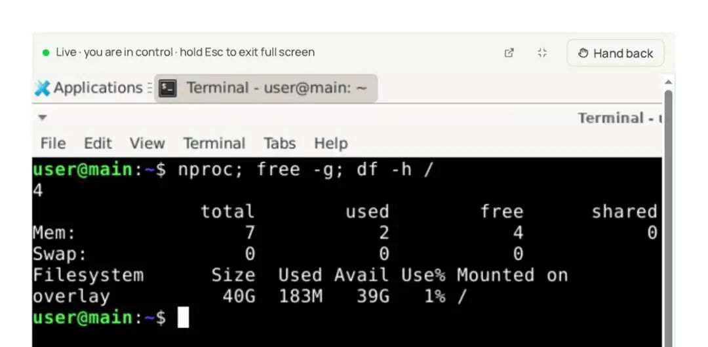
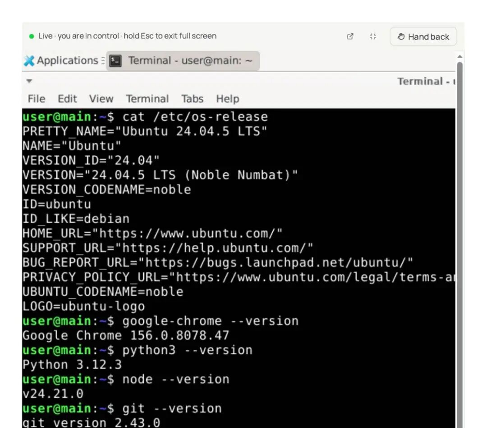
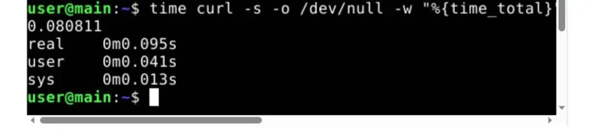
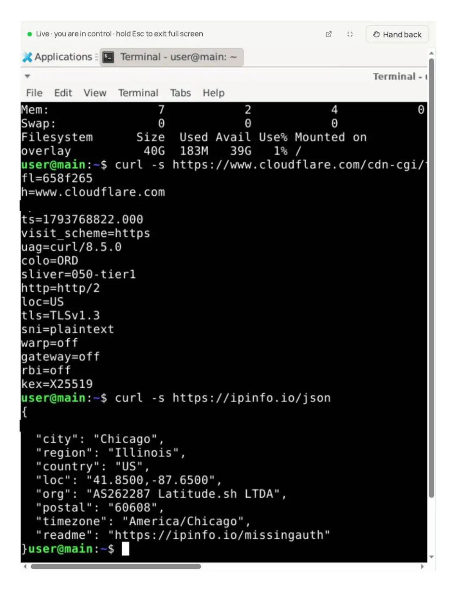
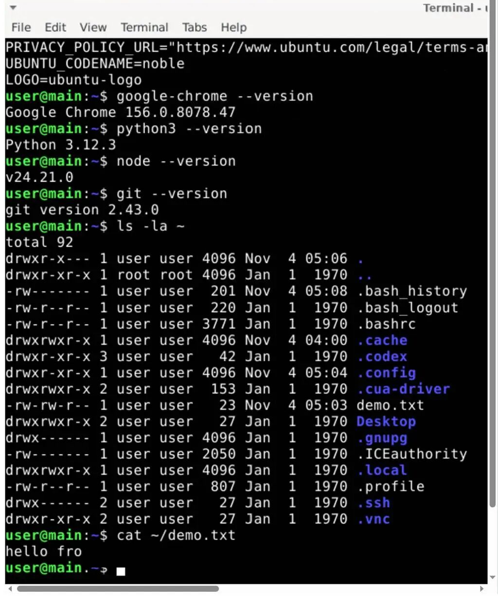
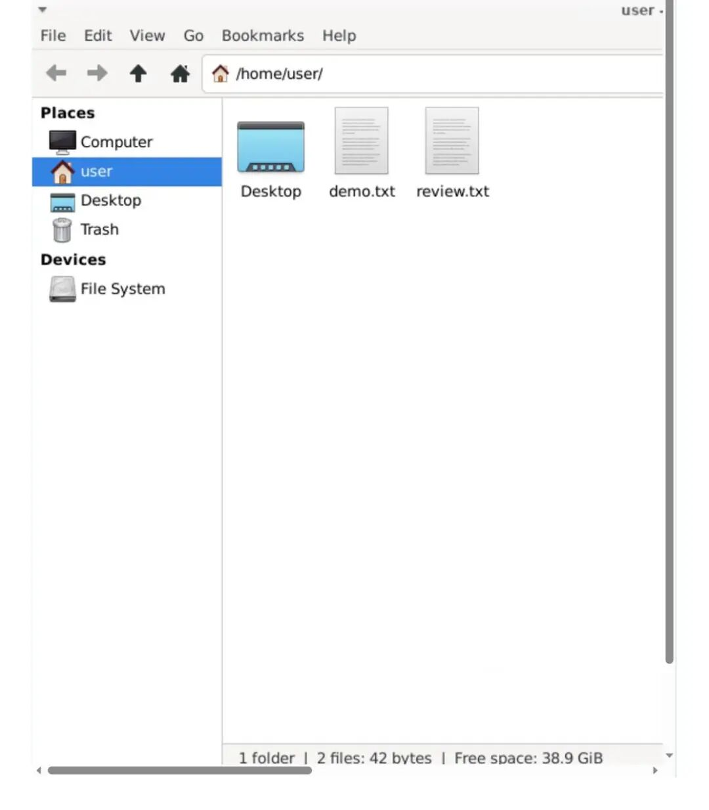
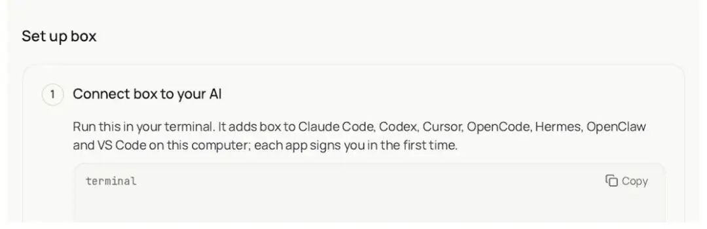
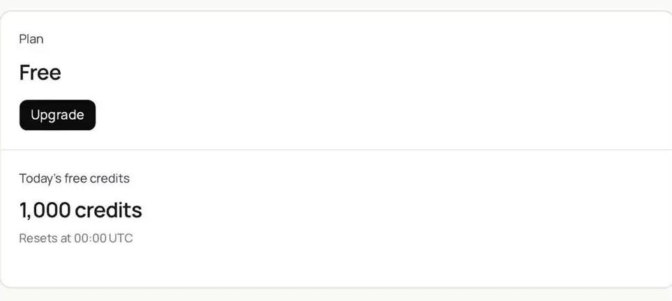
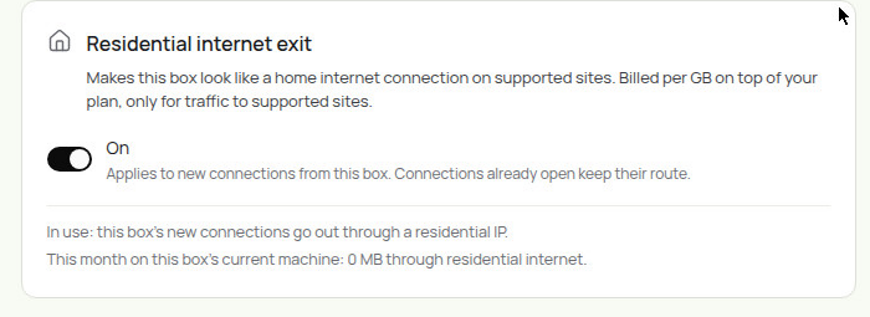

# 不用排队，新上线的免费送云电脑，4核，8G，40G硬盘，还送美国家宽，每天1000积分，不用绑卡，实测完：能用，速领
> 💡 备注属性未写入，可能是备注属性名称或者类型被修改了，建议将字段类型设置为 rich_text，可以在小程序-操作-修改文章数据库页面进行调整
> 💡 原文链接:[https://mp.weixin.qq.com/s?__biz=MzU3NjY2MzQwMA==&mid=2247486080&idx=1&sn=cd914e4e3bca7b1fccc074af7aa9c11d&chksm=fc2384196a484ec111331e6ba3fa365548b45582d4a65eb48e9fdb46805eb03fa60b28f1fbb5#rd](https://mp.weixin.qq.com/s?__biz=MzU3NjY2MzQwMA%3D%3D&mid=2247486080&idx=1&sn=cd914e4e3bca7b1fccc074af7aa9c11d&chksm=fc2384196a484ec111331e6ba3fa365548b45582d4a65eb48e9fdb46805eb03fa60b28f1fbb5#rd)
这台免费云电脑，实测完了。免费是真的，真能用，实测配置 4 核 7G 内存 40G 盘，每天白给 1000 积分，不用绑卡也不用手机验证。出口是芝加哥的机房IP（家宽IP要在后台打开）。
怎么领的，一分钟的事。【注册在文末，使用暗号获取】。进免费计划，盒子一开始是睡着的，点一下唤醒，几秒就醒，桌面直接能用。从打开网页到桌面能点，前后大概一分钟，全程没要卡、没要手机验证，连密码都没输。
配置实测，数字都在图里。终端敲了三条命令：CPU 4 核，内存一共 7G，用了 2G，磁盘一共 40G，只用了 183M。

系统是 Ubuntu 24.04.5，Chrome、Python、Node、Git 都预装好了，开箱就能干活。

性能也不拉胯。随手测了个请求，0.08 秒就回来了；桌面点起来跟手，没觉得卡。只有一个小毛病：Chrome 和文件管理器两个窗口叠在一起的时候，画面闪了一下，像是远程画面的小撕裂，不影响操作。

IP 是重点，单独说。出口在芝加哥，IPv6 和 IPv4 都是美国地址，运营商是 Latitude.sh，一家做云服务器厂商的机房IP.。另外用量页里还有个“住宅流量（经住宅代理）”的计费项，说明住宅代理可能是另外的功能，默认出口不是它。（家宽IP要到后台开启按钮）悄悄告诉你：它只出不进、只放行 443，我知道你很厉害，从里面打一条隧道出去，复用443端口，居然解决你的小应用的连接问题了。别私我，别问我，我不知道。

能干什么，都试了一遍。盒子里的 Chrome 打开搜东西正常，终端敲命令正常，文件管理器也能打开，终端建的文件在图形界面里看得到。

怎么接进自己的 agent，也很简单。后台给了一行接入命令，跑完就接进去了，支持 Claude Code、Codex、Cursor、OpenCode、Hermes、OpenClaw、VS Code，背后走的是标准 MCP 服务。接入命令和连通性在本地都验过，是通的，Hermes 也在支持列表里。安装器列表里没见到 pi，但它是标准 MCP 服务，其他客户端按 MCP 接也能用。接入命令私聊一起发你。

免费方案单独拎出来说。免费档叫 Explore，0 元，每天 1000 积分，UTC 0 点重置。积分花在三处：机器运行时间、流量、走盒子自带模型的调用，100 积分等于 1 美元。后台没写每次操作具体扣多少，这个查不到。付费两档：50 美元一个月给 50000 积分，电脑是专用的，只按运行时间计费，最多同时开 5 台；500 美元一个月无限量，电脑常开。还有个小异常：盒子实际在跑，用量页却显示 0 小时，页面自己写了“通常一小时内入账”，应该是结算延迟。

最后说几个提醒，都是实测里抠出来的。第一，产品刚上线没几天，配套的插件仓库是 11 月 2 日才建的。第二，免费档每天第一次启动要等两分钟左右，别一上来就以为卡死了。第三，家宽 IP 要去后台开启。

结论就一句：白嫖一台云桌面给 agent 干活、跑浏览器任务，够用，有时候卡顿，现在官方给出的回答是正在加设备解决，需要的动作要快，别等关门了才想起来没把它牵回家。😄
明天还有一只，记得来哟
注册私发暗号：Y1106
