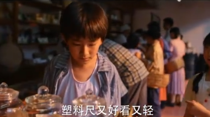
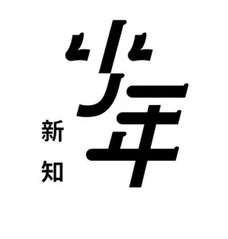
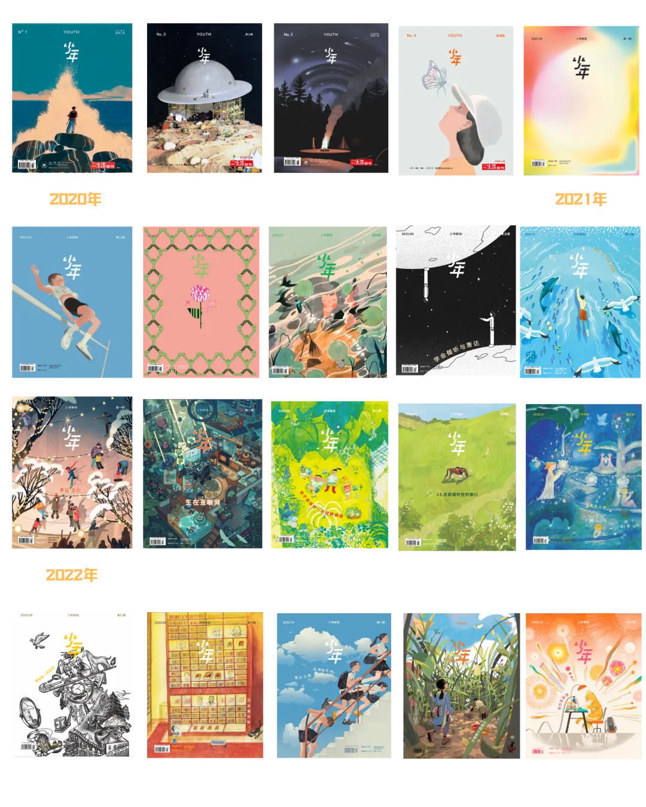
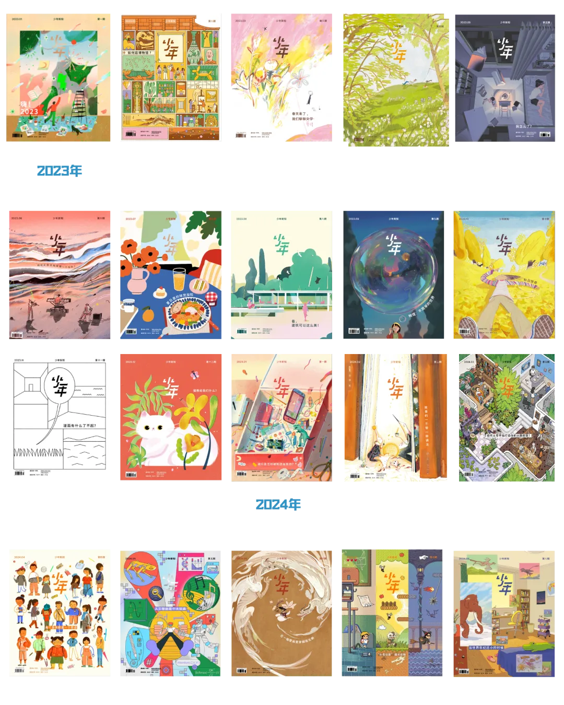
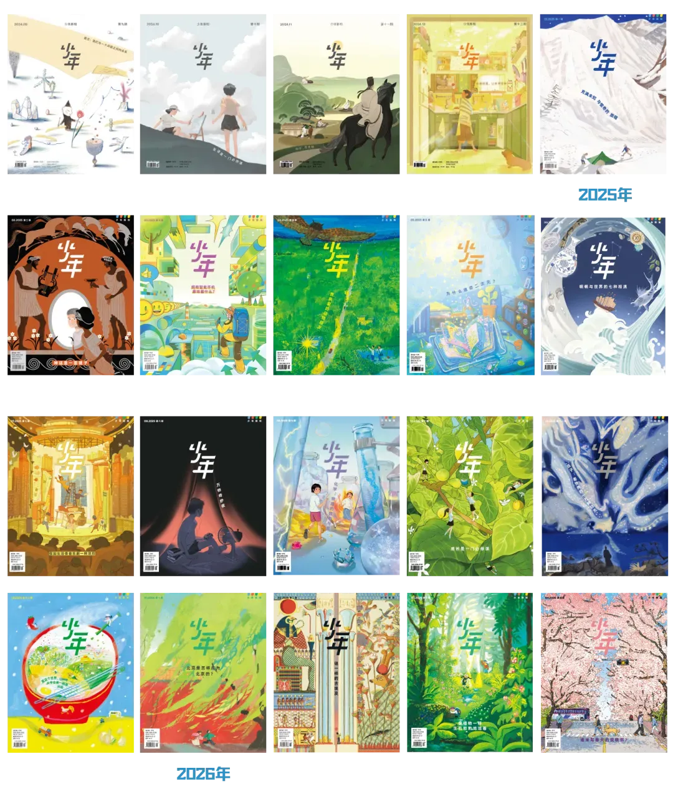
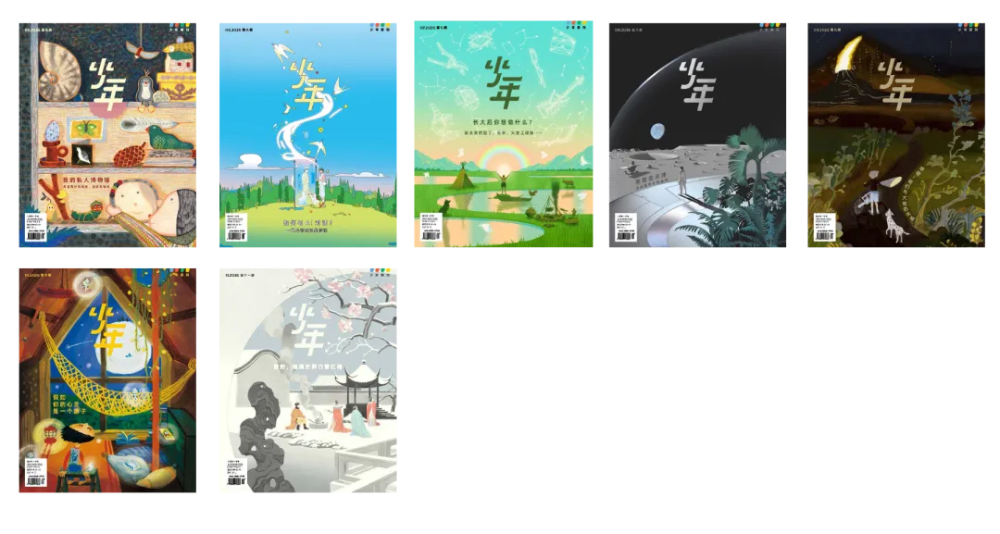
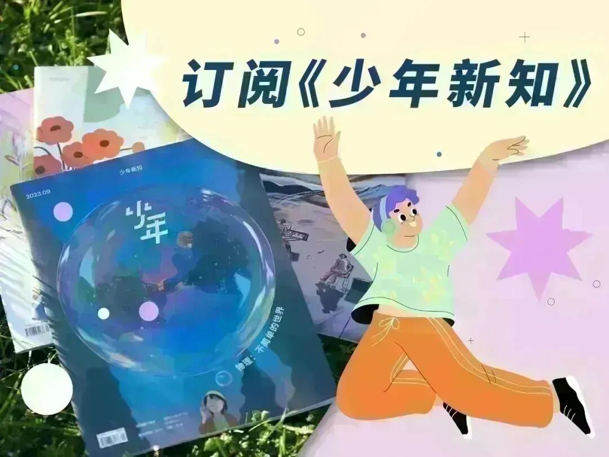

# 世界上最神秘的商家是学校周边的小卖部
> 💡 备注属性未写入，可能是备注属性名称或者类型被修改了，建议将字段类型设置为 rich_text，可以在小程序-操作-修改文章数据库页面进行调整
> 💡 原文链接:[https://mp.weixin.qq.com/s?__biz=MzI1NzI3NjEwOQ==&mid=2247616084&idx=1&sn=e5fefaa7a06b71c968361dbd1c0d5cc4&chksm=eb4f0b6ff1117c09e70028ebed96f83eaef26217123a4cd47163a867f979d7eb7c461eab512f#rd](https://mp.weixin.qq.com/s?__biz=MzI1NzI3NjEwOQ%3D%3D&mid=2247616084&idx=1&sn=e5fefaa7a06b71c968361dbd1c0d5cc4&chksm=eb4f0b6ff1117c09e70028ebed96f83eaef26217123a4cd47163a867f979d7eb7c461eab512f#rd)
自从孩子上了学，我才知道小卖部有多么神通广大。别处没有卖的东西，这里有；学校没发的通知，这里早就知道了；有时，这里还兼具着教化众生的功能。总之，很像是科幻影视剧里那种地球表层毁灭之后的地下黑市，人们熙熙攘攘，各取所需，交换着“武器”和“情报”，只有你想不到的，没有你买不到的。
首先“小卖部”这个名字就很奇特。这么多年过去了，我们的日常生活里多了那么多的超市、商场、购物中心、MALL、Plaza……只有学校周边的小店，叫法雷打不动，一律被统称为“小卖部”。货架上挤挤挨挨，摆放着各种来路不明的教具、花哨玩具和廉价零食。孩子上一二年级时，数学老师要求第二天带来“计数棒”，用来数数、理解“凑十法”和加减法的意义。上网查了查，就是花花绿绿的小棍子，可网购肯定是来不及了，问了问别的家长，都说小卖部有卖的。第二天赶过去，果然，小卖部刚刚进了货，足量供应。四五年级，数学老师又让带来磁铁方块，用于学习“观察简单组合体”。自然，我们的第一选择又是小卖部。

《去有风的地方》剧照
说真的，我总怀疑这些小卖部和学校都是“联谊”单位，或者老板干脆就是老师的亲戚。一天早上，孩子又照例忘记戴红领巾。在小卖部购买时，我随口跟老板念叨，明天气温太高，裹着红领巾孩子会闷得难受。老板一边拿货，一边跟我说可以买红领巾胸徽，能替代红领巾佩戴。末了随口补了一句，明天不用上课。我好奇地问为什么？老板回答明天有活动，占用场地一天。我半信半疑，翻了翻班级群，没有任何消息。到了下午，还是没有动静。快放学时，通知才姗姗来迟：因明天校园临时组织其他活动，暂停课一天。此次课程改由周六补课。
买的东西多了，我们有时候也会聊上几句。看着一群一群孩子往里涌，我说，你们生意真好。老板叹了口气：卖给学生的东西，都不会太贵，也挣不了大钱。你还得雇人盯着，小孩们“拿”东西“拿”得厉害。你安装摄像头都不行，他们有时候还互相打掩护，这个假装买这买那，另一个躲在一边“拿”，就得人盯着。我问，抓住了怎么办。他说，都是孩子，哪儿懂什么善恶啊，也不缺钱，就是觉得好玩，说说就算了。

《最好的我们》剧照
还有一次，我正在上班，有陌生号码打过来，一接，是自家孩子的声音。原来，她拿着我给她的一百元钞票来买东西，老板怕孩子是偷偷从家拿的，所以让打电话证明一下。
可能是天天接触孩子，心也自然会软一些，教育的办法也相对柔和。当年，我的一个同学因为偷书被抓着了，老板倒也没罚他，就是让他放学后帮忙卖书，连续卖了俩礼拜才算完事儿。那同学父母离异，每天晚回去半小时家里也没人问。最后老板反倒送给他一本书，也算是个happy ending。

《隐秘的角落》剧照
孩子上了初中，自然也换了不同的小卖部，但它们的发挥依旧稳定。小卖部可以办卡，家长把钱存到卡里，孩子临时需要什么，就隔着栅栏跟小卖部说，他们会把东西递进去，再划卡。
一天，班主任在群里发消息，说不少同学缺少学习规划，推荐往届学生一直沿用的“学习习惯本”，不少人到高中还受益，附上样图，让有需要的家长自行打印。这次，我连想都没想，下楼骑车子直奔小卖部。不出所料，人家早就印好了成册的本子，厚厚的一沓，封面还是挺括的蓝色皮纹纸。老板说一个班刚刚用班费买走了五十本。一问价格：七元，也不贵。老板又问要这个学校的练习册不，网上没的卖。我立刻掏出钱买下。无可怀疑，他们的建议一定是对的。

《小巷人家》剧照
小卖部如此便捷，但也让我们头疼，尤其是那些包装简陋的小零食。倒不是钱不钱的事儿，关键是看着就很不安全。很多零食的价格，居然还停留在我们小时候的价位。比如那种冰袋，淡淡的果味，冻得硬邦邦。一到夏天，很多孩子手里都攥着一个啃。你给她买大厂出品的雪糕，人家不要，就要这样的。我记得当年有一个词叫“乡镇企业”，很多都是生产这种颜色和配料都很可疑的小零食。没想到，这些玩意儿又和我们的孩子喜相逢了。这么看来，小卖部也算是把我们这两代人的童年串联起来了，穿越了时空，啃着同一个冰袋，陈述着一样的人情世故。

**《少年新知》是《三联生活周刊》旗下的原创青少年杂志，我们的自我定位是人文思维启蒙。我们希望这本杂志能够陪伴青少年一起直面真实复杂的世界，让他们意识到，看待世界不是只有一种方法。**
**自2020年6月创刊，《少年新知》已经推出67期杂志。我们的主题涉及时间、魔法、友谊、家庭、偶像、未知、运动、冬日、海洋、倾听与表达、网络生存、像侦探一样思考、历史、成长的烦恼、微观世界、写作实验室、清单、博物馆、爱情、野外、情绪、音乐、美食、建筑、物理、秋日、漫画、流行、故事、社团、身体、AI、南北朝、游戏、古生物、语文、苏东坡、厨房、旅行、神话、智能手机、野生动物、二次元、明朝、音乐剧、夜晚、化学、成长、庄子、面条、北京、古埃及、植物、诗歌、私人博物馆、职业、月球、地理、青春期、红楼梦等。**

**许多愿意为青少年写作和绘画的成年人加入了这本杂志的创作。科学、游戏、哲学、文学、心理学、艺术专栏的创作者不断地输送着前沿的研究和对日常生活的思考，试图回应青少年对现实世界的困惑。**
**点击图片，一键下单↓↓**

