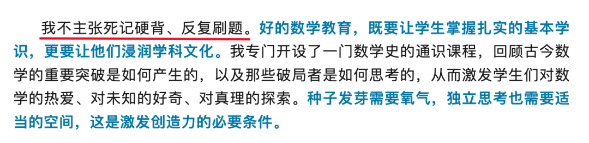
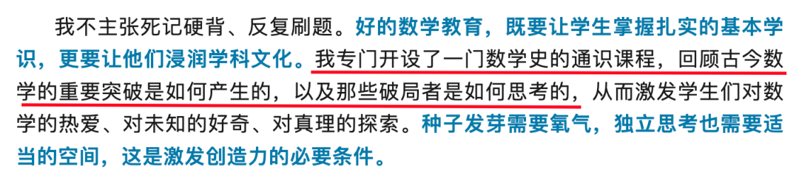
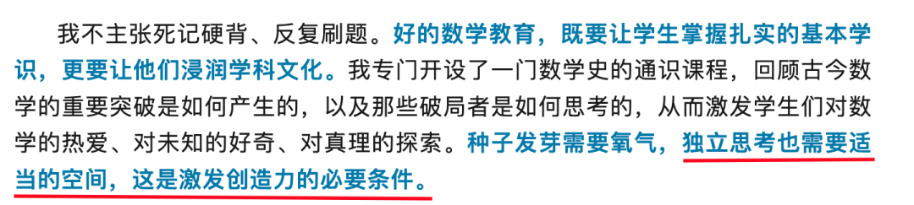
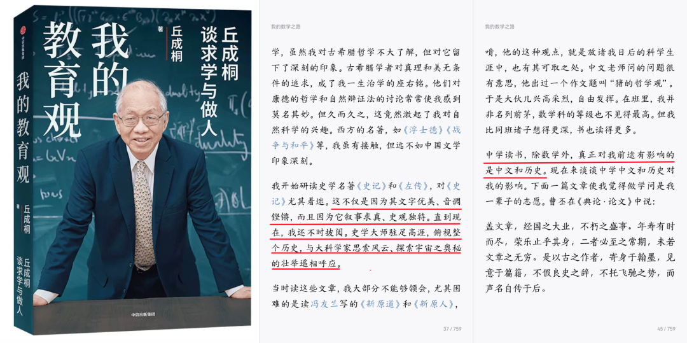
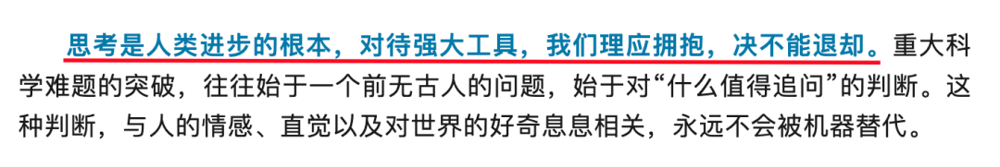

# 丘成桐在《人民日报》谈教育：比刷题更重要的，是保护孩子这几种能力
> 💡 备注属性未写入，可能是备注属性名称或者类型被修改了，建议将字段类型设置为 rich_text，可以在小程序-操作-修改文章数据库页面进行调整
> 💡 原文链接:[https://mp.weixin.qq.com/s?__biz=MzI2Nzc3MzEyNw==&mid=2247668663&idx=1&sn=35d7bbd4735c4d9ff35fb69dc22b6fd5&chksm=eb8d3a29dee4ea2ce6330dc8e80070d6af810e5258dfac9bec2787b2d76f26056e4cf4feb092#rd](https://mp.weixin.qq.com/s?__biz=MzI2Nzc3MzEyNw%3D%3D&mid=2247668663&idx=1&sn=35d7bbd4735c4d9ff35fb69dc22b6fd5&chksm=eb8d3a29dee4ea2ce6330dc8e80070d6af810e5258dfac9bec2787b2d76f26056e4cf4feb092#rd)
## 昨天，数学家丘成桐在《人民日报》发表了一篇文章，题为《守住对真理的好奇》。
文章不长，我们建议家长们都读一读。

丘成桐先生是菲尔兹奖得主，也是当前清华大学求真书院院长，近半个世纪以来，他一直在思考一件事：**怎样培养真正的一流人才？**
从丘成桐中学科学、数学科学领军人才培养计划到丘成桐少年班、求真书院，他在国内开始了一系列不同于常规升学路径的拔尖人才培养路线。
但这次，他谈的不只是数学，也不只是少数天才学生的培养，而是更广泛的基础教育中一些更根本的问题：
**知识与思考是什么关系？**
**兴趣为什么重要？**
**AI越来越强大，人究竟还需要具备什么能力？**
我们想结合文章，和家长聊聊其中几个值得思考的地方。

**数学教育，不应该只有解题**
丘成桐在文章中明确表示，他不主张死记硬背、反复刷题。

但所谓的不刷题，并非是不做题。
他强调，好的数学教育，首先要让学生掌握扎实的基本学识，同时还要理解学科文化。
这两句话，应该放在一起理解。因为当前很多家长，对于数学学习有两种截然不同的认识：
一种认为，数学就是多做题。校内学完刷培优，培优刷完搞竞赛，难题见得越多，数学能力就越强。
另一种则认为，刷题会扼杀兴趣，孩子只需要培养数学思维，不必过分在意计算和基础训练。
我们觉得，这两种理解都有失偏颇。
**数学一定需要训练**。计算的熟练程度、概念的准确理解、基本方法的掌握，都是进一步学习的基础。但，训练不能成为数学学习的全部。
比如，同样是学习勾股定理，有的孩子记住公式，能熟练完成几十道题；有的孩子除了会解题，还想知道，为什么直角三角形的三条边会存在这样的关系？除了课本上的证明，还有没有其他方法？
前者掌握了解题技能，后者则开始接近数学研究的思考方式。
另外，丘成桐先生特别提到，他在求真书院开设数学史课程，让学生了解历史上重要的数学突破如何发生，数学家又是怎样思考问题的。

这些，当然有助于孩子理解数学。但我们觉得，它的意义还不止于此。
数学发展的历史，也是一部人类不断突破认知边界的历史。那些伟大的发现，往往经历了漫长的探索，无数次失败，甚至是对当时公认理论的质疑与挑战。
孩子从中看到的，不只是某个定理如何诞生，更是人类如何面对未知、如何坚持自己的判断，又如何在前人的基础上不断向前。
这些关于好奇、怀疑、坚持与探索的故事，对一个人的成长而言，其价值早已超出了数学本身。

**比起提前学多少**
**更重要的是能不能独立思考**
丘成桐在文章中写道，独立思考需要适当的空间，这是激发创造力的必要条件。

当代教育，有一个很明显的倾向，就是对学习效率的过度追求。
一道数学题，孩子琢磨了半小时还没有头绪，家长可能就着急了。明明老师讲解只需要三分钟，为什么要浪费这么多时间？
于是，我们习惯了帮孩子寻找最高效的学习路径。知识点最好有人提前归纳，解题方法最好有人系统总结，遇到难题最好能迅速找到突破口。
这些都是学习技巧，但自己摸索和直接使用，在我们看来对于长远的学习能力的影响颇为不同。**
**
**因为当我们把学习过程中的弯路都提前清除了，孩子是否会因此失去一些独立探索的机会？**
从思维发展的角度看，那些看似低效的时间，未必是浪费。
孩子尝试一种方法，发现走不通，再换一个方向；或者对一道题产生了疑问，顺着自己的想法研究了很久，最后也没有得到答案。这些经历，可能是独立思考能力生长的过程。
当然，我们并不是鼓励孩子在所有问题上死磕，更不是否定老师的指导和成熟的学习方法。
我们想说的是，教育不能只追求让孩子更快地掌握已有的知识，也应该允许他们花一些时间，去探索那些自己还不知道答案的问题。
毕竟，学会别人已经总结好的方法，与形成独立思考和解决问题的能力，是两件相关，却并不完全相同的事。

**真正的拔尖人才**
**不能只靠单一学科培养**
丘成桐作为数学家，却非常重视人文教育。
在求真书院，他邀请不同领域的学者，为数学专业学生讲庄子、魏晋风度、苏东坡。
为什么培养数学人才，还要学习这些看似不相关的知识？
因为在丘成桐看来，文学、历史、哲学和数学并非完全割裂的领域。不同学科可以提供不同的认识世界的方式，重要的学术突破也常常发生在学科交汇之处。

丘成桐在自传中提到：中学读书，除数学外，真正对我前途有影响的是中文和历史。
而教育的目的，也不应该只是培养某个领域的专业人才，更应该培养一个知识结构丰富、具有全局视野和独立判断能力的人。
一个人可以在某个专业领域钻研得很深，但如果缺乏对历史、社会和人性的理解，他对许多问题的认识，也可能受到自身专业视角的限制。
尤其在今天，科技发展越来越快，许多现实问题早已无法依靠单一学科的知识解决。比如人工智能，它不仅是计算机科学的问题，也涉及伦理、法律、社会乃至哲学。
未来需要的，可能不仅是某个领域的专才，更是既有专业深度，又能跨越学科边界、理解复杂世界的人。
从这个角度看，人文素养从来不是专业学习之外可有可无的点缀，而是一个人建立完整认知、形成价值判断的重要基础。

### AI时代
### 孩子最需要保留什么能力？
### 
文章最后，丘成桐用了相当大的篇幅谈论AI。
他的态度很明确：**应该拥抱AI，但不能完全跟随AI给出的结论。**

一个人能够借助AI完成复杂的任务，并不意味着他真正理解了其中的问题；能够迅速得到一个漂亮的答案，也不意味着他有能力判断这个答案是否可靠。
特别是，AI在提供看似合理的判断时，人很容易习惯于沿着它给出的思路继续往下走。此时，能不能跳出AI的固有思路，保持自己思考的独立性，是很珍贵的能力。
我们觉得，至少有三件事不能轻易交给AI。
**一是自己发现问题，而不只是等待别人布置问题。**
**二是能够判断答案是否合理，而不只是接受一个看似完整的解释。**
**三是面对不确定的问题，愿意继续思考和探索。**
教育要培养的，不仅是使用工具的能力，还有不被工具牵着走的能力。
**鱼圈推荐阅读
**

