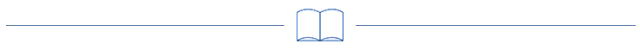

# 严重伤害大脑的 6 个坏习惯
> 💡 备注属性未写入，可能是备注属性名称或者类型被修改了，建议将字段类型设置为 rich_text，可以在小程序-操作-修改文章数据库页面进行调整
> 原文链接:[https://mp.weixin.qq.com/s/idDs0Fa1lijcY_kKEP25fA](https://mp.weixin.qq.com/s/idDs0Fa1lijcY_kKEP25fA)
## 
——**
**
你有没有过这样的经历？刷了一下午短视频，放下手机的时候脑子一片空白，明明看了几百条内容，却一条都记不住；想拿起一本厚书，翻了三页就坐不住，眼睛盯着字，脑子却在到处飘；遇到一个稍微复杂的问题，第一反应不是自己想，而是掏出手机搜 “别人怎么说”。
很多人会把这归结为 “年纪大了脑子不好使”，或者 “天生就不是读书的料”。但在科学哲学家看来，这根本不是天赋的问题，也不是年龄的问题。**你的大脑没有坏，只是被一些你习以为常的坏习惯，一点点磨钝了、锈住了、封死了**。
这些习惯不会让你头疼脑热，不会在体检报告上亮红灯，但它们比熬夜、酗酒对大脑的伤害更深。它们不会杀死你的神经元，但会杀死你的思考能力；它们不会让你变成傻子，但会让你变成一个只会重复别人观点的 “复读机”。而且这种伤害，一旦形成，往往比生理损伤更难逆转。

### 一、先废掉你的注意力，再废掉你的推理力
### 
所有对大脑的伤害，都是从毁掉你的注意力开始的。而这个时代最锋利的凶器，就是**无孔不入的碎片化信息**。
你有没有算过，你一天要被打断多少次？手机弹窗、微信消息、工作群的 @、短视频的自动播放…… 平均每 8 分钟，你的注意力就会被打断一次。而大脑从一个任务切换到另一个任务，需要至少 23 分钟才能重新进入深度专注的状态。也就是说，你看起来忙了一整天，其实根本没有多少时间是在真正思考的。
更可怕的是，碎片化信息会重新训练你的大脑。短视频每 15 秒一个爽点，网文每三章一个高潮，热搜每小时换一次话题。你的大脑会慢慢习惯这种 “即时刺激” 的节奏，变得越来越没有耐心。**它会形成一种条件反射：每过十几秒，就要一个新的奖励。如果没有，它就会感到烦躁、空虚、坐立难安**。
久而久之，你就再也无法忍受那些 “慢的东西” 了。你没法看完一部没有快进的电影，因为前 5 分钟没有冲突；你没法读完一本超过 300 页的书，因为前 10 页没有爽点；你没法和人深入聊一个话题，因为聊超过三句你就想掏出手机刷两下。
波普尔说过：「知识的增长永远始于问题，而不是观察。」但碎片化信息的本质，就是给你一堆没有问题的答案。它把复杂的世界拆成一个个孤立的碎片，把深刻的道理简化成一句句口号，把多面的事实扭曲成非黑即白的判断。它不需要你提问，不需要你推理，不需要你思考，只需要你点赞、转发、然后忘掉。
「大脑最可怕的退化，不是记忆力下降，而是主动放弃了推理的权利。」当你习惯了张嘴就有人喂饭，你就会慢慢忘记怎么自己吃饭；当你习惯了别人把嚼碎了的结论喂给你，你就会慢慢忘记怎么自己思考。最后，你的大脑变成了一个只会接收信息的垃圾桶。

### 二、把观点变成身份，把大脑变成堡垒
### 
如果说碎片化信息废掉的是你的 “思考能力”，那么**把观点和自我认同绑定**，废掉的就是你的 “纠错能力”。这是所有认知僵化的根源，也是科学精神最大的敌人。
我见过太多这样的人：你说某部电影不好看，他立刻跳起来说 “你懂不懂艺术”；你说某个明星有缺点，他立刻骂你 “你是黑子吧”，在他们眼里，你不是在讨论一个观点，你是在攻击他这个人。
为什么会这样？因为他们犯了一个根本性的错误：把「我相信 X」等同于「我是 X」。他们把自己的观点、立场、喜好，当成了自我身份的一部分。如果你否定了他的观点，就等于否定了他这个人本身。
对于一个健康的大脑来说，观点应该是一件可以随时更换的衣服。哪个更合身、更保暖，就穿哪个。今天发现这个观点错了，明天就换掉，这是再正常不过的事情。但对于把观点当身份的人来说，观点是他们的皮肤，是他们的骨头，是他们活着的全部意义。你要扒掉他的观点，就等于要了他的命。
为了保护脆弱的自我，你的大脑会启动一套极其强大的防御机制。它会自动过滤掉所有不利于你的信息，就像给大脑装了一个过滤网，只放进来你想看的东西；它会扭曲所有和你信念不符的证据，把黑的说成白的，把错的说成对的；它会攻击所有提出不同意见的人，给他们贴上 “傻子”“坏人”“别有用心” 的标签。
罗素说：「我绝不会为了我的信仰而死，因为我可能是错的。」但对于这些人来说，他们宁愿死，也不愿意承认自己错了。他们的大脑变成了一座密不透风的堡垒，所有的门窗都被封死了。外面的东西进不来，里面的错误出不去。他们在自己构建的虚假世界里，活得越来越固执，越来越偏激，越来越和现实脱节。
最讽刺的是，他们还会觉得自己特别 “有主见”。殊不知，真正的有主见，是敢于改变自己的主见；而他们的 “有主见”，不过是不敢面对自己错误的懦弱而已。

### 三、只找支持自己的证据，主动走进信息茧房
### 
大脑有一个天生的缺陷，叫「证实偏见」。简单来说就是：**当你相信一件事的时候，你会主动去寻找所有支持这件事的证据，而自动忽略所有反对这件事的证据**。这不是人品问题，这是人类进化出来的本能 —— 大脑喜欢一致性，讨厌矛盾。矛盾会让大脑感到痛苦，而证实偏见能让大脑感到舒服。
比如，你相信 “生肖相克”，你就会记住所有生肖相克最后过得不好的夫妻，忘记所有生肖相克过得幸福的夫妻；你相信 “读书无用”，你就会记住所有没读书赚大钱的人，忘记所有读书改变命运的人；你相信 “男人没有一个好东西”，你就会记住所有渣男的故事，忘记所有负责任的好男人。
「证实一个错误的观点，永远比证伪它容易一万倍。」只要你想找，你总能找到支持你任何观点的证据。哪怕是最荒谬的说法，比如 “地球是平的”，网上也能找到几十万条支持它的帖子和视频。
而算法的出现，把这个本能的缺陷放大到了极致。你只要刷过一次某类视频，算法就会给你推更多一模一样的内容。你喜欢看养生谣言，它就给你推更多养生谣言；你喜欢看阴谋论，它就给你推更多阴谋论；你喜欢骂某个人，它就给你推更多骂那个人的内容。
慢慢的，你就走进了一个完美的信息茧房。你看到的，都是你想看到的；你听到的，都是你想听到的。你会觉得，全世界的人都和你想的一样，你的观点就是绝对的真理。任何和你不同的观点，都是异端，都是傻子，都是别有用心。
波普尔早就看穿了这一点。他说，科学和伪科学的根本区别，不是科学能找到多少支持自己的证据，而是科学敢于寻找能证明自己错了的反例。真正的理性思考者，从来不会去证实自己的观点，只会去证伪自己的观点。他们会主动去看那些反对自己的人的文章，主动去听那些和自己不同的声音，主动去寻找能推翻自己信念的证据。
但绝大多数人，一辈子都在做相反的事情。他们用自己的一生，去证明自己年轻时的偏见是对的。他们的大脑，就这样在自我强化的循环里，慢慢变成了一潭死水。
### 四、把权威当真理，放弃独立判断的权利
### 
很多人会说：“我又不是专家，我不信专家信谁？” 这句话听起来很有道理，但它混淆了两个完全不同的概念：**参考权威**和**迷信权威**。
参考权威是：我不懂这个领域，所以我听听专家怎么说。但我会搞清楚，他的结论是怎么来的？他有没有利益相关？有没有其他专家持不同意见？最后，我自己做判断。
而迷信权威是：专家说的就是对的，只要是专家说的，我就无条件相信。不需要问为什么，不需要找证据，不需要自己思考。

科学从诞生的第一天起，就是反权威的。哥白尼推翻了托勒密的权威，伽利略推翻了亚里士多德的权威，爱因斯坦推翻了牛顿的权威。科学的进步，就是一个不断推翻旧权威、建立新权威的过程。没有任何一个权威是永远正确的，没有任何一个理论是永恒的真理。
费曼曾经讲过一个故事。他当年参与编写美国的中学物理教材，发现里面充满了错误。比如有一本书说，“能量是让东西动起来的原因”，这完全是胡说八道。但所有的老师都照着这本书教，没有一个人提出质疑。因为他们觉得，教材是专家编的，怎么可能错呢？
费曼说：“我见过太多这样的专家了。他们能背下所有的公式，能说出所有的术语，但他们根本不懂自己在说什么。他们只是记住了别人的结论，然后装成很懂的样子。”
当你放弃独立判断，把思考的权利交给权威的时候，你的大脑就不再属于你自己了。你变成了权威的传声筒，变成了别人思想的跑马场。你看起来知道很多东西，但其实你什么都不懂。因为那些知识，从来没有经过你自己的思考，从来没有真正变成你的一部分。
更可怕的是，权威也会犯错，也会撒谎，也会被利益绑架。当你迷信权威的时候，你就很容易被他们牵着鼻子走，变成他们收割的韭菜，变成他们实现目的的工具。
### 五、非黑即白的二元思维，让你永远看不到真相
### 
如果说前面的习惯伤害的是你的思考能力，那么**非黑即白的二元思维**，伤害的就是你的认知结构本身。它会让你永远只能看到世界的一个角落，永远看不到完整的真相。
二元思维是大脑为了节省能量进化出来的本能。原始社会的时候，我们遇到一个东西，只能做两种判断：能吃，或者不能吃；是朋友，或者是敌人。这种简单的分类，能让我们快速做出反应，活下来。但现代社会是一个极其复杂的系统，绝大多数事情，都不是非黑即白的。
一个人，可以同时是好丈夫和坏老板；一件事，可以同时有好的一面和坏的一面；一个观点，可以在这个情况下是对的，在另一个情况下是错的。
但二元思维的人，拒绝接受这种复杂性。他们喜欢简单的答案，喜欢明确的对错，喜欢一劳永逸的解决方案。为了获得这种虚假的确定性，他们会主动简化现实，扭曲事实，把复杂的世界塞进一个非黑即白的框架里。
你说这个人有优点，他就说 “你居然洗白他”；你说这件事有问题，他就说 “你怎么只看到阴暗面”；你说这个政策有好处也有坏处，他就说 “你到底站哪边？”。在他们眼里，世界上只有两种人：和我一样的好人，和不一样的坏人。世界上只有两种观点：我的观点，和错误的观点。
哥德尔用不完备性定理告诉我们：**任何足够强大的形式系统，只要它是自洽的，就必然是不完备的**。也就是说，没有任何一个理论、任何一个观点、任何一个人，是完美的、绝对正确的。所有的东西，都有它的适用范围，都有它的局限性。
但二元思维的人，永远理解不了这一点。他们的大脑只能处理 0 和 1，处理不了 0 到 1 之间的无数个数字。久而久之，他们的认知结构就会变得越来越简单，越来越僵化。他们再也无法理解复杂的人性，再也无法接受矛盾的观点，再也无法做出理性的判断。他们会变得越来越极端，越来越容易被煽动，越来越容易被别人利用。
### 六、逃避不确定性，追求虚假的安全感
### 
所有这些坏习惯，追根溯源，都来自于同一个根源：**人类对不确定性的天生恐惧**。
我们的大脑天生厌恶不确定性。在原始社会，不确定性意味着死亡。不知道草丛里有没有狮子，不知道明天有没有食物，这些都会让我们感到极度的焦虑。所以，我们进化出了各种各样的本能，来逃避不确定性：我们喜欢规律，喜欢习惯，喜欢权威，喜欢简单的答案，喜欢和自己一样的人。这些东西能给我们带来虚假的安全感，让我们觉得一切都在掌控之中。
但现代社会，本质上就是一个不确定的社会。科技在飞速发展，社会在不断变化，没有任何一份工作是铁饭碗，没有任何一个道理是永远正确的，没有任何一个未来是可以精准预测的。不确定性，才是这个时代的常态。
很多人无法接受这个真相。他们宁愿相信一个错误的答案，也不愿意说 “我不知道”；他们宁愿遵循一个僵化的规则，也不愿意面对变化的世界；他们宁愿把自己的命运交给别人，也不愿意自己做决定。为了那一点点虚假的安全感，他们愿意放弃自己的思考能力，放弃自己的自由意志，把自己的大脑交给别人来保管。
但科学哲学最核心的洞见之一，就是告诉我们：**不确定性不是坏事，它是一切进步的源泉**。休谟用归纳问题告诉我们，没有任何知识是绝对确定的，正是因为这样，我们才有不断探索的空间；波普尔用证伪主义告诉我们，科学之所以能进步，就是因为它敢于承认自己的错误，敢于被证伪；哥德尔用不完备性定理告诉我们，任何系统都是不完备的，正是因为这样，我们才有无限的可能。
「真正的勇敢，不是没有恐惧，而是带着恐惧依然前行。」真正的理性，也不是追求绝对的确定性，而是能在不确定性中，依然做出合理的判断，依然保持思考的能力。
### 
说了这么多伤害大脑的坏习惯，其实保护大脑的方法非常简单。不需要吃昂贵的补脑保健品，不需要做复杂的脑力训练，只需要记住一件事：**永远不要让你的大脑停止思考**。
当你刷到一个观点的时候，不要急着点赞，先问一句：“他说的是真的吗？有没有证据？”当你和别人吵架的时候，不要急着赢，先问一句：“我有没有可能是错的？”当你看到一个权威的结论的时候，不要急着相信，先问一句：“他是怎么得出这个结论的？”当你遇到一个复杂的问题的时候，不要急着找简单的答案，先告诉自己：“这件事可能没有那么简单。”
费曼说过：“我可以生活在怀疑、不确定和无知之中。我认为，生活在不知道答案的状态中，比拥有错误的答案要有趣得多。”
大脑最珍贵的地方，从来不是它能记住多少东西，而是它能思考多少东西。一个停止思考的大脑，哪怕再健康，也不过是一块没有灵魂的肉。而一个永远在思考、永远在怀疑、永远在进步的大脑，才是人类最宝贵的财富。
从今天开始，多一点怀疑，少一点盲从；多一点思考，少一点评判；多一点灰度，少一点极端。你的大脑，会感谢你的。

。
**推荐关注**
**上方公号内回复 999 有惊喜**
——
