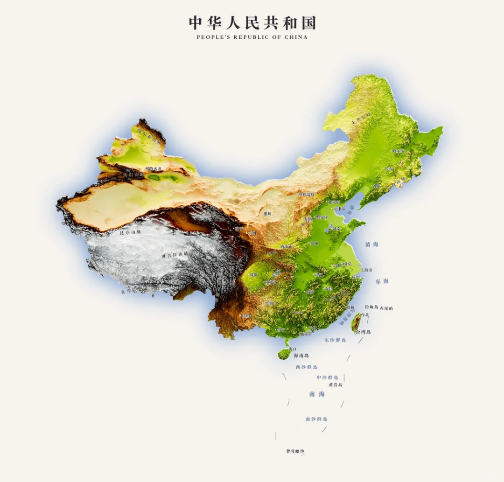
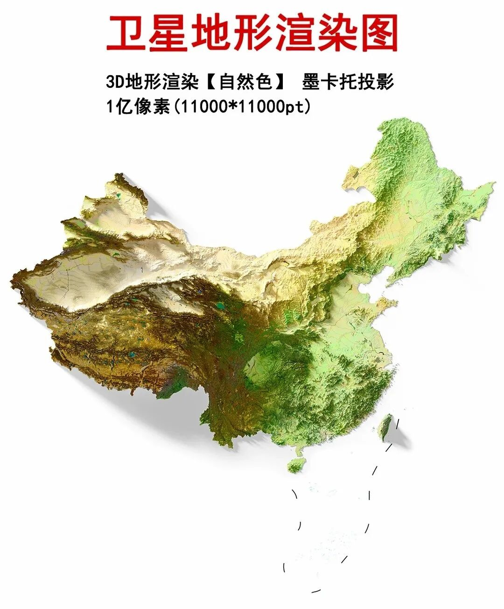

# 中国3D地形图完整版
> 💡 备注属性未写入，可能是备注属性名称或者类型被修改了，建议将字段类型设置为 rich_text，可以在小程序-操作-修改文章数据库页面进行调整
> 💡 原文链接:[https://mp.weixin.qq.com/s?__biz=MzA3Mjk5OTI5NA==&mid=2247509290&idx=1&sn=23b50e2a2d6d6638acd958506c3c6267&chksm=9e686ef28c53a2be92494587a830a7aca21ccf5cac7e289cf64acd5f59a0811e73e280297111#rd](https://mp.weixin.qq.com/s?__biz=MzA3Mjk5OTI5NA%3D%3D&mid=2247509290&idx=1&sn=23b50e2a2d6d6638acd958506c3c6267&chksm=9e686ef28c53a2be92494587a830a7aca21ccf5cac7e289cf64acd5f59a0811e73e280297111#rd)

文章最后**📚获取高清图❤️**
从世界屋脊青藏高原（灰白最高处）一路向东，经过高原、盆地，最终过渡到广阔的平原，并延伸进大海。**大自然的鬼斧神工在地图上展现得淋漓尽致。太美了！**

下面这张图是中国卫星地形图，通过高分辨率遥感影像与数字高程模型融合，同样生动呈现中国复杂多样的地貌特征：
自西向东呈三级阶梯状倾斜，涵盖33.3%的山地（如横断山脉）、26%的高原（青藏高原）、18.8%的盆地（塔里木盆地）及12%的平原（长江中下游平原）等地形单元。其高清影像可清晰展示辫状河流、彩色丹霞、水上雅丹等独特地质景观。

👇在公众号回复**【1222】**即可获取高清图。
