# 中国80后研究报告
> 💡 备注属性未写入，可能是备注属性名称或者类型被修改了，建议将字段类型设置为 rich_text，可以在小程序-操作-修改文章数据库页面进行调整
> 💡 原文链接:[https://mp.weixin.qq.com/s?__biz=MjM5OTc2NzA2MQ==&mid=2651336328&idx=1&sn=833f65048aae9a1aa271e5876f404467&chksm=bd0ebad63319902039f5b786005f741daa9edb2a261bea978c47642e9fce9f68e5515becc0b4#rd](https://mp.weixin.qq.com/s?__biz=MjM5OTc2NzA2MQ%3D%3D&mid=2651336328&idx=1&sn=833f65048aae9a1aa271e5876f404467&chksm=bd0ebad63319902039f5b786005f741daa9edb2a261bea978c47642e9fce9f68e5515becc0b4#rd)

**作者：青山投研中心**
**来源：青山资本（ID：cyanhillvc）**
80后，消失了。至少在今天的公共讨论和研究里，他们似乎消失了。
很少有人知道，在今天常见的“X后”代际命名体系中，“80后”是最早在中国舆论中大规模兴起、并形成广泛讨论的代际标签，也是后来“70后、90后、00后”等命名被系统化使用的重要起点。
中国最早被贴上代际标签的一群人，反而成了如今最不受关注的一群人。
打开一份消费报告，你很容易找到年轻人。90后在想什么，00后喜欢什么，Z世代又在为什么买单，从一杯奶茶到一场演唱会，年轻人的每一点变化都有人研究。把目光移到另一端，银发族同样炙手可热。伴随人口老龄化，养老、医疗、健康、旅游、陪伴，“银发经济”正在成为新的增长叙事。
夹在中间的80后，似乎没人关心了。甚至消费行业里一直流传着一句半开玩笑的话：“不要做中年人的生意“。理由听起来也很充分：他们上有老，下有小，还要自己还房贷。
正因为上有老、下有小，他们才同时连接着最多的消费场景。而拉长时间来看，这些抑制80后消费的因素都有非常明显的生命周期特征。子女大规模成年并逐渐走向经济独立，持续多年的房贷陆续进入尾声，与此同时，父母一代进入高龄，并最终伴随生命自然更替退出长期供养关系，家庭财富也会发生新一轮的代际转移。
一代人的财富、时间和注意力将在未来十年被重新分配。
当一代人的生命周期与一个国家的现代化进程高度重叠，那些宏大的社会变化，最终会如何落到一个普通人的工作、家庭和账单上?他们怎样成为了今天的自己?他们正在和即将把钱花向哪里?当AI时代和长寿社会同时到来，他们的人生下半场又会发生什么?
带着这些好奇和疑问，我们开始了对80后的研究。
**80后的时代底色**
要理解80后，或许要先回到“80后”这个词第一次出现的时候。
20世纪末到21世纪初，“80后”开始闯入中国社会的公共视野。最初，它并不是一个严格意义上的人口学概念，更多指向一批出生于20世纪80年代、活跃于文学创作和互联网讨论中的年轻作者。他们写青春、写成长，也写对成人世界规则的不满与反叛。韩寒、郭敬明等人的走红，让一批此前很少拥有公共表达空间的年轻人第一次以鲜明的群体形象出现在大众面前。
有意思的是，“80后”最初并不是一个多么友善的称呼。当时的主流社会面对这一代人没有经验、无法判断且多有诟病。独生子女、物质条件改善、市场经济、流行文化、互联网……他们成长的环境与父辈已经截然不同。围绕他们的讨论里，“自我”、“叛逆”、“娇气”、“不能吃苦”等评价一度十分常见。这样长大的一代人，以后会变成什么样?没有人知道答案。
在这种来自外部的审视与年轻人的自我表达之间，“80后”逐渐从一个文学标签扩展为一整代人的身份认同。此后，“70后”、“90后”、“00后”等以十年为单位划分代际的方式逐渐进入大众语言。某种意义上，80后不仅是被“××后”命名的一代，也是这种代际命名方式真正进入中国公共生活的重要起点。
这件事本身就很值得思考。为什么偏偏到了80后，中国人开始如此强烈地意识到“代际”?
一个重要原因是中国变化得太快了。1980年，中国人均GDP只有约195美元;2025年，接近14000美元。城镇化率从19%上升到67%，互联网用户从0到11亿，居民杠杆率从4.8%到60%，老龄化率从4.9%到22%。很多国家需要几代人完成的变化，中国80后只用一代人就经历了。
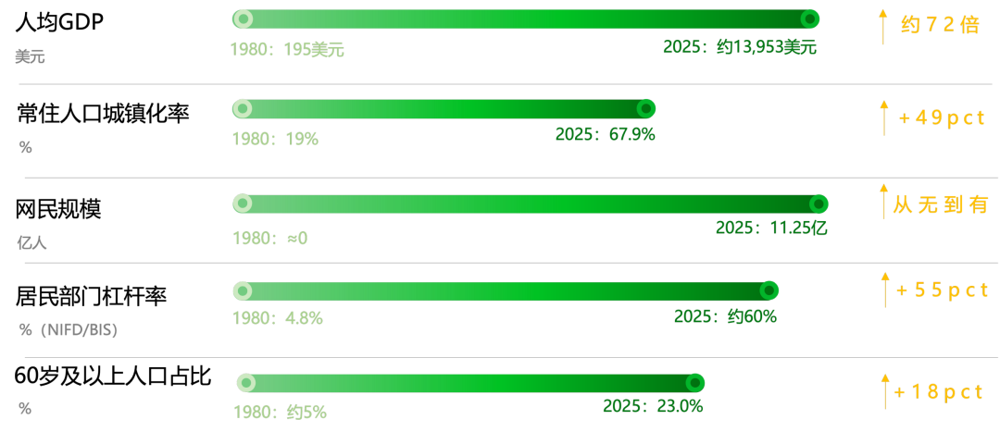
如果一个社会几十年变化不大，出生相差十岁的人未必会拥有截然不同的成长经验。但改革开放之后的中国不是这样。经济增长、城市化、教育扩张、住房市场化、独生子女政策、消费社会和互联网几乎在几十年间接连发生。十年时间，已经足以让两批人的童年、教育、工作和家庭生活变得完全不同，80后恰好站在这场巨变的中央，标志着新老一代的分野。
他们出生时，中国的改革开放刚刚开始;童年仍然保留着物质相对匮乏的记忆，成年时却已经进入商品极大丰富的消费社会;小时候很多家庭还生活在单位制和熟人社会的余温中，长大后面对的却是市场竞争、人口流动和现代职场;他们在没有互联网的世界里度过童年，又成为中国第一批大规模拥抱互联网的人;他们从父母那里继承了关于稳定、储蓄、房子和家庭责任的价值观，同时又在成长过程中第一次大规模接触个人选择、自我实现和消费主义。
时代变化的力量最终沉淀在个人身上，如果要从纷繁复杂的80后群体中寻找一些真正具有解释力的共同底色，我们看到的首先是两件事。
**在物质世界里，他们是重资产、高杠杆的一代。**房子以前所未有的程度进入普通家庭的资产负债表，并与婚姻、城市化、教育和财富积累紧密绑定。80后既赶上了房地产扩张带来的资产增长，也成为住房贷款最深度的参与者之一。
**在精神世界里，他们又是过渡与矛盾的一代。**传统与现代、家庭与个人、稳定与自由、节俭与消费，两套并不完全相同的价值体系同时存在于他们身上。很多看似矛盾的选择，其实不是摇摆，而是一个高速转型社会在个人身上留下的真实痕迹。
**重资产和高杠杆的一代**
80后首先是宏观意义上的“重资产一代”。这里的重资产不是指每个80后都拥有大量资产，而是指他们的成长，恰好与中国依靠固定资产投资、大规模基建拉动经济的阶段高度重合。而基建扩张带来的成本，很大程度通过住房体系转嫁到这一代人身上，造就了他们作为重资产一代的特质。
1988年，中国大陆第一条高速公路——沪嘉高速公路投入运营，那一年，最年长的80后只有8岁。此后的三十余年，中国经历了一轮世界范围内罕见的基础设施扩张。
中国城镇化率从1980年的19.39%，上升到2025年的67.89%，意味着数亿人口在几十年间完成了从乡村到城镇、从小城镇到大城市的空间迁移。80后的成长轨迹，恰好镶嵌在这场空间重构中。他们小时候可能经历过泥土路、露天厕所、蜂窝煤和公共电话，成年后却已经习惯地铁通勤、高铁出行、移动支付和即时配送;他们中的许多人从县城、乡镇和农村出发，通过教育和就业进入城市，又在城市中买房、结婚、生育，成为中国城镇化进程中最典型的人口迁移者。
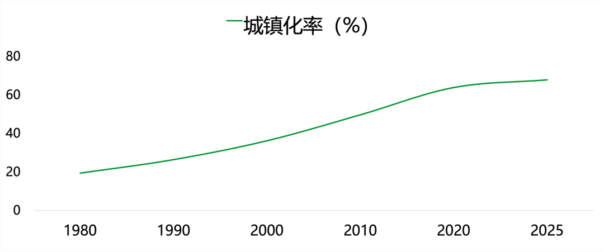
首先是人的流动半径被打开：2000年至2025年，全国公路总里程从167.98万公里增加至557.89万公里，扩大至原来的3.3倍。铁路里程从6.87万公里增加至16.5万公里。1980年，全国民用航空航线仅有181条，到2025年已增加至5488条，扩张到原来的30.3倍。
其次是信息和商品流通能力的跃升：全国光缆线路长度从2000年的121.2万公里增加至2025年的7499.3万公里，扩大至原来的61.9倍;邮政营业网点也从2000年的5.84万个增加至2024年的50.06万个。与此同时，大量看不见的城市管网也在地下铺开：2004年至2024年，全国供水管道长度扩大至原来的3.3倍，天然气管道扩大至14.5倍。**2000年至2024年，集中供热面积扩大至原来的10.9倍。城市用水普及率和燃气率在二十年间达到99.6%和98.6%。**
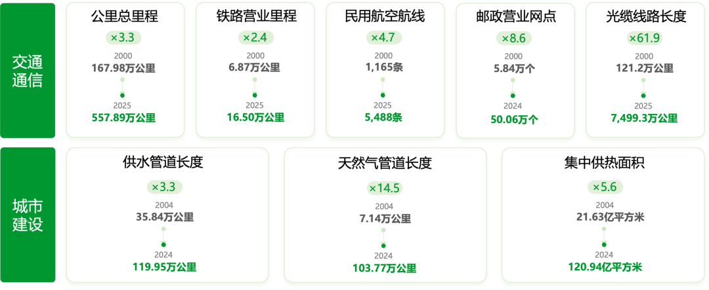
**备注：由于统计口径调整，仅取可比较区间的公开数据**
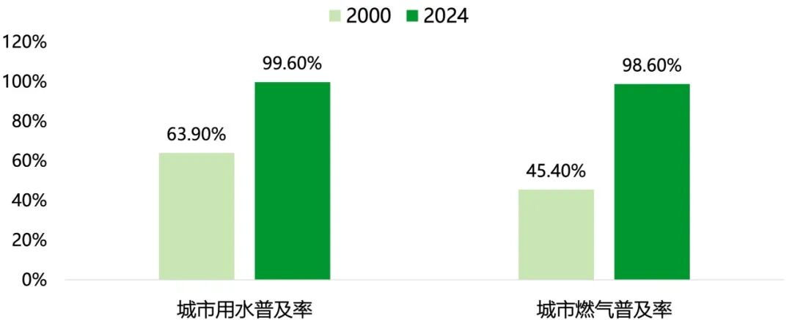
大规模城市建设背后是一场持续数十年的大规模资本投入。1980中国全社会固定资产投资总额仅为0.091万亿元，2000年这一数字已达到3.29万亿元，2025年则达到51.10万亿元。按名义金额计算，1980年至2024年，年度固定资产投资规模扩大至原来的560倍。
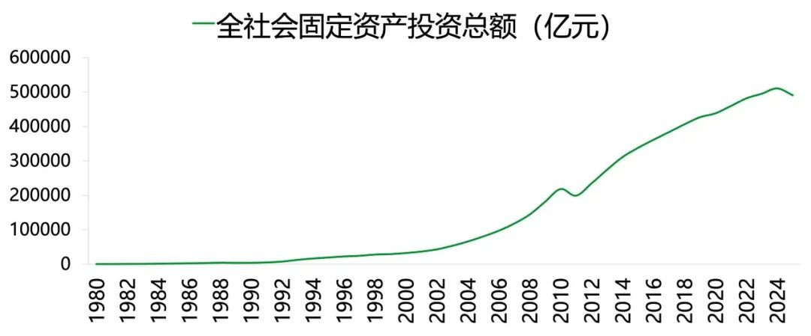
1990年代末以后，土地出让、房地产开发和基础设施投资逐渐形成相互强化的循环：地方政府通过土地出让和以地融资筹集资金，将其投入道路、轨道交通、市政设施和土地开发;基础设施改善又提升周边土地价值和住房价格，为下一轮城市扩张创造条件。
这套以大规模投资和土地开发为支撑的发展模式，为中国城市扩张提供了资金和空间条件，同时也改变了公共设施成本与收益的分配方式。基础设施虽然具有公共品属性，其成本却并非平均落到所有人身上，而是较多传导给城市扩张阶段进入住房市场的家庭。
简而言之，中国现代化发展的重资产模式，以高杠杆形式落到了80后一代身上。根据中国社科院测算，中国居民杠杆率从2000年的不到10%，快速上升到2021年的60.6%，在短短二十年间翻了六倍。研究表明住房贷款贡献当期居民债务增量三分之二以上，而 80 后正是这一轮按揭加杠杆的核心购房群体。
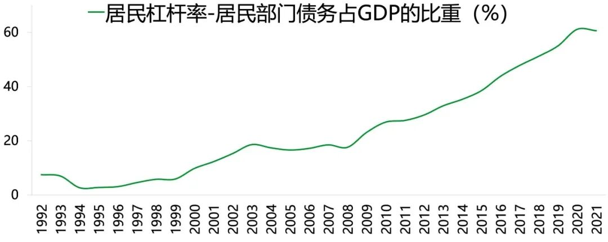
80后既是城市化基础设施红利的受益者，也是重要的成本承担者。1998年福利分房基本退出时，最年长的80后刚满18岁;2003年前后房地产市场进入快速发展阶段，第一批80后开始工作;2008年以后，80后大规模进入婚育和置业年龄;2015年以后，他们又同时成为首套住房和改善型住房的购买主力。
2003年，全国商品房销售面积约3.37亿平方米，销售额约7956亿元;到2021年，销售面积达到16.14亿平方米，扩大至原来的4.8倍，销售额则达到17.02万亿元，扩大至原来的21倍以上。销售金额远快于销售面积增长，意味着购房者承担的不只是更多住房，也包括显著上升的单位住房成本。
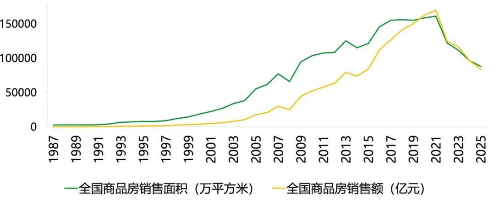
70后中有一部分人享受了福利分房或住房市场化早期的低价窗口;90后开始集中置业时，房地产市场已经进入高房价、高存量和增速放缓阶段;只有80后完整经历了从福利分房退出、商品房市场扩张、住房信贷普及到居民杠杆率见顶的全过程，并在其中完成了首次置业和部分改善置业。80 后是全民信贷买房浪潮中规模最大、被动承担住房债务的核心群体，因此定义为高杠杆一代。
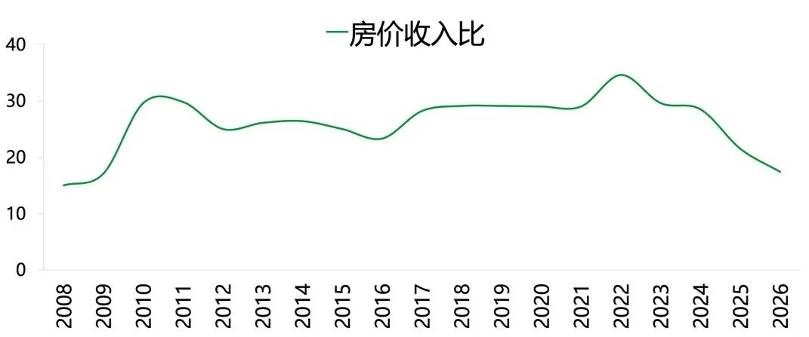
招商证券测算CFPS调研数据显示，**80后家庭平均房贷支出为10.73万元，分别是70后6.24万元的1.7倍和60后5万元的2.1倍;但三代家庭的平均存款规模相差不大。**80后房贷支出与存款之比达到106%，明显高于70后的59.9%和60后的54%;其储蓄率为56%，也分别比70后和60后低10个和31个百分点。
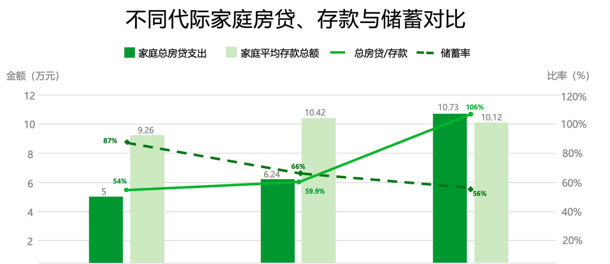
80后的“高杠杆”不只是房贷金额更高，更在于住房支出对家庭流动资金和新增储蓄形成了更强挤压，80后既通过购房积累了家庭资产，也因此承受着更长时间、更高强度的现金流约束。
简而言之，中国现代化发展的重资产模式，以高杠杆形式落到了80后一代身上。中国超大规模基建与城市化扩张，依托土地与住房市场实现成本的社会化转移。完整经历楼市黄金周期、集中完成婚育置业的80后，自然成为了负重承压、资产绑定和现金流强约束的一代人。
**过渡与矛盾的一代**
如果说重资产与高杠杆塑造了80后的物质处境，那么快速发生的社会转型，则塑造了他们的精神底色。
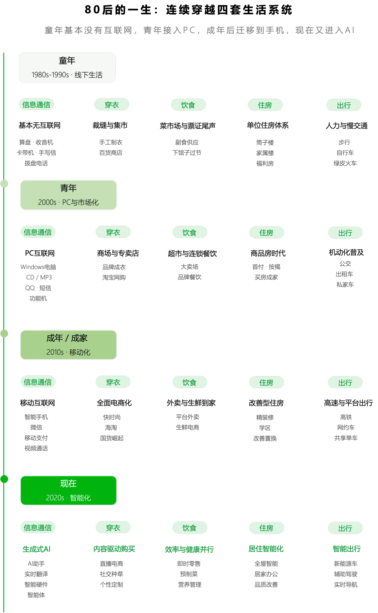
80后的特殊性不仅在于他们比其他世代经历了更多变化，更在于许多变化恰好发生在他们价值观尚未完全定型的时期。他们小时候接受的是一套关于稳定、服从、集体和延迟满足的教育，成年后进入的却是一个强调竞争、流动、效率和个体选择的社会。他们从父母那里继承了传统家庭的责任伦理，又从市场经济和互联网文化中获得了个体意识。他们既相信买房、结婚和养育子女是人生的必要路径，又开始追问婚姻是否幸福、工作是否值得、生活是否必须按照既定顺序完成。
**旧标准并未完全退出，新标准已经开始生效;旧责任仍然需要承担，新需求又不能被忽视。**两套规则叠加，构成了80后身上最鲜明的矛盾。
**职业：机会扩张与**
**竞争加剧同时发生**
**80后是中国高等教育大众化的第一批大规模受益者。**1999年6月，中央决定大幅扩大高校招生规模，当年普通高校招生人数同比增长47%，中国高等教育由精英化加速迈向大众化。此后，高等教育毛入学率持续上升，越来越多普通家庭的孩子得以通过大学进入城市、专业岗位和现代企业体系。
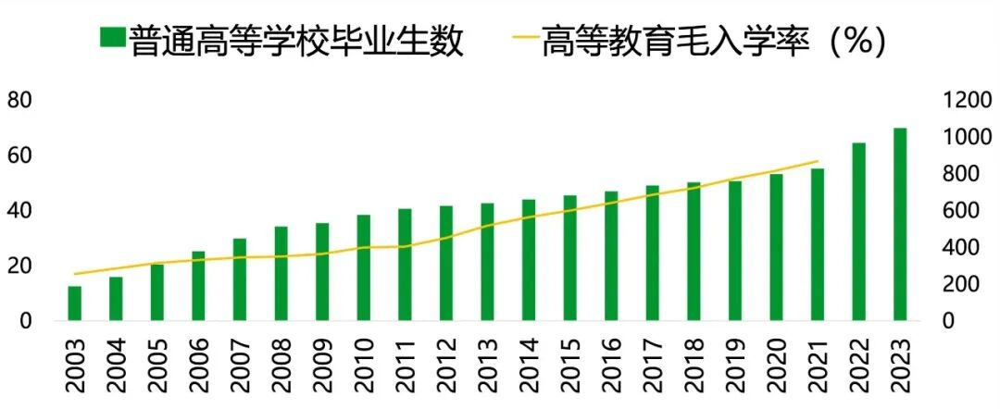
**备注：高等教育毛入学率指高等教育在学总规模占18-22岁学龄人口总数的比重，统计口径包含非适龄在读生。**
教育扩张为他们打开了职业上升的入口，却也悄然改变了竞争规则。当大学文凭从稀缺资格逐渐变为就业门槛，学历带来的优势开始递减，竞争则不断向更高学历、更强技能和更多工作经验延伸。80后既相信“知识改变命运”，也最早发现，仅有学历已经不足以兑换一份稳定、持续上升的职业回报。他们享受了教育普及带来的机会红利，也承担了学历普及后的竞争成本。
与此同时，他们职业生涯的前半程赶上了市场化、城镇化和互联网经济带来的岗位扩张，后半程却开始面对增长放缓、组织调整与用工逻辑变化。过去往往到四五十岁才集中显现的职业困境，被市场前置到35岁左右。年龄门槛、晋升瓶颈、裁员风险和再就业压力，使80后成为第一代大规模直面“中国式职场中年危机”的市场化就业群体。
技术革命进一步放大了这种矛盾。1997年，中国网民仅有62万人;到2025年，网民规模已达到11.25亿，生成式人工智能用户达到6.02亿。80后不是互联网原住民，却完整经历了无网、PC互联网、移动互联网和人工智能的连续换轨。他们依靠学习和适应进入了每一轮新经济，也不得不在每一次技术迭代中重新证明自己。这种“经验在增加、规则却持续变化”的处境，是80后区别于更早代际的重要时代底色。
**婚姻：传统婚姻期待与**
**个体意识觉醒同时发生**
80 后的婚姻呈现传统观念与个体自主意识相互拉扯的特征。作为独生子女一代，他们既受社会成家立业的传统期待约束，又更加看重婚姻内部的情感契合。
根据复旦大学长三角地区社会变迁调查(FYRST)调查，80后婚前同居等现代婚恋行为较为常见。80后受访者的婚前同居比例超过四成，但其中60%已经订婚，34.5%有明确结婚计划，既未订婚、也无结婚计划的只有5.5%。他们接受了更现代的亲密关系形式，最终目标却仍然大多是婚姻。
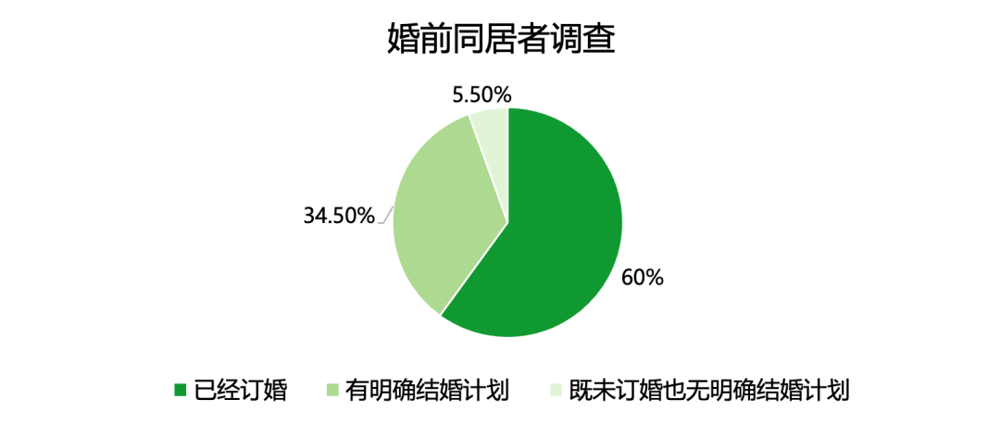
80后的择偶标准也呈现出相似特征。根据FYRST调查，门当户对的婚姻依然是主流，近一半“80后”的配偶是通过介绍认识的，且主要介绍人是长辈亲戚或父母。只有5%的人认为自己完全可能接受不买房、不买车、不办婚礼的“裸婚”。但在实际婚姻中，妻子受教育年限与丈夫相当或更高的比例已经达到83%。传统婚姻的外部框架仍然存在，婚姻内部的性别关系和平等标准却在改变。中国传统“梯度婚”(妻子学历低于丈夫)正在减少，而高学历“同质婚”(夫妻双方学历一致)和女性“向下婚”(丈夫学历低于妻子)增多。
80后是最早在传统婚姻制度内追求个体幸福的一代，他们不再轻易接受父母一代“婚姻就是搭伙过日子”的逻辑，却也很难像更年轻的世代一样彻底退出婚姻。个体意识已经觉醒，家庭责任并未消失，婚姻既是情感支持的来源，也可能是一种压力。
**生育：自己粗放长大，**
**却开始精细养娃**
许多80后的童年具有明显的粗放色彩。父母忙于工作，孩子在学校、院子和街道中自行组织生活;家庭更重视吃饱穿暖，很少系统讨论儿童心理、亲子沟通和兴趣培养。
但当80后自己成为父母，育儿标准发生了变化。他们开始关注营养、教育方法、情绪发展和亲子陪伴，希望避免重复自己童年中缺少理解和表达的部分。复旦调查显示，超过75%的80后父母仍然重视诚实、礼貌、孝顺和责任感等传统品质，但部分父母对服从、“必须做好学生”等的重视程度下降，更希望给予孩子宽松、自主的成长空间。
理念进步却没有降低现实压力，由于自身受益于教育突围的经历，让80后父母根深蒂固地认可教育的价值，对子女的教育抱有较高期待，普遍追求精细化、高质量教育，80后也成为社会“教育内卷”“鸡娃竞争”的核心参与群体。
这意味着，**80后的精细育儿既源于教育观念变化，也受到资源竞争推动。**他们希望孩子自由成长，又担心缺少投入会使孩子失去机会;希望减少孩子的压力，却不得不规划学校、课程和升学路径。“粗放长大、精细养娃”的背后，是父母角色从基本照料者升级为教育规划者、情绪支持者和资源组织者。
**养老：对上一代承担责任，**
**对下一代降低期待**
养老最能体现80后在传统责任与现代观念之间的单向承压。
80后是独生子女政策影响最集中的一代，尤其在城市地区，“四二一”家庭结构开始成为现实。与拥有多个兄弟姐妹的更早世代相比，他们的养老责任更难在家庭内部横向分摊;与更多推迟或放弃婚育的年轻世代相比，他们又已经普遍进入上有老、下有小的家庭结构。
复旦调查显示，近九成的上海“80后”认为自己作为子女应承担照料父母养老的责任，传统孝道并未在80后身上消失。同一调查中，只有约20%的受访者主观上希望与父母同住，现实中与父母同住的比例却接近三分之二。高昂的住房成本、育儿支持需求与老年照护压力，迫使他们在追求代际独立的同时，仍要维持紧密的家庭协作。
当思考自己的晚年时，80后的态度则更加独立。他们较少把多生孩子视为养老保障，也不愿将自己的晚年完全交给子女，而是开始接受储蓄、保险、社区服务和养老机构。对上一代，他们仍然遵循“子女有义务养老”;对下一代，他们却不愿继续强调“养儿防老”。
根据《2025 中国居民退休准备指数调研报告》，80后的退休指数为5.64，远高于其他世代。
(退休准备指数通过对退休责任意识、财务规划认知水平、财务问题理解能力、退休计划完善度、退休储蓄充分度以及取得期望收入的信心进行加权计算得出，直观地反映了居民在退休准备方面的综合水平。)
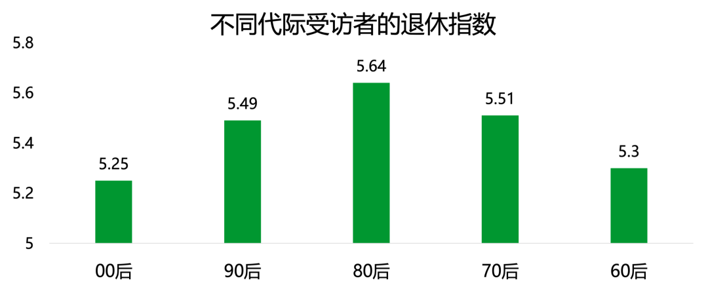
80后并没有直接终结家庭养老，而是自己承担了养老模式转换的成本。他们既要照顾父母，又要尽量不给子女增加同样的负担，还要提前为自己的晚年做准备。负责上一代、呵护下一代，最后还要安排好自己，构成了这代人最典型的责任结构。
80后是中国社会转型中"新旧规则叠加"的一代：他们在价值观尚未定型时同时接受了两套相互拉扯的逻辑。这一矛盾贯穿了他们人生的四个维度：职业上，他们是高校扩招和互联网红利的受益者，却也最早遭遇学历贬值、35岁职场瓶颈与技术换轨的反复自证;婚姻中，他们保留着门当户对、以婚姻为归宿的传统框架，却已开始追问情感契合与性别平等;育儿上，自己粗放长大，却因亲历教育突围而成为"精细养娃""鸡娃内卷"的主力，在渴望孩子自由与担心错失机会之间反复拉扯;养老上，作为独生子女一代，他们在"四二一"结构中独自承上启下——对上恪守孝道、紧密协作，对下放弃"养儿防老"、转而依赖储蓄与社会化养老。旧责任未卸、新需求已至，80后正是在这种双向承压中，承担了中国家庭与社会模式转换的过渡成本。
**重资产与高杠杆，是80后的物质底盘;过渡与矛盾，则是这套物质底盘之上的精神结构。**前者决定了他们有多少钱可以支配，后者影响了这些钱将按照怎样的顺序被花出去。二者共同构成80后的时代底色，也为理解他们今天的消费选择和未来的账单迁移提供了起点。
**80后的消费变迁**
根据《中国人口普查年鉴 2020》分年龄常住人口汇总测算，2020年普查时点70后现存常住人口规模略高于80后。但人口生命周期存在持续自然衰减，70后群体年龄更高，未来十年死亡规模将持续上升，80后当前处于青壮年区间，死亡率维持低位。人口模型推演显示，预计2030年前后，80后现存人口总量将反超70后，成为国内存量规模最大的世代。
基于CFPS数据的学术研究发现，中国居民家庭消费在30—34岁和45—49岁附近出现两个生命周期高点，家庭消费确实会随着家庭形成和中年责任变化发生结构性迁移。80后虽然受到房贷、育儿和赡养支出的约束，消费自由度不高，但其家庭支出总量和跨品类带动能力依然突出。**更重要的是，80后正处于消费结构的转折点：**过去二十年，他们的资金主要流向住房和家庭建设;当前则集中用于维持家庭运转;未来十年，随着部分房贷进入尾段、子女逐步成年，他们的预算将更多转向自身健康、养老储备、品质服务、文化旅行和兴趣消费。
80后消费变迁的核心，是家庭现金流的分配权先由个人让渡给资产、再让渡给家庭，最后才逐步回归到自己。80后既是上一轮消费扩张的核心承担者，也是下一轮消费重配的关键变量;理解80后的家庭账本，实际上就是理解未来十年中国消费结构变化的中轴。
按照80后的生命周期消费变化，我们将其大体分为三个阶段，资产建构阶段、家庭运营阶段、未来重配阶段。
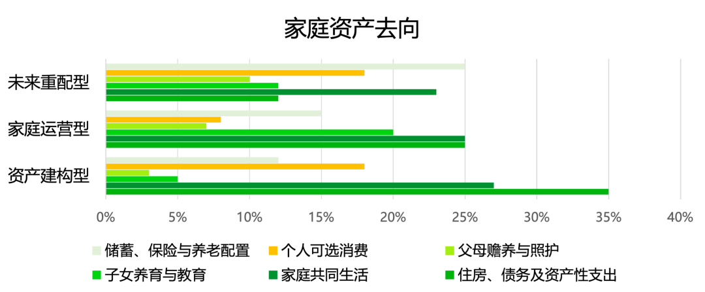
**备注：参考公开统计和调研数据推算得出**
**第一阶段：资产建构型消费**
80后的第一个消费阶段，大致从进入职场延续到结婚、置业、购车和完成基本家庭配置。对较早出生的80后，这一阶段主要集中在2005—2015年;对较晚出生的80后，则可能延续到2015—2021年前后。它不是通常意义上的消费，而是一个家庭从无到有的集中建设：**房子是核心资产，装修、家具、家电和汽车围绕住房依次展开。**
80后集中进入职场、结婚和购房的时期，恰好对应商品房市场、汽车消费和城市耐用品快速扩张阶段。七普资料显示，全国平均初婚年龄由2010年的24.89岁升至2020年的28.67岁。中国人民大学人口与发展研究中心于 2023 年 7-9 月开展的一项专项调查显示，结婚花费的平均值高达 33.04 万元，是 2023 年全国居民人均可支配收入的8倍多。
根据贝壳研究院发布的报告，我国新房和二手房购房者平均年龄在 33.3 岁左右， 而购房会带来装修、家电、家具等一系列大宗支出。B 站联合央视市场研究发布《2025 年哔哩哔哩汽车行业白皮书》显示，中国购车群体不断年轻化，实际拥有首台车的平均年龄已下探至 30.5 岁。结婚、购房和购车都集中在30岁上下，家庭会在收入和积蓄尚未充分成熟时，同时面对多项大额支出。

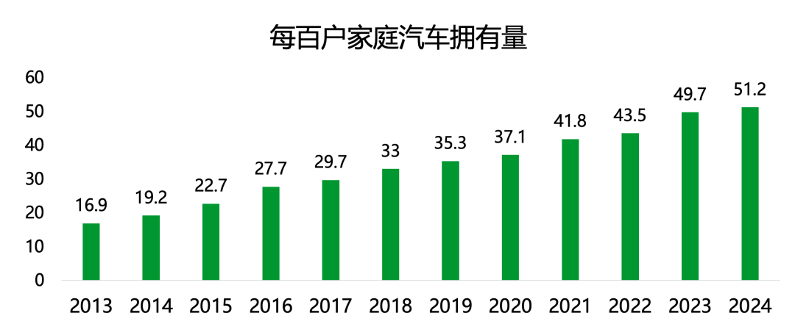
这一阶段的80后消费主要是两大特征。第一是大宗化，80后购买的不是一个孤立商品，而是一套包含住房和汽车等在内的现代家庭生活方式;第二是身份与功能并重，80后成长于改革开放初期，外资品牌大量进入中国、耐用品快速普及的年代，消费选择多，更看重品牌所代表的品质和身份。
这一阶段对未来消费产生了两个长期影响：一方面，80后积累了住房、汽车和家庭耐用品，成为存量资产规模较大的群体;另一方面，购买这些资产所形成的按揭、维护和置换成本，也锁定了此后的家庭现金流。因此，**未来与住房和汽车有关的消费不会消失，但会从首次购买转向改善装修、汽车换购、智能家居和维修保养等。**
**第二阶段：家庭运营型消费**
完成住房、汽车、家电和婚育用品的集中购置后，80后并没有像想象中那样进入轻装生活。相反，他们从家庭资产的建设者变成了家庭系统的运营者。房子买下之后还要偿还贷款、装修维护，孩子出生之后要持续投入教育和生活费用，父母年龄增长又带来医疗、照护与陪伴需求。
中国人民银行2019年对全国30个省份3万余户城镇家庭的调查显示，80后是加杠杆主力，在有负债的家庭中，住房贷款占家庭总负债的75.9%。有房贷家庭的月偿债收入比的平均值为29%，刚需型房贷家庭则达到33%。这意味着对于一个典型房贷家庭而言，每月收入中接近三分之一可能在消费发生之前就已经被偿债责任锁定。房贷之外，80后还需要同时承担子女教育、父母照护、日常生活和自身健康支出。

**数据来源：2019年中国城镇居民家庭资产负债情况调查**
根据《中国生育成本报告》，抚养孩子18岁前每孩月均成本在1500-2500元之间。北京大学中国教育财政科学研究所覆盖29个省、26804户家庭的调查显示，2022—2023学年，有全日制在校生的家庭平均教育支出为15828元，占家庭总消费支出的17.2%;高等教育阶段家庭平均支出达到29135元。教育投入还具有显著的累积性：**从学前三年到本科毕业，一个孩子的家庭教育支出平均约为28.7万元，高支出组家庭则达到约58万元。**
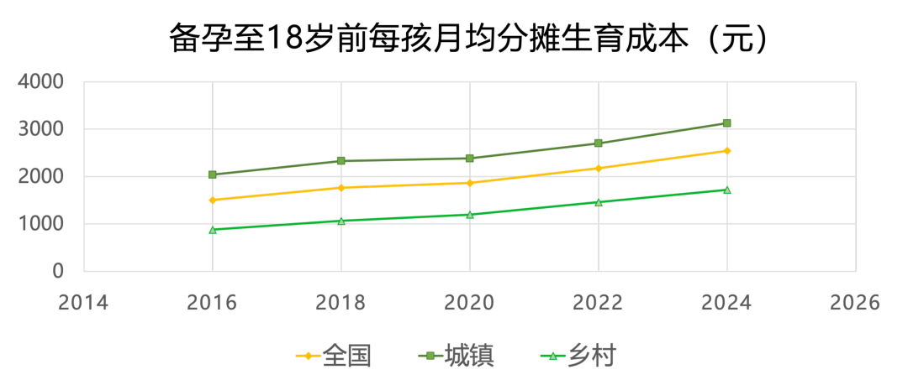
**这一阶段的80后正处于"上有老、下有小"的三明治人生阶段，其消费呈现鲜明的"以家庭中心+理性升级"双重特征**——消费支出受房贷、育儿、养老三大刚性项目挤压，但在健康、保险、教育、品质化升级等领域的支出意愿和强度均显著高于其他代际。
**为家庭舍得花，为自己省着花**
京东消费及产业发展研究院的数据显示，80后购物用户数占比TOP5的品类分别是图书、玩具乐器、健康服务、汽车用品和家装建材。在图书消费中，他们既购买儿童教辅和科普读物，也购买外语学习、职业考试和行业知识类书籍。这种“代际代理消费”在父母端表现得更加明显，京东消费关于银发族的报告显示，80后和90后购买了超过七成的老年适用品。

80后可能不是某些儿童或适老产品的最终用户，却是需求的发现者、信息的筛选者、价格的比较者和风险的承担者。很多看似属于“一老一小”的市场，背后真正需要说服的消费者其实是中间的80后。
**家庭运营期不能简单概括为“消费降级”。更准确的判断是预算约束下的分层升级：**日用品和标准化商品追求性价比，手机、家电等可选耐用品延长更换周期;但对子女教育、全家健康、时间效率和可靠服务仍愿意支付溢价。80后不是全面减少消费，而是在家庭内部重新排序——对自己可以省，对家庭风险不能省;展示性消费下降，功能性和保障性消费上升;购买商品的标准，也更多转向“是否耐用、是否省时间、是否降低未来风险”。

清华大学五道口金融学院与元保2022年发布的互联网保险消费者报告显示，以80后为主的31—40岁消费者中，75%的家庭年度保险支出超过5000元;与90后更关注服务态度相比，80后更在意理赔速度和理赔便利性。
**个人消费并没有消失，**
**而是被包装进入了家庭决策**
家庭消费优先很容易被写成一种中年牺牲叙事，但更准确的理解可能是，80后的个人消费设置了更高的合理性门槛。在家庭责任密集的阶段，一笔只服务于即时欲望的支出更容易被推迟;一笔同时具有健康、学习、陪伴或长期价值的支出，则更容易获得预算。
80后的个人消费经常需要找到一个可以向家庭、也向自己解释的理由。购买运动装备可以解释为健康管理，旅行可以同时承担亲子陪伴和个人休息，学习课程既是兴趣也是职业投资，改善装修不仅提高自己的舒适度，也有利于孩子学习和父母居住。**个人需求没有真正消失，而是被包装进家庭价值、长期价值和风险管理之中。**
这也意味着，80后的“悦己消费”不会简单复制年轻人的悦己逻辑。年轻消费可以强调“我喜欢，所以值得”，中年消费往往还需要回答“它是否真的改善了我的生活”。能够进入80后家庭预算的产品，需要同时通过价格、功能、时间和风险四道审核。一旦通过，它所获得的也不只是一次冲动购买，而可能是更加稳定的复购和更长的用户生命周期。
**夺回时间的控制权**
如果说房贷、教育和照护共同挤压的是80后的金钱，那么工作、家务和家庭协调共同挤压的则是他们的时间。国家统计局第三次全国时间利用调查显示，在18—59岁居民中，有酬劳动参与者日均投入6小时32分钟，无酬劳动参与者日均投入2小时42分钟，而个人自由支配活动参与者日均只有3小时8分钟，在有酬劳动之外，“上有老下有小”的80后还要投入大量时间进行家务劳动和家庭照料，其个人自由支配时间只会更少。对80后而言，最稀缺的消费是一个不被打扰的完整下午。

**因此，80后同时存在两类看似相反的消费，一类帮助他们节省时间，另一类故意让他们消耗时间。**前者包括家政、即时零售、智能家电等，本质上是在购买效率;后者包括钓鱼、骑行、游戏、徒步、露营、演唱会和长途旅行，本质上是在购买沉浸。这两种消费的共同目标，都是从工作和家庭责任中重新夺回对时间的控制权。
在功能性消费上，80后以追求效率和节省时间为目标。商务部研究院相关报告引用的第三方调研显示，2024年31—45岁人群占即时零售消费者的55%。这一年龄段与当时35—44岁的80后高度重合，说明即时配送并非只服务于年轻人的冲动消费，其核心用户中包含大量家庭运营期消费者，希望“少操一次心”、“少跑一趟”和“今晚能早点结束”。
在娱乐消费上，80后则会主动延长时间，希望在繁忙的生活中获得喘息。年轻人的娱乐追求即时刺激，中年人的娱乐追求时间结界。一个产品的价值，在于它是否值得一个成年人心甘情愿地交出整个下午。
“一个币一下午”是许多80后的共同记忆：一枚游戏币、一盘反复通关的游戏、一套租来的漫画或者一张循环播放的光盘，可以承载一个很长的下午。这一代人的娱乐启蒙发生在内容和零花钱都相对有限的年代，因此他们较早形成了一种特殊的价值尺度——一个产品是否值得，不只取决于它带来多强的瞬间刺激，还取决于它能否提供足够长、足够完整的沉浸体验。
中国演出行业协会与灯塔专业版数据显示，2024 年大型演唱会购票观众中 35 岁及以上人群占比达 21.6%，同比增长 2 个百分点;在刀郎等 "国民歌手" 的巡演中，80 后、90 后观众占比超过 30%。对 80 后而言，一场演唱会不只是两个小时的听觉消费，而是一次需要提前规划、专程前往、全程投入的 "时间朝圣"—— 它的价值在于从日常责任中完整地抽离几个小时，与自己的青春记忆独处。
2023 年户外运动参与者中，80 后占比 37.13%，在所有代际里面最高。户外爱好者在单个项目上的年均消费约为2000—5000元，其中滑雪、骑行、露营和徒步分别约为4910元、4033元、3323元和2110元。

**综上，这一阶段更容易获得80后认可的产品和服务，大致具有三类共同特征：**第一，减少时间成本，例如智能家居、即时服务、家庭维修和AI家庭助手;第二，降低风险成本，例如健康筛查、保险、适老改造和可靠的教育服务;第三，提供高密度的自主时间，例如户外运动、深度旅行、文化演出和长期兴趣社群。
年轻消费者愿意为可能性付费，而中年消费者愿意为确定性付费，让复杂的家庭少出一点错其实是更为复杂的消费命题。
**第三阶段：未来重配型消费**
这一阶段不能简单等同于老年消费，更准确地说，它是80后家庭现金流从高度刚性的责任支出，逐步转向可以主动安排的健康、养老、兴趣和体验支出的过程。它可能从45岁以后逐步出现，并在退休前后变得更加明显。
**房贷尾声**
2023年存量首套房贷利率调整涉及超过22万亿元贷款和5000多万户家庭，户均每年减少利息约3200元。据此反推，相关家庭户均贷款余额大致在44万元左右。标普信评对RMBS资产池的研究显示，2021年相关入池住房贷款的加权平均剩余期限约为12.36年。这意味着一部分贷款将在2033—2034年前后进入尾段。
未来10年，80后的房贷会逐渐进入尾声。长期按揭实际上是对未来收入的持续预占，它使家庭在面对换工作、休息、创业和兴趣消费时更加谨慎。当月供退出后，80后获得的是一种新的选择能力：**可以降低工作强度，可以为退休多储备一些，也可以把部分收入重新用于自己。**
**子女成年**
80后女性平均初育年龄大致处于25—28岁。由此推算，多数80后的第一名子女出生于2005—2017年前后，到2035年大致处于18—30岁，其中相当一部分将完成高等教育陆续进入就业阶段。
但“大学毕业”并不等于“家庭支出归零”。子女独立至少包含三个阶段，教育独立(不再承担学费和固定培训费用);生活独立(子女能够覆盖自己的日常生活);风险独立(失业、疾病、婚育等事件不再主要由父母兜底)。到2035年，许多80后家庭能够跨过第一阶段，但未必能够同步跨过后面两个阶段。因此，过去连续、稳定的教育支出，可能转化为频率较低但金额更大的“启动资本”，例如租房押金、求职过渡、买车、婚礼和住房首付。
**这意味着子女账单不是简单消失，而是从年度运营费转变为关键节点支持。**它对消费市场的影响也会发生变化，标准化教育支出下降，但职业教育、青年住房、婚庆、代际旅行和家庭资产规划等需求仍会存在。
**父母照护退出**
第五次中国城乡老年人生活状况抽样调查显示，2021年仍有21.8%的老年人向子女提供经济支持，35.7%的老年人帮助照料孙辈。父母衰老首先意味着这些支持逐步退出，相当于家庭失去了一部分没有被计价的劳动力和安全垫，家庭内部的隐性成本将显性化，照护、医疗等支出会经历一个先增长到逐步消失的阶段。
综合考虑这些因素，根据现有公开数据和生命周期假设，我们可以对**2035年前后80后家庭义务性支出的变化进行情景测算。**基准情景下，到2035年，住房和子女支出可能释放约1.31万亿元年度现金流;扣除父母端新增负担后，净释放约1.21万亿元。假设其中约30%转化为自身消费，对应约3640亿元的年度增量。

测算大致方法：
1、住房端以5000万存量按揭家庭为测算基础，分别假设40%、55%和65%属于80后核心家庭，户均年还款4万—5万元，到2035年退出主要月供的比例为45%—60%;(2023年存量首套房贷利率调整涉及超过22万亿元贷款和5000多万户家庭，户均每年减少利息约3200元。据此反推，相关家庭户均贷款余额大致在44万元左右)
2、子女端分别假设6000万—8000万户80后家庭仍承担主要养育责任，到2035年有45%—65%跨过全日制教育阶段，户均年度净支出下降1.2万—2.4万元;
3、父母端考虑医疗、护理及家庭支持退出，设置0—2500亿元的新增年度负担;
4、个人消费转化率20%—35%属于行为假设，其余资金预计进入养老储备、保险、储蓄、住房改善以及对子女和父母的继续支持。
(备注：测算过程略长，这里仅列举大致测算方法)
**初学者经济**
进入重配阶段后，80后可能在很多领域重新成为“初学者”。他们年轻时可能没有时间学习滑雪、潜水、乐器、摄影、舞蹈和绘画，也可能从未认真进行力量训练、长途徒步或深度旅行。未来，当子女逐步独立、家庭时间稍有松动，这些过去被推迟的愿望会重新出现。
中年兴趣消费不能简单理解为“青春补票”。更准确地说，它是在长期承担家庭角色后，重新建立一个不依附于职业、婚姻和父母身份的自我。
“中年新手”需要的产品与年轻发烧友不同。他们更需要容易入门、降低受伤风险、兼顾家庭时间、具有清晰进阶路径的产品和服务。因此，“初学者经济”不只是出售装备，而是出售开始的信心、持续的路径和不被嘲笑的环境。
**怀旧消费**
80后是中国较早在电视、流行音乐、电子游戏、动漫、网络文学和互联网社区中共同成长起来的大规模人群，也是算法分发全面打散大众注意力之前，仍然拥有较强共同文化记忆的代际之一。
当这些文化符号重新商业化时，80后已经从缺少购买力的少年，进入具备一定支付能力的中年。经典歌手演唱会、老游戏重制、影视IP续作、复古数码产品、收藏玩具和经典品牌复刻等，可以同时满足记忆、社交和身份确认的需求。
怀旧消费不是把旧产品重新卖一遍，也不只是收取“记忆税”。真正有效的产品公式是：旧的记忆 × 新的品质 × 当下的服务。游戏画面可以重制，演唱会服务可以升级，经典品牌可以改善材料和设计，老IP也可以通过展览、旅游、社群和亲子体验重新进入当代生活。记忆和经验是旧的，但交付必须是新的。
80后购买怀旧产品，表面上是在回到过去，实质上是在快速变化的时代里维持自我的连续性。他们想确认，那个听磁带、投游戏币、追连载小说的人，并没有被生活完全压垮。
梳理了三阶段后，我们会发现80后的消费变化形成了一条清晰的主线。青年时期，强调“先拥有”，通过住房、汽车等耐用品建立生活;中年时期，需要“排优先级”，教育和家庭放在前面，消费明显分层;未来进入初老和老年时期，将通过健康管理、体验消费和养老配置重新安排时间和资金。
**80后的未来**
如果说过去二十年，80后面对的主要问题是如何在住房、婚育和家庭责任中分配有限的收入，那么未来二十年，他们需要同时应对两个速度完全不同、却彼此叠加的时钟：一个是不断加速的技术时钟，知识、技能和岗位价值的折旧周期越来越短;另一个是被医疗进步逐渐拉长的生命时钟，工作期、退休期以及需要健康和财务支持的时间都在延长。
80后的真正挑战，是在技术折旧加快的同时延长自身能力的有效期，在寿命延长的同时缩短疾病和失能的阶段，并在家庭责任最重的时期完成养老资产的积累。
**AI时代**
80后不是互联网原住民，却是数字技术连续换轨的完整亲历者：童年基本没有互联网，青年时期进入PC互联网，成年后适应移动互联网，到中年又迎来生成式人工智能。到2025年末，中国网民规模已达11.25亿，生成式人工智能用户达到6.02亿，较2024年末增长141.7%，普及率升至42.8%。**这意味着AI已经越过少数技术爱好者阶段，开始进入普通人的办公、教育、医疗和家庭生活。**

**经验不再自动升值，能力将面临重组**
国际劳工组织2025年的研究显示，全球约四分之一的就业处于某种程度的生成式AI暴露之下，但处在最高暴露等级的就业只占3.3%。由于大多数职业仍包含必须由人完成的任务，研究认为更可能发生的是工作内容重组，而不是岗位整体消失。世界经济论坛对1000多家企业的调查进一步预计，到2030年，经济、技术和人口等结构性变化将使相当于现有就业22%的岗位被创造或替换，39%的现有核心技能可能发生变化。**如果把全球劳动力简化为100个人，其中59人需要接受再培训，但有11人可能得不到必要的培训机会。**
中国招聘市场已经出现这种重组的早期迹象。北京大学国家发展研究院与智联招聘基于2021年1月至2025年7月超过162万条“岗位—求职者”匹配数据发现，劳动力市场错配仍在持续，其本质是技术变化速度快于人力资本调整速度;在部分AI高暴露职业中，企业的岗位划分和人才筛选正在变得更加精细。AI不仅可能减少部分基础任务，也在让剩余岗位更加专业、竞争更加集中。
这对80后意味着，工作年限本身将不再自动构成护城河。资料整理、标准化分析、基础文案、流程跟踪和常规沟通，过去可能被视为“经验丰富”的一部分，未来却可能成为AI最先压缩的任务。如果一名员工所谓的十年经验，只是把同一套流程重复了十年，那么这种经验会随着自动化迅速贬值;但如果经验包含对异常情况的识别、对客户信任的把握、对组织利益的协调、对行业边界的理解以及对最终结果负责的能力，它反而可能被AI放大。
**从个人工具到生活基础设施**
AI对80后的影响并不止于工作。儿童是否使用AI学习工具、父母是否接受远程问诊和智能监测、家庭是否更换智能汽车、家电与可穿戴设备，往往需要由这一代人评估价格、效果和风险，并最终付款和承担责任。
到2025年末，中国在线教育用户为3.27亿，互联网医疗用户为4.11亿;“人工智能+”行动又把智能学伴、居民健康助手、智能家居、智能穿戴、养老托育和陪伴型应用列为重点场景。80后未来的AI消费可能经历三步变化：先购买带有AI功能的手机、汽车、家电和穿戴设备，再为教育、办公、健康管理等软件服务持续付费，最后为能够代办复杂任务的专业智能体付费。消费重心将从一次性硬件购买，逐步转向订阅、服务和结果交付。
不过，80后的支付逻辑大概率不会是单纯追逐新奇。他们同时要对孩子、老人和家庭资产负责，更重视准确性、隐私、安全和售后。对这一群体而言，**真正有吸引力的不是“AI”的标签，而是能否明确节省时间、降低照护成本、改善学习效果或提高收入。**80后因此未必是最激进的AI尝鲜者，却可能是决定AI能否从个人尝鲜走向家庭基础设施的关键一代。
**AI边界的制定者**
80后未必是最懂AI的一代，却可能是最有条件制衡AI的一代。这里的“制衡”并不是拒绝技术或者拖慢创新，而是要求技术进入现实生活以后，必须慎重面对责任、隐私和人的选择权。
80后经历过互联网早期的黄金叙事。那时人们相信信息会变得更加平等，连接会让人与人更加接近，平台会打破传统壁垒。互联网确实创造了巨大价值，但这代人随后也亲历了算法推荐、注意力争夺、信息茧房、隐私泄露、网络暴力和平台垄断。从技术乐观主义走向技术现实主义的完整过程，使他们既不会因为恐惧而彻底排斥AI，也更难再无条件相信“技术进步自然等于社会进步”。
更重要的是，**80后目前已经进入家庭、企业和公共机构的决策层。**他们不一定掌握最前沿的模型，却掌握大量技术落地的接口：企业哪些任务可以自动化，孩子在什么年龄使用AI，医疗建议是否必须由医生确认，家庭数据可以被收集到什么程度，关键决策是否保留人工复核，出现错误以后由谁负责。因而，这代人的作用可能既不是踩下最重的油门，也不是简单拉起手刹，而是为AI安装方向盘和制动系统。
**长寿时代**
以2025年79.25岁的预期寿命为基准，年均增长0.26岁线性外推，80后活到100岁仍属"小概率事件"。但需要关注的是，生命科技可能突破线性外推——当抗衰老药物批量化后，预期寿命增长曲线可能从"线性"变为"指数"。
“长寿逃逸速度”假设每一轮技术增加的寿命超过技术研发所消耗的时间，就可以不断延长生命。80后是否可能进入这一状态，目前没有科学证据;但更温和的桥接效应已经具有现实可能性。四十多岁时通过代谢管理减少心血管风险，使人有机会等到更成熟的癌症和神经疾病治疗;六七十岁时通过精准医疗推迟重大疾病和失能，又使人有机会等到细胞修复或器官替代技术成熟。每一项技术单独增加的健康时间可能有限，但它们可以把一个人送到下一轮技术到来之前。所谓“长寿逃逸速度”的温和现实版本，不是永生，而是不断用已经被验证的有限进步，为下一次进步争取时间。

从2025年开始，中国用15年时间渐进延迟法定退休年龄，男职工法定退休年龄将从60岁逐步延迟至63岁，女职工则分别从50岁、55岁逐步延迟至55岁、58岁;政策同时允许在一定条件下弹性提前或延迟退休。对80后而言，退休已经不再是一个遥远而固定的日期，而开始变成一段需要提前设计的职业斜坡。

如果80后的平均寿命进入85—90岁区间，那么从传统退休年龄到生命终点之间可能仍有二十多年。仅靠在职业高峰期积累一笔资金，完全停止工作，风险会越来越高。更现实的路径可能是，在四五十岁完成第二次技能形成，在五六十岁把高强度全职工作逐渐转为咨询、培训、项目制工作、小型经营或专业服务，在身体和认知条件允许时保持较低强度但更长期的经济参与。
AI与长寿在这里形成了一个重要交叉：生命科技延长身体功能期，AI则可能降低继续工作的体力和信息处理门槛。一个经验丰富但精力下降的人，可以借助AI完成资料处理、客户维护和知识输出;一个退出全职岗位的人，也可能依靠数字工具把经验转化为小规模服务。因此AI不仅可能淘汰一部分中年任务，也可能成为延长职业寿命的辅助技术。
**尾声**
舆论对80后的描摹，似乎总在两套简化叙事之间摇摆。一种反复诉说他们经历的磨难：童年赶上教育竞争，青年撞上房价上涨，中年又被职业危机、育儿与养老层层包围，于是他们被定义为“很苦的一代”;另一种则将他们称作“中流砥柱”，仿佛只要足够成熟、坚韧，便理应接住所有下坠的重量。
而今天，当最年轻的80后也逐渐走近四十岁，他们又有了一个略带调侃的称呼——“中登”。从“中年”到“中登”，从“很苦的一代”到“中流砥柱”，这些标签看似截然不同，其实都省略了真实生活中最复杂的部分：一个人如何在时代的推搡中长大，又如何在重重责任之下，努力保留自己。
80后既不是集体悲情的受难者，也不是自带光环的时代英雄。他们成长于中国社会急速转型的交界处，没有现成的人生范本可以照抄。他们有过不被理解的少年叛逆，也练就了背负责任的沉默与隐忍;他们见过理想，也学会接纳现实。
在房贷、育儿、赡养、健康与职业瓶颈交织的生活里，他们不断计算、取舍、推迟，把“我想要什么”藏在“家里需要什么”。但也正是在中年的一地琐碎中，他们开始重新看见自己，寻找人生中场的新答案。
80后身上的撕裂、挣扎与和解，并不只属于这一代人。他们的财富困境、职场焦虑、家庭负重与精神求索，是过去数十年社会变迁落在普通人身上的印记。读懂80后，不是为了给他们贴上一个更准确的标签，而是为了看见宏大叙事背后，那些具体而沉默的人，如何承接时代，又在缝隙里重新长出自己的人生。
**理解80后，是理解一代人的得失，也是观察中国社会变迁的最好样本。**
**版权声明：部分文章推送时未能与原作者取得联系。若涉及版权问题，敬请原作者联系我们。**

## 摘要

（待补充）

## 我的笔记

（待补充）
