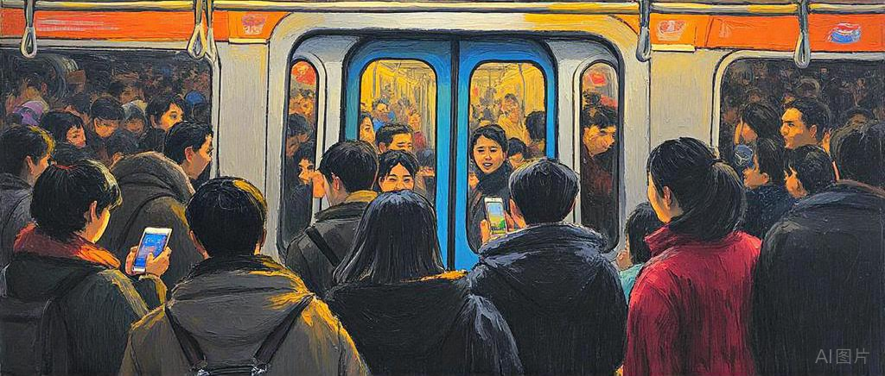
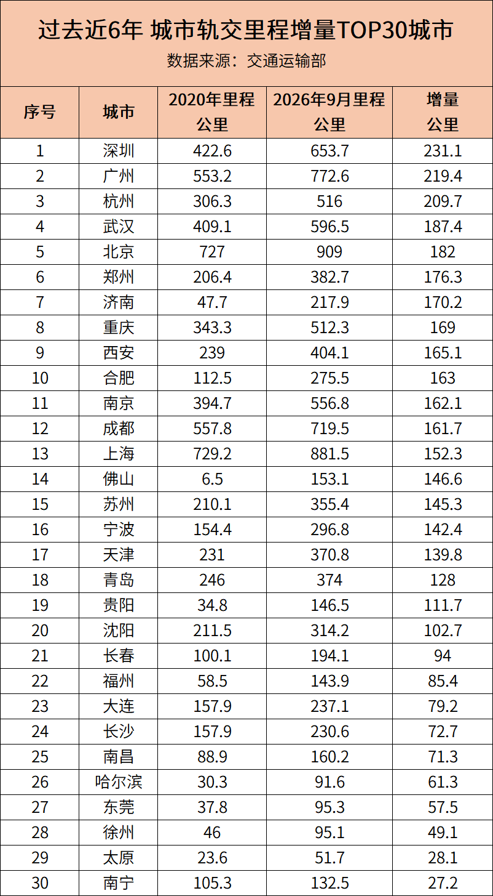
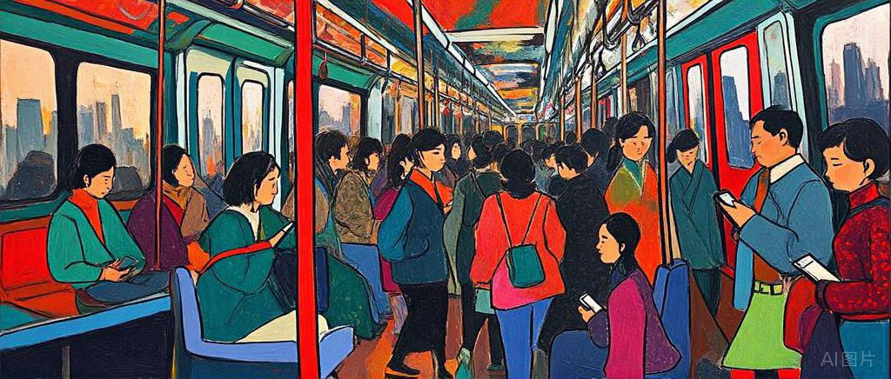
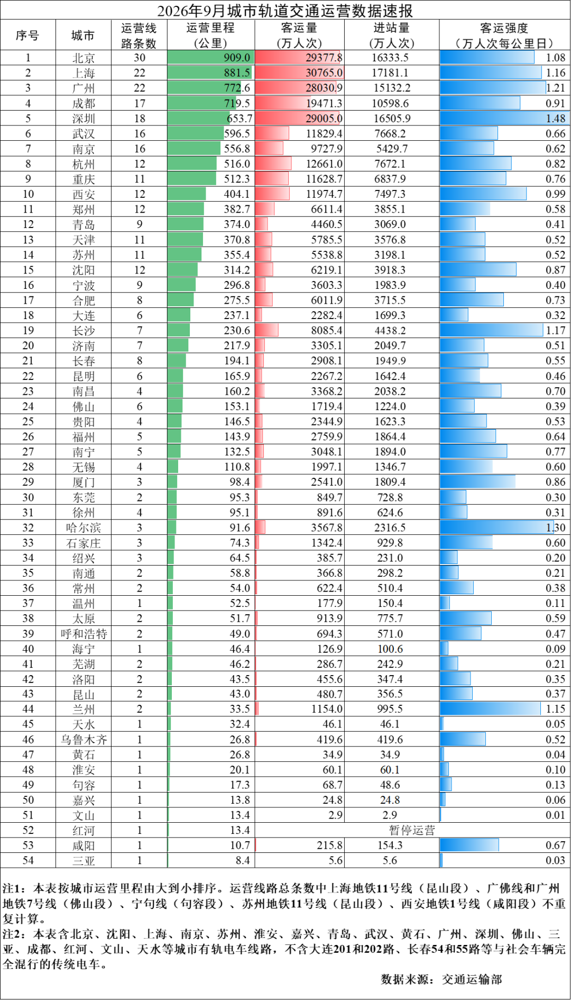

# 中国十大地铁城市，最新排名！
> 💡 备注属性未写入，可能是备注属性名称或者类型被修改了，建议将字段类型设置为 rich_text，可以在小程序-操作-修改文章数据库页面进行调整
> 原文链接:[https://mp.weixin.qq.com/s/2D941NxqL4gYtQLo9evB7Q](https://mp.weixin.qq.com/s/2D941NxqL4gYtQLo9evB7Q)
谁是中国地铁增长之王？深圳第一，广州第二，杭州第三，武汉第四。

说出来，你敢信？
中国内地，**已经有9座城市的地铁里程，超过500公里。**
从增量来看，过去六年，地铁增长最猛的四个城市分别是：
**深圳、广州、杭州、武汉。**
01
**中国十大地铁城市，最新排名**
近日，交通运输部发布2026年9月城市轨道交通运营数据。
按照地铁及轻轨运营里程统计，**全国前十城市分别是：**
北京909公里、上海881.5公里、广州772.6公里、成都719.5公里、深圳653.7公里。
紧随其后的是武汉596.5公里、南京556.8公里、杭州516公里、重庆512.3公里、西安404.1公里。

什么概念？
全国地铁及轻轨运营里程超过500公里的城市，已经达到9座！
其中，北京、上海稳居第一梯队，广州、成都紧随其后，深圳则稳居全国第五。
不过，如果只看总量，可能会忽略另一个更精彩的变化：**增量。**
02
**地铁里程增长前四名：**
**深圳、广州、杭州、武汉**
如果把时间拉回2020年底，再与2026年9月比较，排名就很有意思了。
过去近六年，全国地铁及轻轨里程**增量最大的五座城市分别是：**
深圳净增231.1公里，全国第一；广州净增219.4公里，全国第二。
杭州净增209.7公里，排名第三；武汉净增187.4公里，排名第四；
北京净增182公里，排名第五。

数据仅供参考
也就是说，**深圳、广州、杭州，成为这一轮地铁扩张的领跑者。**
尤其是深圳，虽然目前总里程只有全国第五，但过去近六年新增里程却拿下全国第一。
广州也不简单，新增里程超过219公里，继续拉开与后面城市的距离。
**还有杭州。**
六年新增超过200公里，城市轨道交通从主城向萧山、临平、钱塘等片区快速延伸。
此外，佛山净增146.6公里，排名全国第14位，在普通地级市中表现相当抢眼。
03
**深广杭的增长，为何这么猛？**
很多人好奇，为什么这几座城市地铁能越修越快？
底层逻辑就一个字：**人。**
深圳常住人口稳步走高，光明、龙岗、宝安等外围片区人越来越多，通勤需求压不住，地铁修到哪，人就跟到哪。
广州常住人口站上1910万，每年十万级增量，南沙、花都、黄埔发展提速，加上广佛同城，跨城轨道必须跟上。
杭州数字经济做大，城区人口破千万，亚运会前后多条地铁集中落地，把临平、钱塘、萧山全串进一张网。
细看增量前二十名名单，绝大多数都是省会、直辖市和计划单列市，其中佛山、苏州两座普通地级市格外抢眼。

04
**热闹背后，地铁审批为何收紧了？**
不过热闹背后有一个不容忽视的现状：**差不多近两年来，全国几乎没有全新地铁项目获得批复**，一大批有地铁梦想的城市还在排队等候审批。
不少人疑惑，前些年各地地铁建设热火朝天，为什么如今闸门明显收紧？
**一是地铁属于“烧钱工程”**，每一公里造价动辄数亿元，建成之后每年还有不菲的运营维护成本，建设地铁对于财力、人口都有较高要求：
申报建设地铁的城市一般公共财政预算收入应在300亿元以上，地区生产总值在3000亿元以上，市区常住人口在300万人以上。
**二是国家早已设立明确的客流门槛**，拟建地铁初期客运强度不得低于每日每公里0.7万人次，远期客流规模须达到单向高峰小时3万人次以上。
简单说就是：能不能修地铁，不只看城市意愿，**更要看财力、市区人口、债务风险、客流规模等因素。**
如果各地一哄而上，很容易加重地方财政与债务压力。
对照2026年9月客运强度数据就能发现，只有不到一半开通地铁的城市能达到每日每公里0.7万人次这个基准线：深圳1.48、哈尔滨1.3、广州1.21、长沙1.17、上海1.16、北京1.08、西安0.99、成都0.91、沈阳0.87、厦门0.86、杭州0.82、南宁0.77、重庆0.76、合肥0.73。

这也给很多城市敲响警钟：地铁并不是简单的城市门面，它本质上是服务大量通勤人口的重大基础设施；客流长期不足，再加上每年的运营补贴压力，会长期成为地方负担。

**当然审批收紧不等于“停止建设”**，未来那些人口持续流入、客流基础扎实的城市，还是有机会加建的。
对于许多期盼地铁的城市而言，与其急于争取线路落地，不如先做强产业、留住人口——只要人来了、通勤需求起来了，修地铁是迟早的事儿。
**延伸阅读：**
[中国大模型哪家强？广东放了一个大招](https://mp.weixin.qq.com/s?__biz=MzA3NjU2MzQ3OQ%3D%3D&mid=2653108330&idx=1&sn=02002a9166d445c61c8c7ccc96465c01&scene=21#wechat_redirect)
[广州国际商业港，很不寻常](https://mp.weixin.qq.com/s?__biz=MzA3NjU2MzQ3OQ%3D%3D&mid=2653108304&idx=1&sn=b9e0e25fc5cae3aa13d1afb916f66cd0&scene=21#wechat_redirect)
[300客商奔高明，山高水明有钱景](https://mp.weixin.qq.com/s?__biz=MzA3NjU2MzQ3OQ%3D%3D&mid=2653108304&idx=2&sn=0c5c60fccd1afece5e03afe7d3c209ce&scene=21#wechat_redirect)
[广州第一芯上市，市值超1200亿](https://mp.weixin.qq.com/s?__biz=MzA3NjU2MzQ3OQ%3D%3D&mid=2653108284&idx=1&sn=13a387c9559c573f84552b05f6526789&scene=21#wechat_redirect)

## 摘要

（待补充）

## 我的笔记

（待补充）
