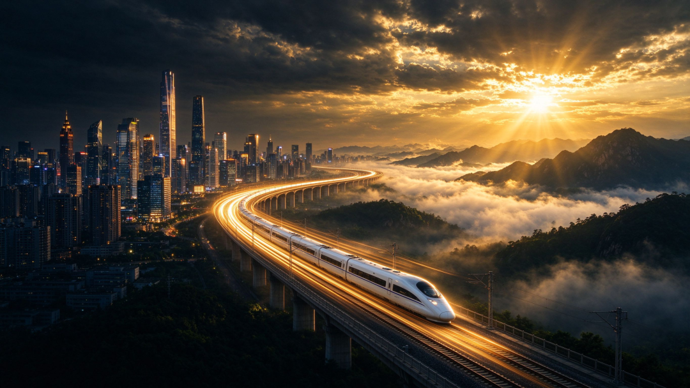
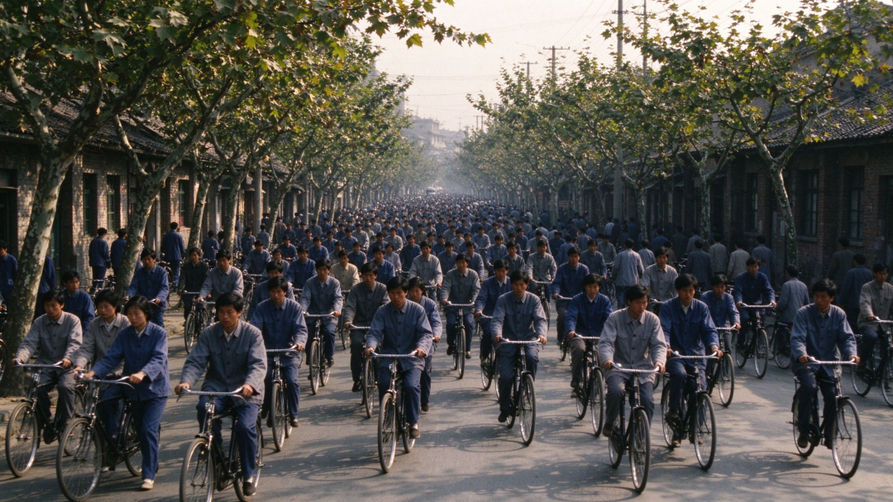
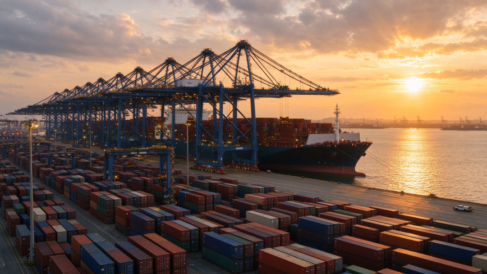
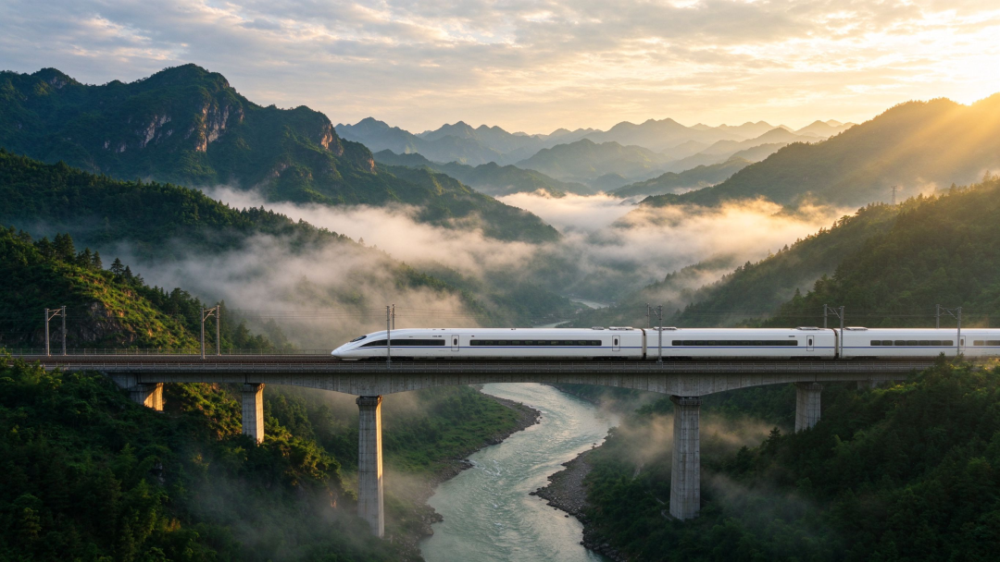

# 中国国运四十年：从8300亿到140万亿，一个大国的逆袭之路（上）
> 💡 备注属性未写入，可能是备注属性名称或者类型被修改了，建议将字段类型设置为 rich_text，可以在小程序-操作-修改文章数据库页面进行调整
> 💡 原文链接:[https://mp.weixin.qq.com/s?__biz=MzcwOTQ3OTM4Mw==&mid=2247483686&idx=1&sn=1eae0b7d50a2b6b46cd9a985006ba4c2&chksm=f4ecc8d8562efed38bf0d716fa262a327c25e19a6ac7d436b10a9bd05c435381ccd927037a9e#rd](https://mp.weixin.qq.com/s?__biz=MzcwOTQ3OTM4Mw%3D%3D&mid=2247483686&idx=1&sn=1eae0b7d50a2b6b46cd9a985006ba4c2&chksm=f4ecc8d8562efed38bf0d716fa262a327c25e19a6ac7d436b10a9bd05c435381ccd927037a9e#rd)

**中国国运四十年：从8300亿到140万亿，一个大国的逆袭之路**
1987年，深圳。
一个43岁的男人，因为做生意被骗了200万，被单位开除，老婆也跟他离了婚。他拖着一家子，挤在一间棚屋里，凑了21000块钱，注册了一家小公司。
公司名字叫华为。
同一年，一个叫马云的年轻人，第三次参加高考，终于考上了杭州师范学院。一个叫马化腾的少年，在深圳中学念初三，课余时间捣鼓计算机。一个叫王健林的退伍军人，刚从部队转业到大连，进了一家区政府下属的房地产开发公司。
这些人后来的故事，全世界都知道了。但在1987年，他们只是茫茫人海中几个不起眼的普通人。
这一年，全中国的GDP是1.2万亿元。听着好像不少？换算成美元，不到4000亿。当时美国的GDP是4.9万亿，日本2.5万亿。中国的经济总量，全球排十名开外。人均GDP不到300美元，在全球排名中处于靠后位置。
那时候的中国人，出国是想都不敢想的事。不是不想，是真没钱。北京上海的大街上，汽车屈指可数，大多数人出行靠自行车。"永久""凤凰"牌的，骑出去比现在开宝马还风光。
四十年后的2025年，中国的GDP是1401879亿元。
140万亿。是1986年的169倍。
人均GDP按购买力平价算，接近3万美元。高铁里程5万公里，世界第一；新能源汽车产量1652万辆，世界第一；制造业增加值连续16年全球第一，占全世界的28%以上。
这四十年，中国到底经历了什么？
很多人喜欢用"奇迹"两个字来概括。但奇迹这个词，听起来像是天上掉下来的，像是运气好。可如果你真的把这四十年掰开了、揉碎了，一年一年地看，你会发现一个朴素的真相：
| **哪里有什么奇迹，不过是一群人在一次次两难选择中，咬着牙选了最难但最对的那条路，然后硬扛了过来。** |
今天这篇文章，我们就用最通俗的方式，把1986到2026这四十年的中国经济史，从头到尾捋一遍。不喊口号，不堆术语，就讲人话。
看完你就会明白：所谓国运，从来不是算命先生嘴里的玄乎东西，而是一个国家在每一个关键路口，做出了什么样的选择。
**📌 第一章 1986-1992：破冰——在争论中找路**
**一、1986年的中国，到底有多穷？**

要讲清楚这四十年，得先回到起点。
1986年的中国，是个什么状态？
改革开放已经搞了七八年，农村家庭联产承包责任制全面推开，农民的积极性被调动起来了，吃饭问题基本解决。但城市呢？还是计划经济的天下。
什么叫计划经济？简单说就是：生产什么、生产多少、卖给谁、卖多少钱，全是上面定的。工厂不需要操心市场，因为东西生产出来不愁卖——反正都短缺。那时候买粮食要粮票，买布要布票，买自行车要工业券，连买盒火柴都要票。不是商家搞饥饿营销，是真的不够。
1986年，全国社会消费品零售总额不到5000亿，摊到10亿人头上，人均一年消费不到500块钱。一个普通工人家庭，家里最值钱的家当是"三大件"：手表、自行车、缝纫机。要是谁家有台14寸的黑白电视，那整条巷子的人晚上都会搬着小板凳来看。
这一年，中国的进出口总额是738亿美元，其中出口309亿。听起来还行？但你要知道，当时韩国的出口额是1232亿美元，是中国的四倍。一个只有4000多万人的小国，出口能力是10亿人口大国的四倍，这就是当时的差距。
更要命的是外汇储备。1986年底，中国的外汇储备只有20.7亿美元。什么概念？当时中国一年要进口的粮食、化肥、钢材、机械设备，加起来远超这个数。说白了，国家手里的美元，紧巴巴的，买了这个就买不了那个。
| **穷，是真穷。但穷不可怕，可怕的是不知道怎么富。** |
**二、价格闯关：一次惊心动魄的尝试**
1988年，中国经济史上发生了一件大事，叫"价格闯关"。
什么意思呢？当时中国的商品价格是"双轨制"——同一种商品，计划内的价格低，计划外的价格高。比如钢材，计划内一吨可能600块，计划外市场价可能1200块。这种双轨制虽然过渡平稳，但也产生了大量问题：谁能拿到计划内的低价货，谁转手就能赚大钱，"官倒""批文"成了最赚钱的生意。
当时的决策层想一步到位，把价格全部放开，让市场说了算。这个思路本身没错，但问题出在节奏上——太急了。
消息一放出来，老百姓慌了。大家都觉得物价要大涨，于是疯狂抢购。从城市到农村，从彩电冰箱到食盐肥皂，见什么买什么。银行门口排起长队取钱，很多储蓄所被挤兑得现金告急。1988年的通货膨胀率冲到了18.8%，这是改革开放以来的最高纪录。
价格闯关失败了。中央紧急叫停，开始"治理整顿"，收紧银根，压缩基建。经济增速从1988年的11.3%骤降到1989年的4.2%，1990年进一步降到3.9%。
很多企业倒闭，很多工人下岗，经济一下子冷了下来。
这时候，国内的争论也达到了顶峰。有人说，改革开放搞过头了，应该收一收；有人说，计划经济才是正道，市场那套是资本主义的东西。整个社会弥漫着一种迷茫的情绪——接下来的路，到底往哪走？
| **很多今天看来理所当然的选择，搁在当时，都是赌上国运的冒险。** |
**三、南方谈话：一个老人的最后一搏**
就在这个关键节点，1992年1月，一位88岁的老人，用35天时间，走了6000多公里，去了武昌、深圳、珠海、上海，边走边讲，讲了一系列改变中国命运的话。
这就是著名的"南方谈话"。
老人说了什么？核心就几句话：
| "计划经济不等于社会主义，资本主义也有计划；市场经济不等于资本主义，社会主义也有市场。""发展才是硬道理。""不改革开放，不发展经济，不改善人民生活，只能是死路一条。" |
这些话今天听着好像是常识，但在1992年的语境下，每一句都是炸雷。因为在此之前，"市场经济"这四个字，在很多人眼里就是资本主义的代名词，谁敢提谁就有风险。
老人的话一锤定音。争论了好几年的"姓资姓社"问题，一下子有了答案。
1992年10月，党的十四大正式确立了"建立社会主义市场经济体制"的改革目标。中国经济，从此彻底告别了计划经济的轨道，进入了市场经济的快车道。
这一年，GDP增速重新冲到14.2%。1993年13.9%，1994年13.1%。中国经济，又活过来了。
但活过来的同时，新的问题也来了。
南方谈话之后，全国上下搞经济的热情被彻底点燃，各地大搞开发区、大上项目，银行放贷失控，通货膨胀又开始抬头。1994年，CPI冲到了24.1%——也就是说，你去年存的100块钱，今年购买力只剩76块了。
这时候，一场更考验智慧的宏观调控，开始了。
**📌 第二章 1993-2001：市场经济的确立——软着陆、大下岗与入世谈判**
**一、软着陆：给过热的经济踩一脚"点刹"**
1993年，面对24%的通货膨胀和经济过热，中央开始了一场被称为"软着陆"的宏观调控。
软着陆的意思不复杂：让过热的经济慢慢降温，别一脚刹车踩死。硬着陆是什么样？看看1989到1990年就知道了——增速直接掉到4%以下，企业大面积倒闭，那叫硬着陆，摔得疼。
调控的办法很干脆：收紧银根、控制信贷、整顿金融秩序、打击乱集资乱拆借。同时推进分税制改革，把中央和地方的财政关系重新理清楚。
这里得说说分税制。1994年之前，中国实行的是财政包干制——地方跟中央谈好一个上缴数额，多收的归地方。这个制度的好处是地方积极性高，坏处是中央财政越来越穷。1993年，中央财政收入占全国财政收入的比重只有22%，中央穷得叮当响，想干点什么事都没钱。
分税制改革之后，中央财政收入占比一下子提到了55%左右。中央有钱了，才能搞转移支付，才能集中力量办大事。
| **这个改革影响极其深远——后来中国能搞大规模基建、能搞脱贫攻坚、能搞全国统筹的社保体系，根子都在1994年的分税制。** |
到1996年，通货膨胀率从24%降到了8.3%，1997年进一步降到2.8%。经济增速呢？仍然保持在9%以上。
通胀下来了，增速没掉多少——这就是"软着陆"。在全世界宏观调控史上，这都是教科书级别的操作。
**二、亚洲金融危机：第一次大考**
1997年7月，泰国铢暴跌，亚洲金融危机爆发。
这场危机从泰国开始，迅速蔓延到菲律宾、印尼、马来西亚、韩国。东南亚各国货币大幅贬值，股市楼市崩盘，企业大量倒闭。韩国的大宇、起亚等巨头差点破产，印尼总统苏哈托被迫下台。
中国当时是什么情况？出口增速从1997年的21%骤降到1998年的0.5%，利用外资跌到20年来最低点。更麻烦的是，周边国家货币都贬值了，人民币如果不贬，出口竞争力就下降；如果贬，可能引发竞争性贬值，危机进一步扩大。
中国选择了人民币不贬值。
这个决定在当时是需要巨大勇气的。不贬值，出口企业叫苦连天，经济增长承压。但不贬值，稳定了亚洲金融市场，也稳定了国际社会对中国的信心。后来的事实证明，这个选择是对的——中国因此赢得了"负责任大国"的国际声誉，也为后来加入WTO攒下了政治资本。
| **很多时候，一个国家的信用，就是在别人都跳水的时候，你选择站在岸上。** |
为了对冲出口下滑的影响，中国开始实施积极的财政政策，大规模发行国债，搞基础设施建设。高速公路、港口、电站、电网，一批批项目上马。这是中国第一次用"扩大内需"的方式来应对外部冲击，这个思路在此后多次被证明是有效的。
**三、国企改革与"下岗潮"：最痛的一刀**
1998年，中国经济面临另一场硬仗：国企改革。
当时的国有企业是什么状况？用一个字概括：亏。很多国企人浮于事、效率低下，生产的东西卖不出去，但还得继续生产，因为工人要吃饭。1998年，国有工业企业的亏损面超过40%，国企占用了70%的银行贷款，却只创造了30%的工业产值。
不改不行了。
1998年到2000年，中央提出"三年脱困"目标，推行"抓大放小"——关系国计民生的大型国企继续搞活，中小型国企通过改制、兼并、破产等方式退出。
代价是什么？下岗。
1998年到2002年，全国国有企业下岗职工累计超过2700万人。
2700万啊，这不是一个数字，是2700万个家庭的顶梁柱突然没了工作。东北老工业基地尤其惨烈，很多工厂整个车间、整个厂子说没就没了。
我看过一个纪录片，东北一个国有纺织厂的女工，下岗后在市场上摆地摊卖袜子。她干了二十年挡车工，技术比武拿过奖，突然有一天，她发现自己除了接线头什么都不会。四十多岁的年纪，再就业难如登天。
| **历史就是这样，宏观上的正确选择，落到微观上，往往是无数普通人的辛酸。** |
但从宏观经济的角度看，这一刀必须切。不切，国企这个无底洞会把整个银行体系拖垮，会把整个国民经济拖死。切了之后，国企的效率大幅提升，2000年国有及国有控股工业企业实现利润2392亿元，是1997年的3.5倍。
这一刀，痛，但不得不切。
**四、房改：房地产的潘多拉魔盒**
1998年7月3日，国务院下发了一份文件：《关于进一步深化城镇住房制度改革加快住房建设的通知》。
这份文件的核心内容就一句话：停止住房实物分配，实行住房商品化。
什么意思？以前城里人住的房子都是单位分的，不用买，交房租就行，房租便宜得跟白给一样。从1998年下半年开始，不分房了，自己买去。
这个改革的初衷是好的——住房实物分配不公平、效率低、滋生腐败，商品化是大势所趋。而且当时亚洲金融危机，出口不行了，需要找新的经济增长点，房地产就是最好的抓手。
但谁也没想到，这个决定会在之后的二十多年里，深刻地改变每一个中国人的生活。
房地产产业链极长，上游连着钢铁、水泥、建材，下游连着家电、家具、装修，还能拉动地方政府的土地财政。一启动，经济就被带起来了。1998年全国商品房销售面积1.2亿平方米，到2007年就冲到了7.7亿平方米，十年增长5倍多。
但房价也开始了漫长的上涨之路。1998年全国商品房平均售价2063元/平米，2007年涨到3885元，2017年涨到7892元，2021年峰值时超过1万元。一线城市更是从几千块涨到了十几万。
| **房地产这驾马车，拉着中国经济跑了二十多年，也让无数家庭背上了几十年的房贷。功过是非，到今天还在吵。** |
**五、入世谈判：十五年的"马拉松"**
1986年7月，中国正式向关贸总协定（WTO的前身）递交了恢复缔约国地位的申请。
谁也没想到，这一谈就是十五年。
十五年里，中美双边谈判是最难啃的骨头。美国要价极高，要求中国大幅降低关税、开放市场、取消补贴、保护知识产权。中方则坚持"发展中国家地位"，要求享受特殊和差别待遇。
谈判最艰难的时候，1999年4月，中方代表团访美，本来以为能签，结果美国方面临时变卦，没签成。回来之后，北约轰炸了中国驻南联盟大使馆，中美关系跌到冰点，入世谈判也停了。
一直到1999年11月，经过多轮博弈，中美终于达成双边协议。2001年12月11日，中国正式加入世界贸易组织。
入世的意义怎么评价都不为过。
入世之前，中国的进出口总额是5097亿美元，世界排名第六。入世之后，中国产品可以享受多边的、无条件的最惠国待遇，出口通道彻底打开。2004年进出口突破1万亿美元，2007年突破2万亿，2013年突破4万亿，成为世界第一大货物贸易国。
入世还有一个容易被忽略的好处：倒逼国内改革。为了符合WTO规则，中国清理了2000多部法律法规，大幅降低关税，开放服务业市场，完善知识产权保护。
| **入世，就是中国市场经济体制的"成人礼"。** |
当然，入世也有代价。农业受到冲击，部分行业被外资挤压，劳工权益问题凸显。但总体来看，入世是中国这四十年里做的最划算的一笔买卖——用市场换技术、换管理、换规则，最终换来了一个世界工厂。
**📌 第三章 2001-2008：黄金七年——世界工厂的崛起**

**一、入世红利：中国制造席卷全球**
加入WTO之后的中国，就像一辆加满了油的跑车，一脚油门踩到底。
2002年到2007年，中国GDP增速分别是9.1%、10%、10.1%、11.4%、12.7%、14.2%。连续六年加速增长，这在世界经济史上都是罕见的。
出口更是爆炸式增长。2001年出口2661亿美元，2008年冲到14285亿，七年翻了5倍多。"中国制造"像潮水一样涌向全世界——沃尔玛的货架上，满眼都是中国制造；美国人过圣诞节，从圣诞树到圣诞礼物，几乎全是中国产。
为什么中国能成为世界工厂？三个条件缺一不可：
第一，人多且便宜。2001年中国制造业工人的平均月薪不到1000元人民币，而美国工人是3000美元，差了20多倍。几亿农村剩余劳动力涌入沿海工厂，提供了几乎无限供给的廉价劳动力。
第二，基础设施好。中国的港口、公路、电力、通信，在发展中国家里首屈一指。集装箱从工厂到码头，当天就能装船发运，这在印度、越南是不可想象的。
第三，产业链完整。从一颗螺丝钉到一台整机，在中国都能找到供应商。珠三角、长三角形成了极其密集的产业集群，采购成本低、反应速度快，这是其他国家短期内复制不了的。
全世界的订单像雪片一样飞来，沿海工厂三班倒、连轴转，货一下生产线就被拉走。
我认识一个东莞的工厂老板，2005年的时候他跟我说，那几年订单多到什么程度？客户带着现金在厂门口等，货一下生产线就被拉走，连质检都顾不上做。
**二、外汇储备：从缺美元到"美元太多"**
出口猛增带来的直接结果，是外汇储备的暴涨。
2001年底，中国外汇储备2122亿美元。2006年突破1万亿，超过日本成为世界第一。2009年突破2万亿，2011年突破3万亿，2014年峰值时接近4万亿。
回想1986年，全国外汇储备才20亿美元，买什么都要精打细算。二十年时间，从"缺美元"变成了"美元太多花不完"，这种反转，搁谁身上都得晕一会儿。
外汇储备多了是好事，但也有烦恼。这么多美元放着贬值不行，得投资。买什么？美国国债。于是中国成了美国国债的最大海外持有国，最多的时候持有超过1.3万亿美元美债。
这就形成了一个很有意思的循环：中国把商品卖给美国，赚回美元；中国再用这些美元买美国国债，把钱借给美国；美国用借来的钱，继续买中国商品。
| **这个循环维持了十几年，双方各取所需。但隐患也埋下来了——中国的外汇资产捏在美国手里，中美经济绑得越深，后来的贸易摩擦就越痛。** |
**三、房地产起飞：造富运动与隐忧**
2003年，国务院发布18号文，明确将房地产业定位为"国民经济的支柱产业"。
这句话一出，房地产的地位就彻底不一样了。此前房改只是停止分房，现在是明确把房地产当支柱来扶持。
于是，房价开始了第一波快速上涨。2003年全国商品房均价2359元，2007年涨到3885元，四年涨了65%。一线城市更猛，北京上海的房价从四五千涨到了一万多。
地方政府发现了一个新的财源：卖地。土地出让金从2001年的1296亿，涨到2007年的近1.3万亿，六年涨了9倍。地方政府有钱了，就能搞基建、搞招商、搞城市建设，经济数据好看，官员政绩突出。
但问题也来了。房价涨得太快，老百姓买不起了。2005年开始，中央陆续出台"国八条""国六条"等调控政策，试图给房地产降温。但每次调控之后，房价反而涨得更猛——因为地方政府不想让地价跌，银行不想让房贷出问题，已经买了房的人不想让资产缩水。
| **房地产，就这样成了一头越来越大、越来越不能倒的"灰犀牛"。** |
**四、2008：北京奥运与全球金融危机**
2008年，是中国经济史上又一个关键年份。
上半年，一切都好得不能再好。GDP增速14.2%，股市冲到6124点的历史最高点，北京奥运会倒计时，全国上下一片欢腾。
然后，金融危机来了。
2008年9月15日，美国第四大投行雷曼兄弟宣布破产，次贷危机迅速升级为全球金融危机。美国、欧洲、日本相继陷入衰退，中国的出口订单断崖式下跌。
2008年11月，中国出口同比下降2.2%，这是七年来首次负增长。12月下降2.8%，2009年1月暴跌17.5%。沿海地区大量工厂倒闭，农民工提前返乡，仅2008年底就有2000万农民工失业。
形势危急。2008年11月，国务院迅速推出了"四万亿"刺激计划——到2010年底，安排约4万亿元投资，重点投向基础设施、民生工程、生态环保等领域。同时配套了宽松的货币政策，2009年新增贷款9.6万亿，是2008年的两倍。
四万亿的效果立竿见影。2009年二季度，中国经济就触底反弹，全年增速9.2%，是全球主要经济体中唯一保持正增长的国家。2010年，中国GDP超过日本，成为世界第二大经济体。
| **但四万亿的副作用也跟着来了：地方债飙升、产能过剩、房价暴涨、通胀抬头。这些毛病，在此后十年里，一个一个冒出来。** |
2001到2008这七年，中国抓住了全球化的黄金窗口，用最低的成本、最快的速度，完成了从农业大国到工业大国的跨越。但高速增长的背后，也积累了大量结构性问题，等着下一个十年去消化。
**📌 第四章 2009-2015：新常态——从"唯GDP论"到"转型升级"**
**一、四万亿的后遗症**
四万亿计划把中国经济从金融危机的泥潭里拉了出来，但也留下了一堆后遗症。
最突出的是产能过剩。四万亿大量投向了钢铁、水泥、煤炭、光伏、风电等行业，这些行业本来就有产能过剩的苗头，四万亿一刺激，产能更是严重过剩。2012年，中国钢铁产能10亿吨，实际需求只有7亿吨；水泥产能30亿吨，需求22亿吨；煤炭产能40亿吨，需求36亿吨。
产能过剩的直接后果是价格下跌、企业亏损。钢铁行业从2012年开始全行业亏损，一吨钢赚的钱，买瓶矿泉水都费劲。煤炭行业从2012年的"黄金十年"跌入寒冬，煤价腰斩，大量煤企发不出工资。
第二个后遗症是地方政府债务。四万亿要求地方政府配套资金，地方没钱怎么办？通过融资平台借钱。2010年底，地方政府性债务余额10.7万亿，到2013年6月涨到17.9万亿。很多地方政府的财政收入，连利息都快还不上了。
第三个后遗症是房价。2009年宽松的信贷大量流入房地产，全国房价再次暴涨。2009年全国商品房均价上涨23%，深圳、上海等城市涨幅超过50%。"房奴"这个词，就是那几年流行起来的。
| **经济学里有句话：天下没有免费的午餐。****四万亿这顿午餐，当时吃得香，后来还了十年的债。** |
**二、高铁：四万亿最成功的遗产**

四万亿被骂了很多年，但有一项投资，今天看来是无比正确的——高铁。
2008年8月，中国第一条真正意义上的高铁——京津城际铁路通车，时速350公里。在此之前，中国铁路的最高时速是200公里，而且只有少数线路能达到。
四万亿计划把高铁建设作为重点，2009年到2011年，高铁投资每年超过7000亿。2010年，京沪高铁开工；2011年，京沪高铁通车，北京到上海4小时48分。
到2015年底，中国高铁营业里程达到1.9万公里，占世界高铁总里程的60%以上。到2020年底，3.8万公里；到2025年底，5.0万公里。
高铁的意义，远远不只是"快"。
它重塑了中国的经济地理。以前从武汉到广州要10个小时，现在3小时；从成都到重庆要4小时，现在1.5小时。城市之间的时空距离被压缩，"同城化""城市群"成为现实。长三角、珠三角、京津冀的经济一体化，没有高铁是不可想象的。
它还带动了整个高端装备制造业的发展。高铁涉及的轨道交通装备、电力电子、通信信号、新材料等领域，中国从引进消化吸收到自主创新，最终形成了完整的产业链。中国高铁技术，现在已经成了国家名片，出口到印尼、沙特等国家。
有人算过一笔账：高铁的投资回报率，虽然短期看财务上不赚钱，但从社会效益看——时间节约、产业带动、区域协调——每投1块钱，能产生3到5块钱的综合效益。
| **这大概就是"集中力量办大事"最实在的注脚。** |
**三、移动互联网：另一条赛道的超车**
就在传统行业为产能过剩发愁的时候，另一条赛道上，中国正在悄悄完成一次超车。
2009年，中国发放3G牌照，移动互联网时代正式开启。2010年，小米成立；2011年，微信上线；2012年，今日头条成立；2013年，4G牌照发放，移动互联网进入爆发期。
2009年，中国智能手机出货量只有几千万部，2013年冲到4亿部，成为全球最大的智能手机市场。到2015年，中国移动互联网用户超过9亿，手机网民规模首次超过PC网民。
移动互联网这股风，把中国经济从上到下吹了个遍。
购物方面，2009年淘宝搞了第一个"双十一"，销售额5200万；2015年双十一销售额912亿，六年涨了1700多倍。电商的崛起，不仅改变了人们的消费习惯，还催生了快递、支付、物流等一整套新产业。
支付方面，2013年微信支付上线，2014年春节红包一战成名。到2015年，移动支付已经渗透到大街小巷，卖煎饼的大妈都用二维码收钱。中国直接跳过了信用卡时代，进入了移动支付时代。
出行方面，2012年滴滴成立，2014年快的和滴滴的补贴大战，让全国人民学会了用手机打车。共享单车2015年出现，随后风靡全国。
| **这一波移动互联网，中国没有像传统制造业那样"引进-消化-吸收"，而是跟美国站在了同一条起跑线上，不少领域还跑在了前面。** |
**四、新常态：告别"唯GDP论"**
2014年5月，中央首次提出"新常态"的概念。
什么叫新常态？核心就三句话：增速换挡——从高速增长转为中高速增长；结构优化——经济结构不断优化升级；动力转换——从要素驱动、投资驱动转向创新驱动。
意思很直白：中国经济不可能永远保持10%的增速。以前靠人口红利、靠投资、靠出口的老路，走不通了。得换个活法。
2015年，中国GDP增速6.9%，这是1990年以来首次跌破7%。很多人慌了，觉得中国经济要不行了。但实际上，6.9%的增速对应的GDP增量是4.5万亿元，比1994年全年的GDP总量还多。
基数大了，增速自然会降，这是经济规律。关键不是增速多少，而是增长的质量怎么样。
2015年，第三产业增加值占GDP比重达到50.5%，首次超过50%；消费对经济增长的贡献率达到66.4%，成为第一驱动力。这些数据说明，中国经济的结构正在变好，不再是靠投资和出口两条腿走路了。
但转型是痛苦的。传统行业去产能、去库存、去杠杆，意味着很多企业要关门、很多工人要转岗。2015年，东北经济增速全国垫底，资源型城市面临转型困境。
| **这一年底，中央提出了"供给侧结构性改革"。一场更深的调整，开始了。** |
**笔者已经是在全力写作，主要是资料收集耗费时间，明天一定准时更新（下集），敬请期待！**
**📚 关于作者**
| 笔者是80后，从小热爱阅读。在如今以短视频直播为快乐、爽文快餐横行天下的时代，笔者相信还是会有一批喜欢深度阅读的爱好者，还是喜欢从深度阅读中获取精神快乐。如果你是这样的人，欢迎与我为伍！ |
| **📌 核心数据来源说明** |
1. GDP数据：1986-2025年各年GDP数据来源于国家统计局历年统计公报及国民经济和社会发展统计公报。其中2025年GDP为1401879亿元，增长5.0%，来源于国家统计局2026年1月发布的初步核算结果。
2. 人均GDP数据：购买力平价（PPP）人均GDP数据来源于世界银行World Development Indicators数据库。1990年约990美元，2025年约29333美元。
3. 进出口贸易数据：2001年进出口总值5097亿美元、2008年25616亿美元等数据来源于国家统计局《对外贸易飞速发展》系列报告及商务部公开数据。
4. 外汇储备数据：1986年20.7亿美元、2001年2121.65亿美元、2020年32165亿美元等数据来源于国家外汇管理局历年公布数据。
5. 城镇化率数据：2020年63.89%、2025年67.89%来源于国家统计局第七次人口普查及2025年统计公报。1986年约24%为根据统计年鉴数据估算。
6. 脱贫攻坚数据：9899万农村贫困人口全部脱贫、832个贫困县全部摘帽、12.8万个贫困村全部出列，来源于国务院新闻办公室《人类减贫的中国实践》白皮书（2021年4月）。1978年7.7亿贫困人口来源于国家统计局公开数据。
7. 高铁里程数据：2020年3.8万公里、2025年5.0万公里来源于交通运输部《2025年交通运输行业发展统计公报》及中国国家铁路集团公开数据。
8. 新能源汽车数据：2020年销量136.7万辆、2025年产量1652.4万辆/销量1649万辆，来源于工业和信息化部及中国汽车工业协会公开数据。产销量连续11年全球第一。
9. 制造业数据：制造业增加值连续16年全球第一、占全球比重28%以上，来源于国家统计局"十四五"经济社会发展成就系列报告及世界银行统计。
10. 5G基站数据：2025年484万个，来源于国家统计局2025年统计公报。
11. 关键历史事件（南方谈话、分税制改革、房改、入世谈判、四万亿计划、供给侧改革、脱贫攻坚等）均来源于官方公开历史资料及中国共产党新闻网大事记。
| **⚖️ 声明** |
本文为基于公开官方数据的历史复盘与经济分析，部分对政策效果的评价、对未来趋势的判断为作者个人观点，不代表任何官方立场。文中涉及的历史事件描述均基于公开资料整理，如有出入以官方权威发布为准。
本文部分内容，图片等由AI辅助生成，经人工编辑审核。数据均标注来源，未使用未经核实的信息，如果不足之处，还请指正。

## 摘要

（待补充）

## 我的笔记

（待补充）
