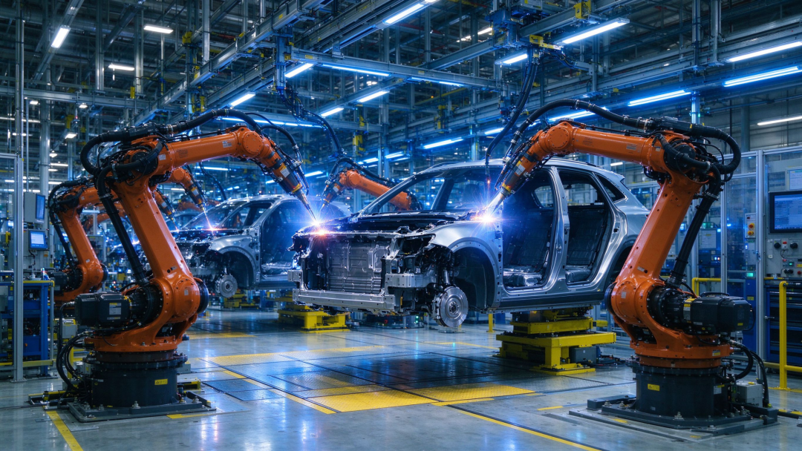
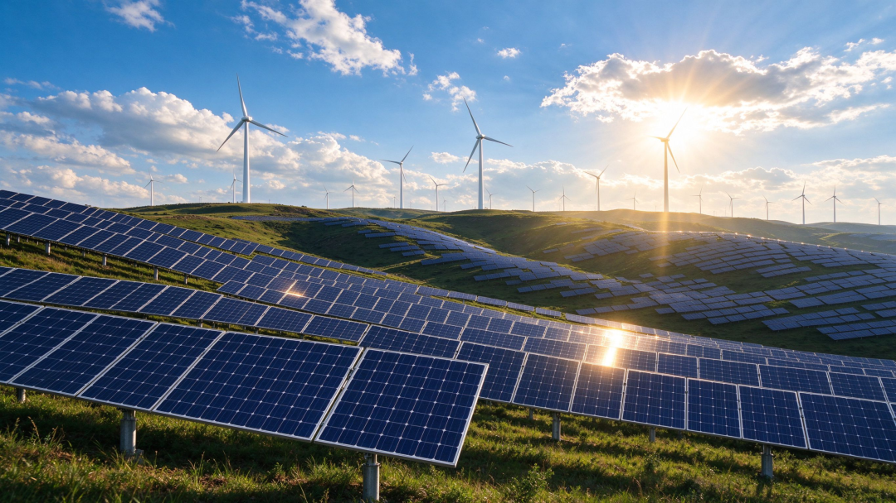
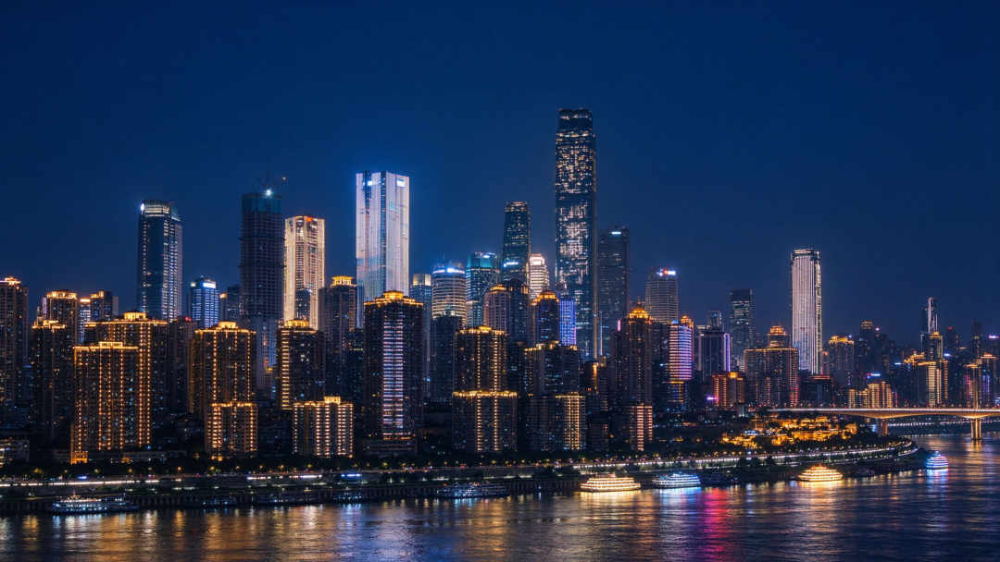

# 中国国运四十年：从8300亿到140万亿，一个大国的逆袭之路（下）
> 💡 备注属性未写入，可能是备注属性名称或者类型被修改了，建议将字段类型设置为 rich_text，可以在小程序-操作-修改文章数据库页面进行调整
> 💡 原文链接:[https://mp.weixin.qq.com/s?__biz=MzcwOTQ3OTM4Mw==&mid=2247483696&idx=1&sn=2de2a01f51e9c1ff12ee38b4e88b1d61&chksm=f4de374cf9a298eb13dbd0fa303b323f4879a7db1242d79f2ef6379207bb4289bd07bbf2e592#rd](https://mp.weixin.qq.com/s?__biz=MzcwOTQ3OTM4Mw%3D%3D&mid=2247483696&idx=1&sn=2de2a01f51e9c1ff12ee38b4e88b1d61&chksm=f4de374cf9a298eb13dbd0fa303b323f4879a7db1242d79f2ef6379207bb4289bd07bbf2e592#rd)
**接上集！**
**📌第五章 2015-2020：刮骨疗毒——供给侧改革与千年脱贫**

**一、供给侧改革："三去一降一补"**
2015年11月，中央首次提出"供给侧结构性改革"。
这个词听起来很学术，其实说的是一件很简单的事：以前经济出了问题，习惯从需求端发力——投资、消费、出口"三驾马车"，不行了就刺激。但现在的问题不是需求不足，而是供给不行——低端产能过剩，高端供给不足。
打个比方：一个人饿了，以前的办法是使劲给他塞馒头，塞到吃不下为止。现在发现他不是饿，是吃腻了馒头，想吃牛排，但你做不出来牛排。所以问题不在需求端，在供给端——你得学会做牛排。
供给侧改革的核心是"三去一降一补"：去产能、去库存、去杠杆、降成本、补短板。
去产能是最硬的一仗。2016年到2018年，全国退出钢铁产能1.7亿吨以上、煤炭产能8亿吨。什么概念？1.7亿吨钢，相当于日本全年的钢产量；8亿吨煤，比美国全年的煤炭产量还多。
去产能的过程很痛苦。河北唐山，一个市的钢铁产量就超过德国，去产能意味着大量钢厂要关、工人要转岗。但去完之后，钢铁价格回升了，行业利润恢复了，剩下的企业竞争力更强了。
| **刮骨疗毒，疼是真疼，但毒不拔出来，命就没了。** |
去库存主要是房地产。2015年底，全国商品房待售面积7.2亿平方米，三四线城市库存高企。通过棚改货币化安置等政策，到2019年底，待售面积降到4.9亿平方米，库存压力大幅缓解。但副作用是三四线城市房价也涨了一波。
去杠杆是防风险。2015年之后，影子银行、P2P、互联网金融乱象丛生，金融风险累积。从2016年开始，金融监管收紧，P2P行业从巅峰时期的5000多家，到2020年全部清零。这个过程中，很多人踩雷、血本无归，但从系统性风险的角度看，该拆的雷必须拆。
降成本主要是减税降费。2016年营改增全面推开，2018年增值税税率下调，2019年再次下调。2016到2020年，累计减税降费超过7.6万亿元。
补短板是补高端供给。芯片、高端装备、新材料、生物医药——这些领域中国还不行，得使劲补。这为后来的"卡脖子"问题和科技自主创新，埋下了伏笔。
**二、脱贫攻坚：人类历史上最大规模的减贫**
2012年底，中国还有9899万农村贫困人口。
9899万，比很多国家的总人口还多。这些人分布在14个集中连片特困地区，832个贫困县，12.8万个贫困村。很多地方自然条件恶劣，"一方水土养不起一方人"。
2015年11月，中央召开扶贫开发工作会议，提出到2020年现行标准下农村贫困人口全部脱贫、贫困县全部摘帽。
这场脱贫攻坚的规模和力度，放在人类历史上看，也是头一回。
怎么干？精准扶贫——不搞大水漫灌，而是逐村逐户识别，因人因地施策。发展生产脱贫一批、易地搬迁脱贫一批、生态补偿脱贫一批、发展教育脱贫一批、社会保障兜底一批，"五个一批"路径。
为了干成这件事，全国累计选派300多万名第一书记和驻村干部，同近200万名乡镇干部和数百万村干部一道奋战在扶贫一线。1800多名同志将生命定格在了脱贫攻坚征程上。
钱花了多少？中央财政专项扶贫资金从2015年的461亿，增加到2020年的1465亿，八年累计投入超过1.6万亿。加上各级地方配套和社会帮扶，总投入数以万亿计。
2021年2月25日，全国脱贫攻坚总结表彰大会上，官方庄严宣告：现行标准下9899万农村贫困人口全部脱贫，832个贫困县全部摘帽，12.8万个贫困村全部出列。
从1978年的7.7亿贫困人口，到2020年的全部脱贫，中国用四十多年时间，让近8亿人摆脱了绝对贫困。按照世界银行的国际贫困标准，中国减贫人口占同期全球减贫人口的70%以上。
| **这不是数字游戏。说人话就是：几千万孩子不用再因为穷辍学，几百万家庭不用再因病返贫，无数偏远山村通了路、通了电、通了网。** |
当然，脱贫不是终点。2020年之后，国家设立了五年过渡期，从脱贫攻坚转向乡村振兴。相对贫困的问题、城乡差距的问题、农村空心化的问题，还远没有解决。但消除绝对贫困这件事本身，放在人类历史上看，怎么评价都不过分。
**三、中美贸易战：脱钩的开始**
2018年3月，美国宣布对从中国进口的约600亿美元商品加征关税，并限制中国企业对美投资并购。
中美贸易战，正式开打。
此后两年多，双方你来我往，加征关税的商品规模从500亿、2000亿，一路加到3000多亿美元。中国的反制措施也层层加码。2020年1月，双方签署第一阶段经贸协议，贸易战暂时休战。
贸易战的表面原因是贸易逆差——美国说中美贸易不平衡，中国赚了美国太多钱。但深层原因，是美国意识到中国的产业升级已经威胁到了它的核心利益。
以前中国造的是衣服、鞋子、玩具，美国人不担心。现在中国要搞5G、搞芯片、搞高端制造、搞人工智能，这些都是美国的看家本领。美国的逻辑很简单：你可以做中低端，但高端不行，高端必须是我的。
贸易战对中国经济的冲击有多大？2019年，中国对美出口下降12.5%，但对东盟、欧盟、"一带一路"沿线国家的出口增长，部分对冲了对美出口的下滑。全年出口仍然增长了0.5%，没有出现很多人担心的崩盘。
但贸易战的真正影响，不在于关税本身，而在于它打破了一个共识——"中美关系好不到哪去，但也坏不到哪去"。从贸易战开始，科技战、金融战、舆论战接踵而至，中美关系进入了一个长期博弈的新阶段。
对中国来说，贸易战最大的警醒是：核心技术买不来、讨不来，必须靠自己。芯片、操作系统、高端装备——这些"卡脖子"领域，必须自主可控。
| **被逼到墙角，有时候反而是好事。** |
于是，从2018年开始，中国对科技研发的投入大幅增加。2015年研发经费投入1.4万亿，2020年达到2.4万亿，2025年超过3.5万亿。研发投入强度从2.07%提高到2.5%以上。
**四、2020：疫情黑天鹅**
2020年1月，新冠疫情在武汉爆发。
1月23日，武汉封城。这是人类历史上最大规模的隔离措施，一座千万人口的城市，说停就停了。
随后，全国进入紧急状态。工厂停工、学校停课、商场关门、交通停运。一季度，中国GDP同比下降6.8%，这是改革开放以来首次季度负增长。
但中国的应对速度和力度也是空前的。十天建成火神山医院、十二天建成雷神山医院，全国4万多名医护人员驰援湖北，口罩产能从日产2000万只迅速提升到日产过亿。
到3月份，疫情得到控制，复工复产逐步推进。二季度GDP增速转正为3.2%，三季度4.9%，四季度6.5%。全年GDP增长2.2%，是全球主要经济体中唯一实现正增长的国家。
2020年，中国GDP达到101.4万亿元，首次突破100万亿大关。
但疫情的影响是深远的。它加速了线上经济的发展，也暴露了公共卫生体系的短板；它让人们重新认识了供应链安全的重要性，也让地方政府的债务压力进一步加大。
| **疫情还改变了世界。全球供应链重组、地缘政治加速演变、通胀和衰退交替出现****——2019****年之前那个世界，回不去了。** |
**📌第六章 2020-2026：新周期——新能源突围、人口拐点与高质量发展**

**一、新能源：换道超车的典范**
如果说移动互联网是中国在互联网时代的一次超车，那么新能源就是中国在工业时代的一次换道超车。
传统汽车工业，中国搞了几十年，始终追不上德日美。发动机、变速箱、底盘，三大件的技术壁垒太高，专利壁垒更厚。你再怎么努力，也只能在后面追。
但新能源汽车不一样。没有发动机了，换成电机；没有变速箱了，换成电控；燃油系统没了，换成电池。整个技术路线全变了，大家站在同一起跑线上。
中国在新能源上的布局，其实从2009年就开始了。当年"十城千辆"工程启动，开始推广新能源汽车。但那时候技术不成熟、补贴骗补乱象丛生，行业走了不少弯路。
真正的爆发是在2020年之后。
2020年，中国新能源汽车销量136.7万辆。2021年352万，2022年688万，2023年949万，2024年1316万，2025年1649万。五年时间，销量增长了11倍。
2025年，中国新能源汽车产量1652万辆，占全球新能源汽车产量的60%以上。产销量连续11年全球第一。比亚迪一家的销量，就超过了特斯拉。
新能源汽车的崛起，不是孤立的。它带动了整个产业链的升级。
动力电池方面，宁德时代、比亚迪的全球市场份额超过50%，中国在动力电池领域拥有从锂矿加工到电池回收的完整产业链。光伏方面，中国光伏组件产量占全球80%以上，硅料、硅片、电池片、组件四个环节，中国企业的全球份额都超过70%。风电方面，中国风电装机容量连续13年世界第一。
到2025年8月底，中国风电、光伏发电装机规模突破16.9亿千瓦，是2020年的3倍以上。清洁能源发电量4.2万亿千瓦时，占总发电量的比重持续提升。
| **新能源这盘棋，中国下了十几年。从补贴培育、到技术成熟、到成本下降、到全球领先，每一步都踩在了点上。这就是****"****换道超车****"****的力量****——****在旧赛道上你追不上，那就换一条新赛道，在新赛道上当领跑者。** |
**二、人口拐点：不得不面对的现实**
2022年，中国人口出现了自1961年以来的首次负增长——全年出生人口956万，死亡人口1041万，净减少85万。
2023年，出生人口进一步降到902万，净减少208万。2024年，出生人口954万（小幅回升），死亡人口1093万，净减少139万。2025年末，全国人口140489万，比上年末减少339万。
人口负增长，来得比大多数人预期的都快。
比总量下降更值得关注的是结构变化。2022年，中国60岁以上人口占比达到19.8%，65岁以上占14.9%，已经进入深度老龄化社会。劳动年龄人口（15-59岁）从2011年的峰值9.4亿，降到了2025年的8.6亿左右。
人口结构一变，经济的方方面面都跟着变。
首先是劳动力成本上升。2010年之前，中国制造业工人月薪两三千，现在月薪五六千都招不到人。人口红利在消退，劳动密集型产业开始向东南亚、印度转移。
其次是养老压力。2025年，中国基本养老保险参保人数超过10亿，但抚养比（缴费人数/领取人数）从2010年的3:1降到了2.5:1，未来还会继续下降。养老金的可持续性，是一个长期挑战。
再次是消费和创新。年轻人少了，住房需求、教育需求、消费活力都会下降。一个老龄化社会，创新活力通常不如年轻社会。日本"失去的三十年"，人口老龄化是重要原因之一。
| **人口问题是个慢变量，不会一夜之间出大事，但一旦出问题，也不是三五年能解决的。这大概是中国未来几十年最棘手的挑战。** |
**三、房地产调整：时代的落幕**
2021年，是中国房地产的历史顶点。
这一年，全国商品房销售面积17.9亿平方米，销售额18.2万亿元，双双创下历史纪录。恒大、碧桂园、万科，一个个如日中天。
然后，急转直下。
2021年下半年，恒大爆雷。2022年，碧桂园、融创、世茂等头部房企相继出现债务危机。2023年，全国商品房销售面积降到11.2亿平方米，比峰值下降了37%。2024年继续下滑到9.7亿平方米。
房地产的调整，是多重因素叠加的结果。
第一，人口到顶了。2021年中国人口达到峰值14.12亿，之后开始下降。住房的刚需在减少。
第二，城镇化减速了。2020年城镇化率63.89%，2025年67.89%，每年提升不到1个百分点，比2000-2010年间每年1.3个百分点的速度明显放缓。进城买房的人少了。
第三，政策收紧了。"房住不炒"从2016年提出，到2020年"三道红线"出台，房地产企业的融资渠道被大幅收紧。高杠杆、高周转的模式走不通了。
第四，预期变了。以前大家觉得房价永远涨，借钱也要买。现在房价跌了，观望情绪浓厚，"买涨不买跌"的心理发挥作用。
房地产的调整，对经济的冲击不小。房地产及相关产业占GDP的比重约20%，地方政府土地出让金收入从2021年的8.7万亿降到2024年的不到5万亿。很多地方政府的财政压力骤增。
| **但从长远看，这个调整是必要的。一个国家的经济，不能永远靠盖房子来拉动。房地产的泡沫早点挤，比晚点挤好。挤完之后，资源才能流向制造业、科技、服务业这些更有前途的领域。长痛不如短痛，这一关，迟早要过。** |
**四、高质量发展：从"有没有"到"好不好"**
2022年，党的二十大报告提出"高质量发展是全面建设社会主义现代化国家的首要任务"。
高质量发展说复杂也复杂，说简单就一句话：从追求"有没有"，变成追求"好不好"。以前追求的是速度、规模、总量，现在追求的是质量、效率、可持续。
具体体现在几个方面：
产业升级。传统制造业向高端化、智能化、绿色化转型。2025年，中国制造业增加值34.7万亿元，占GDP比重稳定在25%左右，连续16年全球第一。但真正值钱的是结构——高技术制造业增加值占规模以上工业增加值的比重，从2015年的11.8%提高到2025年的18%以上。
创新驱动。2025年，中国研发经费投入超过3.5万亿元，研发投入强度2.5%以上。PCT国际专利申请量连续多年世界第一。在5G、人工智能、量子计算、新能源、航天等领域，中国已经从跟跑变成并跑，有些领域甚至领跑。
绿色转型。2025年，清洁能源发电量4.2万亿千瓦时，新能源汽车产量1652万辆，单位GDP能耗比2015年下降超过20%。"双碳"目标（2030碳达峰、2060碳中和）正在稳步推进。
数字经济。2025年，中国数字经济规模超过60万亿元，占GDP比重超过40%。5G基站484万个，是2020年的5倍多。数字经济已经成为中国经济增长的重要引擎。
2025年，中国GDP达到140.2万亿元，增长5.0%。这个增速放在全球看，仍然是主要经济体中最高的之一。但比增速更值得看的是增长的质量——消费贡献率超过55%，服务业增加值占比57.7%，高技术产业投资增长12%以上。
| **中国经济，正在从****"****比块头****"****转向****"****比肌肉****"****。这个转型还在路上，远没到终点，但方向没跑偏。** |
**📌第七章 四十年复盘：数据里的中国逻辑**
讲完了四十年的故事，我们用一组数据来做个总结。
**一、经济总量：从8300亿到140万亿**
| **年份** | **GDP****（亿元）** | **人均****GDP****（美元，****PPP****）** | **全球经济地位** |
| 1986 | 8,305 | 约280（名义） | 全球十名开外 |
| 1992 | 23,640 | 约420（名义） | 全球第十 |
| 2001 | 109,742 | 3,259 | 全球第六 |
| 2008 | 267,875 | 7,713 | 全球第三 |
| 2010 | 324,113 | 9,411 | 全球第二（超日本） |
| 2015 | 613,315 | 13,463 | 全球第二 |
| 2020 | 929,147 | 18,267 | 全球第二 |
| 2025 | 1,401,879 | 29,333 | 全球第二 |
四十年，GDP增长了169倍。人均GDP（购买力平价）从不到1000美元涨到接近3万美元。这个速度，在人类历史上，没有任何一个10亿人口级别的国家做到过。
**二、对外贸易：从738亿到全球第一**
| **年份** | **进出口总额（亿美元）** | **外汇储备（亿美元）** | **全球贸易地位** |
| 1986 | 738 | 20.7 | 全球第15位左右 |
| 2001 | 5,097 | 2,122 | 全球第六 |
| 2008 | 25,616 | 19,460 | 全球第三 |
| 2013 | 41,600 | 38,200 | 全球第一货物贸易国 |
| 2020 | 46,500 | 32,165 | 全球第一 |
进出口总额增长了60多倍，外汇储备增长了1500多倍。从一个缺外汇、缺技术、缺市场的国家，变成了全球第一大货物贸易国、第一大外汇储备国。
**三、城镇化与基础设施：从自行车王国到高铁王国**
| **指标** | **1986****年** | **2025****年** | **变化** |
| 城镇化率 | 约24% | 67.89% | 提升44个百分点 |
| 城镇人口 | 约2.6亿 | 9.54亿 | 增加近7亿 |
| 高铁里程 | 0 | 5.0万公里 | 从无到有，世界第一 |
| 公路里程 | 约96万公里 | 557.9万公里 | 增长4.8倍 |
| 5G基站 | 0 | 484万个 | 从无到有，世界第一 |
四十年，近7亿人从农村搬进了城市。这相当于整个欧洲的人口，在四十年里完成了城镇化。高铁从无到有，5万公里的里程，超过全世界其他国家的总和。
**四、减贫：从7.7亿到零**
1978年，中国农村贫困人口7.7亿，贫困发生率97.5%——也就是说，几乎所有农村人口都是穷人。
2012年，贫困人口9899万。
2020年，现行标准下贫困人口全部脱贫。
四十多年，近8亿人摆脱绝对贫困，占全球减贫人口的70%以上。这在人类减贫史上，也是规模最大的一次。
**五、制造业：从"中国制造"到"中国智造"**
1986年，中国制造业增加值占全球比重不到5%，排在美国、日本、德国之后。
2010年，中国制造业增加值超过美国，成为世界第一。
2025年，中国制造业增加值34.7万亿元，占全球比重28%以上，连续16年全球第一。
比总量下降更值得琢磨的是结构变化。2015年，高技术制造业增加值占比11.8%；2025年，超过18%。新能源汽车、光伏、风电、5G通信、无人机——这些领域，中国已经从跟跑者变成了领跑者。
**📌结语：国运的下一个四十年**
四十年，放在历史长河里不过是弹指一挥间。但对中国来说，这四十年是翻天覆地的四十年。
1986年，中国人均GDP不到300美元，跟很多非洲国家一个水平；2025年，人均GDP按购买力平价接近3万美元，进入中等偏上收入国家行列。
1986年，中国出口额309亿美元，不到韩国的四分之一；2025年（初步核算），中国是全球第一大货物贸易国，出口额超过3.5万亿美元。
1986年，全国外汇储备20亿美元，买什么都要精打细算；2025年，外汇储备超过3万亿美元，是全球最大的外汇储备国。
1986年，高铁里程为零，大多数人出行靠自行车；2025年，高铁5万公里，覆盖全国95%以上的50万人口以上城市。
这些数字的背后，不是什么神秘力量，就是一个个普通人的日子。沿海工厂里加班的打工妹、建筑工地上扛水泥的农民工、实验室里熬到凌晨的技术员、菜市场里起早贪黑的摊主、写字楼里敲键盘的年轻人——十四亿人，各过各的日子，凑在一起，就是这个国家的国运。
| **当然，这四十年也不是没有代价。环境的污染、贫富的差距、房价的高企、人口的老龄化、地方政府的债务****——****这些问题，有的已经在解决，有的还需要很长时间去消化。** |
回望这四十年，中国到底做对了什么？
有人说是制度优势，有人说是人口红利，有人说是全球化机遇。这些都对，但都不是最根本的。
最根本的原因，其实很朴素：
| **在该隐忍的时候隐忍，在该硬刚的时候硬刚，在该闷声发财的时候绝不吱声。** |
八十年代末九十年代初，国内争论"姓资姓社"，最终选择了"不争论，发展才是硬道理"——这是隐忍，忍的是意识形态之争的气，换来的是经济发展的空间。
亚洲金融危机，周边国家货币竞相贬值，中国选择人民币不贬值——这是硬刚，刚的是短期利益的诱惑，换来的是国际信用。
入世谈判，谈了十五年，该让步的让步，该坚持的坚持——这是隐忍也是硬刚，让的是该让的规则，守的是不能让的核心利益。
加入WTO之后，埋头搞制造、搞出口，不争霸、不输出模式——这是闷声发财，发的是全球化的财，攒的是制造业的家底。
贸易战来了，不退缩、不冒险，该反制反制、该谈判谈判——这是硬刚，刚的是核心技术的自主权。
| **四十年的经验，说到底就一句话：别折腾，好好干。** |
那么，下一个四十年呢？
没有人能准确预测未来。但有几个趋势是比较确定的：
中国经济的增速会继续放缓，从5%左右逐步降到4%、3%，这是基数变大后的必然结果。但增速放缓不等于停滞，140万亿的基数，每增长1%就是1.4万亿，比很多国家全年的GDP还多。
产业升级会继续推进。从"中国制造"到"中国智造"，从跟跑到并跑再到领跑，这个过程不会一帆风顺，会有贸易摩擦、技术封锁、地缘博弈，但方向不会变。
人口老龄化会加深，这是最大的挑战。如何在劳动力减少的情况下保持经济增长？答案只有一个：提高劳动生产率，靠科技、靠创新、靠人力资本。
中美关系会长期博弈。竞争大于合作，将是未来几十年的常态。但竞争不等于脱钩，中美经济的深度绑定决定了"斗而不破"大概率是主旋律。
四十年前，没有人能想到中国会变成今天这个样子。四十年后，也没有人能准确预测中国会变成什么样。
但有一点是确定的：
| **国运从来不是天定的，而是人造的。是每一个关键路口的选择，是每一代人的奋斗，是在困难面前不放弃、在争论面前不迷失、在成绩面前不骄傲。** |
这，就是中国国运四十年给我们的最大启示。
_（全文约19000字，结）_

**📚 关于作者**
| 笔者是80后，从小热爱阅读。在如今以短视频直播为快乐、爽文快餐横行天下的时代，笔者相信还是会有一批喜欢深度阅读的爱好者，还是喜欢从深度阅读中获取精神快乐。如果你是这样的人，欢迎与我为伍！ |
| **📌 ****核心数据来源说明** |
1. GDP数据：1986-2025年各年GDP数据来源于国家统计局历年统计公报及国民经济和社会发展统计公报。其中2025年GDP为1401879亿元，增长5.0%，来源于国家统计局2026年1月发布的初步核算结果。
2. 人均GDP数据：购买力平价（PPP）人均GDP数据来源于世界银行World Development Indicators数据库。1990年约990美元，2025年约29333美元。
3. 进出口贸易数据：2001年进出口总值5097亿美元、2008年25616亿美元等数据来源于国家统计局《对外贸易飞速发展》系列报告及商务部公开数据。
4. 外汇储备数据：1986年20.7亿美元、2001年2121.65亿美元、2020年32165亿美元等数据来源于国家外汇管理局历年公布数据。
5. 城镇化率数据：2020年63.89%、2025年67.89%来源于国家统计局第七次人口普查及2025年统计公报。1986年约24%为根据统计年鉴数据估算。
6. 脱贫攻坚数据：9899万农村贫困人口全部脱贫、832个贫困县全部摘帽、12.8万个贫困村全部出列，来源于国务院新闻办公室《人类减贫的中国实践》白皮书（2021年4月）。1978年7.7亿贫困人口来源于国家统计局公开数据。
7. 高铁里程数据：2020年3.8万公里、2025年5.0万公里来源于交通运输部《2025年交通运输行业发展统计公报》及中国国家铁路集团公开数据。
8. 新能源汽车数据：2020年销量136.7万辆、2025年产量1652.4万辆/销量1649万辆，来源于工业和信息化部及中国汽车工业协会公开数据。产销量连续11年全球第一。
9. 制造业数据：制造业增加值连续16年全球第一、占全球比重28%以上，来源于国家统计局"十四五"经济社会发展成就系列报告及世界银行统计。
10. 5G基站数据：2025年484万个，来源于国家统计局2025年统计公报。
11. 关键历史事件（南方谈话、分税制改革、房改、入世谈判、四万亿计划、供给侧改革、脱贫攻坚等）均来源于官方公开历史资料及中国共产党新闻网大事记。
| **⚖️ ****事实边界说明** |
本文为基于公开官方数据的历史复盘与经济分析，部分对政策效果的评价、对未来趋势的判断为作者个人观点，不代表任何官方立场。文中涉及的历史事件描述均基于公开资料整理，如有出入以官方权威发布为准。
本文部分内容由AI辅助生成，经人工编辑审核。数据均标注来源，未使用未经核实的信息。如有不足之处，还请指出！

## 摘要

（待补充）

## 我的笔记

（待补充）
