# 中国工业41个大类全览
> 💡 备注属性未写入，可能是备注属性名称或者类型被修改了，建议将字段类型设置为 rich_text，可以在小程序-操作-修改文章数据库页面进行调整
> 💡 原文链接:[https://mp.weixin.qq.com/s?__biz=MzU4MTc2MzQzMQ==&mid=2247578557&idx=1&sn=cf864b03abbcafdf9e4c1cd9efaca468&chksm=fc1af1ac88fab1f75e6ef6a048377a22db5e7db3d084b8eafe22d73b8a27609fd69a6abd4d86#rd](https://mp.weixin.qq.com/s?__biz=MzU4MTc2MzQzMQ%3D%3D&mid=2247578557&idx=1&sn=cf864b03abbcafdf9e4c1cd9efaca468&chksm=fc1af1ac88fab1f75e6ef6a048377a22db5e7db3d084b8eafe22d73b8a27609fd69a6abd4d86#rd)

“
**【中制导读】**
中国的工业体系涵盖了41个工业大类，207个工业中类，666个工业小类，成为全球唯一拥有联合国产业分类中全部工业门类的国家。其中制造业以31个大类占比76%。
”
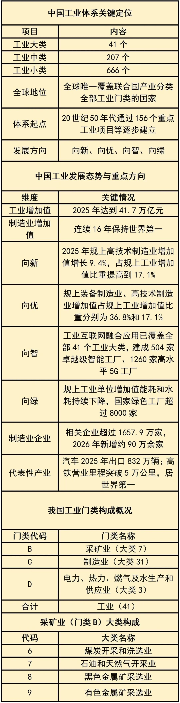
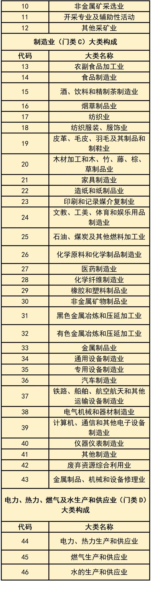
图片来源：TOP行业报告
这41个大类主要归属于**采矿业、制造业和电力、热力、燃气及水生产和供应业三大门类**。其中，制造业以31个大类占比76%。
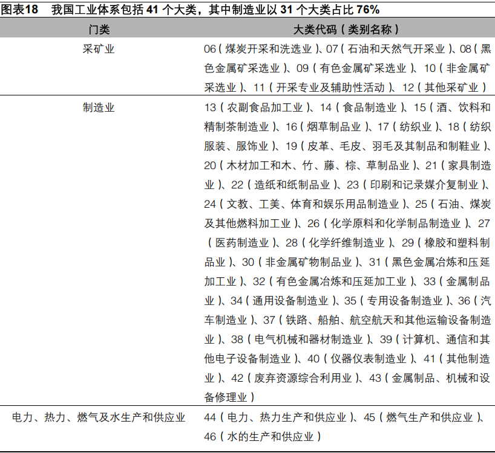
虽然没有国家能像中国一样实现100%全覆盖，但以下国家和地区的工业体系也相当完整或在特定领域实力雄厚。
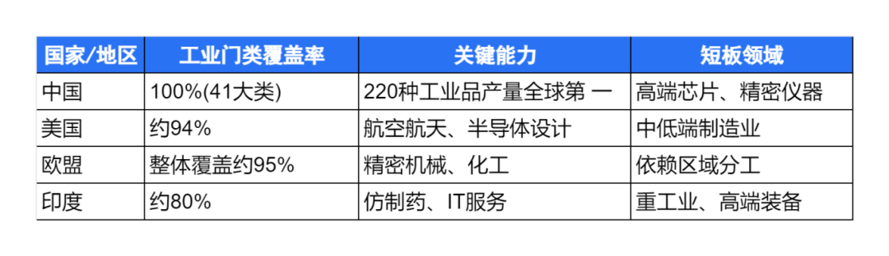
- **美国：**工业体系完整度很高，估计在85%至94% 之间。其在航空航天、半导体、生物医药等高端领域全球领先，但在服装、玩具等中低端制造上依赖进口。
- **欧盟（作为整体）：**作为一个整体，欧盟的工业体系完整度估计达到95% 左右。内部有德国（高端制造）、法国（航空航天）等国的优势互补。
- **其他工业强国：**日本、德国、俄罗斯、英国、法国、韩国、印度等国家在特定领域（如日本的材料科学、德国的精密机床、俄罗斯的军工航天）实力非常突出。但它们普遍存在短板，例如日本和德国的能源与原材料高度依赖进口，而俄罗斯的轻工业和电子产业则相对薄弱
总的来说，“完整工业体系”是各国的共同追求，但实现的路径和程度不同。中国是唯一实现联合国标准下全覆盖的国家。
其他主要工业国虽然门类不全，但在**高端制造、精密仪器、核心零部件**等价值链顶端拥有强大的控制力和影响力。这些国家通过深度参与全球化分工，同样构筑了强大的国家竞争力。
---
**✎**
**THE END**
编辑：小 智

声明：内容来源TOP行业报告、制造前沿，文中内容仅代表作者观点，版权归作者所有。非经注明，文中图片均来自网络。若转载本号文章，请联系授权开白，并注明来源及作者信息。
---
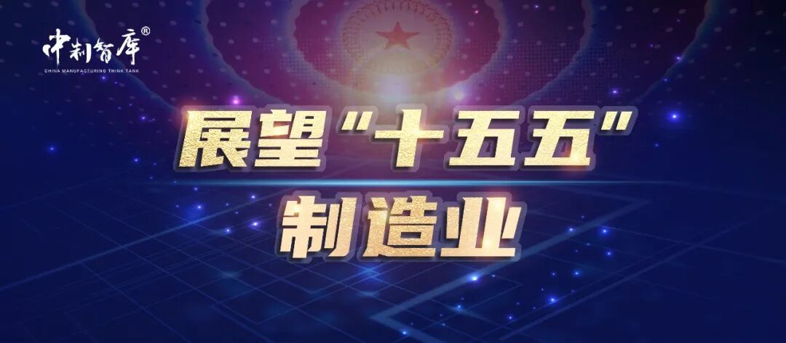
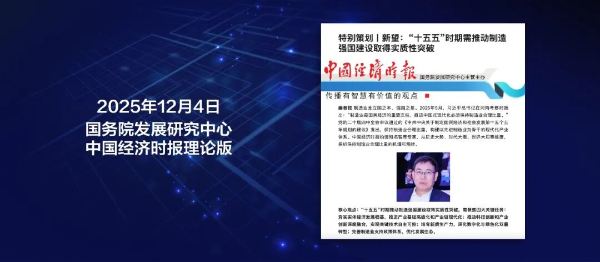
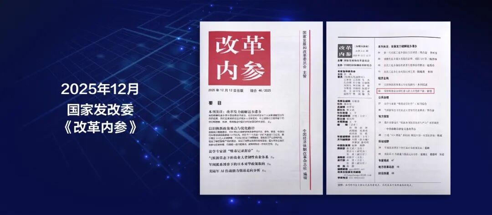
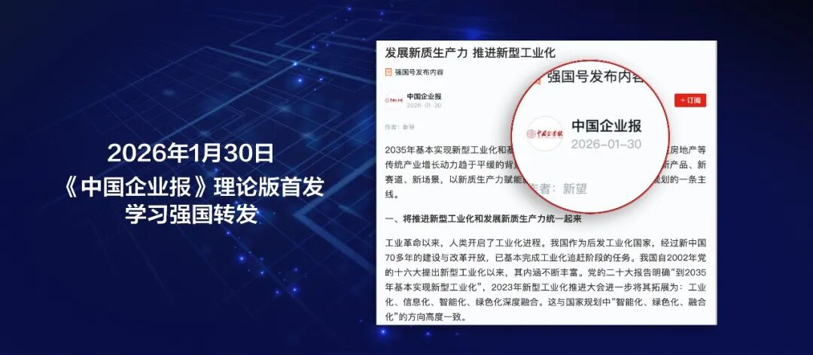
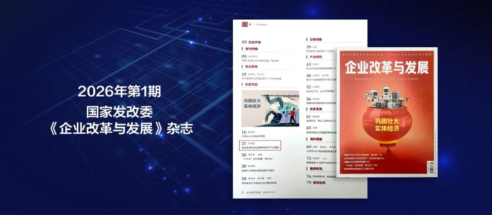
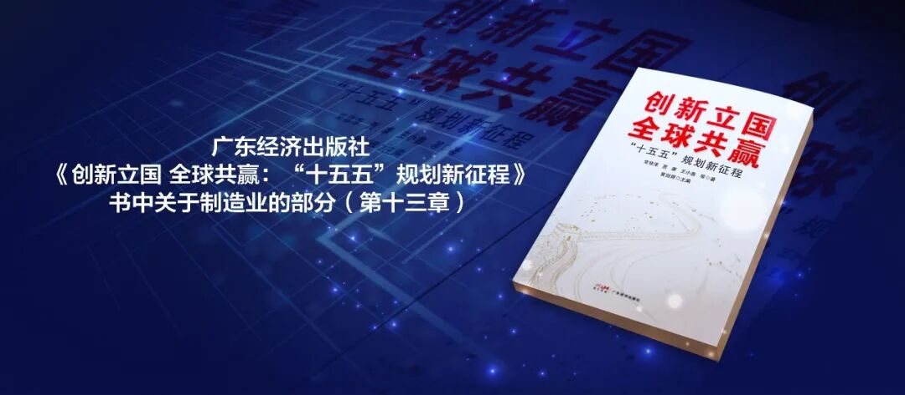
### 
**精彩合集，一键了解！**
[**第十届中国制造强国年会嘉宾演讲合集**](https://mp.weixin.qq.com/s?__biz=MzU4MTc2MzQzMQ%3D%3D&mid=2247576099&idx=2&sn=9282769189b838f4b1c5176a59966e7a&scene=21#wechat_redirect)
[**隐形冠军文章合集**](https://mp.weixin.qq.com/s?__biz=MzU4MTc2MzQzMQ%3D%3D&mid=2247559630&idx=1&sn=717c5d0d80365c2d320b9e12f30930ff&scene=21#wechat_redirect)

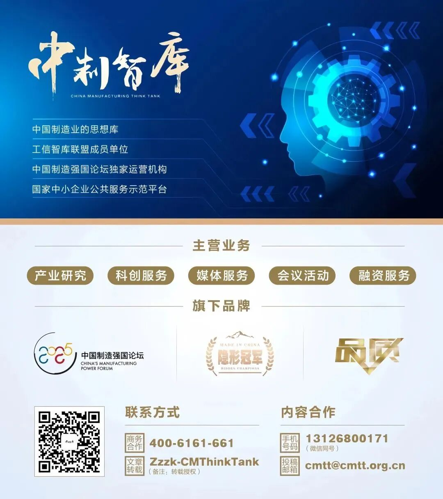

## 摘要

（待补充）

## 我的笔记

（待补充）
