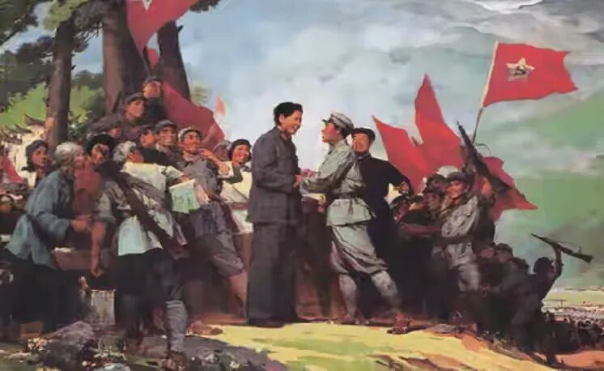
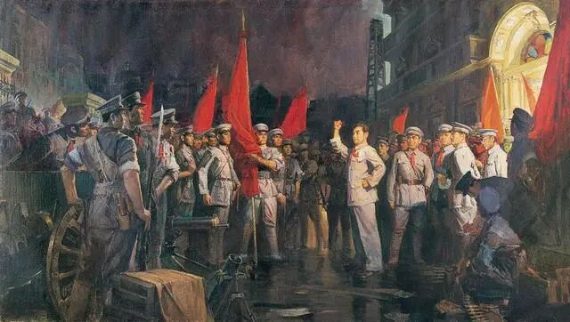
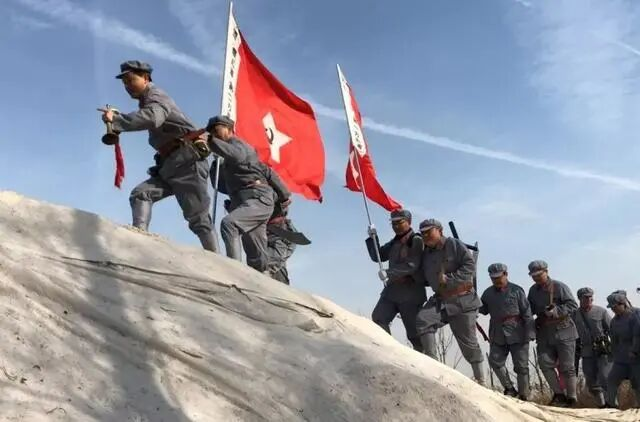
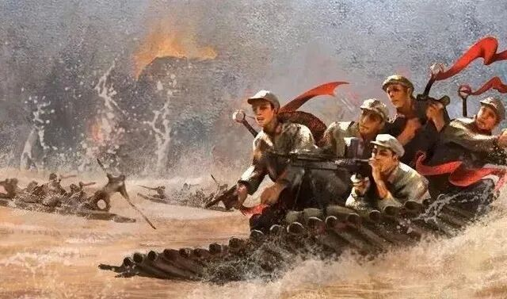
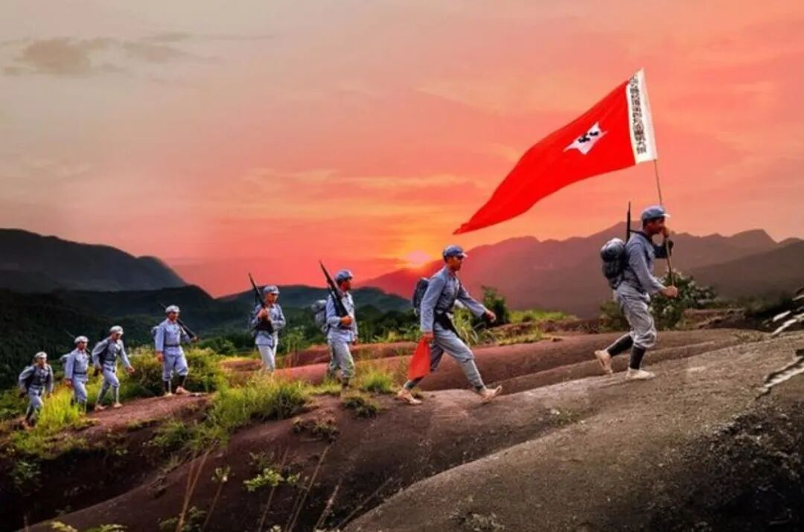
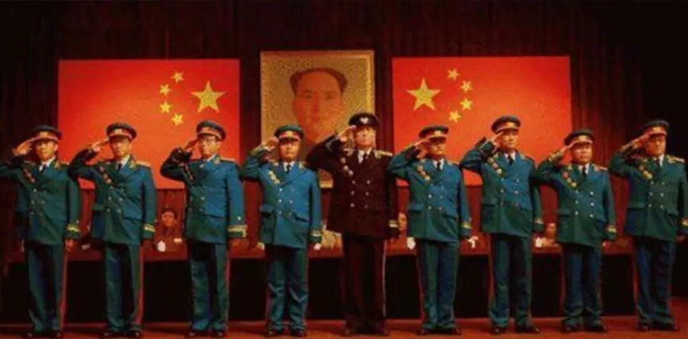

# 中央红军的大本营江西，为什么没能走出一位元帅大将
> 💡 备注属性未写入，可能是备注属性名称或者类型被修改了，建议将字段类型设置为 rich_text，可以在小程序-操作-修改文章数据库页面进行调整
> 💡 原文链接:[https://mp.weixin.qq.com/s?__biz=MjM5NTAyOTY0MQ==&mid=2452783826&idx=1&sn=3215be121761ecf7874a05f343513b9c&chksm=b0e8fe5e5dc7a484d4d0dd50606c9896fa5ba4d7462dca6b7e4071a6cf3c5bfc0071bf111a80#rd](https://mp.weixin.qq.com/s?__biz=MjM5NTAyOTY0MQ%3D%3D&mid=2452783826&idx=1&sn=3215be121761ecf7874a05f343513b9c&chksm=b0e8fe5e5dc7a484d4d0dd50606c9896fa5ba4d7462dca6b7e4071a6cf3c5bfc0071bf111a80#rd)
说起江西，很多人第一反应就是红都瑞金、中央苏区、长征出发地。这里是当年**中央红军的大本营**，扩红规模全国罕见，**有名有姓的烈士接近26万**，占全国烈士总数六分之一，同时也是全国开国将军最多的省份，**一共有327位开国将军**：萧华、陈奇涵、赖传珠3位上将，38位中将，286位少将 。
**
**

**但一个很让人感慨的事实是：江西籍没有一位开国元帅，也没有一位开国大将。**
 
很多人会疑惑：中央红军主力就是在江西发展壮大，兵员绝大多数是赣南赣西子弟，为什么最高层级的将帅，籍贯都不在江西？这个问题，不是江西人不勇敢，而是军衔评定规则、革命起点、骨干牺牲这几重历史因素叠加出来的结果。
 
首先要搞懂：**元帅、大将的评定，看重的不是“在哪打仗”，而是什么时候拉起队伍、是不是方面军一级的创建和领导人、早期武装起义的核心组织者。**

 
十大元帅、十大大将，几乎全部是1927年前后，南昌起义、秋收起义、广州起义、平江起义、黄麻起义、湘南暴动这些早期武装暴动的核心骨干。朱德、贺龙、刘伯承、聂荣臻是南昌起义领导层；彭德怀领导平江起义；徐向前是鄂豫皖根据地创建人；陈毅、粟裕是南方游击、湘南暴动骨干。他们在红军诞生之初，就已经是军团、方面军级别的指挥员，属于人民军队的缔造者这一层面。
 
而江西本地的革命力量，崛起时间要晚一截。

**南昌起义发生在江西，但起义的核心领导人，大多不是江西本地人。**起义部队打完之后迅速南下，并没有留在江西扎根。等到井冈山会师、赣南闽西中央苏区成型，已经是1928年之后。江西大量工农子弟参军，集中在1929—1933年，属于军队成型之后的兵员主体，而不是最早创建这支军队的顶层骨干。
 

简单说：湖南、湖北、四川这批元帅大将，很多是“带兵来江西建立苏区”；而江西子弟，大多是在苏区建立起来之后，踊跃加入红军，从班长、排长、连营干部起步。

1928年4月，朱德、陈毅部队上井冈山，全程由袁文才、王佐对接、掩护、补给、引路。**在红军最弱小、最艰难的初创期，是这两个江西人，守住了中国革命唯一的火种。**没有他们，就没有朱毛会师，就没有红四军诞生，就没有中央红军雏形。
1930年2月24日，永新县城，一场令人扼腕的误判肃反。**井冈双雄袁文才、王佐**，被错杀于党内肃反，年仅32岁。
 
第二个关键原因：**苏区残酷的斗争环境，大量有潜力的本土年轻指挥员过早牺牲。**
 
中央苏区是国民党重点围剿的核心区域，五次反围剿，仗打得极其惨烈。很多本土成长起来的优秀赣籍干部，还没来得及成长到军团、军一级主官，就牺牲在苏区保卫战里。**方志敏**，赣东北根据地创始人，红十军主要创建人，36岁被捕就义，他没有走到授衔年代，不是因为历史作用不够，而是战争结束前已经离开人世。

类似的情况，在江西早期干部中并不罕见。**段起凤、赖经邦**等人参与赣西南苏区建设。**李文林**担任过江西地方党组织的重要职务。**曾炳春、萧大鹏**等人也曾在红军队伍中担任军政职务。他们的名字散在地方史、红军史和烈士名录里，没有出现在元帅、大将名单上。

长征路上，江西籍战士占比极高，兴国一个县，长征路上牺牲一万两千多人，平均每走一公里就倒下一名兴国籍红军。大批年轻、有天赋的基层指挥员，倒在了湘江、雪山、草地，没能完整走完土地革命、抗战、解放战争全程，自然没有机会走到1955年授衔时的最高岗位。
 
还有一部分留下来坚持南方三年游击战争的干部，在敌人反复清剿之下，要么牺牲，要么和组织失联，后续发展路径被打断。

 
第三点：**江西籍将领的成长路径，大多是中央红军（红一方面军）的中层骨干。**
 
我们熟悉的**萧华、梁兴初、吴克华这些赣籍名将，都是在红军时期从团、师一级慢慢打上来。**萧华14岁参加红军，是少共国际师政委，非常年轻，战功卓著，1955年授上将。
按照当年授衔的标尺： 
- 元帅：要求是人民军队缔造者、方面军、军委层级领导；
- 大将，普遍要求红军时期担任军长、军团级主官，长期独当一面，统领一个战略方向；
- 上将，大多以红军时期师级主官为基础门槛。
 
绝大多数江西籍将领，长征时期的岗位集中在师、团这一层，后续在抗战、解放战争里成长为军长、兵团副司令、兵团政委，刚好卡在上将、中将区间，离元帅、大将所要求的“创建、统领一个战略方面军”的资历还差一截，这是客观的职务履历差距，和能力、勇气无关。
 

这里也要区分清楚一个容易混淆的点：**很多元帅大将长期在江西指挥作战，但是籍贯不是江西。**比如朱德、彭德怀、林彪、罗荣桓，长期在中央苏区指挥反围剿，他们是中央红军的最高指挥者，但他们是四川、湖南、湖北人，不是江西本地人。战场在江西，统帅是外地过来的革命先行者，本土子弟是这支大军最坚实的兵源和中坚。
 
很多人会有一个误区：“哪里兵多，哪里就一定出最高将帅”。其实革命不是这样。**兵源大省，往往出海量的中下层优秀指挥员；而早期起义、最早拉起武装的省份，更容易诞生军队顶层创始人。**湖南、湖北，秋收起义、平江起义、黄麻起义都在这一带，天然更容易诞生高阶将帅。
 
但我们不能用“有没有元帅大将”，去衡量江西对革命的贡献。

**江西是真正用一代人的血肉撑起中央苏区的地方。**兴国、吉安、永新、于都这些将军县，家家户户送子弟参军，很多村庄几乎整村青壮年都跟着红军走了。**327位开国将军背后，是几十万埋骨青山、没能等到胜利的无名烈士。**

没有江西籍元帅大将，不是这片土地缺少英才，而是历史时间窗口、早期武装格局、残酷的牺牲，共同写下的结果。那些从兴国、瑞金、吉安走出去的普通农家少年，背着梭镖、放下锄头参加红军，327名江西籍战士一路拼到中将、上将，本身就是一部震撼人心的英雄史诗。
