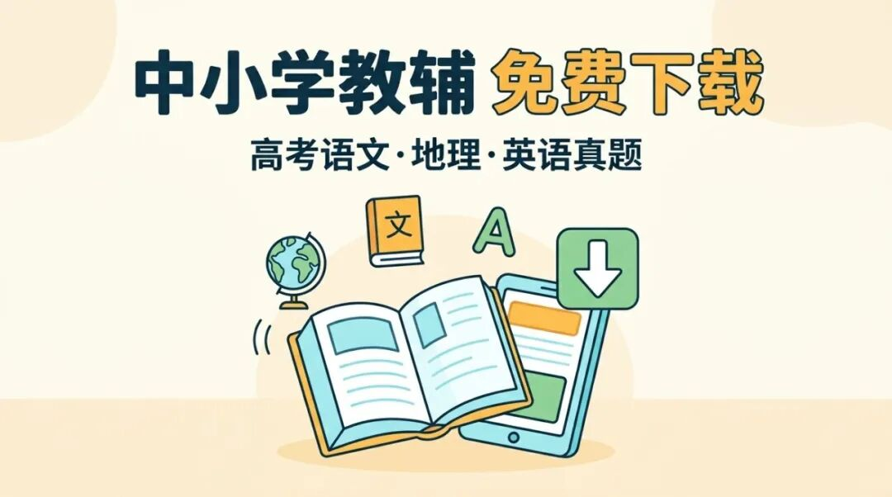

# 中小学教辅电子版免费下载，历年高考语文地理英语真题整理
> 💡 备注属性未写入，可能是备注属性名称或者类型被修改了，建议将字段类型设置为 rich_text，可以在小程序-操作-修改文章数据库页面进行调整
> 💡 原文链接:[https://mp.weixin.qq.com/s?__biz=Mzg3NTI1MjUwMA==&mid=2247490136&idx=1&sn=c21a836ef1117a211430f0064aa5cc36&chksm=cfa93cb3e378f33688e58be5d57aa7ae9ed0454f8149312872180ff33b2777593e1e64652777#rd](https://mp.weixin.qq.com/s?__biz=Mzg3NTI1MjUwMA%3D%3D&mid=2247490136&idx=1&sn=c21a836ef1117a211430f0064aa5cc36&chksm=cfa93cb3e378f33688e58be5d57aa7ae9ed0454f8149312872180ff33b2777593e1e64652777#rd)

还在花钱买真题试卷？到处找各种网盘链接，约等于拆盲盒，里面出来个空文件夹打你脸上。
这篇直接给你彻底解决痛点：3个被民间大神整理好的历年高考真题库（涵盖语文、地理、英语）。
是什么：纯净无广告的历年高考真题库与英语组卷系统。
有什么用：查阅历年原卷、按题型智能生成试卷、直接下载电子版打印练习。
是否免费：完全免费，不用注册，不用扫码，一分不花。
家里有高中生的，或者你自己就是老师，建议直接把这篇收藏，或者转给家长群。因为这些东西在外面，别人就是靠信息差收你几十上百块进群费的。
说白了，卖中小学教辅资源、教辅电子版的商业模式，就是赚信息不对称的钱。真题明明都是公开的，但「整理好」这个动作，就成了收费的理由。你花钱买的不是真题本身，而是别人帮你点击下载并分类的劳务费。
这篇内容，我们直接把这个信息差砸碎。
## 1. 历年高考语文、地理真题纯净版库 (GaokaoCHN / GaokaoGEO)
是什么：
两个由民间大神在 GitHub 上维护的历年高考真题整理库，一个是语文真题（**GaokaoCHN**），一个是地理真题（**GaokaoGEO**）。
没有任何花里胡哨的排版，没有乱七八糟的水印。就是干干净净的历年真题。
适合谁：
需要刷历年原题的高三学生、需要备课的高中语文/地理老师，以及需要寻找教辅资源的家长。
免费到什么程度：
无条件免费。没有VIP，没有积分下载限制，更不需要让你被迫看一堆贴片广告。看到哪个年份，直接点开就是。
怎么用：
这是托管在 GitHub 上的开源项目。
打开网页，就能看到按年份和卷区排列好的文件目录。就像打开你自己的电脑硬盘一样。你只需要点击对应的文件，就能直接查看或保存教辅电子版的原始文本。
这就是纯粹的信息平权。买教辅电子版是花钱，自己到处找教辅是花命（因为到处都是骗子网站和钓鱼链接），但直接用前人整理好的纯净库，是完全白嫖。
白嫖使人快乐，这是不变的真理。
## 2. 高考英语智能组卷系统 (gaokao-english-paper-system)
如果说前面两个是静态的仓库，那这个英语真题库就是个核武器级别的英语学习资源。
是什么：
这是一个基于本地高考英语真题数据库的智能组卷系统。
它不仅仅是一堆试卷的罗列，它是把所有试卷「拆碎」了，变成了一个高度结构化的数据库。根据开发者公布的数据，里面包含了 2008 到 2026 年的 233 套高考英语真题，总计 3478 道题目（其中仅阅读理解就有 857 篇）。
适合谁：
想要针对性刷题的学生（比如只想专项练习某几年的阅读理解），想要快速出小测验试卷的英语老师。它是课本之外，最硬核的英语学习资源补充库。
免费到什么程度：
完全免费的开源工具系统。不仅底层真题数据免费，组卷功能也全部免费，甚至它承诺完全本地运行，不联网上传你的任何练习数据。
怎么用：
它支持三种神仙模式：
1. 按题型组卷：你可以只要阅读理解，或者只要完形填空、七选五，指哪打哪。
1. 自由选题：自己像逛超市一样挑题目，手动组合。
1. 智能推荐：根据年份、主题（人与社会/人与自然等分类）、难度，自动给你配出一套阅读组合。
它甚至能导出三种格式的 Word 和 PDF 文件：学生卷（无答案）、教师卷（含解析）、答案卷（仅答案）。
你仔细想想这个产品的底层逻辑。在外面，这种级别的「英语组卷系统」和「结构化英语教辅资源」，是学校和培训机构要花大价钱买的教育SaaS服务。现在一个开发者直接把它做成了开源免费的个人工具。
入口在github搜：**gaokao-english-paper-system**
（注：因为这是个纯本地运行的程序，需要在电脑上按照页面提示部署运行。如果你自己搞不定代码环境，可以请身边懂点电脑的朋友花几分钟帮你跑起来。一顿便饭钱换一个顶级的组卷系统，怎么算都血赚。）
## 注意事项与入口汇总
注意事项：
1. 上述免费真题资源都存放在 GitHub 上。国内访问有时候会不太稳定，如果打不开，可以换个时间再试，或者使用合规的网络加速工具。
1. 英语组卷系统目前处于中期研发阶段，部分题目（主要是早年的完形填空等题型）的解析可能还不完整，但作为原题刷题库已经足够降维打击外面的各种野路子资料了。
1. 这些教辅电子版的下载与整理都是个人开发者的心血，仅供自己学习使用，千万别拿去倒卖。把免费开源的东西拿去卖钱，是会被戳脊梁骨的。
入口汇总：
- 高考语文真题整理：**https://github.com/Zaxaerith/GaokaoCHN**
- 高考地理真题整理：**https://github.com/Zaxaerith/GaokaoGEO**
- 高考英语组卷系统（233套真题库）：**https://github.com/ZhangYixuan-in-BUPT/gaokao-english-paper-system**
身边有需要考大学的孩子，赶紧把这篇发给他们。这可比逢年过节给他们发多少个大红包都管用。毕竟考上了，这资源才算没白给。
点个关注，下次找免费资源不用再到处搜了，我帮你整理好了。
精彩历史文章：
[免费电子书下载：日本国立国会图书馆35万册古籍免费在线读](https://mp.weixin.qq.com/s?__biz=Mzg3NTI1MjUwMA%3D%3D&mid=2247489831&idx=1&sn=284f32c29b192a4f014dfb67e78eb7dd&scene=21#wechat_redirect)
[免费电子书下载：英国最古老图书馆把镇馆手稿全部搬上网，随便看](https://mp.weixin.qq.com/s?__biz=Mzg3NTI1MjUwMA%3D%3D&mid=2247489828&idx=1&sn=877def7388a4e234b0e844e655970056&scene=21#wechat_redirect)
[免费阅读器软件：本地电子书能朗读、记笔记，还能在多设备接着读](https://mp.weixin.qq.com/s?__biz=Mzg3NTI1MjUwMA%3D%3D&mid=2247489819&idx=1&sn=eccbe04baaecda9101fc5e4a1397f13a&scene=21#wechat_redirect)
[留学不等于烧钱：欧洲一批公立大学免学费，还不用学小语种](https://mp.weixin.qq.com/s?__biz=Mzg3NTI1MjUwMA%3D%3D&mid=2247488523&idx=1&sn=0a29141efaf75d2006b2ce161636f852&scene=21#wechat_redirect)
[语言学习最大的误区：一个加拿大老头会20种语言，靠的不是天赋](https://mp.weixin.qq.com/s?__biz=Mzg3NTI1MjUwMA%3D%3D&mid=2247488421&idx=1&sn=e4dc1030aa00d73713af7496786f4ca3&scene=21#wechat_redirect)
[买编程书花了五千块才发现，GitHub上这11万星的中文书单全是免费的](https://mp.weixin.qq.com/s?__biz=Mzg3NTI1MjUwMA%3D%3D&mid=2247487919&idx=1&sn=f08b16f48b92c328d4d364518f70624d&scene=21#wechat_redirect)
[这些免费学习App，我让孩子用了一个学期，效果比报班好](https://mp.weixin.qq.com/s?__biz=Mzg3NTI1MjUwMA%3D%3D&mid=2247487735&idx=1&sn=5991e2641c98e9de8eafc81baf376c61&scene=21#wechat_redirect)
[一年花两千买书？这6个免费渠道让你一分不花读到饱](https://mp.weixin.qq.com/s?__biz=Mzg3NTI1MjUwMA%3D%3D&mid=2247487799&idx=1&sn=8c46a4d4db80e917253ce2f2f23787cb&scene=21#wechat_redirect)
[ebook-treasure-chest：一个藏了上万本电子书的「海盗宝箱」](https://mp.weixin.qq.com/s?__biz=Mzg3NTI1MjUwMA%3D%3D&mid=2247487578&idx=1&sn=950079c173204ea10f7afbef52485508&scene=21#wechat_redirect)
[B站上有个叫3Blue1Brown的数学频道，每期视频几百万播放，动画讲数学一绝](https://mp.weixin.qq.com/s?__biz=Mzg3NTI1MjUwMA%3D%3D&mid=2247487542&idx=1&sn=9e1e3b6dcdac2fc4792b2d6d982218c8&scene=21#wechat_redirect)
[教育资源的“数字宇宙”：这个4.2K星的项目藏着超100T的学习资料](https://mp.weixin.qq.com/s?__biz=Mzg3NTI1MjUwMA%3D%3D&mid=2247487157&idx=1&sn=65bd1d882c82afe7f492e081231c0b40&scene=21#wechat_redirect)
[国家中小学智慧平台的“万能钥匙”：这个5.8K星的开源工具让你一次下载所有教材PDF](https://mp.weixin.qq.com/s?__biz=Mzg3NTI1MjUwMA%3D%3D&mid=2247487148&idx=1&sn=5d4729976dc057196a8c86f01c2623ad&scene=21#wechat_redirect)
[免费教科书一键下载：这个开源工具帮你把国家智慧教育平台的课本存到本地](https://mp.weixin.qq.com/s?__biz=Mzg3NTI1MjUwMA%3D%3D&mid=2247487098&idx=1&sn=852f3e0c49a4b22671c32d2026d508e9&scene=21#wechat_redirect)
[75K星！这个开源项目把中国中小学教材全部装进了GitHub](https://mp.weixin.qq.com/s?__biz=Mzg3NTI1MjUwMA%3D%3D&mid=2247487161&idx=1&sn=34aa13332d7757789584e3757b38e386&scene=21#wechat_redirect)
[12.7万星！这个GitHub项目把全网免费服务扒了个底朝天，每年至少省5000块](https://mp.weixin.qq.com/s?__biz=Mzg3NTI1MjUwMA%3D%3D&mid=2247485291&idx=1&sn=534e537c34e00448b3468440b244f6a1&scene=21#wechat_redirect)
[免费教材下载：一个开源工具把电子课本课件音频一次搬回家](https://mp.weixin.qq.com/s?__biz=Mzg3NTI1MjUwMA%3D%3D&mid=2247488774&idx=1&sn=294fd493af4ebedd813bdb22078019c9&scene=21#wechat_redirect)
[免费下载：电子课本下载，英语教材配套听力也能找到](https://mp.weixin.qq.com/s?__biz=Mzg3NTI1MjUwMA%3D%3D&mid=2247488674&idx=1&sn=c629557cbed894769535fd2e9193f8b9&scene=21#wechat_redirect)
[把故事变成动画视频，这个开源工具免费，自媒体人看完直接收藏](https://mp.weixin.qq.com/s?__biz=Mzg3NTI1MjUwMA%3D%3D&mid=2247488560&idx=1&sn=8cc062a999b1a95b5a8c37f9f1d3eba9&scene=21#wechat_redirect)
