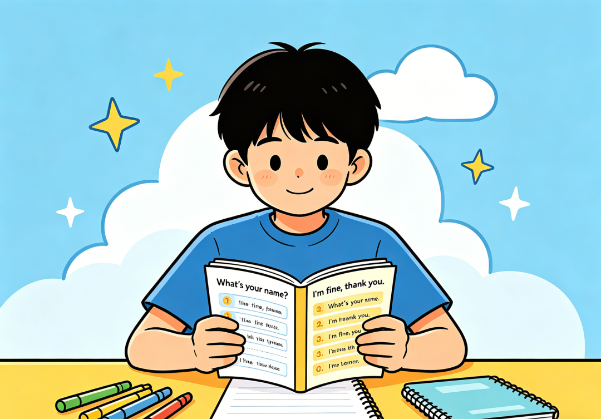

# 中考英语必背350个高频句型，覆盖 90%考点，背完直接提分！（可直接打印）
> 💡 备注属性未写入，可能是备注属性名称或者类型被修改了，建议将字段类型设置为 rich_text，可以在小程序-操作-修改文章数据库页面进行调整
> 原文链接:[https://mp.weixin.qq.com/s/X2TfpoVJiF8O4LmyIDH-Tw](https://mp.weixin.qq.com/s/X2TfpoVJiF8O4LmyIDH-Tw)

中考英语想快速提分，死背单词不如吃透核心句型！单选、完形、语法填空90%的考点都围绕固定句型展开，作文用对还能直接加分。整理了350个中考最高频核心句型，按考点分类拆解，每天背一组，轻松吃透考点，英语稳步提分！

**第一类：be动词&主谓宾基础核心句型**

1. I am + 名词/形容词
我是……/我处于……状态
例句：I am a middle school student.
我是一名中学生。
2. You/We/They are + 名词/形容词
你/我们/他们是……/你们/我们/他们处于……状态
例句：They are good friends.
他们是好朋友。
3. He/She/It is + 名词/形容词
他/她/它是……/他/她/它处于……状态
例句：She is very outgoing.
她性格很外向。
4. I am not + 名词/形容词
我不是……/我不处于……状态
例句：I am not late for school.
我上学没有迟到。
5. Are you + 名词/形容词?
你是……吗？/你处于……状态吗？
例句：Are you interested in English?
你对英语感兴趣吗？
6. Is he/she/it + 名词/形容词?
他/她/它是……吗？/他/她/它处于……状态吗？
例句：Is he from Beijing?
他来自北京吗？
7. There is + 单数可数名词/不可数名词 + 地点状语
某地有……（单数/不可数）
例句：There is a book on the desk.
桌子上有一本书。
8. There are + 可数名词复数 + 地点状语
某地有……（复数）
例句：There are many trees in the park.
公园里有很多树。
9. There is something wrong with + 名词
……出了问题/有故障
例句：There is something wrong with my bike.
我的自行车出故障了。
10. There is nothing wrong with + 名词
……没有问题
例句：There is nothing wrong with your eyes.
你的眼睛没有问题。
11. 主语 + 实义动词原形 + 其他（一般现在时，非三单）
某人/某物做某事
例句：I get up at 7 o'clock every morning.
我每天早上7点起床。
12. 主语（三单）+ 实义动词三单形式 + 其他（一般现在时，三单）
某人/某物做某事
例句：My mother cooks dinner every day.
我妈妈每天做晚饭。
13. 主语 + don't + 实义动词原形 + 其他
某人/某物不做某事（非三单）
例句：They don't like playing football.
他们不喜欢踢足球。
14. 主语（三单）+ doesn't + 实义动词原形 + 其他
某人/某物不做某事（三单）
例句：He doesn't watch TV on school nights.
他上学日的晚上不看电视。
15. Do + 主语 + 实义动词原形 + 其他?
某人做某事吗？（非三单）
例句：Do you go to school by bike?
你骑自行车上学吗？
16. Does + 主语（三单）+ 实义动词原形 + 其他?
某人做某事吗？（三单）
例句：Does she study hard at school?
她在学校努力学习吗？
17. 主语 + 实义动词过去式 + 其他（一般过去时）
某人过去做了某事
例句：We visited the Great Wall last year.
我们去年参观了长城。
18. 主语 + didn't + 实义动词原形 + 其他
某人过去没有做某事
例句：He didn't finish his homework yesterday.
他昨天没有完成作业。
19. Did + 主语 + 实义动词原形 + 其他?
某人过去做了某事吗？
例句：Did you go to the park last weekend?
你上周末去公园了吗？
20. What + be动词 + 主语?
某人是做什么工作的？
例句：What is your father?
你爸爸是做什么的？
21. What + do/does + 主语 + do?
某人是做什么工作的？
例句：What does your mother do?
你妈妈是做什么的？
22. What + be动词 + 主语 + like?
某人性格/外貌是什么样的？
例句：What is your English teacher like?
你的英语老师是什么样的人？
23. What do/does + 主语 + look like?
某人长什么样子？
例句：What does your best friend look like?
你最好的朋友长什么样子？
