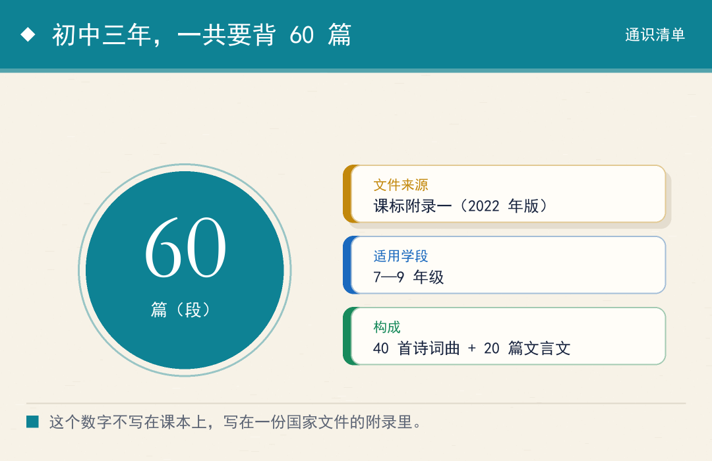
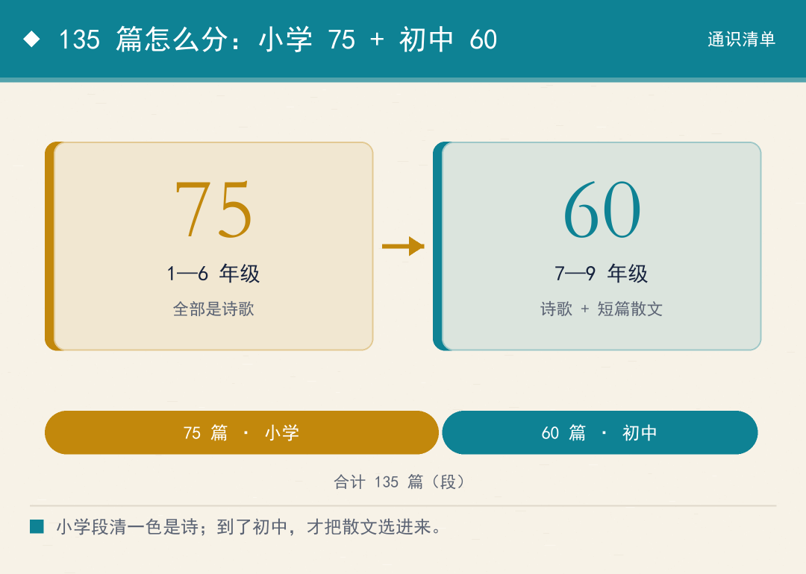
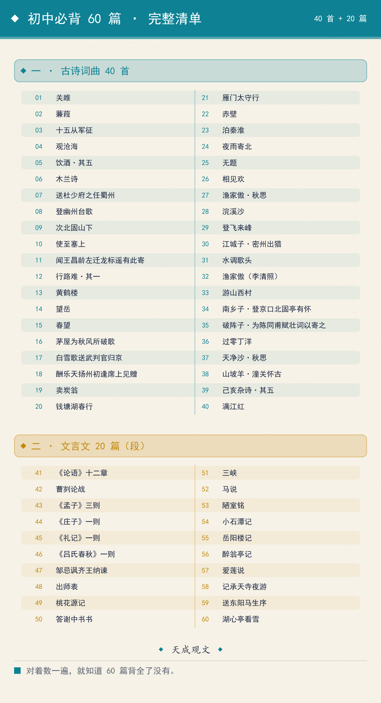
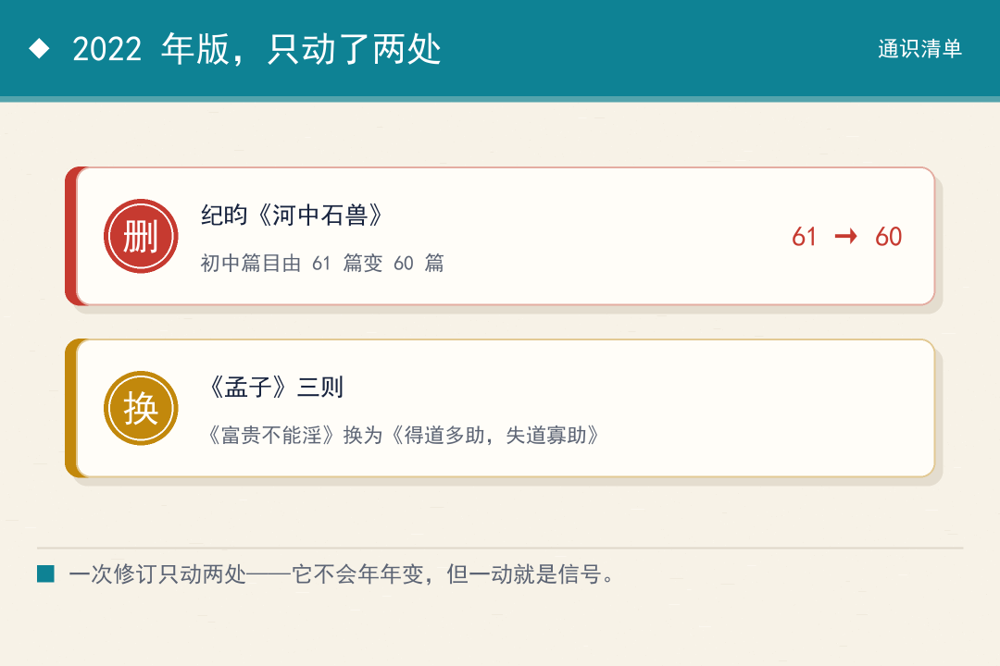
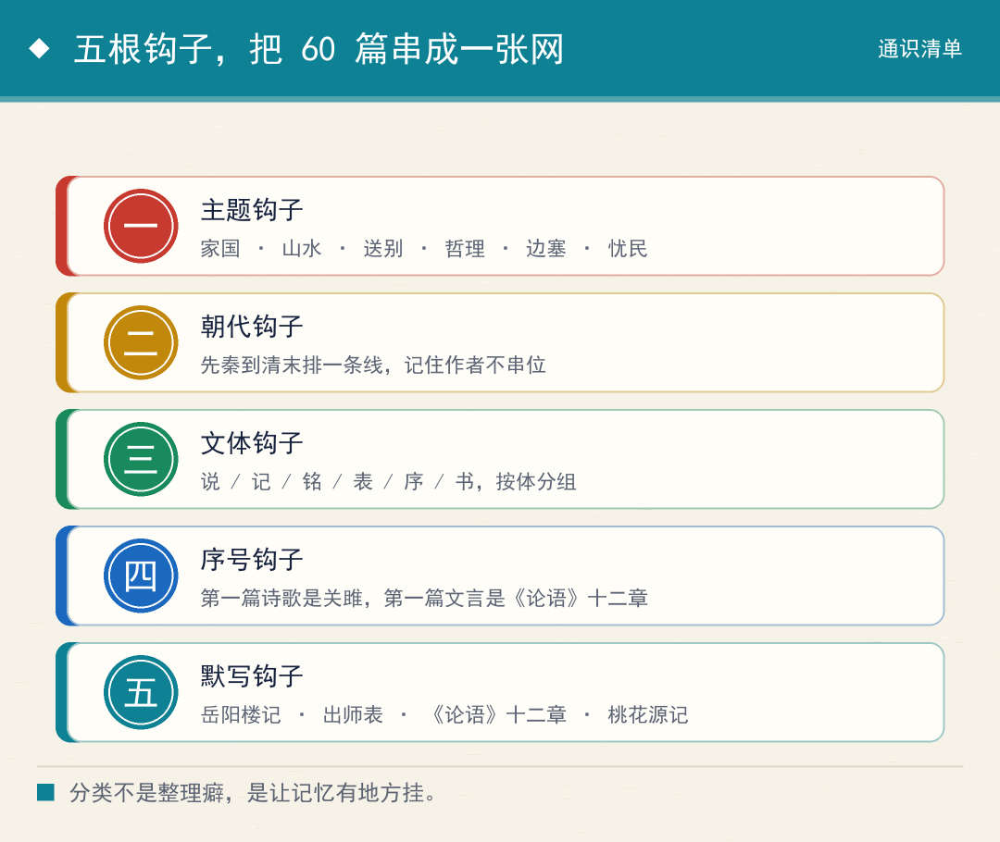

# 中考要背多少古诗文？初中三年 60 篇，一篇不多
> 💡 备注属性未写入，可能是备注属性名称或者类型被修改了，建议将字段类型设置为 rich_text，可以在小程序-操作-修改文章数据库页面进行调整
> 💡 原文链接:[https://mp.weixin.qq.com/s?__biz=MzY4NTQ0NjQ4Mg==&mid=2247484170&idx=1&sn=716af2b86a704d46f1fca971683fb11c&chksm=f2927e75cbc5f79fac252196679d9dd0f77d907ede1ea4282c742444f142ae28f5271810d4c1#rd](https://mp.weixin.qq.com/s?__biz=MzY4NTQ0NjQ4Mg%3D%3D&mid=2247484170&idx=1&sn=716af2b86a704d46f1fca971683fb11c&chksm=f2927e75cbc5f79fac252196679d9dd0f77d907ede1ea4282c742444f142ae28f5271810d4c1#rd)
先问一个具体的问题：初中三年，一共要背多少篇古诗文？
多数人答不上来。课本一册一册发下来，篇目一页一页往后翻，没有人把它加总过一遍。
真去加总，答案是 60 篇。而且这个 60 不是出版社定的，不是老师定的，是一份国家文件写死的。

图1｜初中三年的背诵量：一批国家文件定下的 60 篇
### 60 这个数字，写在课标的一份附录里
定这个数的是《义务教育语文课程标准（2022 年版）》。它的附录一叫作"优秀诗文背诵推荐篇目"。
这份附录把九年义务教育划成两段：1 到 6 年级推荐 75 篇，7 到 9 年级推荐 60 篇（段）。
两段的性质不一样。前一段 75 篇全是诗歌；后一段除了诗歌，还选进了一些短篇散文，所以单位才写成"篇（段）"。
**它不是教学建议，是标准。教材怎么编、老师怎么教、卷子怎么出，都要往这份清单上靠。**

图2｜135 篇的两段结构：小学 75 篇全是诗，初中 60 篇含散文
### 60 篇其实是两批：40 首诗词，20 篇古文
先说诗词曲这一批，一共 40 首，按时代可以排成五段。
先秦两汉三首：关雎（《诗经·周南》）、蒹葭（《诗经·秦风》）、十五从军征（汉乐府）。
魏晋南北朝三首：观沧海（曹操）、饮酒·其五（陶渊明）、木兰诗（北朝民歌）。
唐代最多，十九首：送杜少府之任蜀州、登幽州台歌、次北固山下、使至塞上、闻王昌龄左迁龙标遥有此寄、行路难·其一、黄鹤楼、望岳、春望、茅屋为秋风所破歌、白雪歌送武判官归京、酬乐天扬州初逢席上见赠、卖炭翁、钱塘湖春行、雁门太守行、赤壁、泊秦淮、夜雨寄北、无题。
五代到宋十一首：相见欢（李煜）、渔家傲·秋思（范仲淹）、浣溪沙（晏殊）、登飞来峰（王安石）、江城子·密州出猎（苏轼）、水调歌头（苏轼）、渔家傲（李清照）、游山西村（陆游）、南乡子·登京口北固亭有怀（辛弃疾）、破阵子·为陈同甫赋壮词以寄之（辛弃疾）、过零丁洋（文天祥）。
元明清四首：天净沙·秋思（马致远）、山坡羊·潼关怀古（张养浩）、己亥杂诗·其五（龚自珍）、满江红（秋瑾）。
**唐诗占了将近一半。这不是偏好，是这一段的诗文本身就是高峰。**
再看文言文这一批，20 篇（段），从先秦一直排到明末清初。
先秦到汉的七篇：《论语》十二章、曹刿论战（《左传》）、《孟子》三则、《庄子》一则（北冥有鱼）、《礼记》一则（虽有嘉肴）、《吕氏春秋》一则（伯牙鼓琴）、邹忌讽齐王纳谏（《战国策》）。
魏晋南北朝五篇：出师表（诸葛亮）、桃花源记（陶渊明）、答谢中书书（陶弘景）、三峡（郦道元）。
唐宋六篇：马说（韩愈）、陋室铭（刘禹锡）、小石潭记（柳宗元）、岳阳楼记（范仲淹）、醉翁亭记（欧阳修）、爱莲说（周敦颐）、记承天寺夜游（苏轼）。
明两篇：送东阳马生序（宋濂）、湖心亭看雪（张岱）。
**把这些篇名连起来看，就是一部压缩版的中国散文史——这份清单是按文学史脉络编的，不是随手挑的。**

图3｜60 篇完整清单长图：建议存进相册，对着数一遍
### 2022 年，这份清单动了两处
对比 2011 年版，新版只有两处实质改动。
第一处，删掉了清代纪昀的《河中石兽》。初中篇目从 61 篇变成 60 篇，总数也从 136 缩到 135。
第二处，《孟子》三则里换了一篇：用《得道多助，失道寡助》替下了《富贵不能淫》。
**一次修订只动两处，说明这份清单极稳——它不会年年变，但一旦动了，就是信号。**

图4｜2022 年版只动了两处：删一篇、换一篇
### 它只给篇名，不给原文——这句话很关键
课标的附录只列篇名，60 篇的原文全部散在教材里。
这一点容易被忽略，但它解释了整件事的运行方式：清单是尺子，课本是材料。
一个学生的背诵量，实际上取决于他手上那六册书。清单告诉他"终点在哪"，教材告诉他"路怎么走"。
**尺子是统一的，材料是分散的。所以同样背了三年，不同的人到底背全了没有，差别很大。**
我早年读这些篇目的时候，就是一篇一篇零散地读，读到第四年才发现，有些篇目在脑子里是"孤岛"。后来我把它们按时代重新抄了一遍，才看出它们原本是一条线。
**零散记住的是一篇，串起来记住的是一段历史。**
### 五根钩子，把 60 篇串成一张网
要记住 60 篇，靠一遍遍重复是最慢的路子。按下面五根钩子归类，效率完全不同。
第一根，主题钩子。家国情怀一类：过零丁洋、破阵子、满江红、南乡子。山水田园一类：饮酒、钱塘湖春行、游山西村、三峡。送别怀人一类：送杜少府、白雪歌、闻王昌龄左迁龙标。哲理言志一类：登飞来峰、己亥杂诗、酬乐天、望岳。边塞征战一类：使至塞上、雁门太守行、十五从军征。
第二根，朝代钩子。从先秦到清末排成一条时间线，记住作者，就不容易串位。
第三根，文体钩子。"说"一组：马说、爱莲说。"记"一组：小石潭记、岳阳楼记、醉翁亭记、桃花源记、记承天寺夜游。"铭"只有一篇陋室铭，"表"只有一篇出师表，"序"只有一篇送东阳马生序。
第四根，序号钩子。清单的第一篇诗歌是关雎，第一篇文言文是《论语》十二章。头尾记牢，中间就有了锚。
第五根，默写钩子。岳阳楼记、出师表、《论语》十二章、桃花源记这几篇，是默写题反复出现的地方，值得比别人多背三遍。
**分类不是整理癖，是让大脑有地方"挂"东西。没有钩子的记忆，存进去也取不出来。**
### 这份清单真正的分量
一份清单看着平淡，但它是一次公开的取舍。
135 篇，是把九年时间里最值得记的东西挑出来，压成一个刻度。挑掉的比留下的多得多。
**清单的价值不在于它收了多少，而在于它替所有人划了一条共同的线。**
我认为，这份清单对普通家庭最实际的作用，是给了一个可核对的坐标：到底背没背全，不用猜，对着清单数一遍就知道。
至于 60 篇之外的天地，那是个人的事；这 60 篇之内的事，是标准的事。

图5｜五根记忆钩子：主题 / 朝代 / 文体 / 序号 / 默写
免责声明：本文内容为传统文化、民俗与思想史范畴的知识分享，旨在帮助读者理解古人的思维方式与历史语境。文中所引述均为文献记载、民俗现象或学术讨论，不构成对任何个人事务的预测、指导或建议。请读者以文化视角理性看待。

## 摘要

（待补充）

## 我的笔记

（待补充）
