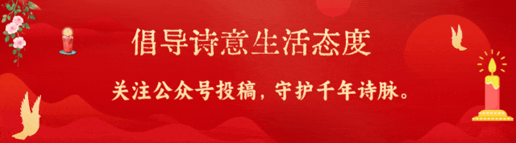

# 串起中华五千年的180个成语典故：按朝代整理，孩子学语文，大人读人生，建议珍藏！
> 💡 备注属性未写入，可能是备注属性名称或者类型被修改了，建议将字段类型设置为 rich_text，可以在小程序-操作-修改文章数据库页面进行调整
> 💡 原文链接:[https://mp.weixin.qq.com/s?__biz=MzI2NDI3ODk0OQ==&mid=2248172137&idx=1&sn=91e906edeb1c62a38c28609090a9eeec&chksm=e839d46d0e5a106f0c2051007c66fd65a5f1a2872532617f1e5d1f0dde28188b8bf60cfc1522#rd](https://mp.weixin.qq.com/s?__biz=MzI2NDI3ODk0OQ%3D%3D&mid=2248172137&idx=1&sn=91e906edeb1c62a38c28609090a9eeec&chksm=e839d46d0e5a106f0c2051007c66fd65a5f1a2872532617f1e5d1f0dde28188b8bf60cfc1522#rd)

**◆ ◆ ◆**
**中国人说话，常带成语。**
「卧薪尝胆」是勾践的十年，「破釜沉舟」是项羽的一战，「三顾茅庐」是刘备的三次登门，「精忠报国」是岳飞的一生。每一个成语背后，都站着一个人、一段历史。
我们把180条成语典故与历史名句，按朝代整理成十卷。从上古神话到明清，从春秋战国到两晋南北朝。每条含人物、释义、出处。
**01**
**卷一 上古·神话**
**01. 精卫填海——精卫**
炎帝之女溺亡东海后化为精卫鸟，衔石填海。比喻意志坚决、不畏艰难。出处：《山海经·北山经》
**02. 夸父追日——夸父**
追逐太阳至死不屈。比喻追求远大目标、坚持不懈。出处：《山海经·海外北经》
**03. 女娲补天——女娲**
炼五色石修补破损天空、拯救苍生。比喻改造天地、拯救危难的伟大功绩。出处：《淮南子·览冥训》
**04. 后羿射日——后羿**
射落九日、拯救万民于酷热。比喻为民除害、勇敢无畏。出处：《淮南子·本经训》
**05. 嫦娥奔月——嫦娥**
偷吃不死药后飞往月宫。比喻追求美好事物或离别后的思念。出处：《淮南子·览冥训》
**06. 愚公移山——愚公**
立志移走门前太行、王屋二山。比喻下定决心、持之以恒克服困难。出处：《列子·汤问》
**07. 大禹治水——大禹**
采用“疏导”之法治理洪水。比喻治理重大问题、有勇有谋、坚持不懈。出处：《史记·夏本纪》
**08. 神农尝百草——神农**
亲尝百草辨别药性、为民寻药。比喻勇于探索、为民造福。出处：《淮南子·修务训》
**09. 盘古开天——盘古**
劈开混沌、开创天地。比喻开创纪元、开辟新天地。出处：《三五历纪》
**02**
**卷二 春秋**
**10. 退避三舍——重耳（晋文公）**
承诺作战时退让九十里。比喻避让锋芒、信守承诺。出处：《左传·僖公二十三年》
**11. 一鸣惊人——楚庄王**
长期韬光养晦后突然展现才能。比喻平时默默无闻、关键时刻一举成名。出处：《史记·楚世家》
**12. 老马识途——管仲**
用老马带路走出迷谷。比喻有经验的人熟悉情况、能起引导作用。出处：《韩非子·说林上》
**13. 卧薪尝胆——勾践**
战败后睡柴草、尝苦胆励精图治。比喻刻苦自励、立志复仇。出处：《史记·越王勾践世家》
**14. 问鼎中原——楚庄王**
率军在周王室郊外耀武扬威，遣使问九鼎轻重。比喻觊觎最高权力。出处：《左传·宣公三年》
**15. 三令五申——孙武**
反复下令操练宫女，斩杀不听令的队长。比喻再三命令告诫。出处：《史记·孙子吴起列传》
**16. 一鼓作气——曹刿**
作战时第一次击鼓士气最盛。比喻趁劲头大的时候一口气把事情做完。出处：《左传·庄公十年》
**17. 唇亡齿寒——宫之奇**
嘴唇没了牙齿就会受寒。比喻关系密切、利害相关。出处：《左传·僖公五年》
**18. 大义灭亲——石碏**
为君臣大义而灭父子私情。比喻维护正义而不徇私情。出处：《左传·隐公四年》
**19. 多行不义必自毙——共叔段**
坏事做多了必然自取灭亡。出处：《左传·隐公元年》
**20. 楚幕有乌——郑国**
楚军夜间撤走留下空营幕，乌鸦栖止其上。比喻败退或军事力量空虚。出处：《左传·庄公二十八年》
**21. 甘拜下风——晋大夫**
晋大夫对秦穆公表示甘居下列。后用作自谦词。出处：《左传·僖公十五年》
**22. 班荆道故——伍举、公孙归生**
朋友途中相遇，铺草而坐共话旧情。出处：《左传·襄公二十六年》
**23. 苌弘化碧——苌弘**
苌弘含冤而死，血化为碧玉。比喻忠贞之人含冤而死。出处：《庄子·外物》
**24. 表里山河——子犯**
晋楚决战前，子犯劝晋文公凭太行山和黄河之险固守。比喻地理国防之固。出处：《左传·僖公二十八年》
**25. 背城借一——宾媚人**
背靠城墙与敌人决一死战。出处：《左传·成公二年》
**26. 病入膏肓——晋景公**
病到无法医治的地步。比喻事情到了无法挽救的地步。出处：《左传·成公十年》
**27. 高山流水——俞伯牙、钟子期**
弹奏《高山流水》遇知音。比喻知音难觅或乐曲高妙。出处：《列子·汤问》
**03**
**卷三 战国**
**28. 完璧归赵——蔺相如**
出使秦国凭智谋保全和氏璧归还赵国。比喻将物品完好无损归还原主。出处：《史记·廉颇蔺相如列传》
**29. 负荆请罪——廉颇**
身背荆条向蔺相如请罪。比喻知错能改、主动认错赔罪。出处：《史记·廉颇蔺相如列传》
**30. 纸上谈兵——赵括**
空谈兵法理论却不能解决实际问题。比喻脱离实际的空谈。出处：《史记·廉颇蔺相如列传》
**31. 围魏救赵——孙膑**
围攻魏国都城解救赵国。比喻避开强敌锋芒、攻击其要害以解困。出处：《史记·孙子吴起列传》
**32. 毛遂自荐——毛遂**
主动向平原君推荐自己出使楚国。比喻自告奋勇、自我推荐。出处：《史记·平原君虞卿列传》
**33. 图穷匕见——荆轲**
地图展到尽头露出匕首。比喻事情发展到最后真相显露。出处：《战国策·燕策三》
**34. 窃符救赵——信陵君**
盗取兵符夺取兵权，率兵救赵。出处：《史记·魏公子列传》
**35. 胡服骑射——赵武灵王**
学习胡人服装、发展骑兵。比喻变革图强。出处：《史记·赵世家》
**36. 朝秦暮楚——各诸侯国**
时而助秦，时而事楚。比喻态度动摇多变、反复无常。出处：《战国策》
**37. 千金买骨——郭隗**
用千金买千里马骨，吸引千里马到来。比喻招揽人才的迫切。出处：《战国策·燕策一》
**38. 悬梁刺股——孙敬（东汉）、苏秦（战国）**
头悬梁、锥刺股。比喻勤苦读书、奋发自强。出处：《太平御览》《战国策·秦策一》
**39. 前倨后恭——苏秦**
起初傲慢，后来恭敬。比喻态度前后反差极大。出处：《战国策·秦策一》
**40. 狡兔三窟——孟尝君**
狡猾的兔子有三个洞穴。比喻藏身之处多、便于躲避灾祸。出处：《战国策·齐策四》
**41. 鸡鸣狗盗——孟尝君**
学鸡叫、装狗偷盗。比喻微不足道的技能。出处：《史记·孟尝君列传》
**42. 纵横捭阖——苏秦、张仪**
指在政治或外交上运用手段进行分化或拉拢。出处：《鬼谷子》
**43. 以逸待劳——王翦**
养精蓄锐、等待疲劳的敌人。出处：《孙子兵法》
**44. 杀妻求将——吴起**
为求将位而杀妻。比喻为追求名利不择手段。出处：《史记·孙子吴起列传》
**45. 讳疾忌医——蔡桓公**
隐瞒疾病、不愿医治。比喻怕人批评而掩饰自己的缺点和错误。出处：《韩非子·喻老》
**46. 目不见睫——庄子**
眼睛看不见自己的睫毛。比喻没有自知之明。出处：《韩非子·喻老》
**47. 门庭若市——邹忌**
门前和院子里像集市一样热闹。形容来的人很多。出处：《战国策·齐策一》
**48. 自知之明——邹忌、齐威王**
能正确认识自己。出处：《战国策·齐策一》
**49. 三人成虎——庞葱**
三个人谎报城市里有老虎，听者就信以为真。比喻谣言重复多次就使人信以为真。出处：《战国策·魏策二》
**50. 南辕北辙——季梁**
想往南而车子却向北行。比喻行动和目的正好相反。出处：《战国策·魏策四》
**51. 滥竽充数——南郭**
不会吹竽的人混在吹竽队伍里充数。比喻没有真才实学的人混在行家里面充数。出处：《韩非子·内储说上》
**52. 买椟还珠——郑人**
买下装珍珠的盒子，却退还了珍珠。比喻取舍不当、舍本逐末。出处：《韩非子·外储说左上》
**53. 郑人买履——郑人**
宁可相信尺码也不相信自己的脚。比喻墨守成规、不知变通。出处：《韩非子·外储说左上》
**54. 守株待兔——宋人**
守着树桩等兔子撞上来。比喻不主动努力而存侥幸心理。出处：《韩非子·五蠹》
**55. 狐假虎威——江乙**
狐狸借老虎威势吓走百兽。比喻倚仗别人势力欺压人。出处：《战国策·楚策一》
**56. 惊弓之鸟——更羸**
被弓箭吓怕了的鸟。比喻受过惊吓的人碰到一点动静就非常害怕。出处：《战国策·楚策四》
**57. 画蛇添足——陈轸**
画蛇时给蛇添上脚。比喻做了多余的事反而不好。出处：《战国策·齐策二》
**58. 亡羊补牢——庄辛**
羊丢了再修羊圈。比喻出了问题后及时补救。出处：《战国策·楚策四》
**59. 鹬蚌相争——苏代**
鹬和蚌互相争持不下。比喻双方相持不下、两败俱伤。出处：《战国策·燕策二》
**60. 曲高和寡——宋玉**
曲调越高深，能跟着唱的人就越少。比喻知音难得。出处：《对楚王问》
**61. 阳春白雪——宋玉**
战国时代楚国的一种高雅的歌曲。比喻高深的、不通俗的文学艺术。出处：《对楚王问》
**62. 下里巴人——宋玉**
战国时代楚国民间流行的一种歌曲。比喻通俗的文学艺术。出处：《对楚王问》
**63. 墨守成规——墨子**
固执拘泥于旧的规章制度，不愿变通。出处：《墨子·公输》
**64. 爱媵贱女——秦穆公**
秦穆公嫁女，陪嫁女妾太美反使公主被轻贱。比喻舍本逐末。出处：《韩非子·外储说左上》
**04**
**卷四 秦·楚汉**
**65. 焚书坑儒——秦始皇**
焚烧典籍、坑杀儒生。比喻摧残文化、迫害知识分子。出处：《史记·秦始皇本纪》
**66. 指鹿为马——赵高**
故意将鹿说成马混淆是非。比喻颠倒黑白、擅权欺上。出处：《史记·秦始皇本纪》
**67. 约法三章——刘邦**
进入咸阳后制定三条规约。比喻简明扼要的行为准则。出处：《史记·高祖本纪》
**68. 破釜沉舟——项羽**
渡河后砸破炊具、凿沉船只。比喻下定决心不留退路、背水一战。出处：《史记·项羽本纪》
**69. 四面楚歌——项羽**
垓下之战时楚军被围，四面传来楚地歌声。比喻陷入四面受敌、孤立无援的境地。出处：《史记·项羽本纪》
**70. 十面埋伏——项羽**
设伏兵于十面以围歼敌军。比喻陷入重重包围。出处：元曲《十面埋伏》（非《史记》原文）
**71. 无颜见江东父老——项羽**
自感惭愧，没有脸面见故乡人。出处：《史记·项羽本纪》
**72. 锦衣夜行——项羽**
穿着锦绣衣服在夜间行走。比喻荣显不能使人知道。出处：《史记·项羽本纪》
**73. 沐猴而冠——项羽**
猕猴戴帽子。比喻外表虽装扮得很像样，但本质却掩盖不了。出处：《史记·项羽本纪》
**74. 背水一战——韩信**
背靠河水摆开阵势。比喻决一死战、不留退路。出处：《史记·淮阴侯列传》
**75. 暗度陈仓——韩信**
表面修栈道迷惑项羽，实则绕道陈仓夺取关中。比喻暗中行动、出奇制胜。出处：《史记·淮阴侯列传》
**76. 多多益善——韩信**
越多越好。出处：《史记·淮阴侯列传》
**77. 一饭千金——韩信**
受人一顿饭的恩惠，用千金报答。比喻厚厚地报答对自己有恩的人。出处：《史记·淮阴侯列传》
**78. 胯下之辱——韩信**
忍受从他人胯下钻过的屈辱。比喻能屈能伸、忍辱负重。出处：《史记·淮阴侯列传》
**79. 成也萧何，败也萧何——萧何**
**成事由于萧何，败事也由于萧何。比喻事情的成功和失败都是由同一个人造成的。出处：《史记·淮阴侯列传》**
**80. 孺子可教——张良**
年轻人有培养前途。出处：《史记·留侯世家》
**81. 运筹帷幄——张良**
在军帐中筹划策略。比喻善于谋划。出处：《史记·高祖本纪》
**05**
**卷五 西汉**
**82. 凿壁偷光——匡衡**
凿穿墙壁借邻居家灯光读书。形容家境贫寒却勤学苦读。出处：《西京杂记》卷二
**83. 金屋藏娇——刘彻**
建金屋给阿娇住。比喻宠爱妻子或另筑爱巢。出处：《汉武故事》（古小说）
**84. 封狼居胥——霍去病**
在狼居胥山筑坛祭天。比喻建立显赫功勋。出处：《史记·卫将军骠骑列传》
**85. 匈奴未灭，何以家为——霍去病**（历史名句）
匈奴还没消灭，怎么能安家呢。出处：《史记·卫将军骠骑列传》
**86. 苏武牧羊——苏武**
出使匈奴被扣，牧羊十九年持节不屈。比喻坚贞不屈、忠于祖国。出处：《汉书·苏武传》
**87. 昭君出塞——王昭君**
远嫁匈奴和亲。出处：《汉书·元帝纪》
**88. 金城汤池——蒯通**
金属造的城，滚水形成的护城河。形容防守坚固。出处：《汉书·蒯通传》
**89. 一诺千金——季布**
许下的诺言价值千金。形容说话算数、极有信用。出处：《史记·季布栾布列传》
**90. 鸡犬升天——刘安**
一人得道，鸡犬升天。比喻一个人做了官，和他有关系的人也都跟着得势。出处：《神仙传·刘安》
**91. 投笔从戎——班超**
放弃文书工作投身军旅。比喻弃文从武、立志报国。出处：《后汉书·班超传》
**92. 马革裹尸——马援**
用马皮把尸体包裹起来。形容英勇作战、死于疆场。出处：《后汉书·马援传》
**93. 老当益壮——马援**
年纪虽大但志气更旺盛。比喻老有所为、不服老。出处：《后汉书·马援传》
**94. 画虎类犬——马援**
画老虎不成反而像狗。比喻模仿不到家，反而不伦不类。出处：《后汉书·马援传》
**95. 实事求是——刘德**
根据实证，求索真相。出处：《汉书·河间献王传》
**96. 夜郎自大——夜郎**
夜郎国国王问汉使“汉孰与我大”。比喻妄自尊大。出处：《史记·西南夷列传》
**97. 项庄舞剑，意在沛公——项庄**
表面舞剑，实则想刺杀刘邦。比喻言行表面无害、实则暗藏杀机。出处：《史记·项羽本纪》
**06**
**卷六 东汉·三国**
**98. 三顾茅庐——刘备**
三次前往隆中拜访诸葛亮。比喻诚心诚意一再邀请贤才。出处：《三国志·诸葛亮传》
**99. 鞠躬尽瘁——诸葛亮**
恭敬谨慎、竭尽心力。出处：《后出师表》（文献有争议）
**100. 开诚布公——诸葛亮**
敞开胸怀、显示公正。出处：《三国志·诸葛亮传》
**101. 集思广益——诸葛亮**
集中众人智慧、广泛听取意见。出处：《三国志·董和传》
**102. 淡泊明志——诸葛亮**
不追求名利以表明志趣。出处：《诫子书》
**103. 不知所云——诸葛亮**
不知道说的是什么。出处：《出师表》
**104. 七擒七纵——诸葛亮、孟获**
七次擒获又七次释放。比喻运用策略使对方心服。出处：《三国志·诸葛亮传》裴松之注
**105. 初出茅庐——诸葛亮**
初次走出隐居的茅庐辅佐刘备。比喻刚步入社会或职场、缺乏经验。出处：《三国演义》第三十九回（小说演绎）
**106. 锦囊妙计——诸葛亮**
预先准备的巧妙计策。出处：《三国演义》第五十四回（小说演绎）
**107. 草船借箭——诸葛亮**
利用草船借来十万支箭。比喻运用智谋借他人之力达到目的。出处：《三国演义》第四十六回（小说演绎）
**108. 万事俱备，只欠东风——周瑜、诸葛亮**
一切准备就绪，只差关键条件。出处：《三国演义》第四十九回（小说演绎）
**109. 赔了夫人又折兵——周瑜**
想占便宜反而遭受双重损失。出处：《三国演义》第五十五回（小说演绎）
**110. 望梅止渴——曹操**
以“前方有梅林”激励士兵解渴。比喻用空想安慰自己缓解当下困境。出处：《世说新语·假谲》
**111. 割发代首——曹操**
割下头发代替首级受罚。出处：《三国志·武帝纪》裴松之注
**112. 老骥伏枥——曹操**
年老的千里马躺在马槽旁，仍想奔驰千里。比喻有志之士虽老仍有雄心。出处：《龟虽寿》
**113. 煮豆燃萁——曹植**
用豆秸煮豆子。比喻兄弟间自相残杀。出处：《世说新语·文学》
**114. 七步成诗——曹植**
七步之内作出一首诗。形容才思敏捷。出处：《世说新语·文学》
**115. 才高八斗——曹植**
形容人文采出众、才华极高。出处：《南史·谢灵运传》
**116. 乐不思蜀——刘禅**
贪图享乐、忘记故国。比喻忘本弃义、贪图安逸。出处：《三国志·蜀书·后主传》裴松之注
**117. 一身是胆——赵云**
浑身都是胆量。形容胆量大、无所畏惧。出处：《三国志·赵云传》裴松之注
**118. 偃旗息鼓——赵云**
放倒旗子、停止击鼓。比喻停止战斗或收敛声势。出处：《三国志·赵云传》裴松之注
**119. 单刀赴会——关羽**
独自携带单刀前往东吴赴宴。比喻勇敢无畏、孤身前往险境。出处：《三国演义》第六十六回（小说演绎）
**120. 封金挂印——关羽**
封存金银、挂起官印。出处：《三国演义》第二十六回（小说演绎）
**121. 过五关斩六将——关羽**
闯过五座关隘、斩杀六员大将。比喻克服重重困难、勇往直前。出处：《三国演义》第二十七回（小说演绎）
**122. 超群绝伦——关羽**
超出众人、同辈中没有可以相比的。出处：《三国志·关羽传》
**123. 言过其实——马谡**
言语浮夸，超过实际能力。出处：《三国志·马良传》
**124. 负重致远——庞统**
背着沉重的东西走远路。比喻能够负担艰巨任务。出处：《三国志·庞统传》
**125. 如鱼得水——刘备**
像鱼得到水一样。比喻得到跟自己十分投合的人或对自己很合适的环境。出处：《三国志·诸葛亮传》
**126. 如嚼鸡肋——杨修**
像吃鸡的肋骨，吃着没味，扔掉可惜。比喻事情不做可惜、做起来没有多大好处。出处：《三国志·魏书·武帝纪》裴松之注
**127. 手不释卷——吕蒙**
手里总拿着书不肯放下。形容勤奋好学、刻苦读书。出处：《三国志·吴书·吕蒙传》裴松之注
**128. 刮目相看——吕蒙**
擦亮眼睛看。比喻用新的眼光看待。出处：《三国志·吕蒙传》裴松之注
**129. 吴下阿蒙——吕蒙**
指原来不好读书的吕蒙。后泛指缺少学识才干的人。出处：《三国志·吕蒙传》
**130. 士别三日——吕蒙**
多日不见，当刮目相看。出处：《三国志·吕蒙传》裴松之注
**131. 兵贵神速——郭嘉**
用兵贵在行动特别迅速。出处：《三国志·郭嘉传》
**132. 大器晚成——崔琰**
大的器物要经过长时间加工才能做成。比喻能担当大事的人要经过长期锻炼。出处：《三国志·崔琰传》
**133. 坚壁清野——荀彧**
加固壁垒、转移物资。比喻对付强敌入侵的一种方法。出处：《三国志·荀彧传》
**134. 画饼充饥——卢毓**
用画出来的饼缓解饥饿。比喻用空想安慰自己、无法解决实际问题。出处：《三国志·魏书·卢毓传》
**135. 对牛弹琴——公明仪**
对着牛弹奏高雅的琴曲，牛却毫无反应。比喻对不懂道理的人讲深奥的话，白费口舌。出处：《弘明集·理惑论》（汉魏间典故）
**07**
**卷七 两晋南北朝**
**136. 势如破竹——杜预**
形势像劈竹子一样，劈开上端之后，底下的都随着刀刃分开了。比喻节节胜利、毫无阻碍。出处：《晋书·杜预传》
**137. 迎刃而解——杜预**
劈竹子时，头上几节破开以后，下面各节顺着刀口就分开了。比喻主要问题解决了，其他问题就很容易解决。出处：《晋书·杜预传》
**138. 洛阳纸贵——左思**
《三都赋》写成后众人争抄，导致洛阳纸价上涨。比喻著作风行一时、广为流传。出处：《晋书·左思传》
**139. 车载斗量——赵咨**
用车载、用斗量。形容数量很多。出处：《三国志·吴书·吴主传》裴松之注
**140. 闻鸡起舞——祖逖**
听到鸡叫就起床练剑。比喻有志者抓紧时间磨砺意志、奋发图强。出处：《晋书·祖逖传》
**141. 中流击楫——祖逖**
在江中敲击船桨。比喻立志收复失地。出处：《晋书·祖逖传》
**142. 东山再起——谢安**
退隐东山后重新出山主持朝政。比喻失势后重新获得地位、卷土重来。出处：《晋书·谢安传》
**143. 草木皆兵——苻坚**
把山上的草木都当作敌兵。形容人在惊慌时疑神疑鬼。出处：《晋书·苻坚载记》
**144. 风声鹤唳——苻坚**
听到风声和鹤叫声都以为是追兵。形容惊慌失措、疑神疑鬼。出处：《晋书·谢玄传》
**145. 投鞭断流——苻坚**
把马鞭投到江里，都能截断水流。形容人马众多、兵力强大。出处：《晋书·苻坚载记》
**146. 鹤立鸡群——嵇绍**
像鹤站在鸡群中一样突出。比喻人的才能或仪表在众人中格外突出。出处：《世说新语·容止》
**147. 入木三分——王羲之**
书法笔力刚劲，墨迹渗入木板三分深。比喻见解深刻、笔法遒劲。出处：《书断·王羲之》
**148. 东床快婿——王羲之**
指豁达出众的女婿。出处：《世说新语·雅量》
**149. 管中窥豹——王献之**
从竹管中看豹，只看到豹身上的一块斑纹。比喻只看到事物的一部分。出处：《晋书·王献之传》
**150. 江郎才尽——江淹**
年轻时才华横溢，晚年文思衰退。比喻才思枯竭、再也无佳作。出处：《南史·江淹传》
**151. 画龙点睛——张僧繇**
为龙画上眼睛后龙即飞去。比喻在关键处加一笔使内容更传神、更出色。出处：《历代名画记·张僧繇》
**152. 渐入佳境——顾恺之**
吃甘蔗从尾部吃到根部，越吃越甜。比喻境况逐渐好转或兴趣逐渐浓厚。出处：《世说新语·排调》
**153. 咏絮之才——谢道韫**
以“未若柳絮因风起”形容雪花。比喻女子才华出众、文思敏捷。出处：《世说新语·言语》
**154. 枕戈待旦——刘琨**
头枕兵器等待天亮。比喻时刻准备作战、报国心切。出处：《晋书·刘琨传》
**155. 拾人牙慧——殷浩**
拾取别人的一言半语当作自己的话。比喻抄袭或套用别人说过的话。出处：《世说新语·文学》
**156. 杯弓蛇影——乐广**
**把酒杯中的弓影当成蛇。比喻疑神疑鬼、自相惊扰。出处：《晋书·乐广传》**
**157. 不为五斗米折腰——陶渊明**
不愿为微薄俸禄向权贵低头。比喻不为名利而屈服、坚守气节。出处：《晋书·陶潜传》
**158. 世外桃源——陶渊明**
与世隔绝、生活安乐的美好地方。出处：陶渊明《桃花源记》
**159. 不求甚解——陶渊明**
读书只求领会要旨，不在一字一句的解释上过分深究。出处：陶渊明《五柳先生传》
**160. 一箭双雕——长孙晟**
一箭射中两只雕。比喻做一件事达到两个目的。出处：《北史·长孙晟传》
**08**
**卷八 隋唐**
**161. 罄竹难书——李密**
用尽竹子也难写完。形容罪行多得写不完。出处：《旧唐书·李密传》（隋末）
**162. 铁杵磨针——李白**
看到老妇人磨铁杵成针而醒悟。比喻只要有毅力、坚持不懈就能成功。出处：《方舆胜览·眉州·磨针溪》
**163. 梦笔生花——李白**
梦见笔头生花后才华大增。比喻文笔出众、写出的文章生动美妙。出处：《开元天宝遗事·梦笔头生花》
**164. 口蜜腹剑——李林甫**
嘴上说得好听，内心却阴险狡诈。比喻两面三刀、笑里藏刀。出处：《资治通鉴·唐纪·玄宗天宝元年》
**165. 请君入瓮——来俊臣**
用周兴“请犯人入瓮烤问”的提议反问周兴。比喻以其人之道还治其人之身。出处：《资治通鉴·唐纪·则天皇后天授二年》
**166. 司空见惯——刘禹锡**
看惯了就不觉得奇怪。出处：刘禹锡《赠李司空妓》
**167. 春风得意——孟郊**
和暖的春风很适合人的心意。后形容人处境顺利、做事如意。出处：孟郊《登科后》
**168. 走马观花——孟郊**
骑在奔跑的马上看花。比喻粗略地观察事物。出处：孟郊《登科后》
**169. 桃李满天下——狄仁杰**
门生弟子遍布各地。比喻教育成果显著、弟子众多。出处：《资治通鉴·唐纪·武后久视元年》
**170. 黄粱一梦——卢生**
在梦中历尽荣华富贵，醒来黄粱米饭尚未煮熟。比喻虚幻的梦境或欲望破灭。出处：唐·沈既济《枕中记》
**09**
**卷九 宋**
**171. 黄袍加身——赵匡胤**
陈桥兵变后部下将黄袍披在赵匡胤身上。比喻发动政变夺取政权。出处：《宋史·太祖本纪》
**172. 开卷有益——赵光义**
读书总有好处。出处：《渑水燕谈录·文儒》
**173. 雪中送炭——宋太宗**
寒冬时为百姓送炭取暖。比喻在他人困难时给予及时帮助。出处：《宋史·太宗纪》
**174. 铁面无私——包拯**
办案公正严明、不徇私情。比喻公正无私、不畏权贵。出处：《宋史·包拯传》
**175. 精忠报国——岳飞**
忠诚报国、为国捐躯。比喻赤诚的爱国情怀。出处：《宋史·岳飞传》
