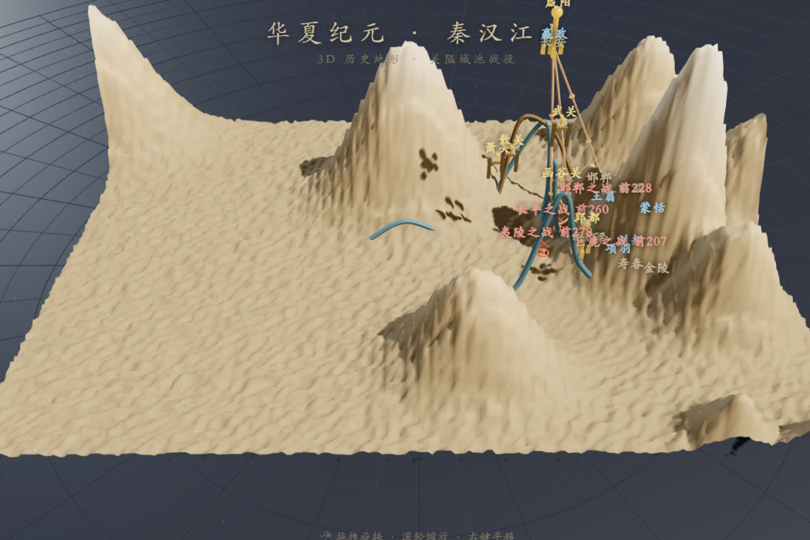
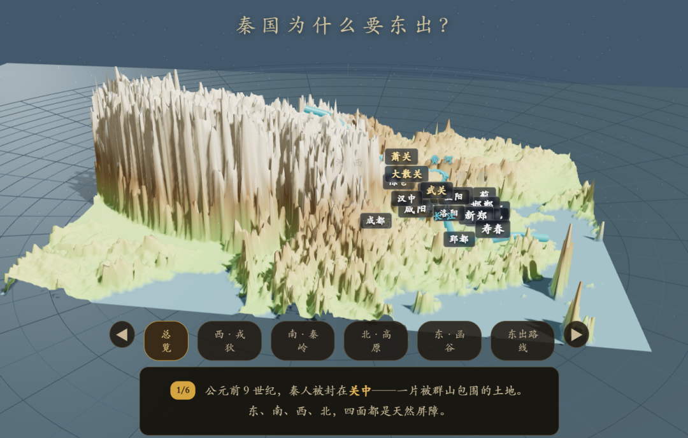
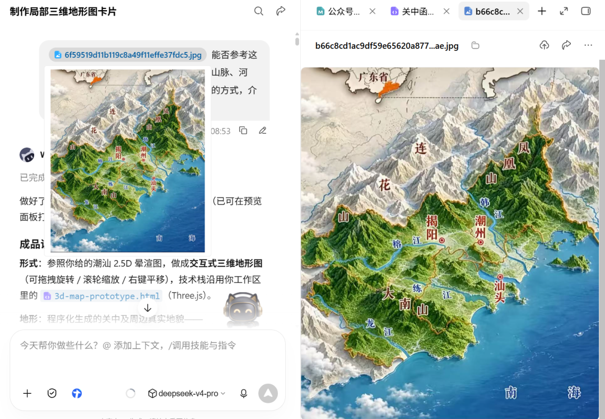

# 为了给孩子讲清楚秦国为什么能统一天下，我做了张三维地形图
> 💡 备注属性未写入，可能是备注属性名称或者类型被修改了，建议将字段类型设置为 rich_text，可以在小程序-操作-修改文章数据库页面进行调整
> 💡 原文链接:[https://mp.weixin.qq.com/s?__biz=MzA3NTIzMzA5NQ==&mid=2247484428&idx=1&sn=1ba5c78e219f15719f673292bf4b85f1&chksm=9e650c0209cdbba4dc01a15c64bedf3d0f3d2b41dbc03ce4f1c73ce4169823459d004d435881#rd](https://mp.weixin.qq.com/s?__biz=MzA3NTIzMzA5NQ%3D%3D&mid=2247484428&idx=1&sn=1ba5c78e219f15719f673292bf4b85f1&chksm=9e650c0209cdbba4dc01a15c64bedf3d0f3d2b41dbc03ce4f1c73ce4169823459d004d435881#rd)
上次说到，我给孩子做了秦的历史地图科普网页[和娃一起，把上下五千年做成了一张"会动"的地图](https://mp.weixin.qq.com/s?__biz=MzA3NTIzMzA5NQ%3D%3D&mid=2247484416&idx=1&sn=cd9504f95ae87988784b6c4773d6391d&scene=21#wechat_redirect)。我本人其实也很喜欢历史，但我过去学的历史也是平面的，后面我看到很多博主结合3D地图讲为什么古代的“关”那么重要，襄阳为什么是兵家必争之地，纸面上的文字一下变成了立体的认知，感觉完全不一样。
所以我就想，能不能把秦国的核心区域关中地图的地形给他展示出来，然后指给他看："你看，秦国的核心区域叫关中。它南边是秦岭，北边是黄土高原，东边有黄河和函谷关守着，西边是陇山。四面全是天然屏障，只有几条狭窄的通道可以进出——敌人打不进来，秦国人却可以随时冲出去。"
于是我开始动手，用AI"搓"出了一张**可以在浏览器里转着看的三维地形图**。
· · ·
### 一、怎么做出来的
核心思路很简单，但过程踩了三轮坑才找到满意的方向。
#### 第一版：用 Three.js 搭了个程序化地形
最开始的想法最直接——用 Three.js（一个开源的浏览器 3D 引擎），手写代码在场景里"堆"出关中的山脉。
秦岭、黄土高原、太行山、吕梁山……每一个都用程序生成的高斯山包模拟。关中平原、汉中盆地、洛阳河谷，把对应区域的高程压低形成盆地。黄河、渭河、泾河用圆柱形的管线画出来，咸阳、洛阳、函谷关这些地标用金色立柱和小门楼标记。
做出来的东西**能转、能缩放、能点标记弹卡片**，该有的交互都有了。**但太难看了。 **所有的山都是圆鼓鼓的土包，没有山脉该有的脊线和沟壑；河流是悬在地表上方的蓝色圆管，不像真的流淌在谷底。

#### 第二版：用高德地图接上真实数据
为了让地形更真实，我换了个策略——不再手写山包，直接接真实地图。
这次用了 WorkBuddy 内置的 KIMI K3.1 PRO 模型，让它帮我接入高德地图的 API。高德的卫星底图叠上三维地形拉伸——秦岭海拔多高、渭河从哪流、函谷关在哪个谷口，全是真数据。还加了一个底部的叙述卡片条，按步骤讲"秦国为什么要东出"，左滑右滑切换场景，像一个小型的交互课件。
做出来的东西**数据是准的**——每个山峰的高度、每条河的走向、每个关隘的位置都和真实地图对齐。但打开一看，又觉得哪里不对：**像一个 GIS 工程师的工作界面，不像是给孩子看的历史绘本。** 冷冰冰的卫星灰底、生硬的绿色覆被、机械的色块分块——标点和河流都飘在天上，调了很多版依然不如意。

#### 第三版：找到参考图，AI 终于做出勉强让人满意的地形
没办法，我只能去网上找我想要的给 AI 做参考。搜到了一张**三维立体晕渲地形图**——既有真实地貌起伏，又有手绘质感的风格。
我把这张图扔给 AI："照着这个感觉做。"

这一次稍微好了点。秦岭不再是冷冰冰的灰白色块，而是有柔和阴影和植被质感的山体；渭河平原是一片温暖的黄绿色；黄土高原的沟壑深浅分明。**真数据 + 手工质感 = 能给孩子看的历史地图。**
#### 在这基础上加细节
地图底子对了之后，又往上叠了几层：
**AI 生成的地标模型。** 做了城池、关隘的图标模型。（目前展示在地图上的效果不是太好，没有贴合）
**贴地的河流。** 河流从悬空的圆柱管改成了沿河谷铺展的平面水面带，黄河、渭河、泾河像丝绸一样铺在真正的谷底。
**历史卡片。** 11 个地标上都挂了信息卡片，点一下镜头飞过去，先讲地形、再讲历史。比如潼关——"黄河在此收束为悬崖窄道，南依秦岭"，然后才说"756 年哥舒翰守关，灵宝大败，长安沦陷"。其他卡片覆盖了函谷关的合纵攻秦、武关的楚怀王被扣和刘邦绕道入秦、大散关的暗度陈仓、蓝田的秦亡之役、龙门的大禹凿山、秦岭的蜀道之难，以及咸阳、洛阳、陈仓的城市格局。
· · ·
### 二、最终效果
打开就是一个**可自由探索的交互页面**：拖拽旋转、滚轮缩放、右键平移。缩近了能看清太白山的雪顶和河道，缩远了能看四塞关隘的整体布局。点一下地标，镜头自动飞过去，同时弹出地形与历史事件的讲解卡片。
整个页面是**单 HTML 文件**（高程数据、图标全部内嵌），不挑环境，双击就能用。画面上有山脉和河流标注、雪线、坡向色、日光照影。
这个 3D 页面也被嵌入到了我之前的「华夏纪元」互动历史项目里——顶部导航多了一个「三维山河」按钮，点进去就是这个地形场景。
· · ·
### 三、后续想继续完善的
**更清晰的地貌分层。** 目前能分辨山、平原、河流，但还不够——我希望孩子一眼能看出**这块是农田、这块是草原、这片是沙漠、这座是要塞**。比如河西走廊，如果能清楚区分绿洲农耕带和两侧戈壁，不用讲孩子就明白为什么"走廊"这么窄、为什么补给线一断就完蛋。
**在地形上画行军路线。** 这是我最想做的。霍去病的奔袭不是书本上的一根箭头，而是一条在三维山河间弯折的实线——溯渭水而上，穿陇山孔道，入河西走廊，沿祁连山北麓穿越沙漠边缘，深入漠北直抵狼居胥山。孩子转着地图看这条线，才真正懂得"深入敌境两千里"是什么概念，为什么"失道"会掉脑袋，为什么河西走廊是大汉的命脉。
**更多区域 + 时间轴。** 关中做完，同样的管线复制去巴蜀·剑门、山西·表里山河、中原·伊洛。再配上时间轴，推着朝代走、地形也跟着变——黄河几次大改道、湖泊的消长、边界的进退，一个时间条拉过去全看得到。
· · ·
### 四、孩子的反馈
这个3D地图我还没给孩子看，但之前做的秦朝历史地图，孩子评价很高，每个卡片他都探索了一遍。特别是7个国家的位置，哪个大哪个小，秦国打败六国的先后顺序他一下就记住了。
这个3D地图，希望也能得到他的认可。
· · ·
— 行远者 · AI 观察 —
