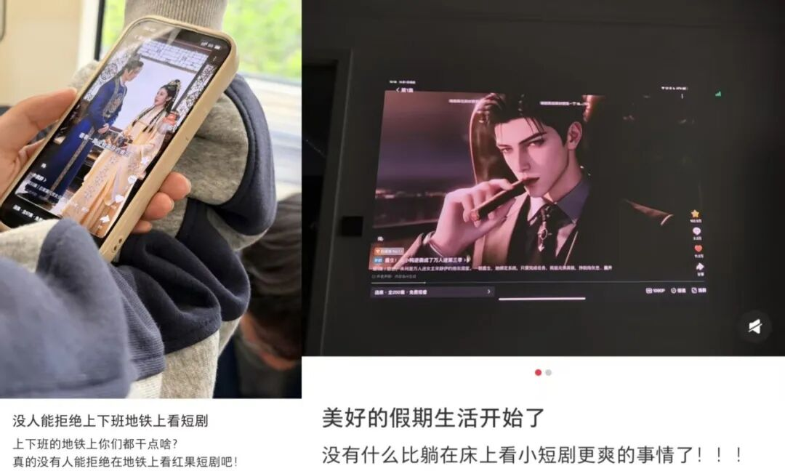
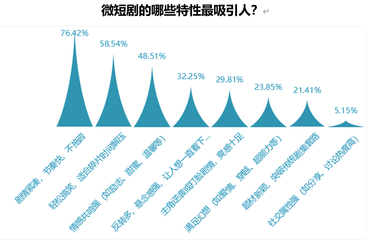
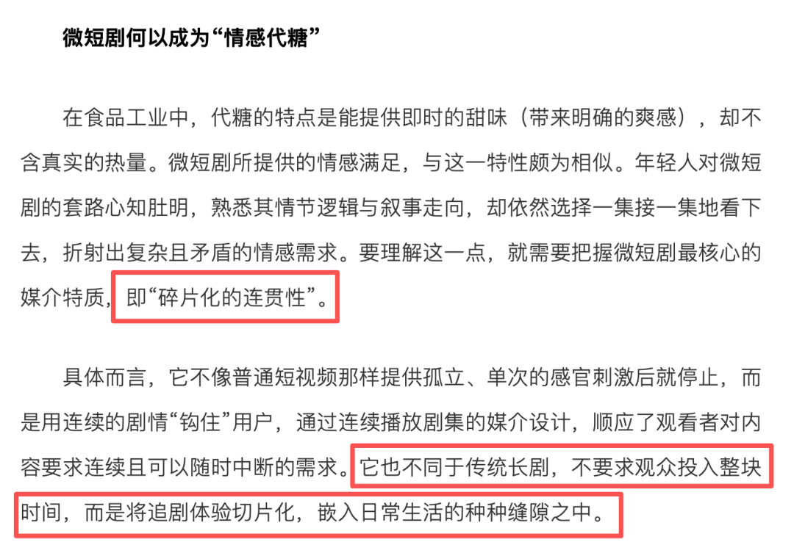
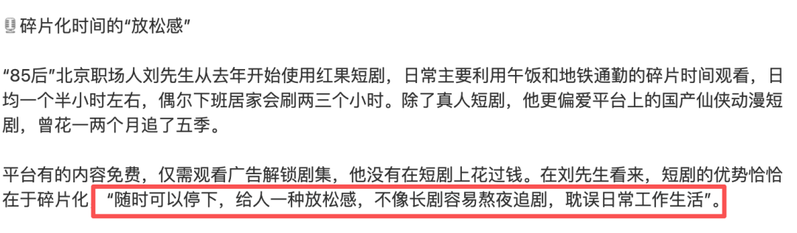
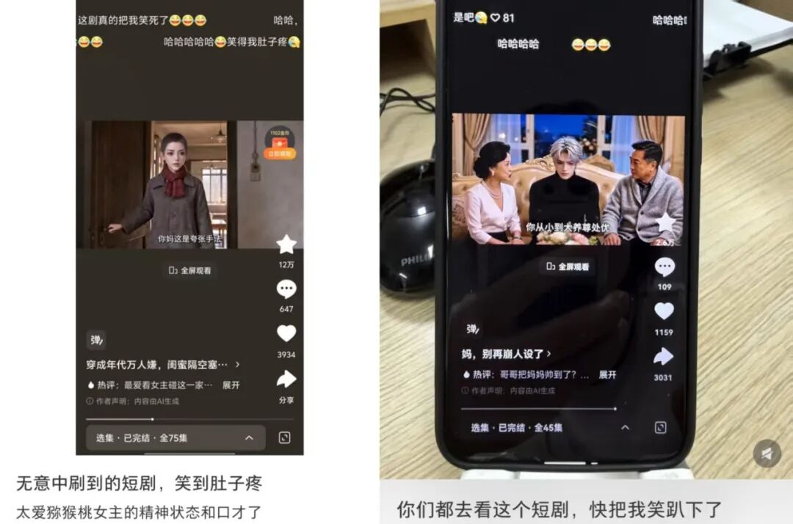
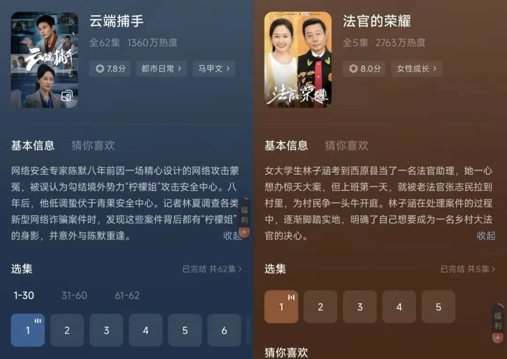
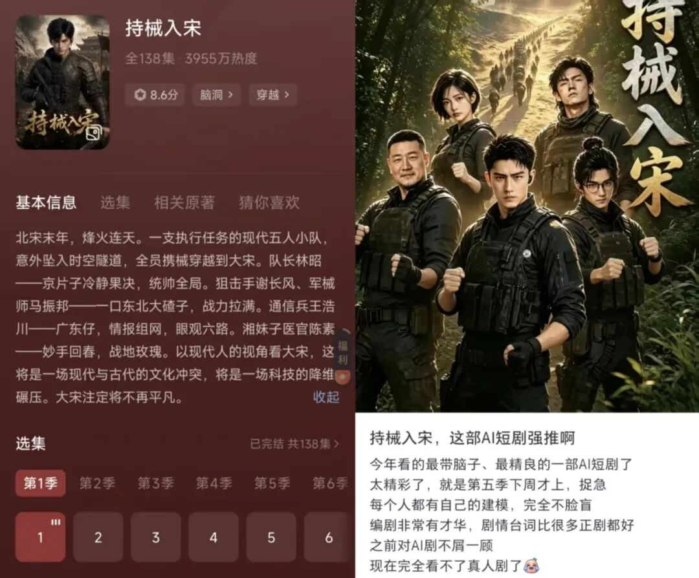
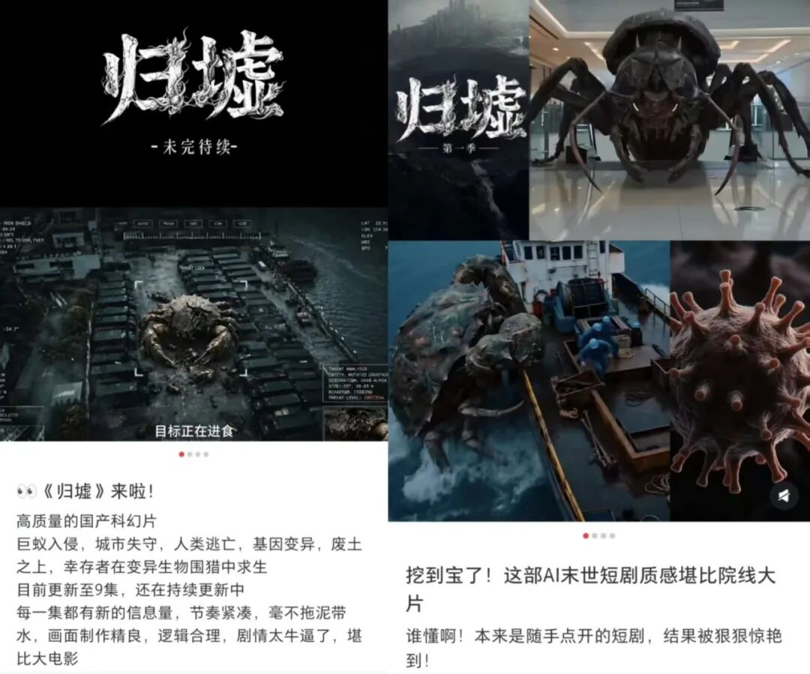
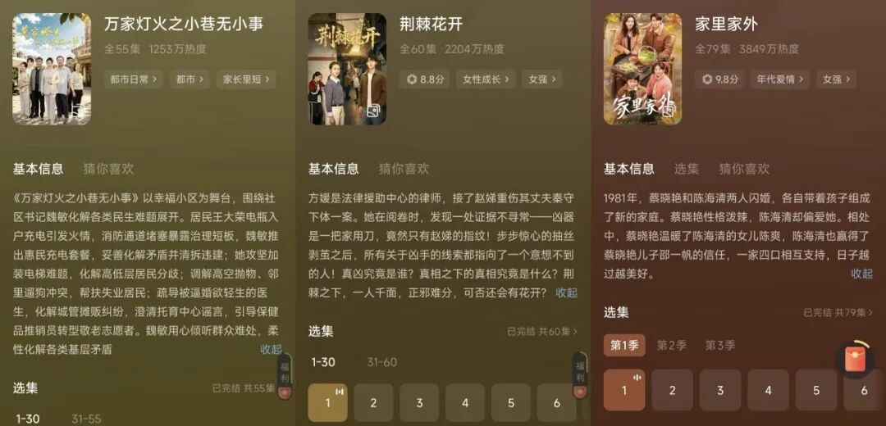
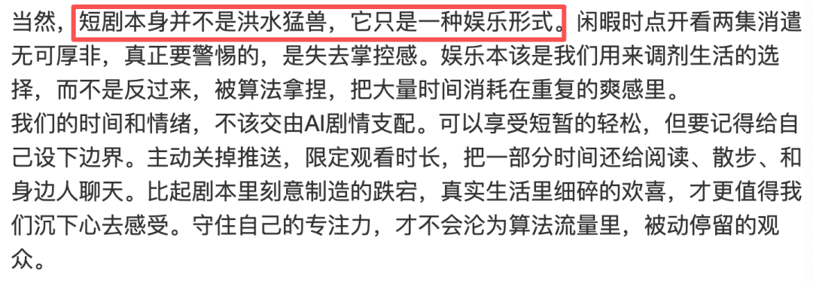

# 为什么偏偏是短剧，接住了成年人的疲惫？
> 💡 备注属性未写入，可能是备注属性名称或者类型被修改了，建议将字段类型设置为 rich_text，可以在小程序-操作-修改文章数据库页面进行调整
> 💡 原文链接:[https://mp.weixin.qq.com/s?__biz=MjM5NTAyODc2MA==&mid=2654974457&idx=1&sn=1b74b1d3f2d67da5b470b2456365ac61&chksm=bc5faa813b67bfa7a6d5ad52ea64e13133757f461a80ecaefd9ab76401ac4ed1d4eaaac01f57#rd](https://mp.weixin.qq.com/s?__biz=MjM5NTAyODc2MA%3D%3D&mid=2654974457&idx=1&sn=1b74b1d3f2d67da5b470b2456365ac61&chksm=bc5faa813b67bfa7a6d5ad52ea64e13133757f461a80ecaefd9ab76401ac4ed1d4eaaac01f57#rd)

王先生今年58岁，经营一家民营企业。下班回家的路上，点开一集短剧。
问他为什么看，他的回答很朴素：“就是看个乐儿。”
每天早上挤地铁，手机屏幕里可能正上演一场豪门恩怨；中午扒着几口饭，抽空看看男女主的关系又有什么新进展；晚上忙完工作、收拾完家务，躺在床上点开一集，给自己一段不被打扰的时间。短剧就这样进入了很多人的日常，成了随手可得的娱乐选项。

图源：小红书
有人会问，为什么偏偏是短剧？
答案也许不在内容本身，而在它兑现情绪的速度。一部电影要两小时，一部长剧要几十集铺陈，而短剧把“被逗一下”“被安慰一下”“被爽到一下”的时间压缩到几分钟。王先生喜欢30到40集的短剧，因为半小时里剧情能翻几番，不用等到明天。
另一位受访者小波说得更直接：“打开短剧，很多时候是为了暂时忘掉生活里的不开心。”

情绪是怎么被接住的
把“情绪价值”说成一个词，容易说得空。拆开来看，短剧接住情绪，靠的不是某一种题材，也不只是密集的反转，而是它与日常生活形成了一种刚刚好的配合。
第一件，几分钟就能兑现。
人的情绪往往等不了太久。早高峰的地铁上、午饭后的十几分钟、睡前还没完全放松下来的那段时间，都不适合进入一个需要耐心铺陈的故事。短剧不要求观众先记住复杂的人物关系，也不用等到几集之后才迎来转折。点开、进入、获得一次明确的情绪反馈，整个过程很短。
这种快，不只是节奏快，更像是一种及时回应。人在疲惫的时候，不一定有力气完成一场深度观看，但仍然需要被逗笑一下、被安慰一下，或者只是短暂地把注意力从现实里移开。短剧把这件事做得足够轻，也足够快。

来源：《中国消费者报》中国消费网
第二件，有头有尾。
短视频也很短，但短剧不同。它把一个长故事切成许多小段，每一段都留有悬念，又往前推进一点。观众花几分钟看完一集，会获得一种细小但明确的“完成感”：这件事做完了，情绪也有了着落。
《中国青年报》刊发的一项访谈研究把它称为“碎片化的连贯性”。它既适应零散时间，又保留了追故事的感觉。人不需要为它空出完整的一晚，却可以在一天的缝隙里，一点点跟着人物往前走。

图源：《中国青年报》
第三件，主动权在自己手里。
北京职场人刘先生说，他看重的是短剧“随时可以停下，给人一种放松感”。这句话说的不只是观看方式，也是一种心理感受。

来源：《南方日报》
**现实生活里，很多事情没有暂停键：工作要按时完成，消息要及时回复，关系需要耐心经营。到了短剧里，观众可以快进、退出，也可以换一部继续看。一位受访者说得更直接：“在工作当中已经很内耗了，在短剧中绝不内耗。”**
**这几分钟由自己决定，本身就是一种补偿。不是所有问题都能被解决，但至少在这段时间里，人不必再勉强自己坚持什么。**
第四件，它提供了一种轻量的陪伴。
短剧给的不只是剧情。弹幕里的共鸣、评论区的讨论、把一部剧顺手安利给朋友，都让观看从一个人的消遣，变成一种可以随时发起的连接。
在《中国青年报》的研究里，一位异地工作的受访者说：“我现在是在异地工作，没有朋友在一个城市，只能跟朋友安利一下最近看的剧。”短剧当然不能代替真实的陪伴，但它提供了一个很轻的开口：最近在看什么，哪个角色让人生气，哪段剧情又让人哭了。话题不重，却足以让两个人重新说上几句话。
有学者在一次访谈中打比方：长剧像在情感生活里经营一段稳定的关系，微短剧则更接近一次约会。它不要求观众长期投入，却能在当下给出回应。不是人们不再需要深的关系，而是在时间和精力有限的时候，也需要一种更容易抵达的连接。
所以，短剧所提供的“情绪价值”，并不是一个模糊的赞美。它具体地发生在这些时刻：几分钟就能进入，一个小故事可以看完，观看的主动权握在自己手里，还有一些轻盈的陪伴随时可以获得。
它未必改变生活，但能让某一段路、某一顿饭、某一个难以入睡的夜晚，变得稍微好过一点。至于这样短暂的快乐算不算数，是接下来真正值得回答的问题。

快乐不必非得有用
接下来的问题是：短短几分钟的快乐，算不算数？
观众给出的答案很直接。宁波市消保委2025年的调查中，微短剧最吸引人的三点是“剧情紧凑，节奏快，不拖沓”“轻松搞笑，适合碎片时间解压”和“情感共鸣强”。人们点开一部短剧，首先想得到的不是知识或道理，而是放松、快乐，以及被理解的感觉。
《2026短剧行业趋势洞察》呈现的期待也与此相似：“情绪共鸣与被理解”以45.6%排在首位，高于“体验现实中无法拥有的生活”（43.4%）和“获得强情绪体验与释放”（40.6%）。对观众来说，被逗笑、被安慰、被某个情节说中心事，并不比“学到了什么”更轻。
**现实生活里已经有太多需要完成的任务，娱乐不必再变成另一项任务。看一部喜剧，人们不会要求每个笑点都蕴含哲理；听一首歌，也未必要从中悟出什么。短剧同样如此。它能让原本平淡的十几分钟多一点乐趣，让紧绷的情绪松下来，就已经提供了真实的价值。**

图源：小红书
选择短剧，也不等于否定电影、长剧或其他更复杂的作品。人只是在不同的时刻，需要不同分量的内容：有整块时间时，可以进入一个漫长的故事；一天只剩下零散的十几分钟，也可以选择一件更轻、更容易抵达的事。
快乐不必先证明自己有用，才有资格发生。不过，当短剧接住越来越多人的情绪之后，它也开始装下更多东西。

它开始装得下更多东西
这几年，短剧的样子变了。
反诈题材的《云端捕手》由红果短剧、法治日报社法报文化传媒、短剧厂牌“好有本领”、抖音反诈中心、今日头条安全中心联合出品，江西省反电信网络诈骗中心指导，取材自“杀猪盘”、虚假投资理财、网络刷单等真实案件，2025年8月28日在红果上线。观众跟着主角追查骗局，顺手把套路记住了。此前红果与最高法合作的《法官的荣耀》，走的是同一条路——把法律知识放进具体案件里。

这类作品的共同点是：情绪先到，知识后到。观众不是因为要学法才点开，是因为故事好看才留下来，然后才发现自己记住了点什么。
更明显的变化，发生在做剧的方式本身。
今年夏天，AI短剧《持械入宋》成了现象级作品。它改编自番茄小说作者茶根儿的同名作品，由“老十一剧场”团队制作，8月21日在红果上线，截至11月7日已更新十季、总计约1000集，每集不足两分钟，全网播放量突破120亿。主创只有6人，没有影视科班背景，也不做投流——54岁的张汉生负责挑本子，成员里有需要接送孩子的宝妈、做批发生意的个体户、前网约车司机。
它没有走穿越爽文的老路。五名现代特战队员带着装备落入北宋宣和年间，枪械、弹药、燃油都有明确的消耗限制，主角不是无所不能。作品花了大量笔墨在历史的具体规则上：户籍、路引、官服品色、行军时的粮道与堡寨，都被逐一查证后落到情节里。剧中以李清照、岳飞为原型的人物李清棠、岳武，被不少观众认为还原度高；也有观众看完自发去整理配套的宋史资料，边追剧边补课。
情绪在这里变了质地。不再是“爽到”，而是“被震动”。第六季秦红缨战死那场戏，总导演何秀山剪完之后看哭了，还专门为这一段写了首歌。他自己的说法是：“如果自己不哭的话，观众肯定也不会哭。”

另一部《归墟》指向另一种可能。这部AI科幻短剧共12集、每集约8分钟，从世界观、剧本到画面生成、剪辑配乐，几乎由1991年出生的创作者江澜一人完成；2026年3月底上线，全网播放量破亿，整体投入近20万元，平均每分钟算力成本约2000元。

图源：小红书
真人短剧也在往上走。年代家庭剧《家里家外》靠一口川渝方言和日常烟火气，上线3天播放量就破了10亿；法治题材的《荆棘花开》播放量破亿，入选国家广电总局优秀网络视听作品；扎根社区的《万家灯火之小巷无小事》被观众叫作“短剧界清流”，并进入广电总局扶持名单。

不过，这样的作品在行业里仍是少数。据齐鲁壹点报道，2026年上半年全网新上线AI短剧超过22.19万部，播放量破亿的只有1055部，破亿率约0.47%。稀缺本身说明了门槛——技术把制作成本压低了，但故事讲不讲得顺、人物立不立得住，还是取决于人。
**短剧最擅长的当然是让人放松，但知识、历史与现实关怀也在进入它的叙事。这说明几分钟的容器，能装的东西比想象中多。**

情绪价值，本身就是价值
**讨论短剧时，人们习惯给快乐分等级：深刻的、持久的，似乎更高级；即时的、轻松的，就容易被归为“消遣”。但对一个刚结束工作、正在通勤或准备入睡的人来说，让紧绷的情绪松下来，让一段难熬的时间变得好过，本身就是具体的价值。**
短剧提供的也不只是同一种快乐。有人想看主角逆风翻盘，获得一场干脆的情绪释放；有人被家庭故事打动，从人物身上看到自己的生活；也有人因为《云端捕手》记住了诈骗套路，因为《持械入宋》重新对宋史产生兴趣。轻松、共鸣、陪伴、知识和审美并不互相排斥，它们可以同时发生在几分钟里。
这种价值也不需要通过替代电影、长剧或阅读来证明。不同内容承接的是不同状态：有整块时间时，人们可以进入一部复杂作品；只有十几分钟时，也可以选择一段更快抵达情绪的故事。短剧的意义，恰恰在于它适应了这种真实而普遍的时间结构。
当然，任何娱乐都可能让人停留太久，但这不是短剧独有的问题。看书、听音乐、玩游戏、刷视频都是如此。真正需要留意的，是娱乐和生活之间的关系是否失衡，而不是先给某一种内容贴上“浅”或“没有营养”的标签。
多数人也有自己的分寸。宁波市消保委的调查显示，微短剧用户每天观看时长以10到30分钟为主，多穿插在通勤、午休、睡前这些零散时间。王先生把它的位置摆得很清楚：“就是看个乐儿。它只是路途之中的调剂，不会凌驾于其他生活事项之上。”95后女孩菲菲睡前看上一小时，用它舒缓情绪，位置接近听音乐。同样是观看，一个是路上的片刻，一个是睡前的放松。
所以，比追问短剧“够不够有用”更重要的，是承认人的情绪需要本来就有很多层次。有人需要一部作品带来长久的思考，也有人此刻只需要笑一下、哭一场，或者短暂地从压力中抽身。前者有价值，后者同样有价值。

图源：网络
回到王先生那个动作：下班路上，一集看完，路也走完了。短剧没有替他解决工作和生活里的问题，但它确实接住了那一刻的疲惫，让这段路变得好走一点。
网友Tiger津言把这件事说得很形象：“刷的不是剧，是疲惫生活里那口‘即时到账’的甜。”
这口甜不是生活的替代品，却是生活真实的一部分。

