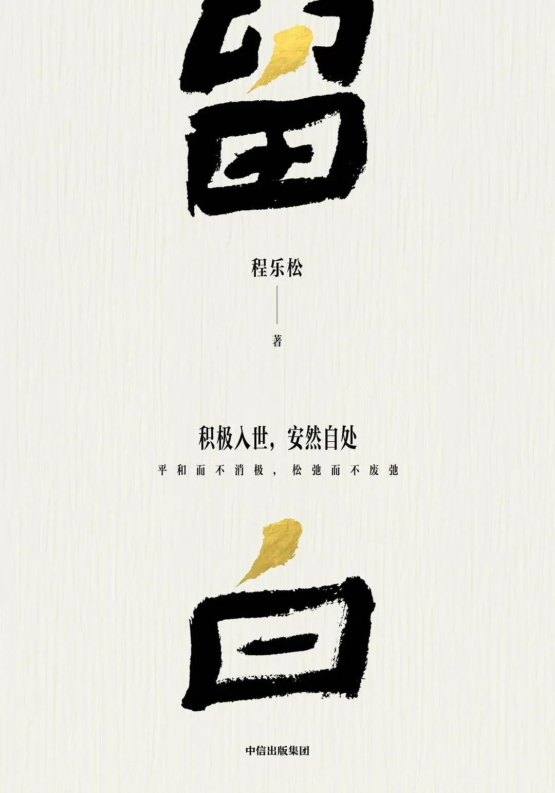

# 为什么我们执着于追求“有用”
> 💡 备注属性未写入，可能是备注属性名称或者类型被修改了，建议将字段类型设置为 rich_text，可以在小程序-操作-修改文章数据库页面进行调整
> 💡 原文链接:[https://mp.weixin.qq.com/s?__biz=MzkyMTY1NjUzMw==&mid=2247510136&idx=1&sn=0c29a88fd990031214757a4b2783c275&chksm=c05e64be308d7e2f0efa5facb60fae8a18c0f23635b96472bc02d9fcdd3b5687689ffa5cdb77#rd](https://mp.weixin.qq.com/s?__biz=MzkyMTY1NjUzMw%3D%3D&mid=2247510136&idx=1&sn=0c29a88fd990031214757a4b2783c275&chksm=c05e64be308d7e2f0efa5facb60fae8a18c0f23635b96472bc02d9fcdd3b5687689ffa5cdb77#rd)

图片来源：东方IC
只有始终保持“不器”的自我期许，才能有成为“大器”的可能；只有拒绝耽于“用处”的安逸，投身于“无用”的自我修养，才能让自己成为一个开放且充满无限可能的、不断自我成就的生命。
**为什么我们执着于追求“有用”**
程乐松 | 文
（选自《留白》）

程乐松 | 著
中信·先见 | 中信出版集团
2026年9月
如今，越来越多的器物、知识，乃至职业都因为被判定为“无用”而遭到嘲讽和鄙夷。但，人生中不可或缺的“无用”之境是人格养成、品位塑造，乃至完善心灵的玄关一窍，盲目追求“有用”的人生往往无法逃脱无意义感与倦怠的折磨，在“有用处”的追寻中失去最宝贵的、成己不已的生命活力。
**人的价值刻度：超越“功用”**
首先，“有用”和“有用处”有什么不同？
这一问题要先区分物与人。实用的功能性作为一个价值标准，其主要用途应该是物品，而非活生生的人（在什么情况下可以将人或某人进行功能性的价值评判，将在后文加以分析）。因此，我们就从物的“用处”和“有用”谈起。
在我们去看望家里长辈的时候，往往都会不自觉地为他们“断舍离”（当然，这个用法是一种俗称，并非佛教中的“断舍离”），尝试将一些老旧和看似没有用处的东西处理掉，这个时候长辈们往往都会说，“这个是有用的”。大多数情况下，如果我们继续追问，长辈们就不太能清晰准确地指出其具体的用处和功能。与此相对，我们往往不会提议将长辈们保留下来的、具有独特纪念意义的物品处理掉，哪怕它们也没有实际的功能甚至严重破损了。
不妨说，在我们的生活中，还有很多物品的价值并不来自具体的用处。特别典型的就是博物馆中陈设的那些文物，其用处显然不是其原初的功能，而是其展示的独特价值——已经消失却始终影响着参观者对历史的理解。换言之，随着岁月的沉淀，这些文物的价值从原初的功能转向了独特的历史价值，完成了价值的迁移。
简言之，从物品的角度出发，“用处”的根本在于作为其功能实现载体或者对象的“处”——可以是一个场景、一种功能，抑或一个具体对象。而在不同的场景和语境中，“处”的迁移让任何一个物品都可能突破其原初的功能定位，而指向更具象征意义的价值。例如文物、艺术品和纪念品之类的物件，实际上都存在这一独特的迁移现象。
与之相对，我们在什么意义上可以从“用处”的角度谈论一群人或者某个人？往往是在从职业劳作和社会竞争的现实出发，理解一群人或者某个人在社会运作、职业生产，以及社会竞争中的角色、职责及其完成情况时。人在这个意义上，是与社会角色或职业岗位进行匹配的。例如，一个不懂电焊技术的人在焊接的职业环境中就是“没有用处的”。同样地，一个人在上述场景中是否“有用处”的根本原因并非他成其为人的本性，也不是其人品好坏或品位高低，而是他拥有的某种独特技能。
由此推开，我们说一个人在社会竞争中没有“能力”或者“用处”的基本意涵，指的是其技能的实用性或者匹配度。从这个视角看，在日常生活中被人们称为“没用”或者“没有用处”的人往往就是因为其掌握的技能和知识在社会生产和竞争中没有严格意义上的匹配。而且，这种对人的价值评价导向会随着社会对物质生产与行业效率重视程度的提高而变得越来越极端，那些无法直接对应到一个生产场景（即某种技能运用的产业环境）的知识或能力，都会被认为要么毫无价值，要么华而不实。
然而，我们需要强调的是，用生产性技能来评判一个人的价值是浅薄和短视的。姑且不论那些歌颂和捍卫人性的深刻反思，以及对人之为人的本质的尊重，单就近世以来的社会生产力发展，就不难看到如下情形：人从技术进步中获得的最大红利，就是从劳作中解放出来，越来越多的劳作技能随着技术进步都显得冗余了。
易言之，技术进步和新器物的产生，往往会带来基于技能的对应的人的“用处”的消失。任何技术进步和新设备的运用都意味着拥有特定技能的人被抛出了“有用处”的价值光谱，成为在独特场景下“没用”的人。在大规模的工业生产时代，铁匠的技艺及其价值已经变得毫无竞争力，铁匠的技艺就是没用的，但我们不能说，原本是铁匠的那些人就都因此没有用了。同理，全自动数控机床的出现，往往意味着站在老式机床旁技艺精湛的老师傅变得“没用了”。
这种狭隘的看法不仅将人的价值错置为某种技能，更忽视了人与机器之间的根本差别——人是具备无限潜力的、能适应变化并能自我完善的生命。即便从职业环境中的技能出发，一种技能需求的消失，并不能否定任何一个具有主观能动性和学习力的人的潜力和价值。将人的价值等同于他/她拥有的劳动技能或生产知识，就是对“有用”的人的最根本否定和价值错置。
**君子不器方成器**
当然，不能否认的是，人的日常生活总是在社会分工之中展开的，其与社会群体互动的基本方式，就是基于劳动的价值创造与交换。任何人都不能自外于社会生产和生活的体系，在一个社会分工极度细密的现代化社会之中尤其如此。然而，积极加入社会分工、参与社会竞争并且让自己适应不同的职业环境，并不意味着要将自己的价值简化为某种职业知识或生产技能，而是要以学习与适应能力为基石让自己成为可以在不同环境中获得肯认的、有价值的人。
两千多年前，孔子就极具洞见地提出了上述辩证关系，他一方面强调，君子要始终重视自我修养、乐学不厌，在成己不已的道路上培养更加完善的人格，而非成为某种用具，或者别人眼中具备某种技能的工具，这就是孔子所谓的“君子不器”；另一方面，他在论及子贡的时候又称赞子贡具备成器之才，其价值就像宗庙里贵重的礼器瑚琏，认为子贡才识不凡、人品贵重、堪当大任。在提出“ 君子不器”的同时又称赞子贡是成器之才，以孔子的智慧，何以形成无法贯通的“自相矛盾”之说呢？
于我而言，孔子强调君子自重，以人格完善、德行完满为终极目标，必以立其大者为根本，所谓“本立而道生”。以圣人境界自许的君子之行显然要警惕以“成某器”为目标的自缚手脚、自累于物的态度。与之相对，要以勇毅精进的态度不拘一隅、不限一事，因为一旦成了“器”，这个“器”的功能和用途就会限制人格养成与德行完善的高度；与此同时，不断自修的君子以成己不已的态度不断完善自身的人格，在他人眼中便是堪担天下重任的人中魁首与家国柱石。因此，“君子不器”与“成器之才”，是分别从自修与事功两个不同视角来理解君子自修实践的两个侧面。
正是因为君子在日常实践中坚持积累成己不已的自修功夫，才能成为他人眼中不可限量的、无不可任的栋梁。只有从不以“用处”自限、以“成某器”为目标的人，才能“终成大器”而成为天下楷模。寒来暑往、日复一日的修养功夫是中国思想家提倡的、指向独立人格和超凡智识的生活方式。
当然，还需要强调的是，不以“有用处”为标准的人的价值的实现，不可能来自纯粹的空想或从不反思的习惯，而是要躬身入局，反躬自省。要言之，以自期自修的方式立凌云之志，一定要辅以一粥一饭、洒扫应对的具体实践。“一屋不扫，何以扫天下”的告诫，提醒所有以完满人格为目标的修养实践，回到粗糙的地面和日常的琐碎中来。修养实践绝不是耽于玄想的空疏，也不是拒绝反思的麻木。
**无用之用即大用**
成为有价值的人当然不等于成为“有用处”的人，换言之，人们不能将自己工具化或功能化。然而，任何生活场景都是人们在与人或事打交道，都是在磨炼某种具体的技能，积累特定的行动经验。这显然是一个通过反复实践，掌握技能并逐步达致熟练的过程。
既然我们总是在这些实践中用特定的技巧“武装”自己，何以又说不能工具化或功能化呢？难不成我能熟练地操控飞机或轮船，却因为所谓“不器”或不成为工具的自我要求，就刻意不从事这些活动？
显然不是的，任何具体的生活实践都是在以特定的方式重复某些行动，并且在这些行动的持续中，逐步确立生活的秩序与具体的技能。
我们需要警惕的，是用具体的“用处”来定义自己的价值，耽于这些“用处”并安于成为某一特定语境中的工具，以此限制持续自修、不断完善自我的可能性。但这并不意味着要拒绝生活实践本身，也不意味着要拒绝在实践中自然磨炼出来的技巧与能力。
更加准确地说，我们需要明确的是，完满的人格与熟练的技巧作为自修的两个方面存在着明确的主次关系：以自我塑造和完善为目标，投身于日常生活实践，但是这些具体实践不能以获得某种具体技能为最终目标，也不能自限于已经形成的某种竞争优势。
在庄子的眼中，这正是道与技的先后与主次关系。《养生主》中神乎其技的庖丁拥有令人惊叹的解牛之技，然而他自己对此的解释却是“ 臣之所好者道也，进乎技矣”。我们看到的是他游刃有余的技巧，他却说这种技巧的根本，是他对于天道的体悟，以及顺应事物之理而展开的行动。对于庖丁而言，无论是否专注于解牛（实际上，他也可以专注于承蜩或斫轮），他的根本目标都是天道；解牛或其他技艺，都是他贴近和体认天道的具体操练形态。
换言之，对于天道的体认是庖丁持续自修的根本目标和实际收获，而这一收获的表现形态是“十九年而刀刃若新发于硎”的解牛之技。所有技巧练习都是人格养成和精神修养的手段，技巧的熟练只是精神修养的副产品。所以，耽于熟练的技巧而忘记了持续的自我修养，便是本末倒置的自我戕害。
此外，人格的完善与精神世界的完满，并不限于在具体社会实践中的技能练习，还有心性的锻铸、品位的养成与德行的开展。生活世界的丰富性在于人总是在具体的事上磨炼心性、涵育品位、养成德行。然而，与精神品质有关的自我完善所关照的并不是具体的做事技能或某种职业化的知识，而是对世事与人心的洞察、对自我的期许与理解、对人与物的评判。这些都是心力塑造和自我完善：既离不开日常的鲜活，又不是可感可学的具体技巧。
这些独特的、面向自身的心灵实践都是绵绵用力、久久为功的，其特点在于无论做什么具体的事情，都要以念兹在兹的方式反躬自省，持续打磨和完善自己看世界的眼光与对自我的理解。因此，这样的心灵操练显然不会有具体的功利目标，也不会指向某种特定的技巧，而是看似没有用处，也没有立竿见影效果的“无用”之举。
然而，一定要强调的是，这种超越功利的“无用”性指向的是“开物成务”“成己达人”的人生境界：以人格完善和心性塑造的方式为所有的“用处”奠定坚实的基础，形成顺时而动、应势而行的柔性力量，以及刚毅从容、坚守道德的笃定。
说到底，“无用”是所有“大用”的基石。如果没有看似“无用”的精神秩序的建构与人格修养形成的坚定内心，任何熟练的知识和圆熟的技巧，都不过是让人成为“器具”而已，“有用”也会在世易时移中，因“用处”的消失而化为乌有。没有笃定自我与持续自修能力的人，从根本上都是“无用”的——无法持守独立的人格，被困于随时可能被弃的“器具”之中。
只有始终保持“不器”的自我期许，才能有成为“大器”的可能；只有拒绝耽于“用处”的安逸，投身于“无用”的自我修养，才能让自己成为一个开放且充满无限可能的、不断自我成就的生命。
**点关注，不迷路。更多深度好文↓↓**
