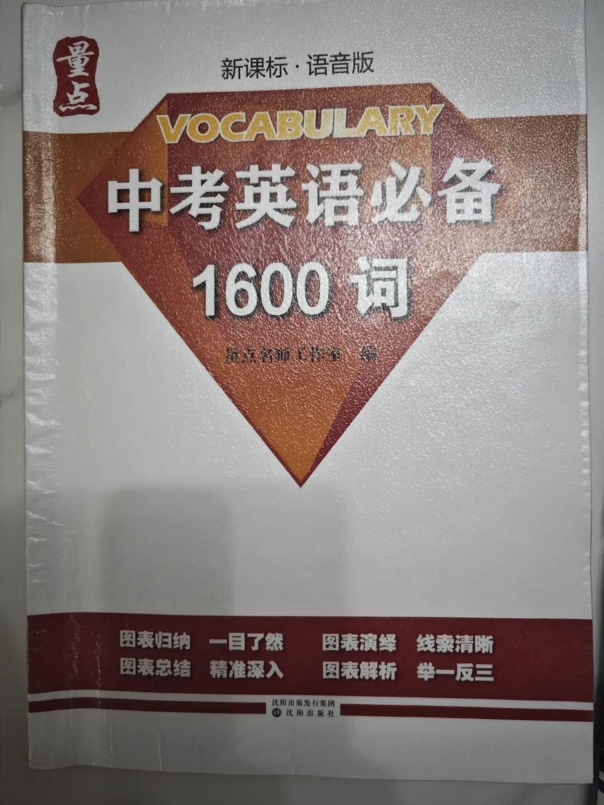
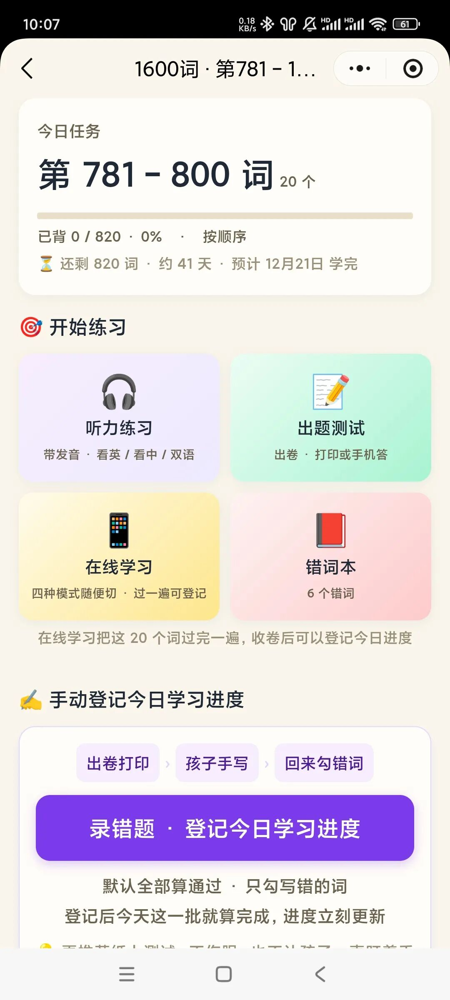
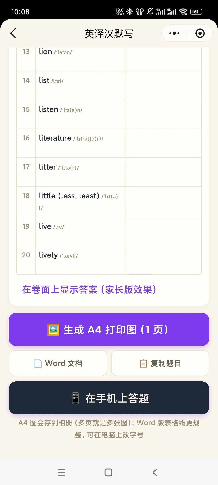
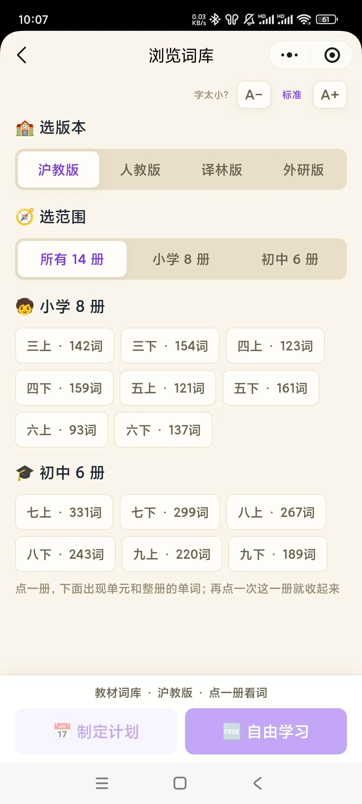
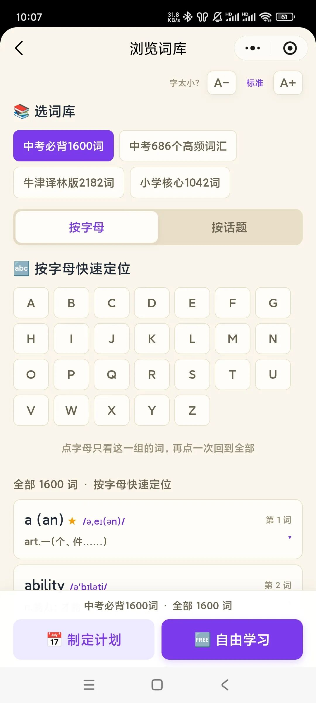

# 为什么我推荐先把 1600 词背扎实，以及这个免费背词小工具好在哪
> 💡 备注属性未写入，可能是备注属性名称或者类型被修改了，建议将字段类型设置为 rich_text，可以在小程序-操作-修改文章数据库页面进行调整
> 💡 原文链接:[https://mp.weixin.qq.com/s?__biz=MzY0MDk4ODE2OA==&mid=2247484672&idx=1&sn=7d309755ec839ef99a42859f6b23369e&chksm=f0d8dc2694cb169320821c74e6a8e570b758e622c7ac1ac29fa4633599c7b71220b01b1b9e9b#rd](https://mp.weixin.qq.com/s?__biz=MzY0MDk4ODE2OA%3D%3D&mid=2247484672&idx=1&sn=7d309755ec839ef99a42859f6b23369e&chksm=f0d8dc2694cb169320821c74e6a8e570b758e622c7ac1ac29fa4633599c7b71220b01b1b9e9b#rd)
陪孩子走英语这条路，很多家长都卡在单词这一关。
这几年教材改版频繁，人教、外研、沪教牛津多版本并行，2026 年新一轮调整后，新旧课本交织，每个学校的进度和词表顺序都不一样。跟着校内课本追单词，版本一变，背诵计划就得推倒重来；孩子每天花时间打卡，背了忘、忘了背，看着很努力，词汇底盘却始终不稳。
一、我的主张：十鸟在林，不如一鸟在手
中考命题不绑定任何一套教材。所有初中英语课本，统一的标尺是 2022 版新课标，而这 1600 词，就是中考固定不变的核心考察池。

各版本教材做的，只是把这一批词打乱顺序、拆到不同年级和单元里。校内单元测、月考跟着本校课本走，但中考统考衡量词汇掌握情况，最终仍落在这 1600 词上。
所以不管是小升初提前打底，还是初中阶段备考，先把 1600 啃扎实，就是先稳住词汇的基本盘。主线抓住了，再补校内教材词、应付单元测，主次分明，不容易被不断更新的课本带着跑。
反过来，如果一头扎进零散的课本词里，教材一改节奏就乱，很容易做大量无用功。
这不是说课本词不重要，而是先抓不变的，再补变化的。
二、为什么我自己做了一个
市面上主流的背词软件，我基本都带孩子试过：入门免费，等到要用真正刚需的功能——自由挑词段、打印自测卷、长期登记错题、匹配课本词库——就要付费解锁。
这类产品面向海量用户，功能越做越全，反而很难贴合一个家庭带背的具体节奏。
于是我自己动手做了 【初中单词 Buddy】。它是个人开发的小工具，从一开始就不是为了商业化，只是解决我们自己背词时遇到的痛点，所以全程免费，没有隐藏付费门槛。

三、它现在的核心，就是围绕"1600"这一件事
围绕 1600 核心词搭建，不铺一堆用不上的功能
内置艾宾浩斯遗忘曲线复习方案，新词学习、循环复盘、错题巩固形成闭环

可自主选择词段，按自己家的节奏推进，不被系统排好的进度绑住
支持 A4 打印自测卷，引导孩子用纸笔默写，不用长时间盯屏幕——这也是我带孩子背词最看重的方式
四、关于教材词库，我说明白
校内教材词我们没有舍弃。很多家长希望同步课本，所以我在 2.0 版本挂载各版本教材词库。
只是 2026 年教材大范围改版，新旧版本混杂，校对和整理的工作量确实很大。我希望词库准，不想仓促上线，所以 2.0 还没有正式发布。

目前线上稳定运行的基础版，优先主推 1600 词；教材同步词库暂时只上架主流教材的最新版，旧版词库我已存档，有需要的家长可以单独联系我添加。
五、想请大家评判一件事
这套思路是：主线先拿下 1600 中考核心词，校内教材词汇作为辅助补充。
大家认可这个体系吗？欢迎在评论区说说你的做法，我也想听听不同家庭的经验。
如果你试用基础版觉得顺手，想提前体验搭载教材词库的 2.0 内测版，可以私信我报名。使用感受、优化建议都欢迎随时告诉我，一起把这个免费的小工具磨得更好用。
版本再多、课本再变，抓住不变的核心，背单词才能少走弯路。
