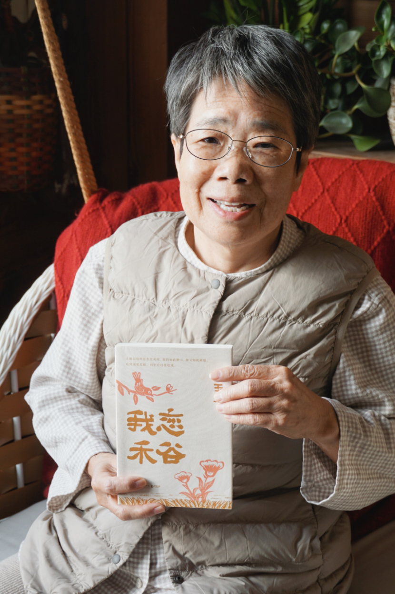
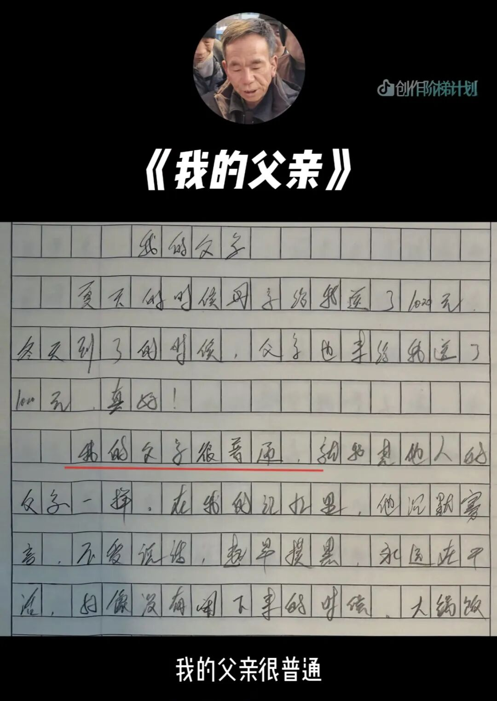
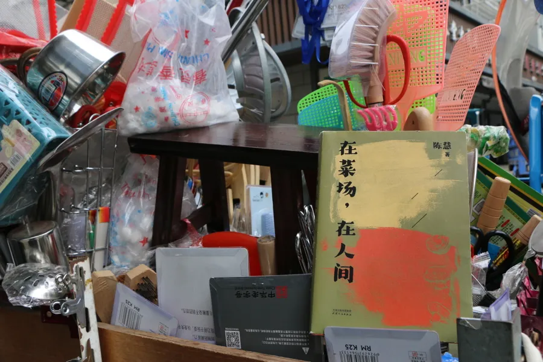

# 为何“晚熟”的笔偏能写就生活的真？

王玉珍和她的新书《我恋禾谷》。图片来自网络
“沂蒙二姐”吕玉霞、“外卖诗人”王计兵、“田鼠大婶”裴爱民、“菜场女作家”陈慧、农民工安三山、“奶奶作家”王玉珍……这些质朴而响亮的名号，在新大众文艺蓬勃生长的当下，格外引人注目。他们游走在田间地头，以诗歌散文勾勒乡村变迁；驻足于街头巷尾，以细腻笔触描摹市井百态。这些带着泥土芬芳与人间烟火的作品，登上云端，打动了无数网友。**这些在岁月沉淀中执笔发声的中老年创作者，正熠熠生辉。**
据中国互联网络信息中心统计，截至2025年6月，我国50岁及以上网民群体占比33.5%。**随着这些**“晚熟”的表达在互联网上得到广泛关注引发大众共鸣，是时候重塑对于中老年群体文化创新创造力的认知和期待了。

安三山的作文《我的父亲》。图片来自网络
当前，互联网技术降低了文艺创作的门槛，语音转写、便捷剪辑、手写输入等适老化功能不断迭代升级，为中老年群体搭建了前所未有的创作场域。开放、包容、便捷的传播生态更让他们的作品得以在海量网络内容中精准触达受众，为在快节奏生活中步履匆匆的人们提供真切的“情绪价值”。同时，与受过长期专业训练、数十年如一日持续深耕创作的文艺工作者不同，吕玉霞、王计兵等新大众文艺创作者多是农民、外卖员、家庭主妇，他们的创造力更多孕育于技术赋能与生活土壤之中，或质朴真挚，或幽默风趣，无不透露出对生活的热爱与对世界的独到观察。**与年轻创作者天马行空、“从无到有”的创造不同，中老年群体的创作更偏向于扎根现实、“从有到悟”**——他们善于将人生阅历与生命体悟熔铸于笔端，创作兼具精神滋养与文化传承双重价值的作品。这不仅丰富了新大众文艺的内涵，更为社会注入了温暖而强大的正能量。
然而，无论是给予网友的“情绪价值”，还是对于时代的记录价值，**中老年创作者的故事和才华被更多人看见，对于他们而言，更多的是实现“自我价值”。**正如70岁出版个人作品集《我恋禾谷》的玉珍奶奶所说：**“我不再是那个守着窗子，数着日出日落的老太婆。我仿佛正在逆着时间行走，重新成了一个有用的人。”他们的热忱和追求，**诠释**了创作无关年龄，只关生命体验，艺术不分高低，只关真诚表达。**许多人眼里的“为时已晚”，其实“恰逢其时”。**他们正以创作主体的姿态，积极参与绘就新大众文艺图景。**

陈慧的小推车和她的作品。图片来自网络
**新大众文艺的繁荣，建立在尊重并激发所有年龄层创造力的基石之上。**从古至今，各领域、各行业涌现出无数诞生于暮年的佳作，身体衰老并不意味着创造力衰退，文艺创作尤其如此。游本昌、牛犇、吴彦姝、李雪健等老艺术家，以炉火纯青的演技、入木三分的演绎圈粉当代年轻人，诠释着艺术生命的永恒。而“王计兵”们则以“草根”之姿，证明了文艺创作从来不被专业门槛设限。无论是靠深耕专业不断精进，还是靠扎根生活破圈而出，都殊途同归地印证了：时光的沉淀只会让创作更深厚动人。
如何让更多被“岁月尘封”的才华尽情释放？于**社会**而言，当构建包容多元的创作生态，为中老年创作者提供更普惠的扶持与更畅通的传播通路，让“菜场文学”“田间诗集”这类扎根生活的作品，拥有走向更广阔舞台的可能。于**代际交流**而言，年轻人不妨主动倾听长辈的生命故事，以共情激发创作热情；家庭给予包容与鼓励，让他们敢于打破“不会写、不能拍”的顾虑，乐于提笔、勇于表达。于**中老年创作者**自身，要突破自我设限的心理壁垒——不妨从记录日常点滴起步，也可借力线上社群交流碰撞，拓宽创作视野。这份将生命体验熔铸为艺术语言的勇气，终将让更多中老年创作者的微光，汇聚成照亮新大众文艺生态的星河。

作者 | 王丽
编辑 | 王丽
一审 | 张钰童
二审 | 高森
三审 | 张乐
投稿邮箱 | zgwywxw@126.com
