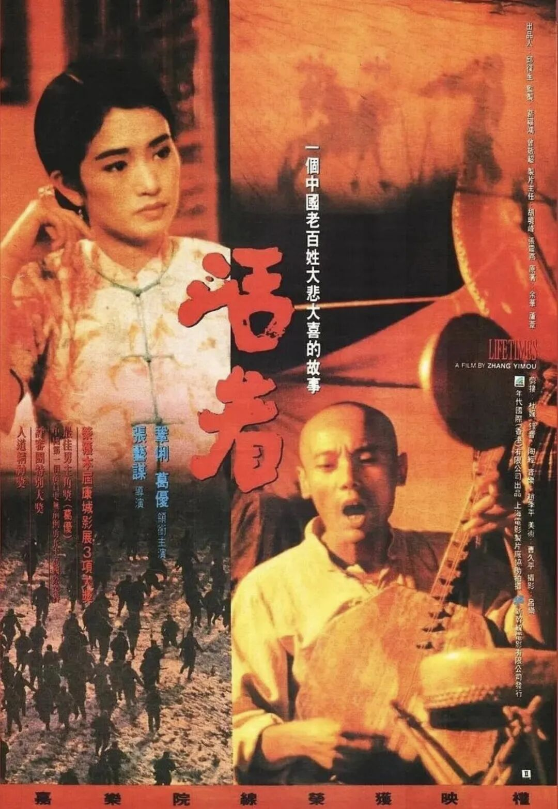
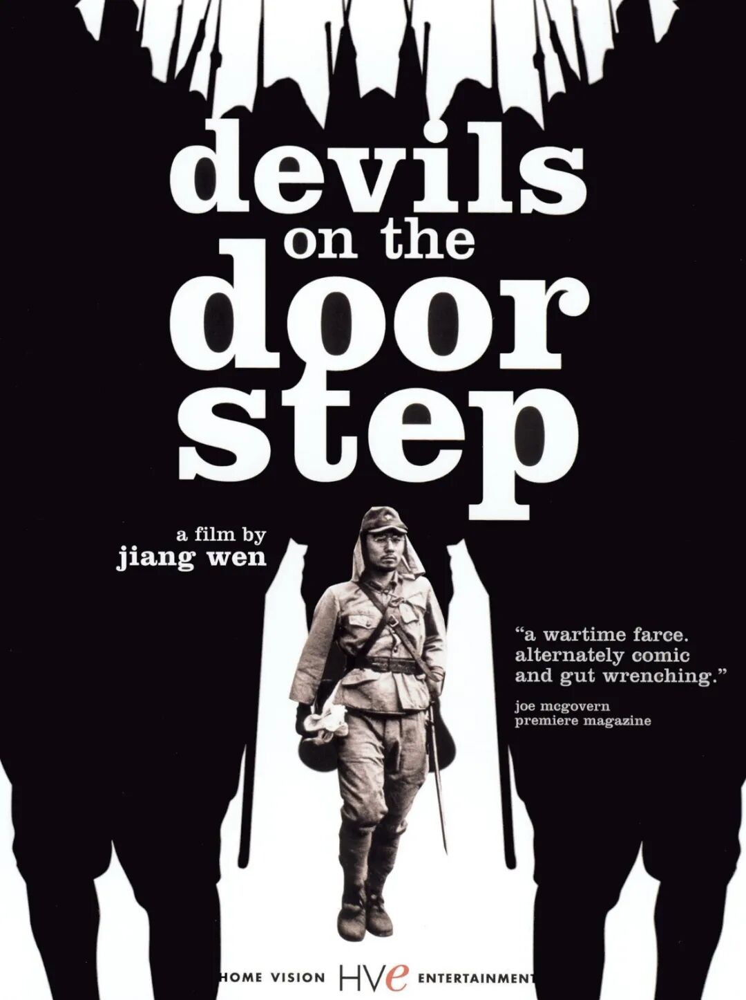
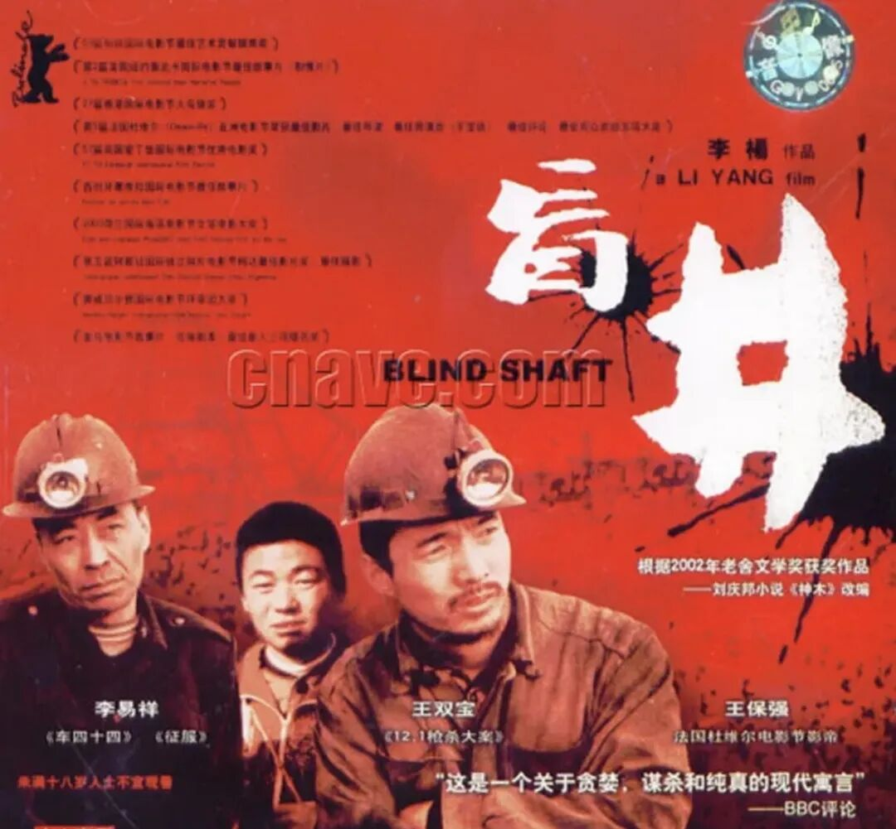
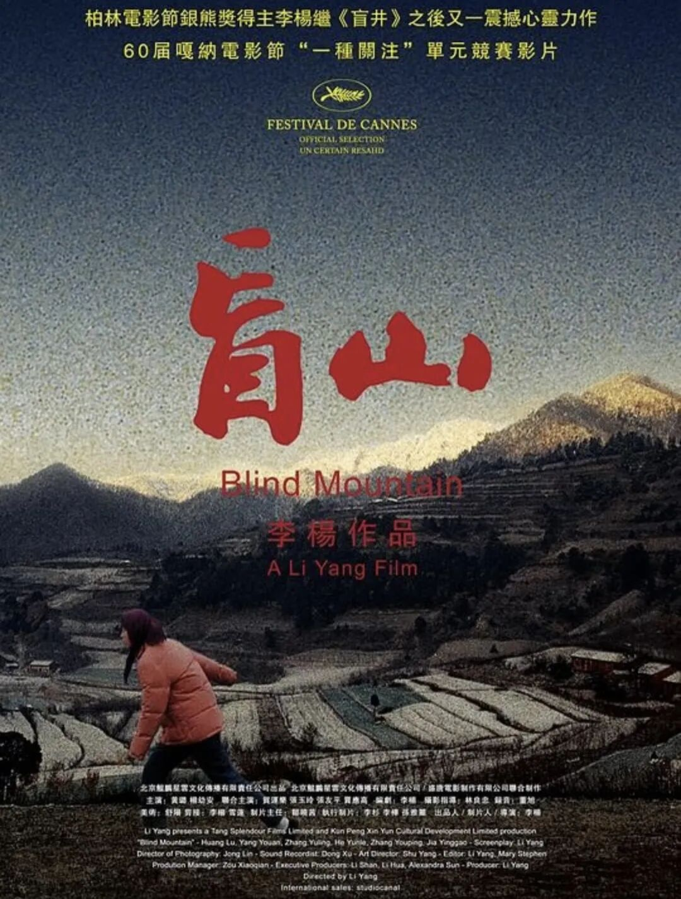
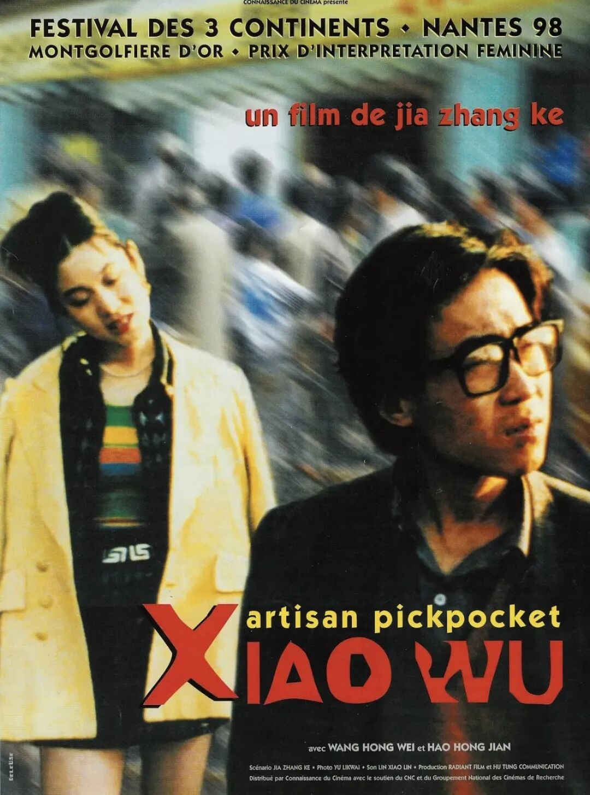
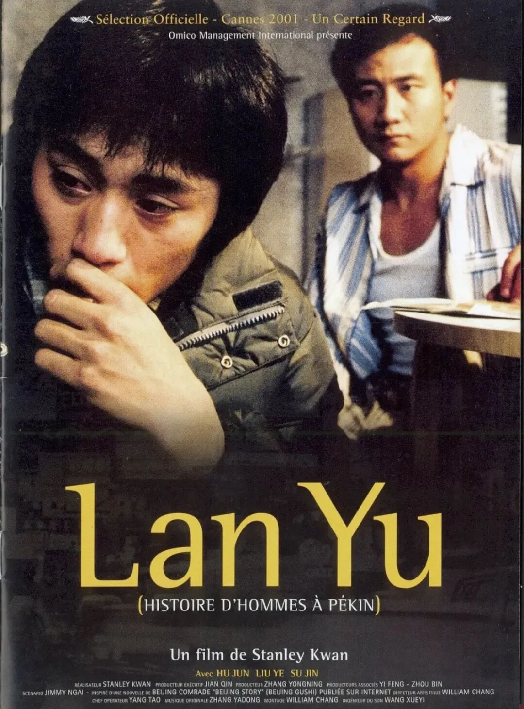
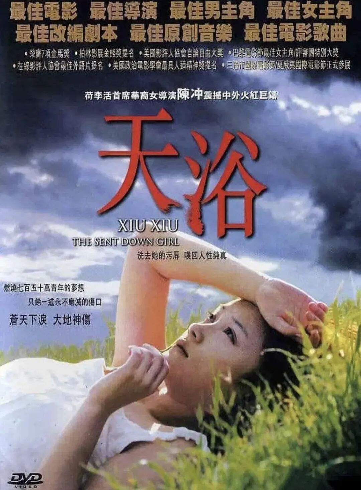
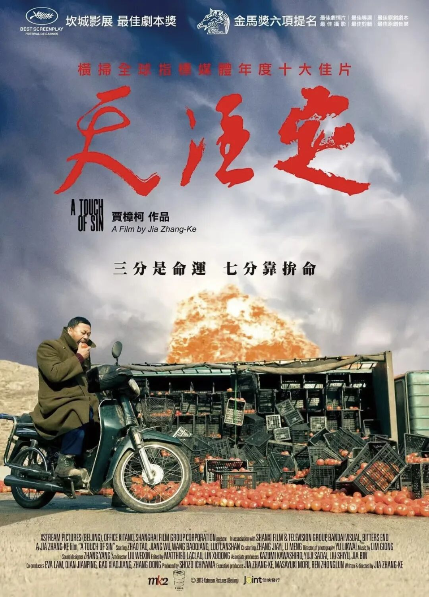
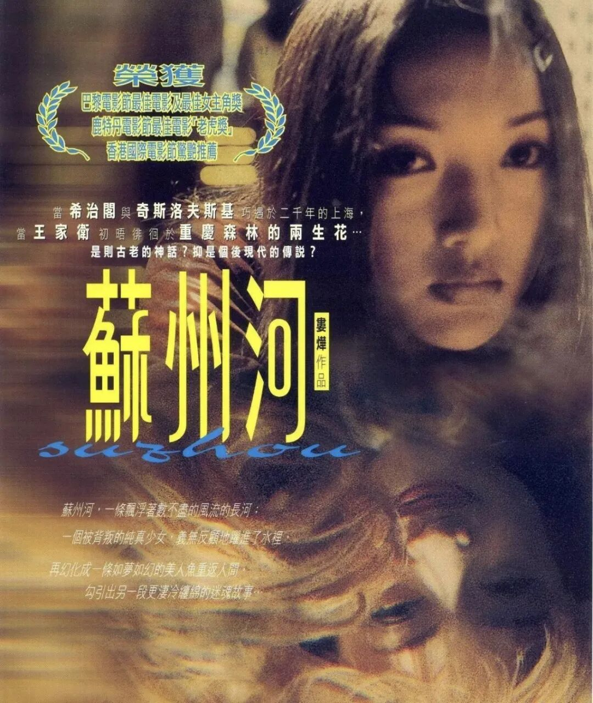

# 九部当年被禁的国产片，后来都拿奖了
> 💡 备注属性未写入，可能是备注属性名称或者类型被修改了，建议将字段类型设置为 rich_text，可以在小程序-操作-修改文章数据库页面进行调整
> 💡 原文链接:[https://mp.weixin.qq.com/s?__biz=MzA3NTUwNTEwOA==&mid=2247483914&idx=1&sn=2c0255f0ef2ee4e30126b3930561a72a&chksm=9ebd1087c4a5f930605a79b83d9a7594c66889d0293fe533d141d6edb12a09f9208ed9e343dc#rd](https://mp.weixin.qq.com/s?__biz=MzA3NTUwNTEwOA%3D%3D&mid=2247483914&idx=1&sn=2c0255f0ef2ee4e30126b3930561a72a&chksm=9ebd1087c4a5f930605a79b83d9a7594c66889d0293fe533d141d6edb12a09f9208ed9e343dc#rd)
一些没有进电影院的影片，却进入了电影史里。
中国电影史中有一种影片很不寻常：在国内没有公开放映过，而且导演还曾经被禁止拍摄电影，在国外却连续获得戛纳、柏林和威尼斯等电影节奖项。多年之后，这些片子大都在豆瓣获得了8.5以上的高分，并且成为了一代又一代影迷心目中的经典之作。
今天我们来聊聊这九部“墙内开花墙外香”的电影。
---
**一、《活着》(1994)张艺谋**

奖项：戛纳电影节评审团大奖、戛纳影帝（葛优）
余华的小说《活着》本身就有神作底色，张艺谋把它们搬上了银幕，并且请来了葛优和巩俐出演了福贵一家在内战、大跃进以及文化大革命等时期里经历过的苦难历程。
影片没有过审，在内地还没有正式上映。但是1994年的时候在戛纳拿了评审团奖，葛优也成了第一个获得戛纳电影节影帝的人。“活着”两个字，就把中国普通人的“好死不如赖活”的坚韧表现出来了。豆瓣评分9.3分，仍然排在华语电影最高分的位置上。
---
### 二、《鬼子来了》（2000年）姜文

奖项：戛纳电影节评委会大奖
姜文执导的第二部电影是黑白色调的战争片。村民马大三收留了两个“包袱”——一个日本兵、一个翻译官，养了半年，最后换来了村庄被屠杀的结果。
这部电影并不是以“神剧式”的方式来表现抗战，而是拍出了国民性的麻木和荒诞。该片未经审查即参加戛纳电影节并获得评委会大奖；姜文因此受到惩罚，在几年之内不能担任导演一职。多年之后再来看，《鬼子来了》在影迷心目中的地位越来越高了。
---
**三、《盲井》（2003年）李杨**

奖项：柏林电影节银熊奖（艺术贡献奖）
改编自刘庆邦的小说《神木》，以真实发生的煤矿事故诈骗案为背景：两个骗子把陌生人骗下矿杀死，就装作家属去向矿主要钱。十六岁的王宝强在影片中完成了自己一生当中最常被人提起的一次演出。
没有经过审核就拍摄并且参加展映，在柏林获得了银熊奖，而王宝强也获得了金马奖的最佳新人大奖。可以说没有《盲井》，就不会有现在的王宝强了。
---
**四、《盲山》（2007年）李杨**

李杨“盲系列”的第二部。女大学生白雪梅被拐卖到一个偏僻的小村庄里，在不断地逃跑和被抓回来，整个村子的人都是“共谋”。
影片拍出了令人窒息的现实——它取材于真实的拐卖妇女案件。当年为了通过审查，导演做了一个相对温和的结局版本（公映版），而他自己最满意的另一个版本，直到 2018 年"丰县事件"引发全民关注后才被更多人重新看到。国内公映版票房惨淡，但这部电影推动的讨论，比很多能上映的片子多得多。
---
### 五、《小武》（1998）贾樟柯

奖项：柏林电影节青年论坛首奖、南特三大洲电影节最佳影片、釜山新浪潮奖等
贾樟柯以16毫米胶片、21天和30万成本完成的第一部电影。主角小武是汾阳县城里的一个小偷，被自己的人出卖了，在家人的鄙视中长大，并且还被人抛弃，最后被警察拷到街上示众。
电影没有经过审查就参加了柏林电影节，并获得了许多国际大奖，之后贾樟柯就再也不能拍电影了。“当一个社会急匆匆往前赶路的时候，不能因为要往前走，就忽视那个被你撞倒的人。”这句话成为《小武》最好的注解之一。因此贾樟柯也有了个外号——“贾科长”。
---
### 六、《蓝宇》（2001）关锦鹏

奖项：金马奖最佳导演、最佳男主角（刘烨）等等
根据网络小说《北京故事》改编而成，由胡军、刘烨扮演的一对恋人，在上世纪80年代末纠缠到到本世纪初，该片涉及同性题材，从没有在内地上映过。
但是在2001年的金马奖上面，《蓝宇》大放光彩：关锦鹏获得最佳导演，刘烨凭借《蓝宇》一角获得了金马影帝，“蓝宇”也成为华语同志电影中绕不开的名字。
---
**七、《天浴》（1998）陈冲**

奖项：金马奖最佳影片、最佳导演和最佳女演员（李小璐）等
陈冲的第一部导演作品。知青文秀想要回到城里，在草原上被人践踏利用，最终走向了毁灭。17岁的李小璐凭借该影片获得了金马影后。
因为题材以及没有经过审核就参加了比赛所以在内地被禁止了，但是李小璐却在金马获得了最佳女主角。这是华语电影中很少见的，一部由女导演拍摄的女性悲剧，非常含蓄而尖锐。
---
### 八、《天注定》(2013) 贾樟柯

奖项：戛纳电影节最佳编剧奖
四个故事，四声闷雷：握着猎枪去要说法的农民、走投无路的流水线工人、雨夜里作案的摩托车杀手，在KTV反杀客人的洗脚妹。每一个故事都有一些真实的事件的影子。
电影原本打算在国内放映，海报都做好了，在即将公映的前夜又突然撤档，并没有在内地影院上映过。但是它获得了戛纳最佳编剧奖；盗版碟曾经被黑市上的人抬高到了一百多元一张的价格。“天注定”这三个字就是最讽刺的注脚。
---
**九、《苏州河》（2000）娄烨**

奖项：鹿特丹国际电影节金虎奖
“如果有一天我走了，你会不会像马达一样去找我呢。”周迅一个人扮演了牡丹与美美两个角色，像一条河的两个倒影。
没有经过审核就参加了电影节，娄烨因此被禁拍了好几年。但是《苏州河》却获得了鹿特丹国际电影节的最佳影片奖，并且成为第六代导演的作品之一。后来解禁之后的娄烨又拍摄了《风中有朵雨做的云》、《兰心大剧院》，但是影迷们提到他的巅峰，还是会想起《苏州河》。
---
### 好片子为什么总是在“禁”里呢？
把这几部电影放在一起看的话就会有一些相同的地方：
他们的镜头全部对准了“被撞倒的人”。被时代碾压过的福贵、被屠村吞没了的村民、被拐卖出去的白雪梅、被围观的偷儿小武以及被撤档的时代故事……主流叙事关注的是“向前走”，而这些影片所关心的是“谁被撞倒了”。
大部分都触及了审查禁区。没有经过审核就参加展览，这是许多电影被禁止的原因之一；而由于主题本身比较尖锐，所以不容易过审。
它们的时间会说话。《活着》豆瓣评分9.3分，《鬼子来了》也达到了9.3分，而《盲井》、《天浴》、《小武》和《苏州河》都超过了8分。二十多年过去了，被禁止的原因已经渐渐淡忘了，但是好的电影还是越来越清晰。
电影就是时代的切片。有一些切片当时不忍细看，但时间会让它们变得锐利而珍贵。
那么可以这样结尾：用贾樟柯的话来说就是……
“不要因为往前走，就忽略那个被你撞倒的人”。
---
你看过这几部吗？你觉得哪一部印象最深呢？在评论区里聊一聊吧
（关注我，我们一起看看那些“差一点就被埋没了”的好电影。）
