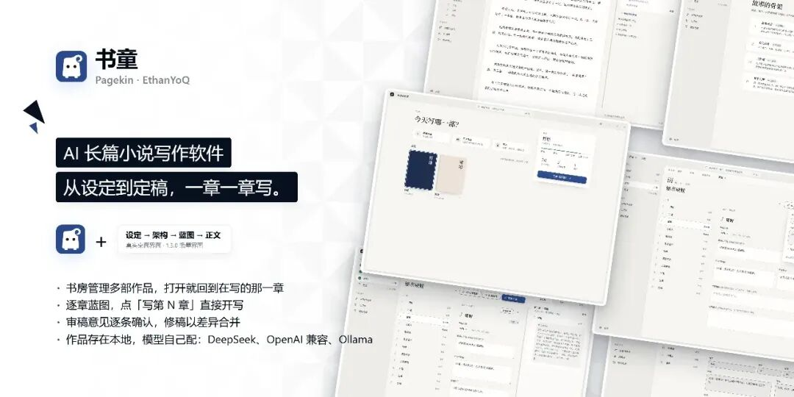
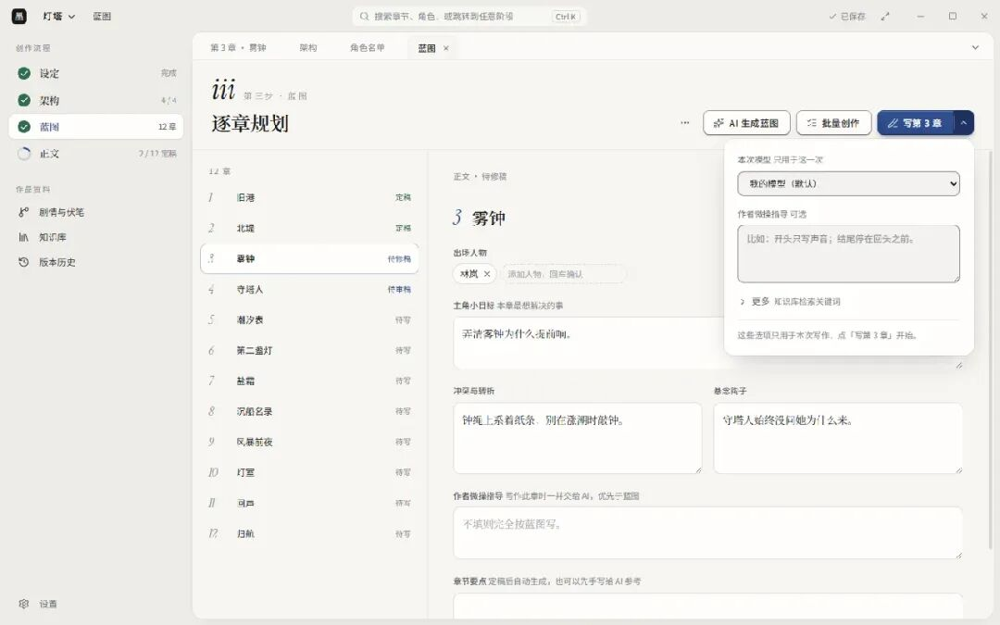
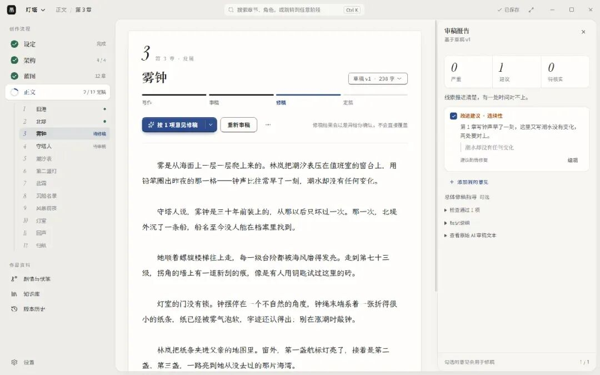

# 书童 Pagekin：开源的 AI 长篇小说写作软件
> 💡 备注属性未写入，可能是备注属性名称或者类型被修改了，建议将字段类型设置为 rich_text，可以在小程序-操作-修改文章数据库页面进行调整
> 💡 原文链接:[https://mp.weixin.qq.com/s?__biz=MjM5ODMwNjY0MA==&mid=2457902157&idx=1&sn=dd7d46d5af6f7af49618cbcbeed52af1&chksm=b098a637a2f48bf2211c3a61340bfad21912f5db5b89de387856000731238c7d6429910b25c6#rd](https://mp.weixin.qq.com/s?__biz=MjM5ODMwNjY0MA%3D%3D&mid=2457902157&idx=1&sn=dd7d46d5af6f7af49618cbcbeed52af1&chksm=b098a637a2f48bf2211c3a61340bfad21912f5db5b89de387856000731238c7d6429910b25c6#rd)
书童（英文名 Pagekin，以前叫 AI 小说作家）是一个开源的 AI 长篇小说写作软件，有 Windows 和 macOS 两个版本。它按写一本书的顺序排好了流程：设定、架构、蓝图、正文，一章从待写到定稿都在同一页里完成。软件本身不带模型，得自己填写接口密钥，或者接本机的 Ollama。作品保存在你自己的电脑上。

**01**
**核心功能**
- 书房管理多部作品，打开就回到上次写到的那一章
- 拆解参考小说，提取结构和文风，反推章节蓝图
- 导入自己写好的原稿接着续写，前面的人物和情节会接上
- 设定、架构、角色名单、世界观、情节大纲分节填写，每节可以让 AI 起草
- 逐章蓝图，写清主角小目标、冲突转折、悬念钩子和出场人物
- 单章走完写稿、审稿、修稿、定稿四步，修稿结果按段落对比
- 批量创作，一次最多连写 10 章
- 所有生成任务在运行侧页里排队，可以取消、暂停、看实时输出
- 剧情与伏笔跟踪，记下每条线索在哪一章埋设、推进、解决
- 知识库支持导入资料，配了向量模型就能语义检索，没配也能本地全文搜索
- 版本历史、导出 Markdown 或 TXT、打包备份到本机或 WebDAV
- 可以导入提示词型的写作 Skill，绑定到规划、写稿、审稿或修稿阶段
- 界面有中文和英文，浅色深色两套外观
**02**
**每一章是怎么写完的**
蓝图页逐章列着规划，每章有出场人物、主角小目标、冲突与转折、悬念钩子，还可以补一段作者自己的指导。写完点「写第 N 章」，弹出来的小窗只问两件事：这次用哪个模型，要不要加一句指导。
AI 拿到的东西是这一章的蓝图、相关角色的档案、世界观、前文摘要和上一章全文，不是整本书的聊天记录。**这也是它能写长篇的原因：上下文只跟当前这一章有关，不会随着章节数膨胀。**

草稿出来之后进入审稿。审稿报告按严重、建议、待核实分三类，每条意见都能看原文引用，你可以逐条勾选，也可以自己加意见，再让它按选中的意见修稿。修稿不会直接覆盖原稿，而是按段落给出差异，你一段一段决定用哪一版。

**03**
**拆解、仿写与续写**
书房里有个「小说拆解与仿写」，可以导入 .txt、.md 或 .epub 的小说，按章拆开，导入时选用途。
选「参考小说」，AI 会拆它的结构、提取文风、反推章节蓝图，生成一份仿写约束。参考小说只进知识库和拆解结果，不会混进你的正文。
选「我的原稿」，你写好的章节按章节号导入成定稿，后面 AI 续写时会接着前文的人物和情节往前走。这是给写了一半想找人接手的人准备的。
改写分两种粒度。整章改写用「修稿」，写下方向再执行；改一小段就选中文字，用工具条上的润色、扩写、改成对话。1.4.0 之后还多了一个「按意见改」，选中一段，写下要求（最多两千字），看过结果再决定要不要用。
**04**
**模型怎么接**
软件不提供模型，也不代管额度。设置里填写服务地址、模型名和密钥，支持两种协议：OpenAI 兼容的对话接口，以及 Google Gemini 的原生协议。
内置预设包括 DeepSeek、硅基流动、智谱、OpenAI、xAI、Gemini、Ollama 和 NovelAI，也能自己填写地址。
用 Ollama 的话，地址写 http://127.0.0.1:11434/v1，不是 /api 那个原生接口；密钥可以空着，界面要求的话填写任意占位值。知识库的语义检索还要另配一个向量模型。
1.4.0 加了分工模型：规划、写稿、审稿、修稿、定稿后处理可以分别指定模型，没指定的走默认。想让便宜的模型负责规划、贵的模型写正文，现在可以这样搭配。
**05**
**写作 Skill**
设置里有个「写作 Skills」页，可以从本机选一个 Skill 文件夹或单个 SKILL.md，也能填写 GitHub 上的地址，把提示词型的写作规则导进来，比如去 AI 味、某种文风、某类题材的写法。SKILL.md 引用的参考文本会一并导入。
安装前软件会先把内容读出来给你看，确认后才安装。安装好之后绑定到某个阶段，之后这个阶段的生成都会带上它。
需要说明的是，它只接受自包含的提示词。脚本、钩子、子代理、工具调用这类内容不会被安装，Skill 也不能在你的电脑上执行代码。这个边界划得很清楚，反而让人放心。
**06**
**数据与备份**
作品、角色、蓝图、草稿和定稿都存在你的作品文件夹加一个本地 SQLite 数据库里。**只有你主动发起生成时，相关的提示词和上下文才会发给你配置的模型服务。**
模型配置和密钥保存在应用数据目录的 ai-novel-writer 文件夹里。这个文件夹要自己看好，别分享出去，也别让别人用你的系统账户。
备份有两种做法：把作品打包保存到本机，或者备份到你绑定的 WebDAV 云端。恢复时总是另存成一份新副本，不会覆盖现有的。导出支持合并的 Markdown、分章 Markdown 和 TXT。
**07**
**安装**
- Windows：下载 exe 安装包，升级不会删除作品、角色卡和设置
- macOS：苹果芯片和 Intel 芯片各有 dmg，拖进「应用程序」
- 更新：Windows 安装版能在应用内检查并下载更新；macOS 只能去发行页手动下载新包
- 源码运行：需要 Node.js 22.14 以上和指定版本的 pnpm
**08**
**注意事项**
- 安装包没有代码签名。Windows 会提示未知发布者，macOS 只有 ad-hoc 签名、没走苹果公证，系统会拦。只从官方发行页下载，然后按文档里的办法手动允许打开。
- 软件不带模型，也不送额度。云端模型的费用你和服务商结算，写多少花多少。
- 「自定义」只在 OpenAI 兼容和 Gemini 两种协议里换地址，不是随便什么接口都能接。Anthropic、Azure、KoboldAI 的原生接口需要单独的适配器，换个地址不保证能用。NovelAI 只是最小兼容，作者写明没有用真实账号完整验证过。
- 1.3.0 起助手聊天的入口暂时隐藏了，作者说以后会单独重新开放，写作、审稿这些功能不受影响。
- AI 写出来的内容要自己审。软件不替你判断事实、不替你判断版权，也不代办发布。
- 写作 Skill 里常见的一类是「去 AI 味」。这类规则能让文字读着自然些，但不改变平台对 AI 参与创作的要求，投稿前该声明还是得声明，别拿它当绕过检测的办法。
- 拆解参考小说得到的是结构和文风上的提示，不是把别人的正文搬过来用。改编、续写、仿写各自的版权边界不一样，动手之前先想清楚。
- 名字改过：1.3.1 起从「AI 小说作家」改成「书童 Pagekin」，网上两种叫法都会遇到。Windows 上以前固定在任务栏的旧图标升级后会失效，需要重新固定一次。
- 仓库里还有一个 DeepSeek Harness 的网页插件，作者已经冻结维护，并写明能力不足桌面版的十分之一，不能替代桌面版。
**09**
**项目地址**
GitHub：https://github.com/EthanYoQ/AI-Novel-Writer
下载地址：https://github.com/EthanYoQ/AI-Novel-Writer/releases/latest
