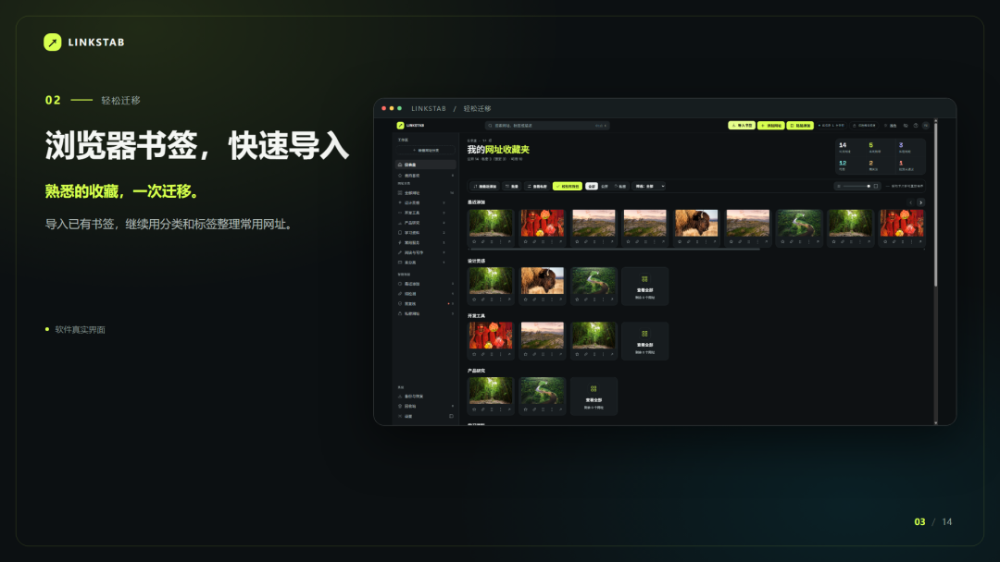
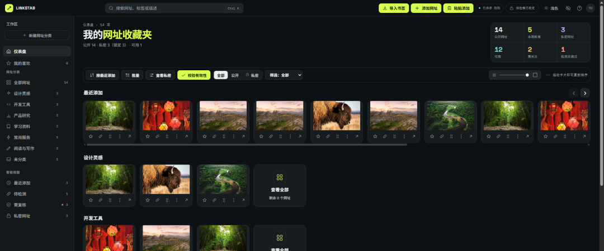
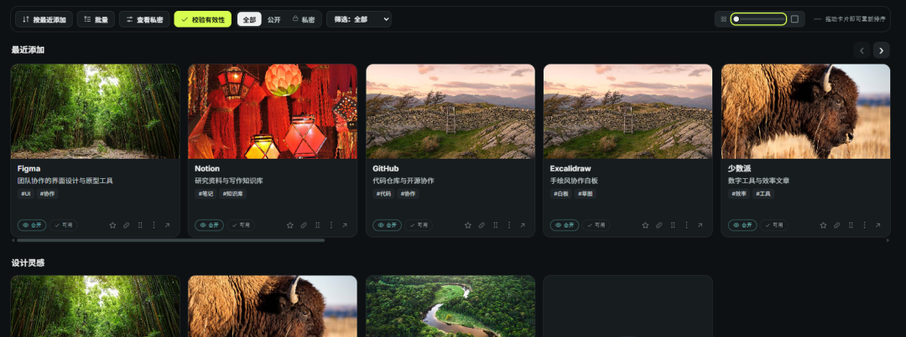
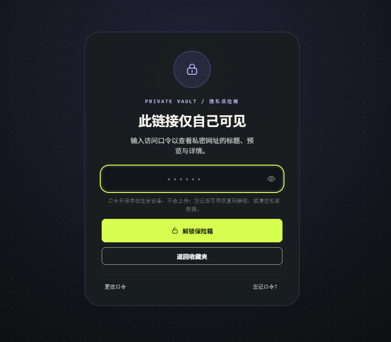
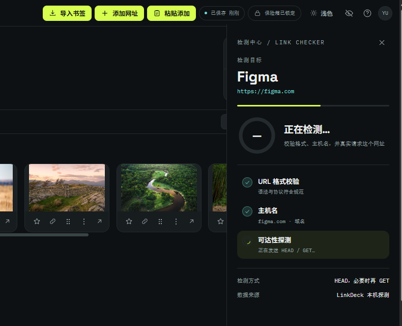
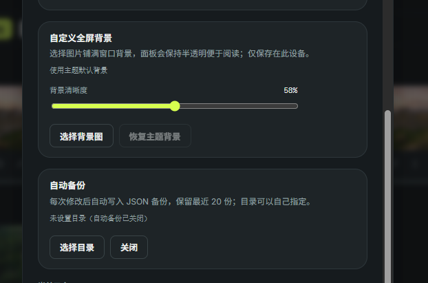
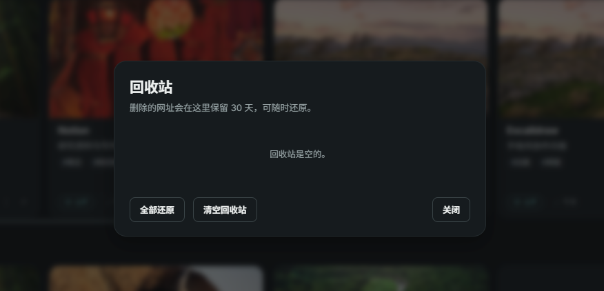
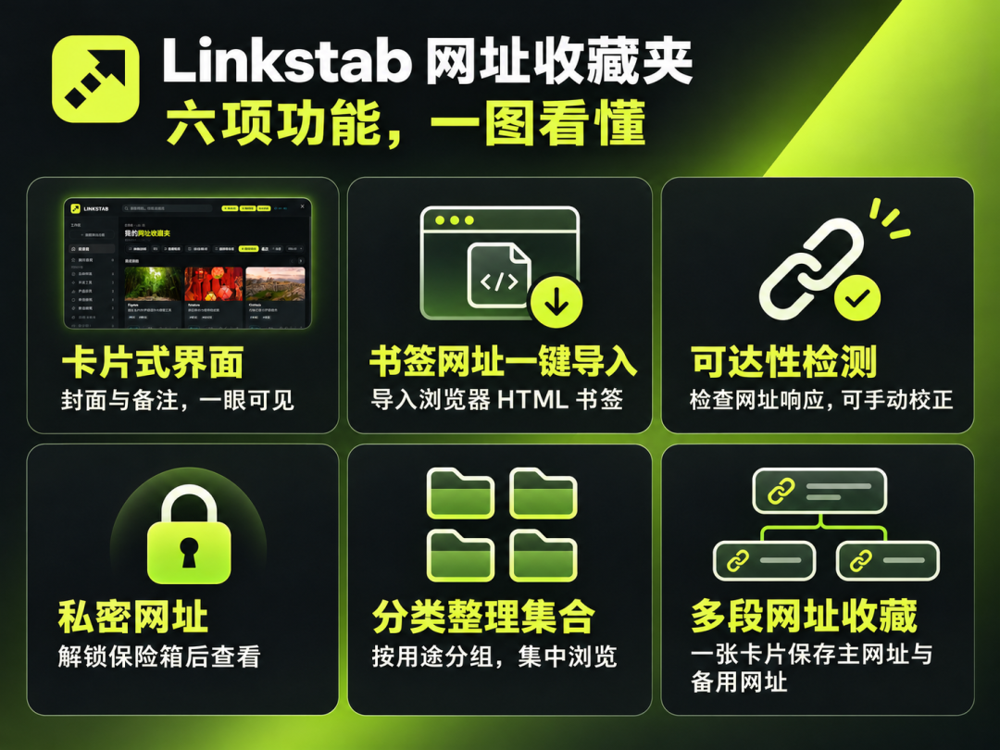

# 书签越存越多，我做了个卡片式收藏夹｜Linkstab
> 💡 备注属性未写入，可能是备注属性名称或者类型被修改了，建议将字段类型设置为 rich_text，可以在小程序-操作-修改文章数据库页面进行调整
> 💡 原文链接:[https://mp.weixin.qq.com/s?__biz=MzcwNTUwMTYzOQ==&mid=2247483663&idx=1&sn=98d917f86ba125fca2c84c69842c37ca&chksm=f510595e6c28ea6bcb2b35670668585222736cbd9f4acb97436cb5e44332446138979cf1fd29#rd](https://mp.weixin.qq.com/s?__biz=MzcwNTUwMTYzOQ%3D%3D&mid=2247483663&idx=1&sn=98d917f86ba125fca2c84c69842c37ca&chksm=f510595e6c28ea6bcb2b35670668585222736cbd9f4acb97436cb5e44332446138979cf1fd29#rd)
**LINKSTAB · Windows 网址收藏夹**
## 书签越存越多，我做了个卡片式收藏夹｜Linkstab
明明收藏过，为什么下次还得重新搜？Linkstab 是我的首个公开 AI 辅助开发项目。一篇看懂它怎样导入书签、整理网址。

一个上周存的配色工具，名字忘了，只记得当时觉得好用。打开书签，翻了几层文件夹，最后还是重新搜了一遍。
我做 **Linkstab**，就是想把「下次还能找回来」这件事做得简单一点。打开收藏夹，你能认出熟悉的封面，能按用途翻找，也可以靠随手写下的一句备注，把那个忘了名字的网站找出来。
### 已有的浏览器书签，一次搬进来
浏览器里已经存了一批网址，可以先导出 **HTML 书签文件**，再点击 Linkstab 的「导入书签」。一个书签文件就能导入多个网址，导入时还可以选择默认封面样式。
平时只收一个链接，复制网址后点「粘贴添加」，即可把链接带入表单。想从头录入，也可以用「添加网址」，一起填好名称、分类、标签或备注。初次打开时，可以保留示例收藏先看看，也可以从空白收藏夹开始。

导入书签、添加网址和粘贴添加，都在顶部工具栏。
### 分好类，也能很快找回来
**仪表盘**会展示最近添加和各分类的预览。最近添加的一行可以左右滑动；分类卡片按一行排列，剩余网址可从「查看全部」进入。「分类集合」则只展示分类，适合分类多的时候从上往下找。
首页和左侧栏显示哪些分类，可以分别设置。想多留一点空间给卡片，也可以折叠侧栏。常用网站点星标后会收进「我的喜欢」。切到自定义顺序时，可以拖动卡片，也能给想留在当前位置的卡片加上固定标记。
记不住分类时，按 **Ctrl + K** 打开搜索，按名称、网址、标签或备注查找。比如存工具时写了「配色」，之后就可以用这个词找它。

仪表盘集中显示最近收藏与分类预览。
### 卡片可以认封面，也可以改大小
每个网址都可以配图片、纯色或渐变封面。遇到没有网站图标或图标加载失败时，卡片会用 Linkstab 的图标代替。需要时还可以在卡片里补充简介和标签。
顶部滑块可以整体调节卡片密度，两端按钮可以直接切到最小或最大尺寸。缩小后适合扫一眼，放大后能看到更完整的信息。在「全部网址」或分类视图中，需要强调的卡片还可以单独从 **1×1** 调到 **2×1**，尺寸按视图保存。仪表盘保持统一卡片尺寸。
整个界面也能换外观，支持深浅主题、自定义全屏背景和背景清晰度。常用操作可在设置里调整快捷键。

卡片放大后，可以一起看到封面、名称、备注和标签。
### 私密网址，单独放进保险箱
有些网址只想自己查看，可以设为私密收藏。保险箱上锁后，需要先解锁才能查看这些网址，也可以设置自动上锁。
收藏保存在本机，无需注册账号，目前没有云端同步。打开网页、检测可达性或加载在线封面和网站图标时，仍会按功能发起网络请求。

私密收藏需要解锁后查看。
### 网址还能不能打开，先检查一遍
可以检测单个网址，也可以检查当前分类里的网址。结果区分「可用」「需关注」「检测未通过」和「待检测」，并记录最近一次检测时间。
检测结果会受网络环境和网站策略影响。如果软件提示检测未通过，但在浏览器里能打开，可以到卡片的「更多操作」里手动修正。对需要特定网络环境访问的网址，还可以加一个梯子徽标，之后从筛选菜单快速找出来。

网址检测会显示当前进度和结果，便于后续复核。
### 整理错了能找回，换电脑能带走
整理一批收藏时，可以多选后批量操作。误删的网址可以在回收站保留期内恢复。重要收藏可手动导出为 **JSON 备份**，也可以在设置中选择目录，开启自动备份。
换电脑或在 Electron 和 Tauri 之间切换时，先在原版本导出备份，再到目标版本的「备份与恢复」导入。恢复操作会替换当前收藏，建议先为目标版本也保留一份备份。

背景图和自动备份目录可以在设置中调整。

误删后，可以先到回收站查看。
### Windows 下载版本怎么选
这次发布的是 windows版本，只在win11系统上测试运行过。想节省下载体积，可以选 Tauri。想在断网时也能安装，可以选自带运行时的 Electron。软件提供便捷和安装版两种选择。

