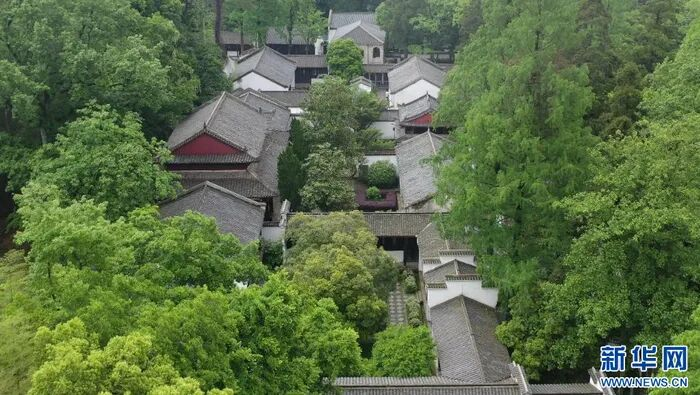
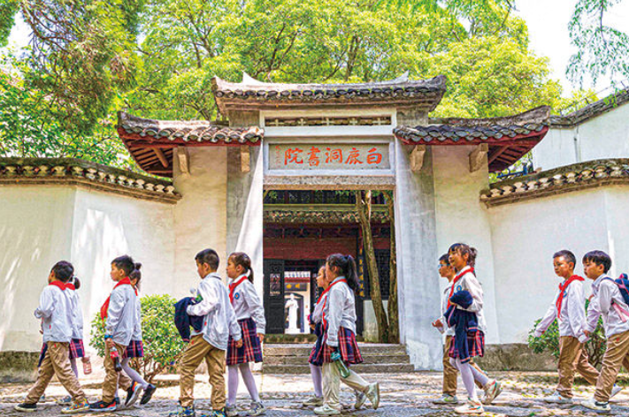

# 书院甲天下 文脉润人心——解码赣鄱阅读DNA
> 💡 备注属性未写入，可能是备注属性名称或者类型被修改了，建议将字段类型设置为 rich_text，可以在小程序-操作-修改文章数据库页面进行调整
> 原文链接:[https://mp.weixin.qq.com/s/03NFf9f84JNyWO0k-8j8qg](https://mp.weixin.qq.com/s/03NFf9f84JNyWO0k-8j8qg)

书院千载，桂馥兰薰；文脉赓续，弦歌不辍。
　　自古江西多书院。经过书院洗礼的士子们，怀揣着“耕读传家”的朴素理想，践行着“文章节义之邦”的家国担当，传颂着“好读书”的诗意人生……他们共同书写了赣鄱阅读的DNA。

**桂花香里开先河**
　　四月，高安华林桂岩书院内，四季桂花，缀满枝头。
　　一千多年前，也在此处，唐代教育家幸南容创办书院。据南宋幸元龙所著《桂岩书院记》记载：“因植桂百株，结草堂数间，为斋者四。讲隶有舍，庖膳有所。益国周公为大书匾曰‘桂岩书院’。”
　　南昌师范学院书院研究中心主任、江西省书院研究会会长张劲松认为，桂岩书院是据目前所知史料中我国最早招徒授业的私家书院之一。
　　江西书院，正是在那片桂花香中得以孕育。
　　“一意诗书为功名”道出了幸南容创办桂岩书院的初衷。幸南容是高安人，与柳宗元、刘禹锡是同榜进士，为官期间执掌教育行政，他革弊除陋，教育风气焕然一新。
　　前驱开径，后继踵踪。
　　创立于公元890年前后的德安东佳书堂，是中国书院史上最早拥有学田、订立教规的家族书院，为后世书院的稳定运作提供了制度范本。公元984年经扩建成的华林书院，鼓励女子读书，也为全国首创。
　　书院打破了官学局限，催生民间教育，改变了读书人的命运。在崇文重教氛围下，桂岩、东佳、华林等早期私家书院为江西培育了科举人才，仅唐代袁州就诞生了卢肇、易重两位状元。卢肇状元及第写下“果然夺得锦标归”，借用龙舟竞渡夺标，激励后世学子苦读成才。
　　书院的兴盛，让耕读传家的观念深入人心。
　　义门陈氏正是耕读传家的典范，其家风家训规定：“立书堂一所于东佳庄，弟侄子孙有赋性聪敏者令修学，稽有学成应举者。”这是中国古代家族教育中罕见的制度性安排，将“读书”从个人选择上升为家族义务。黄庭坚的曾祖父黄中理制订《黄氏家规》,强调读书为立身之本。而对于华林书院，宰相李昉有诗赞云：“岁收千箱稻，家贮一楼书。”
　　十步之内，必有芳草；百里之境，必有书院。钟灵毓秀的赣鄱大地，似乎天然适合读书人在此兴办书院、读书和讲学。
　　唐朝诗人李渤隐居庐山五老峰读书。据人民日报引清代编纂的《白鹿洞志》提到：“唐长庆年间，李渤任江州刺史，在白鹿洞创建台榭，遍植花木，引得四乡文人往返不绝。”南宋民族英雄江万里因见吉安白鹭洲上环境清幽，创立白鹭洲书院……江西科技师范大学历史与旅游文化学院院长习罡华认为，江西“物华天宝”的地理环境与崇学风气，为书院的兴盛提供了土壤，使其数量长期位居全国前列，最终形成“文节俱高”的读书传统。
　　清代学者黄瑞图在《濂溪书院记》中记载：“江右……名儒辈出，书院甲于他省。”根据江西省地方志办编纂的《江西书院》最新统计，江西历代有书院近2000所，占全国书院的四分之一。其中，白鹿洞书院、鹅湖书院、白鹭洲书院、豫章书院在全国影响力最大。
　　江右书院甲天下，青山处处有书声。
**文章节义见风骨**
　　庐山五老峰南麓，白鹿洞书院枕山抱水。走进书院的朱子祠内，就能看见那块清代乾隆年间刻有《白鹿洞书院揭示》（又称《白鹿洞书院学规》）的石碑。
　　“父子有亲，君臣有义，夫妇有别，长幼有序，朋友有信”“学问思辨四者，所以穷理也”……这些学规内容，成为当时全国书院共同遵守的准则，也是元明清三代官学教规的重要补充。
　　《白鹿洞书院学规》也被悬挂于白鹭洲书院道心堂。书院提出“不独以文章取科名而已，愿以行己有耻为第一义”的办学宗旨，确定书院培养人才要重节义。

　　忠义气节正是庐陵读书人的核心内容。出生于吉安富田乡的文天祥，正是在这种忠义传统的感召下，成长为民族英雄。文天祥去世前留下名言：“孔曰成仁，孟曰取义，惟其义尽，所以仁至，读圣贤书，所学何事？而今而后，庶几无愧！”这说明他认为读书人的使命是追求仁义，即使面临生死抉择，也要无愧于圣贤教诲。南宋覆灭之际，文天祥最终写下千古名句“人生自古谁无死，留取丹心照汗青”。
　　书院兴，则人才盛。据江西省地方志编纂委员会办公室编《江西进士》统计，江西历代考中进士约1.05万人。学者夏汉宁在《区区彼江西 其产多材贤》中提到，“两宋时期的江西科举人才，不但在全国名列第一方阵，而且有不少传诵千古的人物，的确蔚为壮观。”
　　“天下多举子，朝中半江西，翰林多吉安”“一门六进士，五里三状元”“三千进士冠华夏”……这些或典籍记载、或歌谣传唱，正是江西“文章节义之邦”的真实写照。
　　何为“文章节义之邦”？不仅是有人才辈出、节操高尚，还在于从思想上丰盈了中华优秀文化传统。
　　宋明理学作为重要的思想体系，其孕育就在江西。宋明理学的开山鼻祖周敦颐一生六次任职江西，开创了宋明理学的宇宙论与心性论体系。理学集大成者朱熹将理学思想转化为可操作的书院学规。同一时期，南宋著名哲学家陆九渊提出“宇宙便是吾心，吾心便是宇宙”，主张“发明本心”“先立乎其大者”，开创与理学并峙的心学体系。
　　和而不同，论道明理。据《鹅湖书院志》记载，公元1175年，朱熹与陆九渊在鹅湖书院围绕理学和心学分歧展开辩论，史称“鹅湖之会”。中国书院学会副会长王维生指出：“鹅湖之会是中华优秀传统文化的重要精神财富，其蕴含的平等对话、理性思辨精神，在当代文明交流互鉴中仍具有重要价值。”
　　在江西，王阳明完成了心学思想的关键突破：在南昌悟出“致良知”这一核心观点。黄宗羲在《明儒学案》中感叹：“阳明一生精神，俱在江右”。
　　千年文脉的思想星火，在赣鄱大地上代代相传、熠熠生辉。

**书香致远文脉长**
　　书院的馨香不仅萦绕赣鄱大地，还远播海内外。
　　“朱熹《白鹿洞书院揭示》还传播到日本、朝鲜半岛和越南等地区，对当地的传统教育、学校制度及社会伦理价值均产生了深远影响。”江西省朱子学研究会副会长、南昌大学哲学系主任张新国告诉记者。据其介绍，在日本江户时代，朱子学是幕府官学，许多藩校与私塾直接以《白鹿洞书院揭示》作为教育纲领；在韩国，《白鹿洞书院揭示》被广泛应用到传统书院教育、科举考试以及现代教育价值融入。记者在采访中还了解到，承载着“和而不同”思想的鹅湖书院，如今已是中国华侨国际文化交流基地，帮助众多华侨学子追寻中华文脉，感知文化博大精深。
　　书院文化，既承载着授业育士的千年传统，也滋润着读书人的心灵。历代读书人留下的名言警句，已然是赣鄱文化传统中的独特亮点，也成为中国人心底里的一种文化共识。
　　“穷且益坚，不坠青云之志……” “一介书生”、初唐诗人王勃在南昌奉献出“天下第一骈文”《滕王阁序》，至今吸引着五湖四海读书人来到滕王阁吟诵。
　　读书带给人们不仅是入世时的勇猛精进，也有出世后的淡定从容。
　　“好读书，不求甚解；每有会意，便欣然忘食。”在中国人精神维度产生过深刻影响的东晋诗人陶渊明，不为五斗米折腰归田园居后写下的这句，一直为后世读书人津津乐道。
　　读书本来就是人生永恒的乐趣。
　　唐末诗人、广丰人王贞白在白鹿洞书院吟出了千古名句：“读书不觉已春深，一寸光阴一寸金。”
　　唐宋八大家出自江西的三家，都称赞读书大有裨益、饶有兴味。王安石一首劝人读书的诗劝得明明白白：“读书不破费，读书利万倍……”曾巩喜藏书，积至两万卷，在其著名的《墨池记》一文中直言，学习“岂可以少哉”。欧阳修说读书是“少而干禄利，老用忘忧患”，自己则“老尚把书卷”，真是“至哉天下乐”。
　　腹有诗书气自华，不读书则缺了精气神。
　　“江西诗派”开派宗师、书法史上“宋四家”之一的黄庭坚，将读书人只有勤读方能有底气、正气，说得生动形象：“士大夫三日不读书，则义理不交于胸中，对镜觉面目可憎，向人亦语言无味。”
　　饱读诗书之人， 从来都能让人刮目相看、肃然起敬。

　　最是书香能致远。今年4月20日至22日，第五届全民阅读大会将在我省举办，主题是“共促全民阅读，共建书香社会”。
　　全民阅读，正是赓续文脉的一种当代践行。
　　我省高度重视千年书院的文化传承与发展。去年5月，在首届书院文化会讲上，我省提出启动“书院焕新计划”——
　　守护书院文脉。豫章书院复建并正式开放，鹅湖书院清理出宋元时期讲堂遗址与排水系统。《江右文库》将《江西书院史》纳入“研究编”出版计划，计划2至3年内正式出版。
　　传扬书院精神。白鹭洲书院讲坛吸引一批文化名家来授课，白鹿洞书院延续着千年讲学传统，围绕先秦儒学、朱子义理每月开展公益会讲，鹅湖书院深挖“鹅湖之会”历史文脉，举办鹅湖会讲、鹅湖论道等讲座；
　　链接现代生活。今年1月，我省推出“江右书院甲天下·我的江西四大书院研学之旅”精品线路，将四大书院串珠成链，设计推出三大主题路线，传统书院与旅游的融合，让书院及其文化变得可触可感、可学可游。
　　千年书院，正以其独特的文化魅力，融入现代生活的脉搏，绽放出历久弥新的时代芬芳。
---
来源：江西日报

编辑：张瑞颖
复审：刘斐
审签：宋茜
