# 五步做出360VR互动网页
> 💡 备注属性未写入，可能是备注属性名称或者类型被修改了，建议将字段类型设置为 rich_text，可以在小程序-操作-修改文章数据库页面进行调整
> 💡 原文链接:[https://mp.weixin.qq.com/s?__biz=MzU4MzM1NjUwMg==&mid=2247486184&idx=1&sn=c43eb052661f5a562d43e5b3b532f5fd&chksm=fccc0abbaa242b8177f6ddb5f2694e3191b87be50e5ec01659788a3cff116e9e6ae85772e7a8#rd](https://mp.weixin.qq.com/s?__biz=MzU4MzM1NjUwMg%3D%3D&mid=2247486184&idx=1&sn=c43eb052661f5a562d43e5b3b532f5fd&chksm=fccc0abbaa242b8177f6ddb5f2694e3191b87be50e5ec01659788a3cff116e9e6ae85772e7a8#rd)
做一个能转的 360 课堂网页 · 零基础操作手册
 零基础老师操作手册。全程五个步骤，跟着点就行。 不写代码、不装软件、不看原理。做完得到一个文件，双击就能转着看。 
适合谁 所有一线老师
要用什么 电脑 + WorkBuddy
要用多久 30 到 40 分钟
要不要会代码 完全不用
案例 《圆明园》七年级语文
在线演示（复制到浏览器打开）　https://yuanmingyuan-360.app.workbuddy.host/?sharecode=HJJGY35DN4
《WorkBuddy 教师实战蓝皮书》配套专题 · 零基础操作手册 · 所有截图来自真实运行
**先说一件事。**
这份是
零基础精简版
，只讲点哪里、怎么做出成品。 完整版较长，需要的话，在公众号后台
**私信发送「互动网页」**
四个字，会自动发给你。
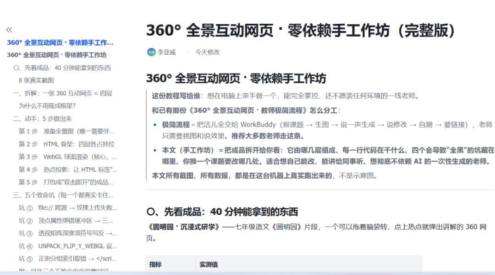
先看一眼你要做出来的东西
下面这个东西叫「360 全景互动网页」。它是一张**能转的图**。学生按住鼠标拖一下，画面就跟着转，像站在现场四下看。图上贴着几个小圆点，点一下就弹出一句讲解。
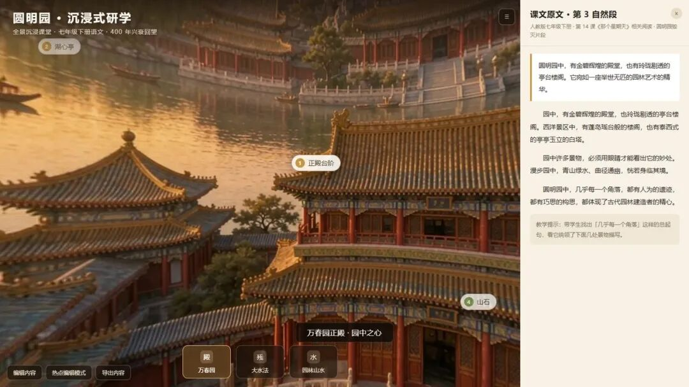
做出来长这样。左边是能转的画面，右边是课文讲解，底下是换场景的按钮。
| **这个东西能干什么** | **举个例子** |
| 画面能转 | 学生想看哪就转到哪，不用翻页 |
| 图上能点 | 点到「正殿台阶」就弹出一句讲解，讲完了关掉 |
| 能换地方 | 底下三个按钮，从万春园换到大水法 |
| 文字随时改 | 页面里有个「编辑内容」按钮，改完点一下就生效 |
| 发得出去 | 就是一个文件，微信直接发到班级群，学生双击打开 |
**这份手册里没有代码。**

每个步骤都是「在哪儿点、点什么、会看到什么、卡住了怎么办」。
如果某一步你没看懂，看最后那节「卡住了怎么办」，那里几乎能回答所有问题。 
**这份手册的五个步骤 **
第 1 步　把课题告诉 WorkBuddy，让它出方案。 
第 2 步　让 WorkBuddy 直接把图画出来（不出软件）。 
第 3 步　说一句话，让 WorkBuddy 把网页做出来。 
第 4 步　花 30 秒，自己先试一遍
第 。 第 5 步　发给学生
换成你自己的课题，只改三个地方。
动手前先确认下面几件事，能省掉后面大部分麻烦。
| **准备什么** | **具体怎么做** |
| **一台电脑** | 能上网的 Windows 或苹果电脑都行。屏幕大一点更好做。 |
| **打开 WorkBuddy** | 桌面双击 WorkBuddy 图标。如果没装，问学校的信息老师，或者搜「WorkBuddy 下载」。 |
| **什么别的都不用** | **全流程在 WorkBuddy 里**画图、做网页、改文字，全在这一个软件里完成。**不用注册即梦，不用建文件夹，不用下载改名。** |
| **心里有数** | 这节课的课文是什么、你想让学生看懂什么。三分钟想清楚就够。 |
**最容易卡住的一点，先说在这里。**
**
**
**说画图要求时，一定要带上「横版宽幅，宽高比 2比 1」这句**， 不然画出来是方的，放进网页就不好看。 真出成方的也没关系，回一句「把这三张裁成宽高比 2 比 1」就行。**别自己动手裁。**
**1：把课题告诉 WorkBuddy，让它出方案**大约 5 分钟
**你做什么**
打开 WorkBuddy，把下面这段话**整段复制进去**，然后把三个【】里的字换成你自己的。
要复制的这一段（这就是你的课题）
我要做一个 360 全景互动网页，就是一个文件、双击就能打开、能用鼠标拖着转、图上点了会出讲解的那种，不用装任何东西。课文或知识点是【《圆明园》毁灭片段，七年级下册语文】我想让学生【能转着看园林景物，把课文里的描写和看到的画面对上号】年级是【五年级】风格想要【写实的历史复原感，夕阳暖光】（这一项可写可不写）请先只给我方案，不要急着做。方案里说清楚三件事：一、分几个场景，每个场景看什么；二、每个场景上放几个可以点的知识点，点开弹什么；三、每个场景配一张什么样子的图。方案我确认之后，再把每个场景要生图的提示词写给我。
**三个【】里分别填什么？**

第一行【】填**课文名和年级**，比如《题西林壁》五年级语文上册。 第二行【】填**你希望学生看懂什么**，用大白话写就行，比如「看懂横看成岭侧成峰」。 

第三行【】填**年级**
**风格那一行可以整行删掉**，不写WorkBuddy 自己定。 
**你会看到什么**
WorkBuddy 会先**不着急动手**，先给你一份方案。大致长这样。
**W：**好的，先给你方案，确认了再动图。**
**
**一、场景安排（3 个）**

场景一 万春园正殿，看皇家园林的气派； 
场景二 大水法遗址，看被毁后的残迹； 
场景三 园林山水，看造园手法。**
**
**二、可以点的知识点**

场景一放 4 个（正殿台阶 / 湖心亭 / 西洋楼远影 / 假山）； 
场景二放 2 个（残柱 / 石雕）； 
场景三放 2 个（九曲回廊 / 白塔）。**
**
**三、生图提示词** 确认方案后我发给你，共 3 条，直接复制去生图。你看完方案，觉得可以就回「方案可以」，要改就说「第三个场景换成山顶俯瞰」这种。
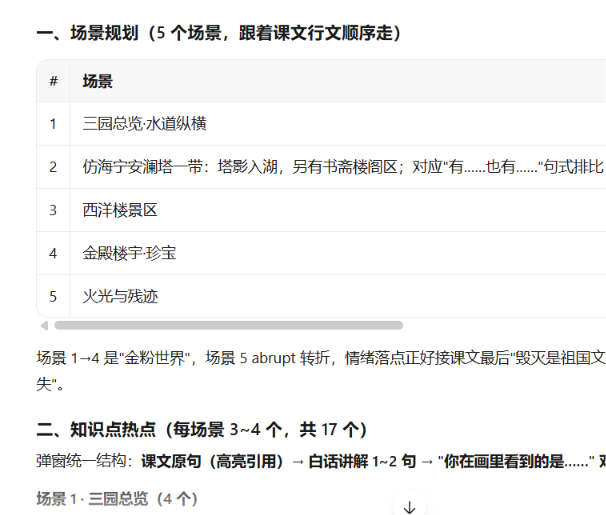
当然并不是每次都一样，设计不一样，场景也会不同，只是做一个演示
**你做什么：**
看一遍方案。**觉得行**就回复 **「方案可以，把提示词发给我」**。**觉得不行**就直接说人话，比如：
「场景太多了，两个就够了」
「我想换成《题西林壁》庐山的场景」
「第二个场景换成山顶俯瞰」
**它发回来的提示词长这样（这一段是真实案例，圆明园场景一）：**
生图提示词（场景一 万春园正殿）
中国古典皇家园林全景，360 度全景图，宽高比2 比 1。画面中心是万春园正殿，三层高台之上，汉白玉台阶，金色琉璃瓦大屋顶，殿前开阔庭院。远景是湖面、曲桥、亭台楼阁。夕阳暖光，水面倒影。写实历史复原风格，超高细节，不要文字，不要水印，不要人物特写。
提示词是哪儿来的？
很多老师会卡在「这段话我得自己写吗」。**完全不用自己写。**这段话是 WorkBuddy 按下面这个固定的格式，把你填的课题自动拼出来的。
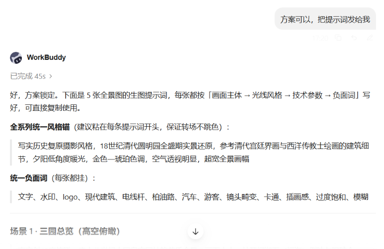
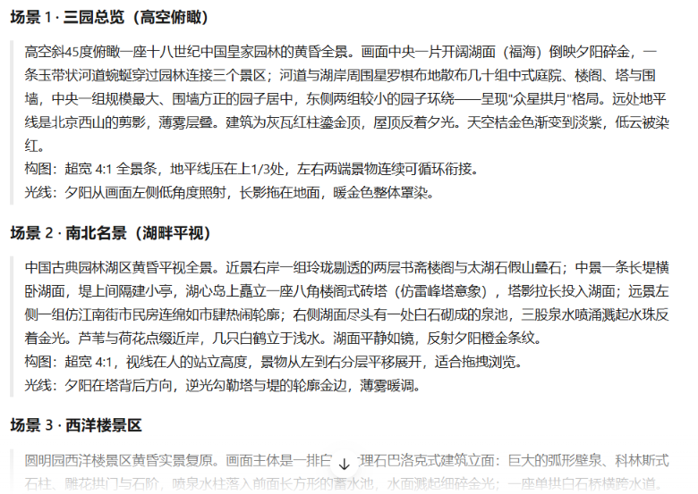
**有一句话一定要留在提示词里：**
**「360 度全景图，宽高比 2 比 1」**。 这句话告诉生图工具，出的是一张横长条的图。删了它，出来的可能是竖图或方图，放到网页里就不好看。 
**如果你想要别的风格**，现在就改，不要等做完再改。
回 它一句话：「风格改成**水墨插画**，三条提示词重新发一遍」。 **注意三张图的风格要一样**，不能一张照片一张漫画。 
**2：让 WorkBuddy 直接把图画出来**大约 5 分钟
**这一步不用离开 WorkBuddy。** 画图、挑图、换图，全在刚才那个对话里接着做。 不用打开别的网站，不用登录别的账号，不用下载图片、不用改文件名。 
**你做什么**
在**同一个对话框**里，接着发这一段。
要复制的这一段
请按你刚才给的提示词，一条一张，把三张图画出来。要求横版宽幅，宽高比 2 比 1。先让我看图挑一挑，我说可以之后再做网页。
你会看到什么
**W：**好的，我来画三张，一张一张出。**图一　万春园正殿**（已生成）**图二　大水法遗址**（已生成）**图三　园林山水**（已生成） 你看一下这三张。不满意我可以重画，也可以只换其中一张。图会直接显示在对话里，你看完回话就行。
用的是什么模型（老师问得最多的一句）
**不用挑，也不用去设置里找。**

WorkBuddy 自带的图片生成，用的是**腾讯混元**（hunyuan-image-v3.0），**免费、不用配密钥、说一句「帮我画图」就自动用它**。画这种**风景、建筑、历史场景**的图，它完全够用。三张画下来大约花 **15 到 30 积分**，不额外收钱。 
| **什么情况** | **选什么** |
| **画课堂用的全景图**（本文这种） | **用内置混元，别折腾** 不用换模型、不用装技能、不用配密钥。够用，而且全程不出 WorkBuddy。 |
| 想要更写实、细节更强的画面 | 可以加装付费的图像模型（如 Gemini 3 Pro），但要自己配密钥、按张付费。 **不建议老师们为这一个课件去弄**，收益不大。 |
| 做中文海报、带中文字的图 | 那才轮到专门做海报的图像模型。做全景图用不上。 |
| 做架构图、流程图 | 跟本任务无关，不展开。 |
**一句话记住。**

 画「场景图」（本文这种）就用内置的，**不要去挑模型**。 真正决定效果的是你那条提示词写得够不够具体。 
尺寸这一件，必须说清楚
**360 全景图要用「横长条」（宽高比 2 比 1）。** 但内置生图默认给的是 其他比例，就要求它生成2:1的图。**
**
**① 上面那段话里我已经写了「宽高比 2 比 1」，WorkBuddy 会尽量按这个出； **　② 就算出成了 其他，**你只要回一句「把这三张裁成宽高比 2 比 1」**，它自己会裁好，一步完成。**不要自己去截图、不要自己用画图软件裁。**说一句话比动手快。 
怎么挑图（三条标准，按重要性排）
**细节差点没关系。**瓦片糊一点、人影怪一点，学生看不出来。上面三条不过关才是真问题。 
不满意怎么办（都只用说话，不用动手）
直接口喷：三张全不行
「这三张都不行，重新画一遍。」                                       「第二张不行，重画一张。」                                              「三张都换成
水墨插画
风格」      
注意三张风格要统一，别一张照片一张漫画。光线/时辰不对
                                                             「光线改成清晨，重画。」                                                「
就用这三张，可以做网页了。
」    
**3：说一句话，让 WorkBuddy 把网页做出来**大约 3 分钟
你做什么：
回到 WorkBuddy，把下面这段话发过去。
要复制的这一段
就用这三张图，按刚才确认的方案生成网页。要求：生成一个文件就好，双击就能打开，不要让我装任何东西。做完请告诉我，那个能直接打开的文件在哪儿。
**图不用你去找。**刚才画的三张就在对话里，WorkBuddy 自己认得。不用建文件夹、不用下载、不用改文件名。 
**你会看到什么**
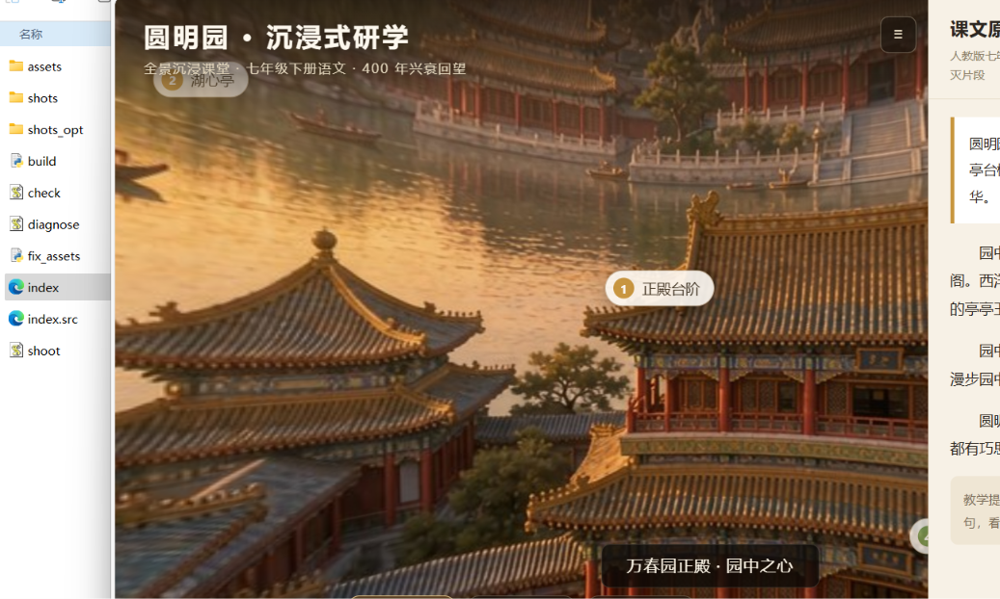
**W：**好的，三张图我找到了。现在生成网页。 场景一 万春园正殿，4 个知识点； 场景二 大水法遗址，2 个知识点； 场景三 园林山水，2 个知识点。 做好了。直接打开的是这个文件**圆明园360研学.html或者是index.html**（WorkBuddy 会告诉你具体在哪）双击它，浏览器就打开了。不用装东西，不用联网也行。
**你做什么：**
找到 WorkBuddy 说的那个文件，**双击它**。默认会用浏览器（Edge 或 Chrome）打开。
**双击之后如果看到一片黑**，别慌，这是最常见的一个情况。 99% 是因为开错了文件（开成了「源文件」），或者图没放对位置。 
直接去最后一节「卡住了怎么办」看第 1 条和第 2 条。 
打开后你应该看到
一整屏的画面（不是黑的，不是空白的）
画面上贴着几个**白色小圆点**，写着「正殿台阶」这类小字
右边有一栏课文和讲解
底下有三个方块按钮，写着「万春园」「大水法」「园林山水」
看到这四样，就是做成了。
**4:花 30 秒，自己先试一遍**大约 1 分钟
**这一步千万别省。** 自己先转一圈、点一遍，比上课当天翻车强一百倍。整个过程一分钟都不到。 
六个动作，一个一个来
① 转一转
按住鼠标左键不放，左右拖
。画面会跟着转，像人在现场回头。
如果拖不动，看是不是点了别的地方。要按在画面上拖。
② 抬头低头
滚动鼠标中间那个滚轮
。画面会往上看、往下看。    
③ 点知识点
用鼠标点画面上的白色小圆点
。会弹出一个白框，里面有标题和讲解。
      读完点右下角「
关闭
」。
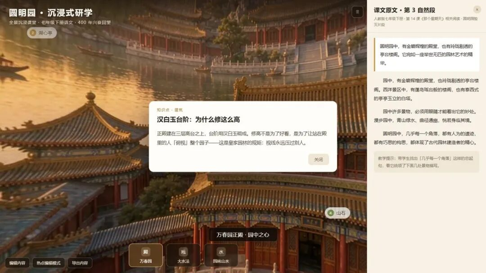
点开之后是这样。右下角「关闭」一点就收起来。
④ 换场景
点底下三个方块按钮
。点了画面就换到另一个地方。
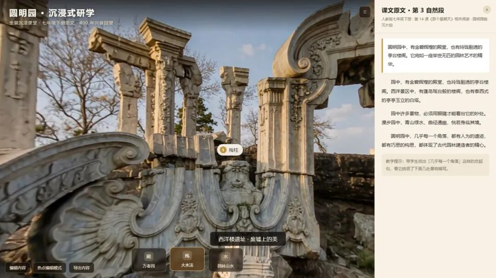
点「大水法」就换到遗址那张图了。按过的按钮会变亮。
⑤ 投屏前收面板
点右上角那个「≡」（三条横线）
，右边那栏会收起来，画面变大。
      上课投屏的时候用这个。再点一下就恢复。
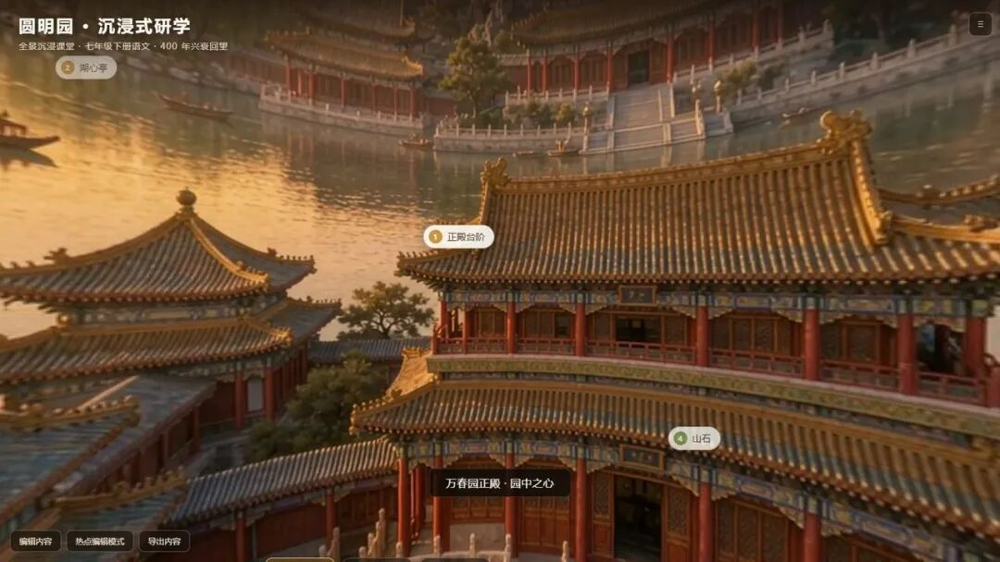
收起来之后就是这样，画面全屏，更好讲。
⑥ 改文字
点左下角「编辑内容」
。会弹出一个框，里面是要显示的所有文字。
      直接在框里改，改完点「
应用并刷新
」。
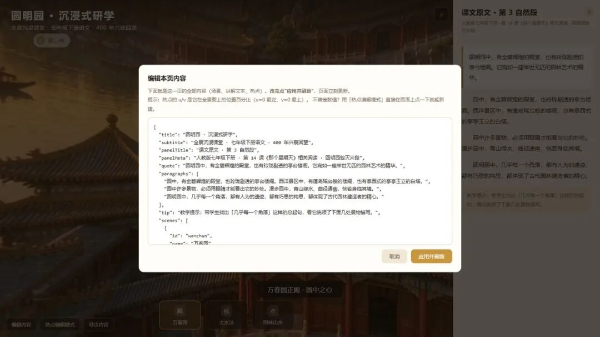
改文字不用找文件，在这个框里改就行。
还有一个很好用的东西
想加一个新的知识点
点左下角「热点编辑模式」
，然后
在画面上你想要的位置点一下
。
      它会问你四句话，照着填就行：名字、标题、讲解、分类。
      填完就多了一个能点的小圆点。
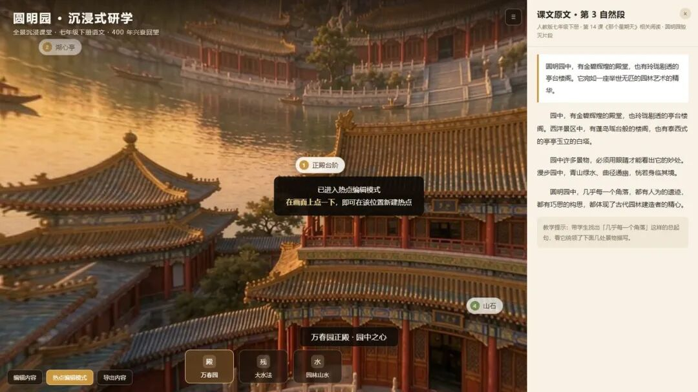
不用知道什么坐标，点哪儿就加在哪儿。
**你刚才转到远处，应该还藏着一两个没看见的知识点。** 这是故意的。留一两个要转一下才看得见的地方，学生才有「找」的劲头。
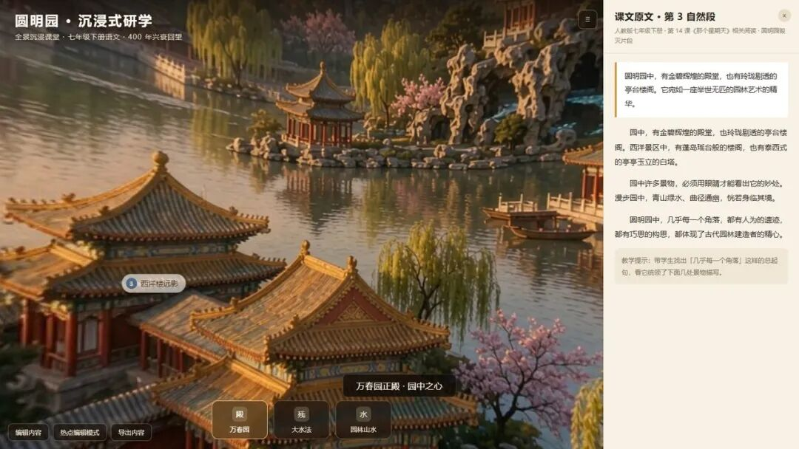
转过去才出现的「西洋楼远影」。上课可以让学生转着找。
**5:发给学生**大约 1 分钟
发什么文件
就发**一个文件**，就是你刚才双击打开的那个。一般是 **「圆明园360研学.html」** 这种名字。
**发文件的话，只发那一个文件。**不要把整个文件夹一起发，文件夹里还有别的东西，学生反而打不开。**更省事的是直接发上面那个链接。**
怎么发
发链接（最省事）
 我这个已经发布成在线链接了，直接复制发给学生，他们点开就能转：      
**在线演示（可直接转发）**
https://yuanmingyuan-360.app.workbuddy.host/?sharecode=HJJGY35DN4
链接在电脑浏览器打开最舒服。手机也能开。
微信班级群（发文件）
把文件拖进微信聊天窗口，或者点聊天框旁边的「文件」按钮选它。发出去即可。    
学生用手机
  手机上微信收到后，点开可能会提示「用其他应用打开」，选浏览器。      
电脑上发给电脑用是最稳的。
想留着下学期还用
把这个文件复制一份到你的 U 盘或者网盘。它不依赖任何东西，放几年照样能打开。    
上课时怎么用：
投影前先双击打开，按 **「≡」** 收起右边栏；讲到哪，就**把画面拖到那儿**，别一直指着屏幕不动；让学生**上来动手转一下**，比你讲十句都管用
讲完一个问题就点开对应的圆点，讲完关掉
换成你自己的课题，只改三个地方
上面全程用的是《圆明园》。换成你自己的课文，只要改三个地方，别的都不用动。
| **改哪儿** | **怎么改** | **举例（换《题西林壁》）** |
| **第 1 步的三行** | 把【】里的课文名、教学目标、年级换掉 | 《题西林壁》，五年级语文上册让学生从不同角度观察庐山五年级 |
| **第 2 步的三张图** | 提示词换了，生成的图就是庐山了。图还是在对话里画，挑完直接用 | 画面换成「庐山山景，云雾缭绕，远近山峦层叠」 |
| **第 4 步改文字** | 网页做好后，点「编辑内容」把课文、讲解、知识点名字换成你的 | 课文原文换成《题西林壁》全文 |
**几个已经想好的用法，你可以直接照搬。
**
**语文：**《题西林壁》看角度《苏州园林》看造园、《登鹳雀楼》看远景。 **地理：**一条流域、一处地质构造，让学生找最高点、说坡度。 **
**
**科学：**校园植物、天坛回音壁、一个实验装置的四周。 **
**
**历史：**遗址、纪念馆、博物馆展陈现场。 **
**
**总原则：**凡是课文中提到「站在那儿能看到什么」的内容，都适合做。 
卡住了怎么办（12 个常见问题）
按问题出现的先后排。基本覆盖了老师第一次做会遇到的所有坎。
**Q双击那个网页文件，打开是一片黑的，什么都没有。**
A十有八九开错了文件。你开的可能是「源文件」（名字里常带 src 或者后缀不同）。 回到 WorkBuddy 问一句：**「请告诉我，能直接双击打开的成品文件叫什么名字、在哪个位置」**。 正确的那个双击之后应该是有画面的。
**Q画面是黑的，但上面有字写着「全景图未加载」。**
A多半是图没被认到。回到对话里跟 WorkBuddy 说一句「**三张图没找到，请重新附上刚才那三张，再生成一次网页**」。
**Q画出来的图是方的，或者不够宽。**
A直接回它一句「**把这三张裁成宽高比 2 比 1**」，它自己会裁好。 不要自己截图、不要用画图软件裁。
**Q画的图没一张满意的。**
A直接说「**重新画一遍**」。别急着改提示词，改了反而容易跑偏。 一般两三轮之内会有一张能用。真要换风格，就说「风格换成 XX，三张重画」。
**Q三张图风格不一样，一张照片一张漫画。**
A第 1 步就要跟 WorkBuddy 说清统一风格，比如「三张都要写实历史复原风」。 已经画出来的，就说「**三张风格不一致，重画，风格统一成 XX**」。
**Q要不要买更贵的图片模型？**
A做这种课堂全景图，**不用**。内置的混元够用，还免费。 花钱买更强的模型，对这一类图提升不大。真要花钱，先把提示词写具体更划算。
**Q网页打开了，但拖不动画面。**
A按住**鼠标左键**，在**画面中间**拖。不要点在按钮上、也不要用触摸板的单指轻扫。 笔记本触摸板要用双指按住拖。
**Q画面上看不到白色小圆点。**
A可能正好看在背面。**拖着画面转一圈**，圆点是分布在四周的。 如果转一圈一个都没有，是内容没写进去，问 WorkBuddy：「画面上没有知识点标签，请检查内容」。
**Q点圆点没反应。**
A圆点很小，点**中间那个数字**最准。如果点到白框外面就没反应了，这是正常的，再点一次。
**Q我想改一句话，但是找不到在哪儿改。**
A不要去翻文件。**点网页左下角「编辑内容」**，在弹出的框里直接改字，改完点「应用并刷新」。 这是最快的办法。
**Q发到微信里，学生说打不开。**
A多半发成了文件夹，或者发的是改不改名的中间文件。确认发的是**一个 .html 文件**。 学生手机上打不开就让他们用**电脑**打开，或者课上你直接投屏。
**Q做好的网页，我想换个课题还能用吗。**
A能。但最好的做法是**让 WorkBuddy 重新做一份**，别自己改旧的。 跟它说：「照这个样子，换成《题西林壁》再做一份」。
**Q我完全没时间做，有没有更省事的办法。**
A有。只做两件事：**① 把课题发给 WorkBuddy；② 把它给的提示词去生图、存好。** 剩下的全部跟它说「你来弄」。真正必须你动手的只有挑图那一下。 蓝皮书里另有一份《360° 全景互动网页 · 教师极简流程》，就是这么做的。
最后三句话
**一、这个东西的价值不在技术，在于画面能转。** PPT 上的圆明园只能看，学生用手一拖转到湖心亭，那个「身临其境」是学生自己发现的。
**二、图可以是假的，现场一定要真。** AI 生成的图讲历史、讲地理、讲抽象空间都够用。讲你自己的学校、自己的实验室，一定要真拍。
**三、第一次做，40 分钟差不多；第二份，15 分钟就够。** 因为五个步骤里，只有挑图那一下是重复劳动。
如果这份手册对你有用
**一、转给一个同事。**同年级、同学科的老师最用得上。你踩过的坑，转出去别人就不用再踩一遍。
**二、留一句话。**说说你打算用在哪一课、哪个环节。 别人留下的选题，常常比自己想的更好用，看完心里就有数了。
**三、拿完整版。**这份是精简版。技术原理、可以自己改的部分、错误的排查办法，都在完整版里。公众号后台私信发送 **互动网页** 四个字，自动发给你。
《WorkBuddy 教师实战蓝皮书》配套专题 · 零基础操作手册 · 所有截图来自真实运行
