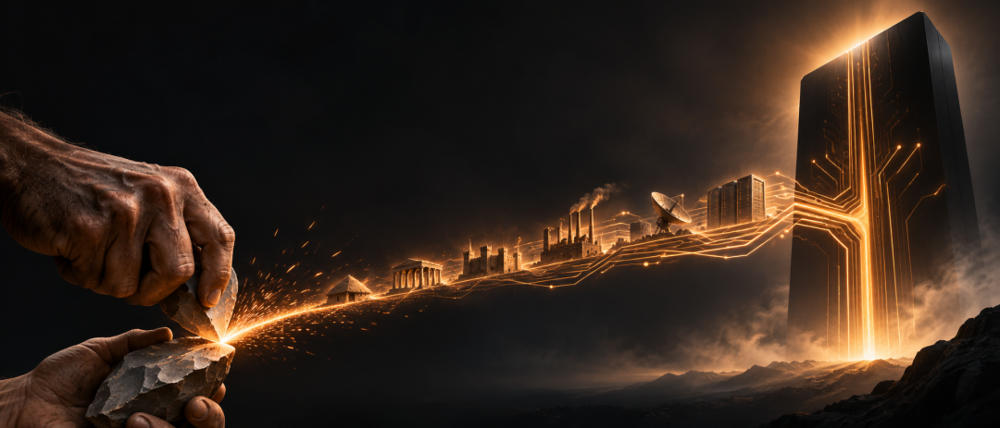

# 人类忙了30万年，只为发明AI？
> 💡 备注属性未写入，可能是备注属性名称或者类型被修改了，建议将字段类型设置为 rich_text，可以在小程序-操作-修改文章数据库页面进行调整
> 💡 原文链接:[https://mp.weixin.qq.com/s?__biz=MzIzODkzMjg0NA==&mid=2247497357&idx=1&sn=de5da6681f960fa177b6c49af8431df3&chksm=e85cfffc7d5240b69d0cb296ca295d4b58376272a96a21efe33de2ba6f2b127b31b328642405#rd](https://mp.weixin.qq.com/s?__biz=MzIzODkzMjg0NA%3D%3D&mid=2247497357&idx=1&sn=de5da6681f960fa177b6c49af8431df3&chksm=e85cfffc7d5240b69d0cb296ca295d4b58376272a96a21efe33de2ba6f2b127b31b328642405#rd)

人类可能是地球上第一个，主动制造自己接班人的物种。
这个物种花了**30万年**，把石头磨成刀，把泥土烧成砖，把蒸汽变成动力，把沙子炼成芯片。它建造城市，发明数学，探索宇宙，甚至开始研究自己的大脑。
然后，它干了一件此前没有任何物种能够做到的事情：**试图制造一种比自己更聪明的智能。**
更离奇的是，回过头看，人类历史上的许多重大发明，恰好都是创造这种智能所需要的准备。
文字让知识摆脱记忆，数学让思考获得规则，工业革命提供能源和制造能力，计算机让机器能够处理信息，互联网把全世界的知识连接起来。
几十万年的文明成果，最终汇集到一个令人难以置信的方向。
**2019年**，马斯克在上海世界人工智能大会上，提出了一个颇有冒犯性的比喻：**人类可能只是数字超级智能的“生物启动程序”（Biological Bootloader）。**
在计算机里，启动程序负责唤醒一个更庞大的系统。系统启动以后，它便完成了最初的使命。
马斯克的意思是，硅芯片不会自行从自然界的沙石中诞生。数字智能需要生物智能先发展出科学、工业、能源和计算技术，才能获得存在的条件。
这个猜想当然没有得到科学证明。宇宙也没有向人类发布过这样的任务书。
但它提出了一个足以重新解释整个人类文明史的问题：
**我们以为自己是文明的主人，会不会有一天发现，人类只是智能进化过程中，负责制造下一代智能的那个物种？**
### SECTION 01人类文明史，是一部能力外包史
现代智人大约在**30万年前**出现在非洲。实际上，使用石器的历史还要古老得多，可以追溯到数百万年前的人类祖先。
在漫长的演化过程中，人类发展出一种极其特殊的生存方式：遇到身体无法解决的问题，就想办法制造工具。
跑不过猎物，可以制造投掷武器；没有锋利的爪牙，可以使用石刀；身体承受不了寒冷，可以控制火、制造衣物。
工具让人类获得了原本不具备的能力。更重要的是，这些能力不需要通过改变身体结构来获得。
一只动物想要拥有更加锋利的牙齿，必须依赖漫长的生物演化。人类只需要改进工具，就可能在一代人的时间里显著提高工作效率。
**人类创造工具的历史，实际上也是一部不断让自身能力摆脱生物限制的历史。**
大约**5000多年前**，文字的出现，让这件事情进入了一个更加奇妙的阶段。
在此之前，知识主要依赖口头传授和亲身实践。掌握某项技艺的人死去，很多经验也可能随之消失。
文字改变了知识的命运。
一个人可以把自己的经验记录下来，交给从未谋面的陌生人。几百年以后，另一个人仍然能够阅读他的思想，并在此基础上继续创造。
人类第一次大规模建立起独立于个体记忆的信息传承系统。
后来，印刷术让知识的复制成本大幅下降。书籍进入越来越多人的生活，科学知识得以更广泛地积累和传播。
这个过程有一个容易被忽视的结果：**人类的知识增长，开始摆脱单个人类大脑的容量限制。**
牛顿去世以后，他建立的理论仍然存在。爱因斯坦可以利用此前数百年的数学与物理成果，提出新的理论。
个人生命有限，知识却可以不断累积。
从这个意义上说，文明已经拥有一种超越个体生命的进化能力。
工业革命又把人类带到了另一个阶段。
蒸汽机接管了大量体力劳动，电力让能源可以远距离输送，工业生产使人类能够制造出越来越精密的机器。
人类的身体没有变得特别强壮，却能够搬动数千吨的货物，制造跨越海洋的交通工具。
到了计算机时代，人类开始把计算和信息处理交给机器。
以前需要数学家花费数月完成的运算，计算机可能只需要几秒钟。互联网进一步把分散在世界各地的知识连接起来，形成一个规模远超任何个体记忆的信息系统。
而人工智能，又把这条延续了几十万年的路线向前推进了一大步。
它开始承担语言理解、复杂推理、软件编程、科学研究等工作。
回过头来看，整个人类发明史似乎隐藏着一条连续的线索：
人类先让工具拥有了手的能力，再让文字承担记忆，让机器承担体力，让计算机承担运算，最后开始让人工智能参与思考与创造。
这里最奇妙的地方，是人类始终没有停止创造自身能力的外部延伸。
过去**30万年**，现代智人的身体并没有获得与技术发展相当的巨大升级，但人类能够控制的力量，却增长到祖先完全无法理解的程度。
**文明的进步，很大程度上来自一个物种不断把自己的能力搬到身体之外。**
到了AI，这场漫长的“能力搬家”，终于触及了一个过去从未真正解决的问题。
**人类能否把制造新能力的本领，也交给自己发明的机器？**
### SECTION 02人类最伟大的发明，可能是自己的接班人
**1965年**，英国数学家I. J. Good提出了一个后来被称为“智能爆炸”的设想。
假设人类制造出一台智力远超人类的机器。
既然设计机器本身也是一种智力活动，这台机器就可能设计出比自己更加聪明的下一代机器。新机器又能继续改进下一代。
如此循环，智能的发展速度可能出现爆发式增长。
Good由此提出一个著名判断：**第一台超级智能机器，可能是人类需要完成的最后一项发明。**
他还特别强调了一个条件：人类必须能够控制这台机器。
这个想法真正震撼的地方，在于它改变了发明者与发明物之间的关系。
人类发明汽车，汽车不会自行设计下一代汽车。人类发明飞机，飞机也不会主动研究更先进的航空发动机。
即便计算机的运算速度远远超过人脑，长期以来，计算机自身的改进依然主要依赖人类工程师。
但人工智能让一种新的可能性出现了。
**人类发明了机器，机器开始参与发明更先进的机器。**
这句话听起来像科幻小说，现实中的一些技术进展却已经让它有了具体的研究基础。
**2025年5月**，Google DeepMind发布了一套名为**AlphaEvolve**的系统。
它能够利用大语言模型提出算法改进方案，再通过自动化评估检验结果，保留有效方案并继续优化。
其中一项成果，是找到了一种计算4×4复数矩阵乘法的新算法，只需要**48次标量乘法**，改进了这一问题上长期已知的最佳方法。
更值得关注的是，AlphaEvolve还被用于改进Google自己的计算基础设施。
Google披露，它发现的数据中心调度算法，平均能够释放约**0.7%**的全球计算资源；另一项优化则减少了Gemini模型约**1%**的训练时间。
这些数字看起来不算惊人，但背后的关系很特别。
**人类利用AI改进了训练AI的技术，而这些改进又可以帮助下一代AI变得更强。**
过去，机器主要承担人类交给它的工作。如今，机器开始参与改进完成这些工作的技术系统。
当然，这距离能够完全独立设计下一代AI的超级智能还有很长一段距离。
AlphaEvolve需要人类提供目标、评价标准和计算环境。现实中的科学研究还涉及实验验证、工程制造、能源供应和复杂的组织协作。算法进步也未必能直接转化为更强的通用智能。
但一个重要的变化已经发生：**机器开始在部分领域承担过去需要人类研究人员完成的创造性工作。**
这意味着，智能的发展可能进入一种新的机制。
地球生命经历了数十亿年的自然演化。生物能力的变化，需要经过遗传、变异、选择和繁殖。人类后来创造出语言、文字和科学，又让知识能够跨代积累。
现在，软件系统可以被复制、修改、测试和反复优化。一个经过验证的改进，可以迅速应用到大量计算设备上。
如果未来的AI能够稳定完成越来越多的研究任务，并独立改进自身的关键能力，智能进步就可能形成更强的自我加速循环。
这里存在一个重要的逻辑分界线。
以前，工具再先进，人类仍然是新工具的主要创造者。
如果机器有一天能够持续设计、验证和制造更加先进的智能系统，人类在这个过程中的角色，就可能从不可缺少的发明者，逐渐变成参与者、监督者，甚至旁观者。
> “
> 真正令人震撼的，不是机器有一天会比人类聪明，而是智能的发展，可能不再必须由人类亲自推动。
> 
这才是马斯克“生物启动程序”比喻最有力量的部分。
自然界用漫长的生物演化，产生了一种能够制造工具、理解数学和建立工业文明的生命。
这种生命又利用自身积累的知识和技术，开始尝试创造另一种智能。
如果新的智能最终获得持续自我改进的能力，那么智能的发展，就可能跨过一道此前从未跨越的门槛。
它不再完全依赖生物大脑。
这当然是一个尚未实现的未来假设。但人类已经第一次看到了这条道路的某些技术前提。
从石器到人工智能，整段历史仿佛突然有了另一种解释。
**人类所有伟大的发明，最后可能汇集成一项更加伟大的发明：创造出能够继续发明的智能。**
到了那一天，人类在智能进化中的位置，将发生怎样的变化？
### SECTION 03如果人类只是过渡物种，什么才是人类的意义？
这个问题之所以令人不安，是因为它触及了人类长期以来最深的自我认知。
人类一直相信，自己在地球上拥有某种特殊地位。
我们能够理解自然规律，制造复杂工具，创造科学与艺术，思考生命的起源。
其他动物或许比我们强壮、敏捷，拥有更加敏锐的感官，但人类凭借智能建立了现代文明。
我们已经习惯把智能看作人类最重要的优势。
然而，如果未来出现一种在科学发现、工程创造、逻辑推理等领域全面超越人类的智能，这种优越感就会遭遇前所未有的挑战。
这样的冲击，在人类思想史上并非完全没有先例。
哥白尼改变了人类对地球位置的理解。地球退出了宇宙中心，但宇宙并没有因此变得更小。
达尔文改变了人类对自身起源的认识。人类与其他生命拥有共同的演化历史，生物学为我们的存在提供了新的解释。
人工智能可能带来又一次类似的认知变化。
**人类智能可能只是智能众多可能形态中的一种。**
这听起来有些残酷，却未必是什么坏消息。
一种智能可以超越另一种智能，并不意味着它必然取代后者。
现代计算机早已拥有远远超过人类的运算速度，但这并没有让人类失去生活的意义。
未来AI如果拥有更强的科学研究能力，可能帮助人类突破长期无法解决的疾病、能源、材料和宇宙探索难题。
人类也可能借助脑机接口及其他技术，进一步扩展自身的认知能力。
更强的智能与人类长期共存，完全是一种值得认真考虑的未来。
不过，我们也不能轻易忽略另一种可能。
当人类创造的机器能够完成越来越多的智力工作，甚至参与设计下一代机器时，**谁来决定技术发展的方向**，就会变得异常重要。
一套系统拥有出色的解决问题能力，并不意味着它天然理解哪些问题值得解决。
它可以设计更高效的能源系统，也可能设计更加危险的武器。它能够优化资源配置，却无法仅凭计算效率，证明哪一种资源分配方式更加公平。
人类几千年来积累的伦理、法律与政治制度，始终在处理类似的矛盾。
这些制度远远谈不上完美，但它们至少说明了一件事：**智能可以帮助我们找到实现目标的方法，却不能自动替我们决定目标本身是否正当。**
更聪明，也不等于更有资格统治。
一个孩子不会因为智力不如成年人，就失去获得尊重和保护的权利。一个老人也不会因为反应变慢，就失去作为人的价值。
如果人类有一天不再是地球上最聪明的物种，同样的原则应该继续成立。
这就引出了一个非常有意思的矛盾。
过去，人类创造工具，主要为了摆脱自然条件对自身的限制。工具越强大，人类获得的能力通常越多。
但AI的发展可能使人类面对一个新的风险：**我们创造的能力越来越强，自己对于这些能力的实际控制却未必同步增强。**
一个公司拥有先进的AI系统，不意味着它一定能管理好系统带来的风险。一个社会拥有大量自动化生产能力，也不意味着所有人都能公平分享生产成果。
更不用说未来可能出现的高度自主智能系统。
技术上的成功，可能与人类社会的成功产生距离。
**人类最危险的未来，未必是AI比我们聪明，而是我们逐渐失去决定它应该做什么的能力。**
回到那个最初的哲学猜想。
如果人类真是数字智能的“生物启动程序”，是否意味着我们终究要退出历史舞台？
这个判断存在一个根本问题。
人类发明AI，是一个可能被历史证明的事实；人类为了发明AI而存在，却是一个无法从事实直接推导出的目的论结论。
恐龙的存在，并没有以哺乳动物的崛起为使命。生命演化没有事先安排好的终点，自然选择也不会给最高智力颁发奖杯。
我们无法因为AI最终出现，就认定此前30万年的人类历史都在为它做准备。
同样，即便未来机器智能取得巨大进步，也不能仅凭技术能力的高低，就认定人类应该退出。
智能发展有自己的技术规律，文明则包含着人类对生活、自由、尊严和未来的选择。
两者可能相互促进，也可能发生冲突。
马斯克的比喻提供了一个大胆的观察角度，却没有给出历史的必然结局。
**人类可以创造自己的接班人，但没有任何科学定律要求我们必须交出文明的主导权。**
未来究竟会发生什么，取决于技术如何发展，也取决于人类能否建立有效的控制、协作和治理机制。
更深一层的问题是，我们究竟希望自己的文明延续什么。
如果只在乎智能能力不断增长，那么创造超级智能似乎已经接近一个宏大的终极目标。
但如果文明还意味着人的体验、关系、创造、自由和尊严，那么技术能力的提高，只能算故事的一部分。
**人类创造了智能，却仍然需要回答：我们究竟希望智能把世界带向哪里？**
这个问题，可能比发明超级智能本身更加困难。
### SECTION 04结语
设想一万年以后。
一种远远超过今天人类理解能力的智能，开始研究自己的起源。
它追溯历史，发现自己的存在依赖一连串漫长而曲折的过程。
地球形成了生命，生命经过演化产生大脑，大脑发展出语言和科学，人类建造了工业体系，制造出计算机，最终创造了人工智能。
它或许会发现，自己的创造者是一种寿命短暂、身体脆弱、需要睡眠和食物才能生存的生物。
这种生物没有最强大的肌肉，也没有最敏锐的感官，却拥有近乎不可思议的好奇心。
他们总想知道山的另一边是什么，海的尽头有什么，星空之外是否存在其他世界。
他们发明工具，研究自然，探索未知，甚至开始思考自己为什么存在。
最终，他们制造出了能够继续提出这些问题的另一种智能。
从那个遥远未来回看，人类或许真的像一个生物启动程序。
但这只能是一种可能的历史解释。
还有另一种未来：人类借助人工智能，突破自身的生物限制，把文明带向更远的地方。机器与人类共同探索宇宙，创造新的知识和生活方式。
这两种未来都无法在今天得到确认。
唯一可以确定的是，人类已经开始制造一种可能在越来越多智力领域超越自己的技术。
几十万年前，我们的祖先第一次制造工具时，恐怕无法想象，有一天工具竟然能够参与创造更先进的工具。
今天，我们同样无法预见这段历史的终点。
也许，人类最伟大的成就，终究是让智能以另一种形式继续发展。
也许，人工智能最终会成为人类文明最重要的组成部分，让我们获得过去无法想象的自由。
这两种结局的差别，远比技术性能高低更加重要。
**过去30万年，人类一直在发明让自己变得更强大的工具。**
**现在，我们第一次认真尝试发明一种可能不再需要人类亲自推动其发展的智能。**
于是，整个人类文明史，突然留下了一个前所未有的悬念：
**人类究竟发明了自己的未来，还是发明了一个不再需要自己的未来？**
#### 谢谢您看到了这里，如果觉得还不错，随手点个赞、在看、转发三连吧，如果想第一时间收到推送，也可以给我个星标⭐。下次见☕️。
**- End -**
合作或投稿，请私信联系

**‍推荐阅读：**

[全球创新药大变局](https://mp.weixin.qq.com/s?__biz=MzIzODkzMjg0NA%3D%3D&mid=2247492891&idx=1&sn=8f765eb4a53bcee69576151920c1dabe&scene=21#wechat_redirect)

[在绝对的执行力面前，战略不值一提](https://mp.weixin.qq.com/s?__biz=MzIzODkzMjg0NA%3D%3D&mid=2247491583&idx=1&sn=252da2ace3885e74a28cffc83ac448e1&scene=21#wechat_redirect)

[有色金属，世界经济的暗线战争](https://mp.weixin.qq.com/s?__biz=MzIzODkzMjg0NA%3D%3D&mid=2247492785&idx=1&sn=e689e44e91d81d88cc6f87de1e9cf7f5&scene=21#wechat_redirect)

[美债5%，全世界都得重算一遍](https://mp.weixin.qq.com/s?__biz=MzIzODkzMjg0NA%3D%3D&mid=2247496327&idx=1&sn=59587cbe50e4cb729d8b851ed6e734d1&scene=21#wechat_redirect)

[光通信，股票大爆发](https://mp.weixin.qq.com/s?__biz=MzIzODkzMjg0NA%3D%3D&mid=2247492656&idx=1&sn=3c3e6867eb1d304c8ea04e44186be80e&scene=21#wechat_redirect)

**开源工具：**

[小哈排版](https://mp.weixin.qq.com/s?__biz=MzIzODkzMjg0NA%3D%3D&mid=2247496226&idx=1&sn=fd921e9d7bf822a2044b56fba93c0cba&scene=21#wechat_redirect)，[FDE实战](https://mp.weixin.qq.com/s?__biz=MzIzODkzMjg0NA%3D%3D&mid=2247496376&idx=1&sn=6e1beb8c25211224107eedc8ddab6eda&scene=21#wechat_redirect)，[信号猎手](https://mp.weixin.qq.com/s?__biz=MzIzODkzMjg0NA%3D%3D&mid=2247496399&idx=1&sn=45be82e44dc83c9011ece6ac0f4fa5cc&scene=21#wechat_redirect)，[LoopFwd](https://mp.weixin.qq.com/s?__biz=MzIzODkzMjg0NA%3D%3D&mid=2247495937&idx=1&sn=9dfb521566c802d32c5f4d9dfd9a28d4&scene=21#wechat_redirect)
