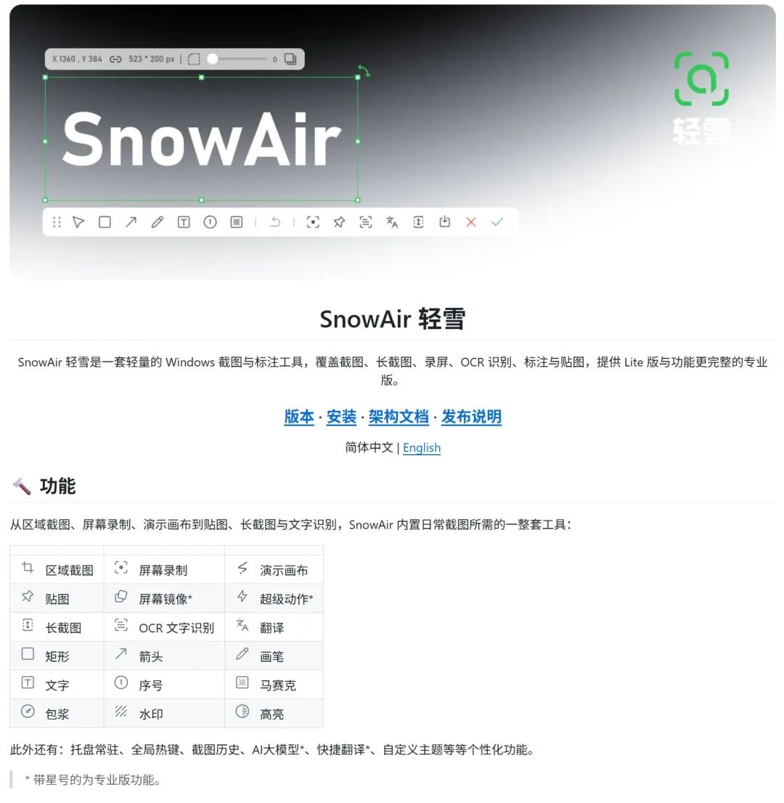
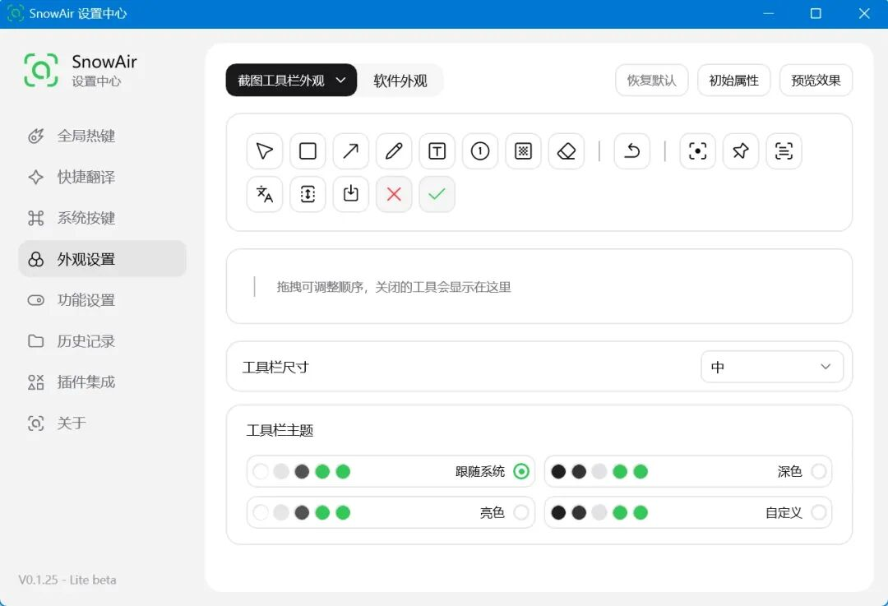
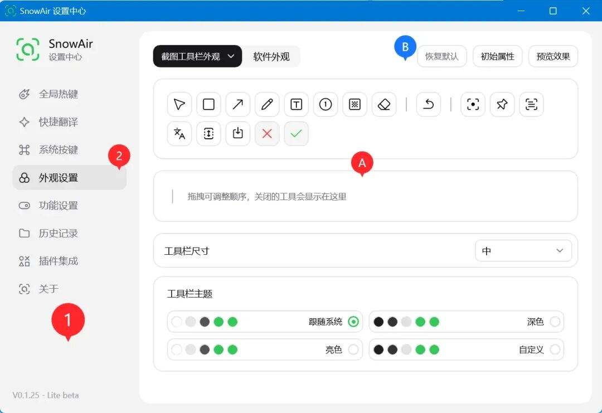
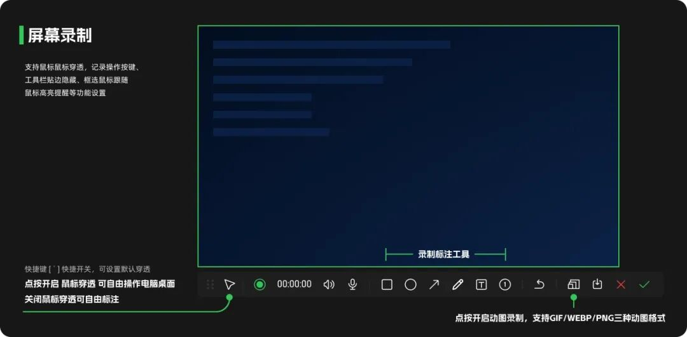
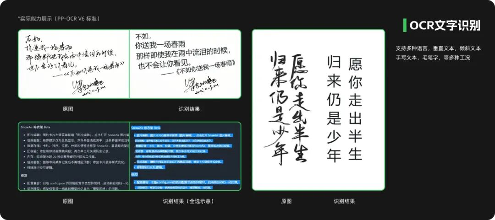
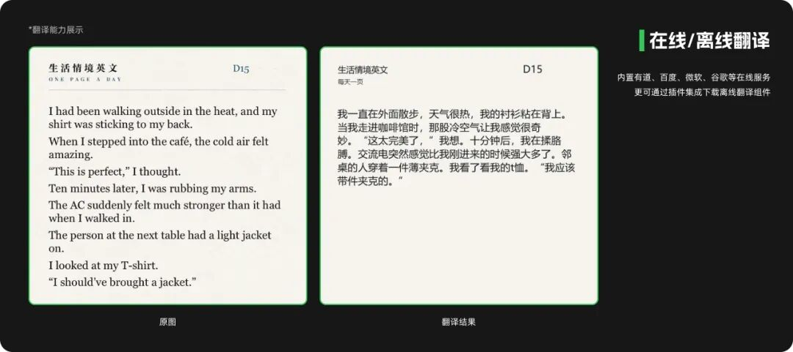
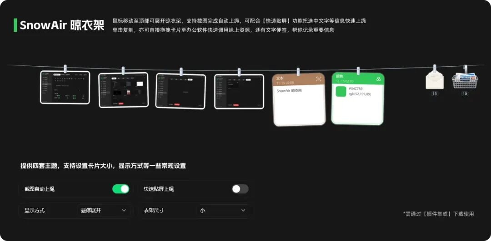
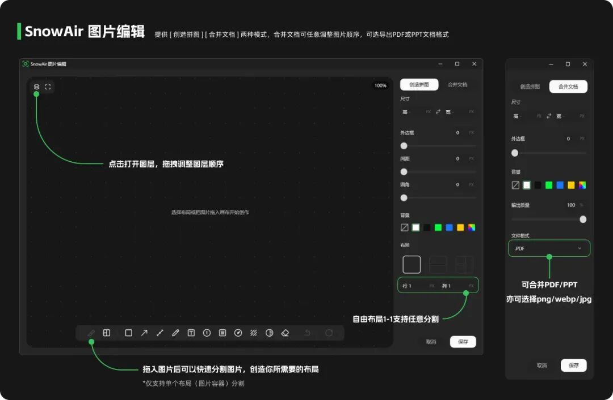
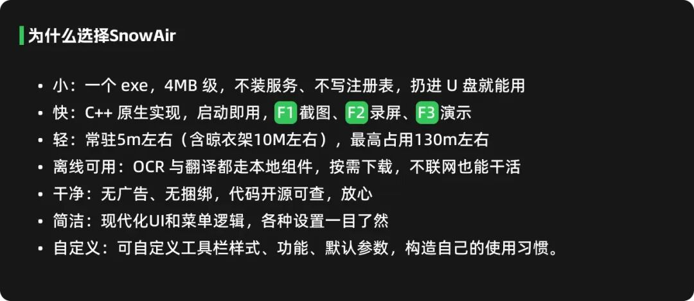

# 仅4.5MB！发现一款超轻量的开源截图神器，截图、录屏、OCR全都支持！
> 💡 备注属性未写入，可能是备注属性名称或者类型被修改了，建议将字段类型设置为 rich_text，可以在小程序-操作-修改文章数据库页面进行调整
> 💡 原文链接:[https://mp.weixin.qq.com/s?__biz=MzY0MDUwNDcxNg==&mid=2247486620&idx=1&sn=26e3daeec8864f27a51d57f8cb32afdd&chksm=f1f5028179047362d2e557bedd529942fc5bcf793e9986d01fa2eea7deaf8ea8090d1bebb47e#rd](https://mp.weixin.qq.com/s?__biz=MzY0MDUwNDcxNg%3D%3D&mid=2247486620&idx=1&sn=26e3daeec8864f27a51d57f8cb32afdd&chksm=f1f5028179047362d2e557bedd529942fc5bcf793e9986d01fa2eea7deaf8ea8090d1bebb47e#rd)
前段时间给大家推荐过一款开源截图工具 [QuickShot](https://mp.weixin.qq.com/s?__biz=MzY0MDUwNDcxNg%3D%3D&mid=2247485680&idx=1&sn=c6ae106eca1a36ef59f52979684c4be8&scene=21#wechat_redirect)，它把截图、标注、图片美化和拼接等功能整合在了一起，功能很丰富，界面也比较漂亮。
最近又发现一款 Windows 截图工具，名字叫 **SnowAir，中文名「轻雪」**。

这款软件最吸引我的地方是它的资源占用。
**整个软件只有 4.5MB 左右，作者公布的常驻内存数据仅 5MB 左右，即使启用了额外的晾衣架功能，通常也只有 10～15MB。**
而且它还集成了截图、录屏、长截图、OCR 文字识别、翻译、贴图以及图片编辑等功能。
关键是，它使用 C++ 原生开发，没有依赖 WebView 来渲染软件界面。
对于一款需要长期驻留后台的截图工具来说，这种轻量化设计确实挺有吸引力。
### 截图、标注，该有的功能基本都有了
SnowAir 默认使用 `F1` 快捷键截图，也可以通过系统托盘启动。
截图时可以自由框选区域，也支持自动识别窗口和界面元素，省去手动调整选区的麻烦。
截图完成之后，直接就能进行标注。
像我们经常用到的矩形、箭头、画笔、文字、序号、马赛克、高亮、水印等工具，它基本都提供了。

比较实用的是，**截图工具栏支持自定义排序，还能隐藏不常用的功能，并且可以设置默认的标注属性。**
比如平时经常需要给软件教程添加红色箭头、数字序号，就可以按照自己的习惯调整工具栏。

另外，它也支持长截图，可以滚动截取网页、聊天记录和文档，截取过程中能够暂停，还能对最终图片继续编辑。
### 还支持录屏、文字识别和翻译能力
SnowAir 除了截图，还可以录制屏幕，支持 MP4 和 GIF、WebP 等动图格式。
使用时可以先框选录制区域，再开始录制。录制过程中还能添加标注，开启鼠标穿透后可以继续操作下面的软件。

对于经常制作软件教程、录制操作演示的朋友来说，挺方便的。
另外一个比较实用的功能是 **OCR 文字识别**。

比如别人发来一张包含代码、命令或者文字内容的截图，你想复制里面的文字，可以直接通过 SnowAir 识别。
它默认可以调用 Windows 自带的文字识别接口，也支持按需下载离线 OCR 组件。

除了提取文字，还能使用有道、百度、微软、谷歌等翻译服务，识别后的文字可以直接选择和复制。

### 还有一个很有趣的「晾衣架」功能
SnowAir 还有个设计比较特别的功能，作者给它取名叫「晾衣架」。
它会在屏幕顶部放置一根可以收起的虚拟晾衣绳，你可以把截图、图片、文字、便签，甚至文件挂在上面。

需要使用的时候，把鼠标移动到屏幕顶部，晾衣架就会展开；不用的时候可以自动收起。
比如写文章时需要参考几张截图，或者工作时需要反复复制某段文字，就可以把这些内容临时挂在晾衣架上，随时取用。
另外，软件还内置了剪贴板历史，可以保存之前复制过的文字、链接、图片和文件。

最近的版本甚至增加了图片编辑功能，支持制作拼图、调整图片布局、合并文档，并导出 PDF、PPTX 或常见图片格式。

晾衣架和图片编辑目前仍属于测试阶段，但从功能设计来看，作者已经不满足于做一款普通的截图软件了。
### 为什么它能做到这么小？
从开发者角度看，我更关注 SnowAir 的技术实现。
现在不少桌面软件会采用 Electron 或者 Tauri 这样的技术方案。它们的优势很明显，前端开发者可以直接使用熟悉的网页技术构建界面，跨平台开发也比较方便。
不过，这类方案需要使用浏览器渲染引擎。特别是 Windows 上基于 WebView2 的应用，即使软件界面看起来很简单，运行时也会涉及额外的浏览器进程和内存开销。
SnowAir 选择了另一条路线。
**它使用 C++20 开发，界面基于定制的 Ling 框架，结合 Windows Composition 和 Direct2D 完成布局与绘制。**
简单理解，就是直接利用 Windows 提供的原生图形能力构建界面，不需要额外启动网页渲染环境。
另外，它还做了一些针对性的资源优化，比如启动时只创建托盘，不立即初始化截图窗口和图形设备，等到真正使用截图功能时再按需加载。
作者此前在更新记录中提到，经过优化，首次截图启动耗时从约 250 毫秒降低到了 90～100 毫秒。
根据作者公布的数据，轻量版常驻内存约 5MB，开启晾衣架后约 10～15MB。
这组数据属于开发者提供的测试结果，实际占用会随使用功能和系统环境变化。不过，从架构设计来看，它确实为减少后台资源占用做了不少工作。
当然，这种原生实现也有代价。
**SnowAir 目前只支持 Windows 10/11 的 64 位系统。** 作者也提到，软件大量依赖 Windows API，移植到 macOS 并不容易。
另外，项目分为 Lite 轻量版和专业版。轻量版已经覆盖日常截图需要的大部分功能，专业版则基于 Qt6，提供屏幕镜像、超级动作和 AI 大模型等更完整的功能。
### 安装使用
SnowAir 的 Lite 版本只有一个可执行文件，下载之后双击就能运行，不需要安装。

截至 2026 年 11 月 19 日，最新轻量版为 **v0.1.25 Lite**。
> 项目地址：https://github.com/CM-idea/SnowAir
> 软件下载：https://github.com/CM-idea/SnowAir/releases/latest
> 
进入发布页面后，下载 `SnowAir-Lite.exe` 即可。
如果你使用 Windows，平时经常需要截图、标注、录屏，又希望工具尽可能小巧、后台资源占用低，可以试试这款 SnowAir。
我觉得它特别适合长期驻留系统托盘，随时按下快捷键就能使用的场景。
从截图功能到图片编辑，再到那个很有辨识度的晾衣架，作者在这款只有几 MB 的软件上确实花了不少心思。
感兴趣的朋友可以去 GitHub 看看，也欢迎给作者点个 Star。
