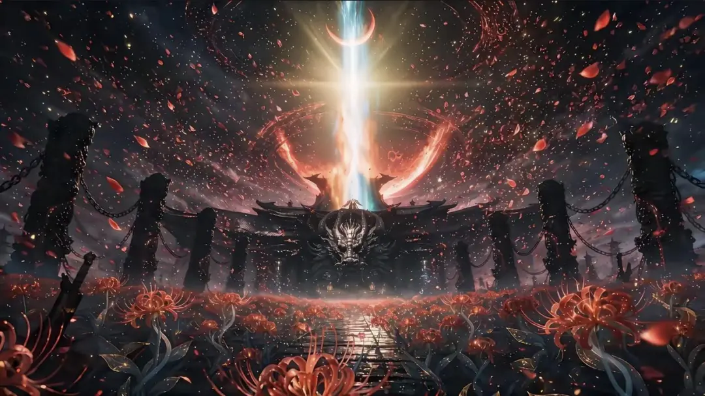

# 今天的短剧，开始超出我的知识范围了
> 💡 备注属性未写入，可能是备注属性名称或者类型被修改了，建议将字段类型设置为 rich_text，可以在小程序-操作-修改文章数据库页面进行调整
> 💡 原文链接:[https://mp.weixin.qq.com/s?__biz=MjM5OTc2NzA2MQ==&mid=2651336549&idx=1&sn=cd1d0bdec40e46d7bdb414067108356a&chksm=bd18c6e0663907be190e18d45c7d7d24bd8bc4ef9e471005d176946191bef41f2f591c473a0b#rd](https://mp.weixin.qq.com/s?__biz=MjM5OTc2NzA2MQ%3D%3D&mid=2651336549&idx=1&sn=cd1d0bdec40e46d7bdb414067108356a&chksm=bd18c6e0663907be190e18d45c7d7d24bd8bc4ef9e471005d176946191bef41f2f591c473a0b#rd)

**作者：刘润 主笔：景九 编辑：橙子**
**来源：刘润（ID：runliu-pub）**
最近，短剧太火了。
有多火？根据QuestMobile的数据，截至今年年中，国内短剧行业的去重用户规模，已经达到：
**8.51亿。**
8亿多人。这说明，看短剧的人，早就不是什么小众群体了。从陆家嘴的Cynthia、Allen，静安寺的Debbie，到严肃的大学教授，都有可能在忙完一天后，猫在被窝里看上那么几集。
只是，他们可能有点不好意思承认。
为什么？因为很多人，对短剧还是有刻板印象。比如，短剧就是霸总逆袭、此子恐怖如斯，简直降智。甚至有人觉得，天天抱着手机看短剧的人，没什么审美。
可是，真是这样吗？
最近，我刷了不少短剧。有种感觉，渐渐清晰：
**我们可能小看了今天的短剧，更小看了短剧观众的眼光。**
为什么这么说？
**01**
**今天的短剧，已经成这样了？**
上画面，先感受一下。
这是《持械入宋》的开场剧情。
5个特种兵，穿越回千年前，他们手持枪械，正小心翼翼地穿行在原始森林里。穿越的时间点，距离北宋汴梁被攻陷，只有几年时间。他们，要如何挽救大宋？
这剧情有意思。而且，这部剧的设定也不烧心，没有和很多穿越题材一样，有系统和外挂。虽然有枪，但子弹有限。所以大敌当前，连女医官陈素，都要和村民拿起弓弩拼命，才能拖住骑兵。
是不是还不错？咱再看一个。
这段，来自《魏家逆子成首辅》。展示的，是主角和继母之间的试探。
为什么要试探？主角魏逆生，是古文学博士，穿越到了古代，出生当天，生母难产，爷爷去世。因此，被全家视作不祥之人。而继母想做的，就是夺掉他的话语权。
于是，在视频里，你能看到各种特写，火盆、茶盏、指尖、眼珠，两个各自打算盘的角色。还有中远景切换、对焦虚焦，运镜……
可能是我见识不够。虽然不少地方还不太自然，但我确实感受到了电影质感。
不光镜头。剧里的对话，也挺讲究。看这段。
朝堂上，皇帝突然问了句大实话：把你从肥缺调到烂差事，怪不怪朕？
**我想，任何一个职场人听到这种问题，都会猛然一惊。**
说怪，是对皇帝不满。说不怪，皇帝就信吗？
怎么答？
魏逆生没有急着表态，而是讲了个典故：
> 💡 臣曾读《汉书》，见萧何至未央宫，刘邦责其过度，萧何对曰：“天子以四海为家，非壮丽无以重威。”臣每读至此，未尝不掩卷思考。当年萧何修缮宫殿，并不是为了他自己，而是为了彰显天子的威仪。如臣进入度支司任职，也不是为了我的私利，而是为了陛下的江山社稷。

我不在乎自己在不在肥缺，只在乎如何为陛下的江山社稷做事。皇帝问感受，他答立场。
好家伙。这还是我印象中的短剧吗？
**台词有典故，对话有机锋。短短几句，试探和算计全出来了。**
还有部剧，我特别想分享给你。叫《寒塘鉴人心》。这部剧，讲的是村里，大家养大闸蟹、买大闸蟹的故事。
嗯。听起来，很像之前扮猪吃虎的开局。主角受人欺凌，但身份揭开，却是八千亩蟹塘继承人，两排保镖和路虎一字排开……
但这部剧，还真不是。你看视频。
等等，他们的争论，好像还真有点专业。说冷空气一来，螃蟹就会应激会打架。到时候一地蟹钳子。硬等蟹价上涨，风险很大。
嘶……听起来很有道理啊！但真是这样吗？
我有点将信将疑。直到刷到了六神磊磊的文章，他专门问了蟹农，发现确实如此。
**啊。太卑鄙了。竟然用这种方式让我学习。**
而这种“能学知识”的短剧，还有好多好多。我甚至看到有博主这么讲：
> 自从有了红果，你知道我看了多少职业了吗？外卖，地摊，卤味，开酒店，跑冷链，打金，做民宿，跑大车，服装工厂，珠宝设计……我看的太来劲了。要是读书的时候有这东西，哪会走什么弯路。
> 
好吧。好吧。
原来今天的短剧，已经是这样了。
这说明什么？
这当然说明，短剧的内容质量，正在越来越好。但它更说明了：
**过去，短剧观众的眼光真被小看了。**
为什么这么说？
作品质量高，当然是创作者的本事。但在那么多短剧里，愿意点开哪部，愿意花时间看哪部，是观众凭自己的审美，做出的选择。
而能把这些高质量的短剧，从成千上万部剧里送到排行榜前列，更是说明，观众对好故事的需求，一直存在。
那为什么过去，这种质量的作品，很难看到？
**02**
**想得到的故事，未必拍得出来**
因为故事想得再好，也不一定拍得出来。
就拿《持械入宋》来说。5个特种兵，穿越到北宋末年，想改变历史，挽救大宋。
故事写到这，编剧大笔一挥：
> 金兵南下，数万大军兵临城下，可谓是旌旗蔽日，战马嘶鸣。真是黑云压城城欲摧啊！
> 
好了。写完了。可导演拿到剧本，就犯愁了。
这咋拍呀？
实拍，那就要去找取景地，自己搭景。用虚拟拍摄，也还是要搭实景，要用大量设备。
根据2024年对某片场的报道，如果要搭宫殿，要上百名木匠、瓦匠干一个月，用掉500多立方米木材。哪怕用虚拟拍摄，也得弄个大屏幕竖在后头，搭六七米的柱子做前景。
**编剧写下“千军万马”，只要1秒。可把这四个字变成画面，要的是真金白银。**
而且，这还只是历史战争。如果想拍外星飞船、未来城市呢？
创作者越天马行空，制作的难题就越多。
所以，虽然这些年短剧已出了《盛夏芬德拉》《冒姓琅琊》等不少好剧，能用更灵活的篇幅和制作方式，拍出好故事，可遇到大场景、复杂特效，成本依然是难关。
于是，创作者就只有这几种选择：
**1、有钱。**投入更多资源，把想象中的场面尽可能拍出来。
**2、没钱。**想办法调整。原本是千军万马的正面交锋，可能改成几个人躲在城楼上，听着远处的喊杀声，商量下一步怎么办。
**3、放弃。**算了，咱换个容易拍的题材吧。
但是今天，情况不一样了。
**03**
**会讲故事的人，迎来了自己的时代**
当下的短剧行业，出现了一个重要变化：
**奇观，变得便宜了。**
什么是奇观？奇观，就是千军万马的战场，是拔地而起的城池，是横穿宇宙的星际飞船。这些场面，往往需要大量人力、物力和资金。
我喜欢漫威电影，更喜欢看大场面。但2小时的电影，给看半个多小时的奇观，已经很给面子了。没办法，贵啊。
那怎么办？现在，有了个相对统一的答案：
**AI视频生成。**
还记得刚才让导演犯愁的“金兵入侵”场面吗？
把场景直接描述给AI，它就能生成相应的视频画面。镜头不够低？调整角度。气氛不够紧张？修改光线和人物动作。
虽然生成看运气，出素材要抽卡，但比起过去，已经便宜了太多太多。
最近，我经常给我的同事们推荐一部剧，叫《万妖图录传》。在我看来，这部剧能火的一个重要原因，就是奇观太密集了。

那么，当奇观的成本大幅下降，对制作者来说，拥有什么能力才能脱颖而出？
**首先，是用文字讲故事的能力。**
5个特种兵穿越到北宋，当然很有看头。但让我追更100集的，是他们各自的人设，各自的选择和故事。
面对皇帝的一句“你怪不怪朕”，主角引经据典，回答得滴水不漏。没有千军万马，没有惊天特效，可我照样看得津津有味。
为什么？因为故事精彩，人物鲜活，对话里有值得琢磨的东西。
**还有，用镜头表达的能力。**
还记得《魏家逆子成首辅》的片段吗？人物一会儿清晰，一会儿虚化。明明只是两个人坐在那里说话，通过镜头的切换，你却能感受到试探和戒备。
所以，同样一句台词，镜头是要对准说话的人，还是对准听话的人，人物应该放在画面中央，还是留出一大片空白，什么时候特写，什么时候拉远，这些选择，都有讲究。不同的表达方式，就会改变观众的感受。
这也是为什么，我看这部剧时会觉得，制作者一定是精通镜头语言的高手。
文字，决定故事怎么发生。镜头，决定故事怎么被看见。技术，让生产变得简单。会讲故事，才能让作品脱颖而出。
现在，回头再看整个短剧行业。
一边，是观众对好故事的需求。另一边，是越来越多有才华的创作者，有机会把故事拍出来。两者结合，好作品肯定会越来越多。
这也是最让我感到激动的地方。
**因为未来，一批会讲故事的人，会迎来真正属于他们的时代。**
**最后的话**
**每个时代，都有新的讲故事方式。而接受这个方式，往往需要时间。**
比如电影。100多年前，电影刚刚兴起，很多人觉得，这太儿戏了。在一块幕布上放映影像，哪能和演员的现场表演相比？
比如电视剧。1961年，美国联邦通信委员会主席，甚至专门演讲，批评当时的电视节目充斥着套路化喜剧和暴力内容。
后来，电影、电视剧，都成了我们生活中，再熟悉不过的娱乐方式。因为时代在变，人们的生活方式，也在变。
以前，人们去剧院看戏，去电影院看电影。后来，电视走进千家万户，人们开始在家追剧。
而今天，大家手机不离身，等车、坐地铁、休息时，随时都能打开。所以，短剧这种内容形式，应运而生，直到今天。
从这个角度看，短剧流行其实是时代的选择。
当然，今天的短剧，依然有制作粗糙、剧情套路的内容。你完全不喜欢，也完全可以批评。
但你没必要因此，批评喜欢看短剧的人。
可能他就是忙了一天，回到家，只想看看轻松痛快的内容。可能他就是觉得打开手机就能看，简单方便，没什么不好。
**而且观众看什么，首先取决于市场上有什么。**
如果市场上的作品品质都一般，那观众对好故事再有需求，也只能看这些。
作品的上限，不是观众审美的上限。
**但如果今天还有人觉得，短剧就是低质，看短剧的人也没什么审美，我倒觉得，他是真的不知道今天的短剧，长什么样子了。**
哎，不说了。
等我找个地儿坐下，看看那5个特种兵，救大宋救到哪一步了。
**版权声明：部分文章推送时未能与原作者取得联系。若涉及版权问题，敬请原作者联系我们。**

