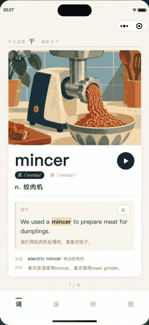
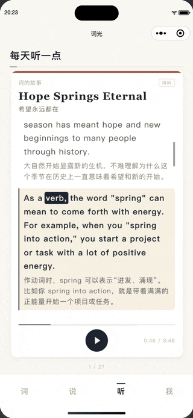
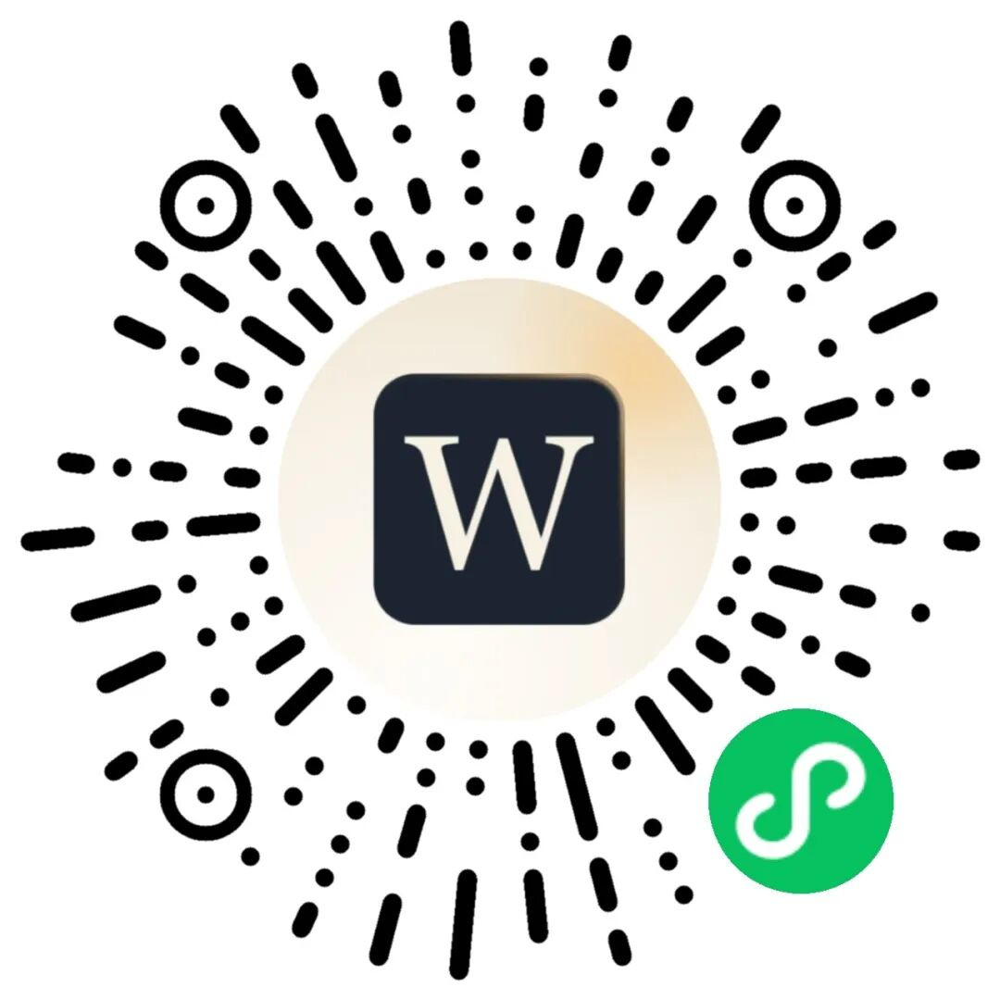

# 今天，「词光Light」正式上线了
> 💡 备注属性未写入，可能是备注属性名称或者类型被修改了，建议将字段类型设置为 rich_text，可以在小程序-操作-修改文章数据库页面进行调整
> 原文链接:[https://mp.weixin.qq.com/s/KTHBRMuibvSx6jlwMKLatg](https://mp.weixin.qq.com/s/KTHBRMuibvSx6jlwMKLatg)
一个人，一个 AI，和 7298 个单词。
—— 「词光Light」上线了
这个词光Light，是我和 AI 一句一句聊出来的一个小程序。过去这些天，我每天做的事其实很单调：想清楚要什么，把话讲给它听，它写，我打开模拟器看，不满意就推翻重来，一直改到我自己愿意每天打开它为止。
所以严格说，它不是「我写的」。方向是我定的，词是我挑的，手感是我一遍遍试出来的；代码大部分是我们俩一起敲的。这件事能做出来，靠的是我没放弃，它没下班。
为什么做这个。市面上的背单词软件都在催你：打卡提醒、连续天数、你已落后百分之多少。我试过好几个，每次关掉屏幕都松一口气。我想要的是相反的东西 —— 每天几个词，看完就走，不欠谁的。
今天它正式上线了。先说句抱歉：上一版提交之后，审核和备案一起拖住了，让一部分人一直等在体验版外面。
但这段等待没有白费。你们提的每一条我都记着，能当场改的就当场改，改完自己先用两天。所以今天这一版，和当初那一版已经不是同一个东西了。下面把这些天的小版本都摊开写一遍，你可以顺手找找，有没有你提的那一条。
本 文 三 段
一
它是什么
01
二
这些天改了什么
02
三
AI 帮不了的那部分
03
01
WHAT IT IS
**它不做词库，它做今天**
名字里的 Light 没有别的意思，就是一个词被点亮的那一下。你划过一个词，认得，它就亮一下，然后让开。
词光Light只做一件事：每天给你几个词，不多不少。给几个由你的星座和当天的运势定 —— 听着有点玄，实际是为了别让你在第一天就把自己逼死。状态好就多看两个，状态差就少看两个，第二天照常来。
三个入口，对应三种学法。
词
一张卡一个词。配图、音标、例句、搭配、辨析都在上面，左滑是「面生」、上滑是「眼熟」、右滑是「认得」，手比脑子快。
说
真实对话场景，一句一句跟。听不懂就点开中文，不想听就往下翻。
听
一整篇文章，逐词可点。点到哪儿就从哪儿念，不用再拖那条细得看不见的滑块。

左滑一张卡，换下一个词
02
WHAT CHANGED
**这些天，改了什么**
从 1.1.2 到 1.2.4，一共十几个版本。挑重要的按顺序说。
1.1.2
修好了两个很烦的毛病：翻页之后上一篇的声音还在响，拖卡片时整页跟着动。
1.1.3
加了微信登录、头像、昵称、生日，和一张排行榜。不登录也能用，登录是为了换手机不丢进度。
1.1.4
词、说、听三处都记住你翻到哪儿了。以前每次打开都回第一页，这条应该是最多人催的。
1.1.6
清过缓存、换过手机，位置也能自己接回来；接不回来的时候，有个地方能让你看清楚是哪一步断了。
1.1.8
难易度分成五档，从入门到高阶自己选。星座负责「一天几个」，难度负责「发哪些词」，两件事分开了。
1.1.9
词库从 5416 扩到 7298，补上了 C1 和 C2。这次是真的把整本词表搬完了。
1.2.1
运势页整个重做：每日运势、宜忌，还有「算一卦」。星座详情补了介绍和性格分析。听页也会接着上次的位置往下播。
1.2.3
整个小程序只留一个喇叭。以前在词页念例句、切到说页又按了播放，两个声音会叠在一起，现在谁开口谁就把另一个按下去。
1.2.4
我自己加的一个小统计，用来知道到底有多少人在用、谁会回来。只记时间和一个随机编号，不碰任何设备信息。
**算一卦，今天要不要开这个口**
运势页里最花时间的是这个。六爻从下往上一条条落，落完给你一个卦，告诉你哪一爻是内卦、哪一爻是外卦，嘴上说的和心里想的，往往不是一件事。它不解命，只给你一个停顿的理由。

摇一卦，六爻自下而上落下来
**听的时候，点到哪儿就从哪儿念**
一整篇文章铺开，每个词都能单独点。哪句没听清，手指往那句上一按，声音就过去了，进度条和高亮会一起跟过去。

点文中任意一个词，声音就跳过去
**7298**
收录的词
**A1–C2**
六个等级全在
03
HOW TO START
**AI 帮不了的那部分**
写了这么久，有件事我挺确认：AI 能写出能跑的代码，但它写不出判断。要不要做打卡、要不要显示连续天数、要不要在晚上八点推送一条提醒你 —— 这些它给过建议，我一条条否掉了。
因为产品是一堆取舍叠出来的，而取舍背后得有个人肯负责。它不知道你下班回家有多累，也不知道一个人被「你已落后」这几个字刺到是什么感觉。
还有手感。一个滑动的阻尼、一句台词接下一句的那零点几秒、一句文案的语气，AI 给的是「可以用」。够不够好，只能自己拿在手里用两天，用到烦，再改。
所以它现在这个样子，是这么磨出来的。微信搜索小程序「词光Light」，或者扫文末那个码进来。第一次打开会让你选个星座，选完直接开始，不用注册、不用登录。
想同步进度、想上榜，再在「我」那一页登录。登录只是把成绩接上云，不登录也一个字都不会少。
给 我 留 言
用着哪里别扭、哪个词的解释不对、哪个音听着奇怪，直接在这篇下面留言，或者在小程序「我」那一页找我。每一条我都会看，能改的下个版本就改。
∞
POSTSCRIPT
**慢一点也没关系**
我不打算把它做成一个让人上瘾的东西。它更像每天十分钟的一个安静角落，你来了，看几个词，走了，明天再来。
所以它没有打卡提醒、没有连续天数警告、没有「你已落后 87% 的用户」。你哪天没来，就是没来。
「谢谢你们等了这么久。」

END

我是词光Light的开发者。代码大部分是我和 AI 一起敲的，剩下那些它替不了的部分，只能自己扛。
如果你觉得这篇有点用，欢迎 **点赞、在看、转发** ，也欢迎把用着别扭的地方告诉我，我们下个版本见。
扫 码 就 能 进

词光Light
长按识别小程序码，或微信扫一扫
搜「词光Light」也找得到
