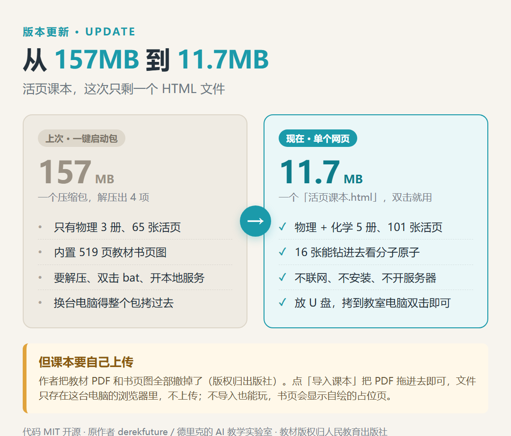
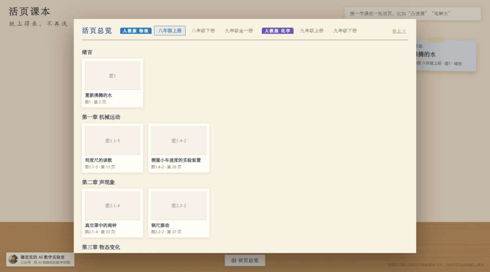
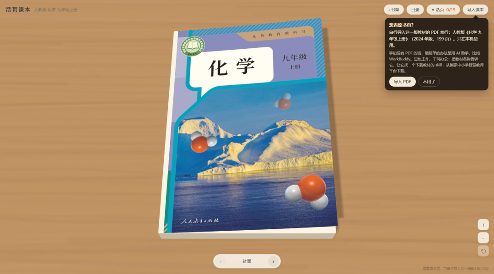
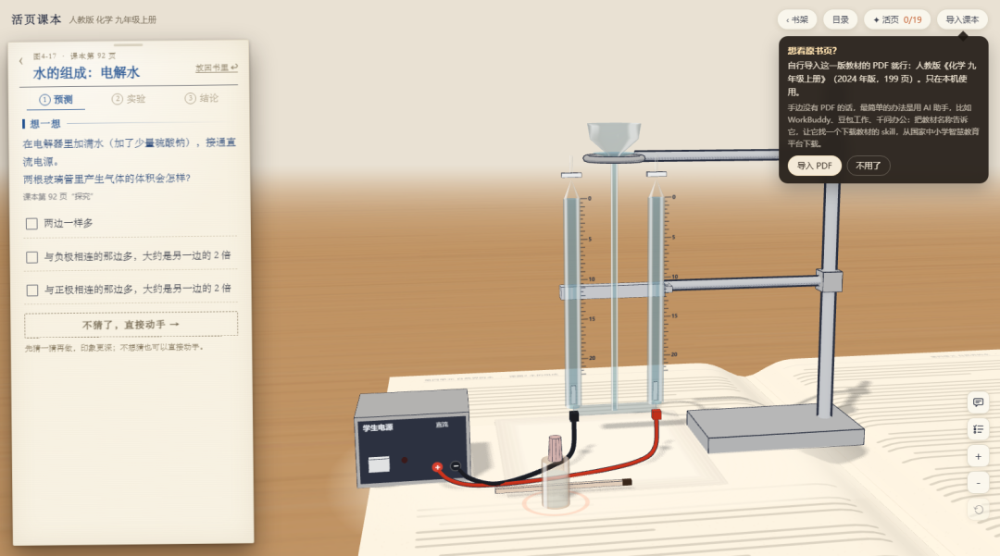
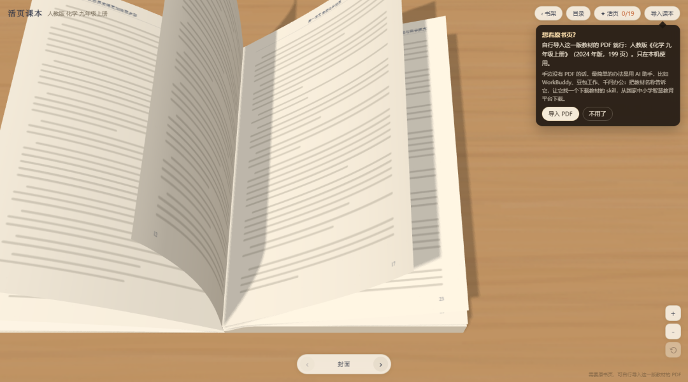

# 从 157MB 到 11.7MB：活页课本这次只剩一个网页，但课本得你自己传
> 💡 备注属性未写入，可能是备注属性名称或者类型被修改了，建议将字段类型设置为 rich_text，可以在小程序-操作-修改文章数据库页面进行调整
> 💡 原文链接:[https://mp.weixin.qq.com/s?__biz=MzU4MzM1NjUwMg==&mid=2247486277&idx=1&sn=039d93dde4c7f65cd77e8d8d78e13e5c&chksm=fc00b926198a66e4e199aa45575ade8de569f1c29da51adb68c415c45e85e65fff4122b21110#rd](https://mp.weixin.qq.com/s?__biz=MzU4MzM1NjUwMg%3D%3D&mid=2247486277&idx=1&sn=039d93dde4c7f65cd77e8d8d78e13e5c&chksm=fc00b926198a66e4e199aa45575ade8de569f1c29da51adb68c415c45e85e65fff4122b21110#rd)
其实昨天很多朋友都拿到了新版本，文件已经更新，关键词还是不变“livebook”，因为昨天有事，我没发文章。今天就简单说一下。
**先声明三件事都拿到了**
**① 作者不是我，这次也不是我改的。** 项目是 derekfuture/livebook（github.com/derekfuture/livebook，MIT 开源），作者公众号「德里克的 AI 教学实验室」。这次是**作者自己更新了项目**——加了化学、做成了单文件网页。我**只是转发官方最新版**，没有改动任何一行代码，左下角作者小签也是原样保留，不敢居功。
**② 包里没有教材。** 只有一个 11.7MB 的 HTML 网页，不含任何教材 PDF，也不含书页扫描图。**教材版权归出版社，请大家注意版权**：请从正规渠道自行获取、仅供个人学习使用，不要公开传播教材扫描件。试用装同样如此，别向别人索要、也别转传教材扫描件。
**③ 怎么拿、拿什么：**
- 需要完整网页：公众号私信回复「**livebook**」领取（一个 11.7MB 的 HTML，物理化学 5 册都在里面，**不含教材 PDF**）。
- 手边**没有教材 PDF**、想先看看效果：回复「**物理**」或「**化学**」领取**试用装**。
- 如需其他版本的教材、或其他改编版，请自行准备——我这边只有官方这一版。
---
前几天我介绍过一个 Windows 一键启动包：157MB，解压、双击、开个本地服务，物理课本就在屏幕上"活"过来了。当时后台领包的老师不少。
这几天，原作者把项目进行了大更新。我那篇教程，一夜之间基本作废。

### 变化一：化学也活过来了
上次只有物理三册、65 张活页。这次书架分成了上下两层：
- 物理 3 册：八年级上册、八年级下册、九年级全一册，65 张活页
- 化学 2 册：九年级上册 19 张、九年级下册 17 张，共 36 张活页
加起来 **5 册、101 张活页**。化学这部分不是简单套个壳：从氧气、二氧化碳、燃烧，到溶液、金属、酸碱盐，其中 **16 张能"钻进去看"——分子、原子、离子怎么重新组合，跟着你的操作变**；而且每一张化学活页都配了「老师演示」，器材按课本步骤自己动，还带字幕，空格随时暂停。

首页底部的「活页总览」可以跨 5 册直接找任意一张活页，按学科、按册分好类：

### 变化二：现在只有一个 HTML 文件
这是我最喜欢的一个改动——不过得说清楚，**这是作者做的，不是我做的**。
以前：157MB 的压缩包，解压出四个东西，双击 bat、等黑窗口、开本地服务，换台电脑得整个包拷过去。
现在：**一个 活页课本.html，11.7MB。双击就开。**
不用联网，不用安装，不用解压，不用开服务器。放 U 盘里，拷到教室电脑上双击，课本就摊在桌上。作者自己写了个构建脚本，把代码、样式、书的目录、封面、连 pdf.js 的字库和解码器，全都塞进了这一个 HTML 里——所以 `file://` 直接打开也不会缺东西。
这个变化的另一面更实在：**包里不再有 519 页教材扫描图了**。以前那个 157MB 的包，绝大部分是课本内页；现在只剩 5 张封面和作者小签。作者把教材内容撤干净，是对版权的尊重，我这里也照办，转发的文件里一个教材文件都没有。
### 变化三：但课本，得你自己上传
**这一条必须说在前面，不然你打开会懵。**
作者把教材 PDF 和书页图全部从仓库里撤掉了——**版权归出版社**。所以现在打开一本书，右上角会弹一个小提示框：

它写得很清楚：想看原书页，自行导入这一版教材的 PDF 就行，比如人教版《化学 九年级上册》（2024 年版，199 页），只在本机使用。手边没有 PDF 的话，它还提示可以找 AI 助手帮忙——甚至直接点名了 WorkBuddy、豆包、千问，让它们从国家中小学智慧教育平台（basic.smartedu.cn）下载。
**怎么导入：** 点书里右上角「导入课本」，或者直接把 PDF 拖进窗口。PDF 只存在这台电脑的浏览器里，不会上传到任何服务器；系统还会按页数核对是不是同一版教材。
**不导入能不能用？能。** 这是我实测后最想告诉老师的一点：没导入时，书页会变成作者自己画的**占位页**——纸、页眉（单元·课题）、页码、淡灰线代替正文，插图位置留着图号框。看着像一本"没印字"的课本，但 **101 张活页照样全部能点开、能动手、能读数、能盖章**。
⚠️ **教材版本别弄错**：必须是人教版《义务教育教科书》、依据 2022 年版课程标准编写的新版。版本不对，页码和插图位置全对不上。**用其他版本教材的老师，请自行准备对应 PDF、自行核对页码**，我这边只有官方这一版，也没有其他版本的资源。
实在手边没有 PDF、又想先看看效果的，可以私信回复「物理」或「化学」领一份**试用装**；但教材终究得自己准备，**版权归出版社，注意别传播扫描件**。
### 怎么用，三步
1. 双击 （Edge / Chrome 都行）
1. 想看真实书页，就导入课本 PDF；不想导，跳过这步
1. 点书页上发光的插图，活页就在书页上"站"起来
键盘：`← →` 翻页、`T` 目录、`Esc` 合上活页，老师演示时空格暂停。
### 打开之后能做什么
拿化学举两个例子。
**电解水**：翻开是「水的组成·电解水」，左边先让你猜——两根玻璃管里产生的气体体积会怎样？然后再动手接电源、看气泡、自己读数，最后掀开课本结论对照。中间那套 3D 电解装置是直接立在书页上的：

**测定空气中氧气的含量**：红磷燃烧、水倒吸进集气瓶，屏幕上还会浮出 `4P + 5O₂ → 2P₂O₅`。这一类活页里，还能点「钻进红磷表面看」，看 O₂ 分子撞上去反应、N₂ 撞上去又弹开。

现在上游直接把"离线可用"做成了官方能力，我能做的只是**把官方最新版原样转发过来**。轻、合规、随时能跟上更新，也不必担心我夹带任何不该带的东西。
剩下唯一需要你自己做的，就是把课本放进去——**这一步，本来也该由我们自己来**。教材 PDF 请各自从正规渠道准备，别把它和这个 HTML 一起打包对外分发。
---
**需要完整网页：公众号私信回复「livebook」，我把文件发你。**
（一个 11.7MB 的 HTML，物理 3 册 + 化学 2 册都在里面，**不含教材 PDF**。）
**手边没有教材 PDF、想先看看效果？回复「物理」或「化学」领取试用装。**
⚠️ **再说一次版权**：教材 PDF 和书页扫描图的版权归出版社，网页和试用装里都不含教材文件，请自行从正规渠道获取、仅供个人学习，别公开传播，也别把教材和网页打包转发。**如需其他版本，请自行准备。**
- 作者：德里克的 AI 教学实验室（公众号）／ GitHub：derekfuture/livebook
- 项目与源码：github.com/derekfuture/livebook（MIT 开源）
- 在线体验：livebook.derekfuture.club
- ⚠️ 版权提醒：代码 MIT 可自由使用；教材 PDF 与书页扫描图的版权归人民教育出版社。本文转发的网页不含任何教材文件，请自行获取、仅供个人学习，勿公开传播
- 本文只是转发官方最新版，未修改任何代码；左下角作者头像与名字原样保留
