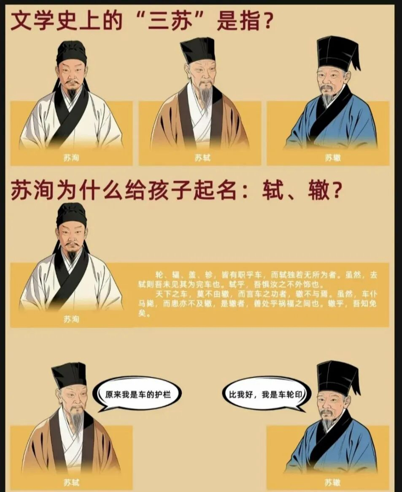
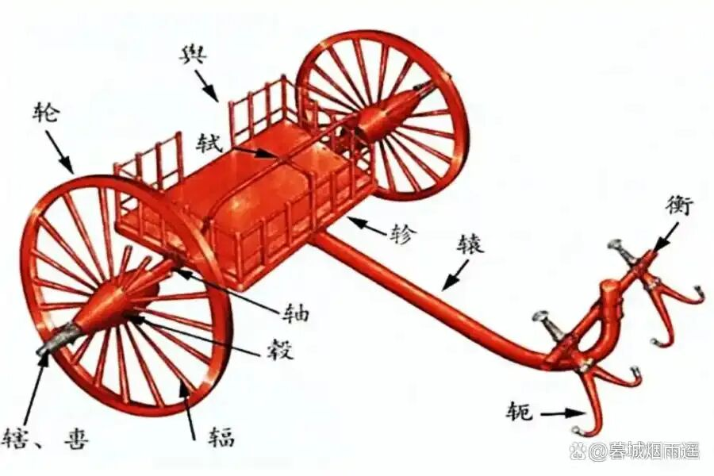
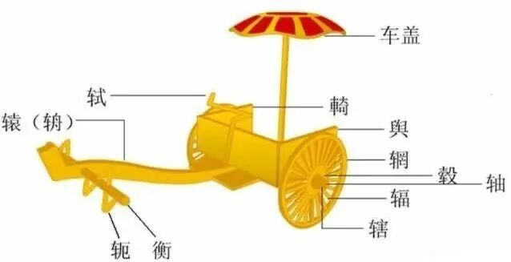
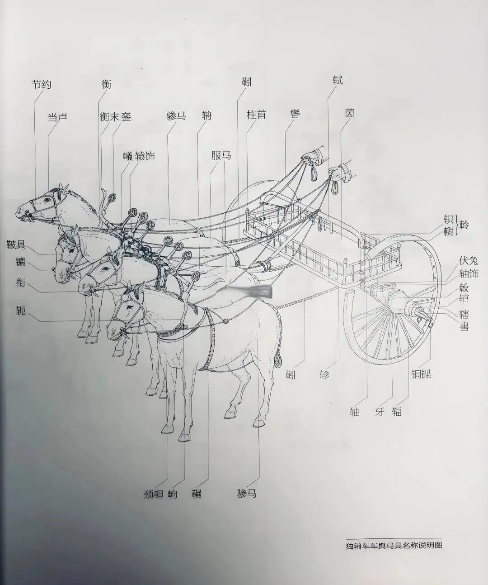

# 从《曹刿论战》说苏轼、苏辙名字的由来
> 💡 备注属性未写入，可能是备注属性名称或者类型被修改了，建议将字段类型设置为 rich_text，可以在小程序-操作-修改文章数据库页面进行调整
> 💡 原文链接:[https://mp.weixin.qq.com/s?__biz=MzIyNTYyODc2Ng==&mid=2247561340&idx=1&sn=81cacf80ce0390f63fd7e8f0518823af&chksm=e9172409482ba383971f8a0dd0d67c603c94b0093ef23e6f8e8b0022067c18d711ea452b9aa2#rd](https://mp.weixin.qq.com/s?__biz=MzIyNTYyODc2Ng%3D%3D&mid=2247561340&idx=1&sn=81cacf80ce0390f63fd7e8f0518823af&chksm=e9172409482ba383971f8a0dd0d67c603c94b0093ef23e6f8e8b0022067c18d711ea452b9aa2#rd)
           

**点击**
**青青思语**
**关注我们**
 《曹刿论战》“下视其辙，登轼而望之”一句里藏着苏洵之子苏轼和苏辙的名字。
 欲知缘由，请读其父苏洵之文《名二子说》——

 《名二子说》

 宋·苏洵
 轮辐盖轸，皆有职乎车，而轼独若无所为者。虽然，去轼则吾未见其为完车也。轼乎，吾惧汝之不外饰也。
 天下之车，莫不由辙，而言车之功者，辙不与焉。虽然，车仆马毙，而患亦不及辙，是辙者，善处乎祸福之间也。辙乎，吾知免矣。

 《名二子说》
标题——“我为什么要这样给儿子起名”，
正文大意：

 车轮子、车辐条（连接轮子和轮毂的木条，呈放射状排列于轮圈之中）、车顶盖和车轸（车厢底部的横木）都有各自的作用。
只有“轼”（扶手），看上去仿佛可有可无。虽然是这样说，但是天下还没见过不带“轼”的车。我的轼儿啊，我只担心你不会隐藏锋芒。
 天下所有的马车经过之后，都会在路上留下一道辙痕。人们在提到车的功劳的时候，是绝不会想起辙痕的。好在当车仰马翻时，辙痕也不会受到牵连，这就是“辙”。于是我知道，“辙”善于处在祸福之间。我的辙儿，你是能让我放心的。

 ‌“轼”是古代车厢前面供人扶靠的横木‌，主要作用是扶手和乘车时保持平衡。‌
 其实，“轼”（车把手）看似无用的东西，但是每辆马车上都有。这是因为中国古代的马车都是“两轮车”，车厢里的人无论是坐着，还是站着，都很难保持平衡。
 有了“轼”以后，乘车者以手扶着它，就安全多了。所以“轼”尽管根本不参与马车的轴承驱动，却在保障乘客安全方面是必不可少的。
 除了行车时稳定身体，古人途经特定场合时会扶轼俯身，以此向路人、贤者表达敬意，也就是“式而听之”的礼仪动作。

 除此之外，“轼”还有“登高望远‌”的作用，可踩着或靠着它观察远处，如《曹刿论战》中“登轼而望之”。‌‌
 “辙”的本义是车轮轧出的痕迹，如“车辙”“覆辙”“如出一辙”等。
 后来引申出路线、办法、韵脚等含义，如“上下辙”“顺辙儿”。北京话里常说“没辙了”，就是没办法了；也有“想辙”“找辙”的说法。韵脚，即戏曲、曲艺唱词押的韵，如“合辙押韵”“十三辙”。

 轼是车前扶手，供人倚靠观望；辙是车轮印，车行必有辙。苏洵在《名二子说》里说，轼虽然“无所饰”，但少了它车就不完整；而辙呢，功劳轮不到它，翻车也怪不到它，是“善处乎祸福之间”的。 这么取名，是希望苏轼能显露才华、被人倚重，而苏辙能避开祸患、平安处世。
 所以我们学习的《曹刿论战》里，不只是战场谋略，还藏着苏洵给儿子取名的巧思——**他盼着两个儿子能像曹刿“登轼望”“下视辙”一样，既有登高望远的眼界，又有脚踏实地的沉稳。“望”即有“瞻”意，苏轼，字子瞻，登轼可瞻也！“辙”貌似无用，却对进退有指引作用，可一窥敌军之阵脚。**
 读这《名二子说》你读出一个父亲操心后代的良苦用心了吗？
读《名二子说》，试回答下列问题：
 ‌

‌
