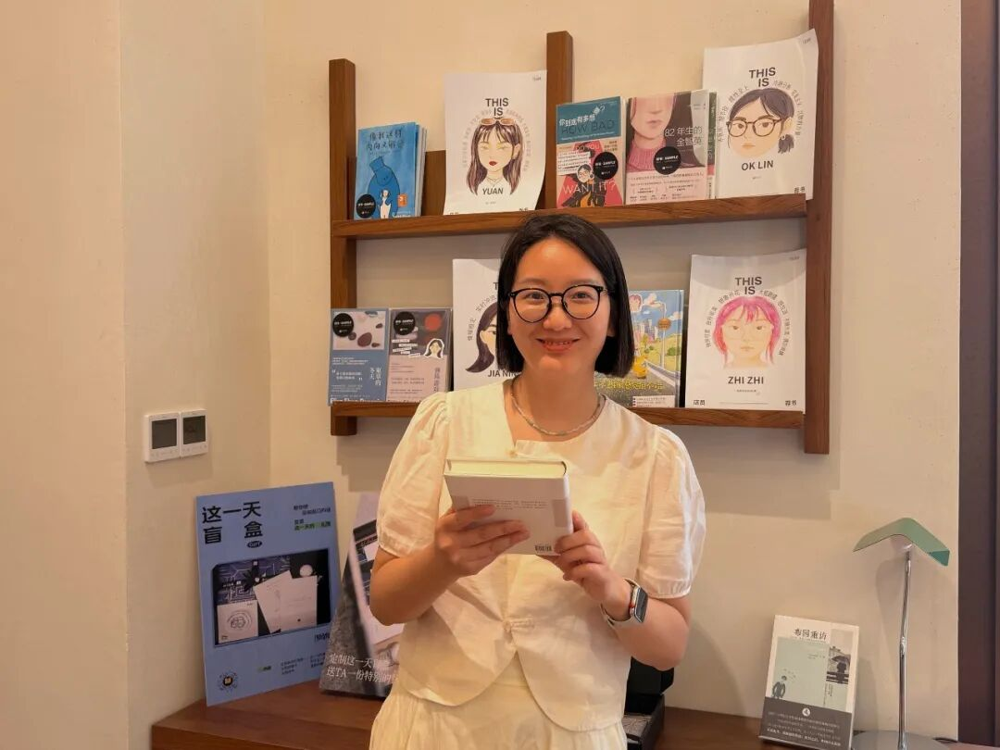
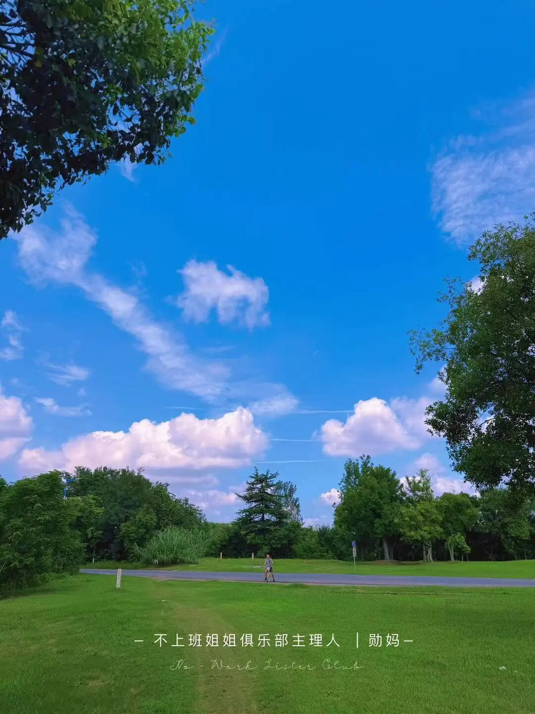
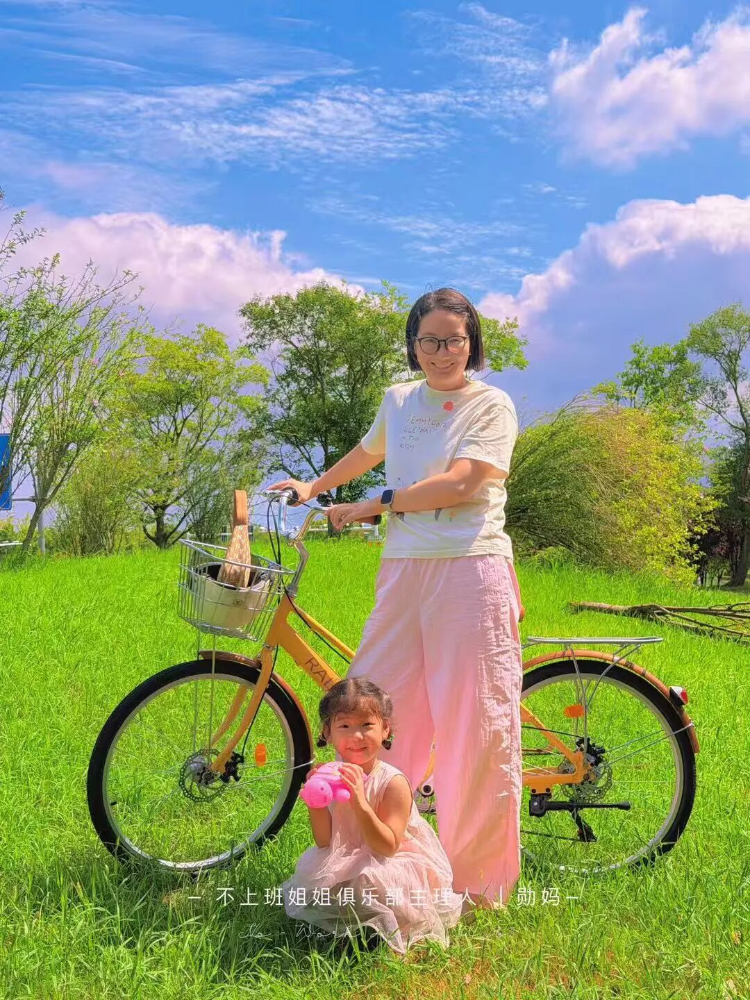
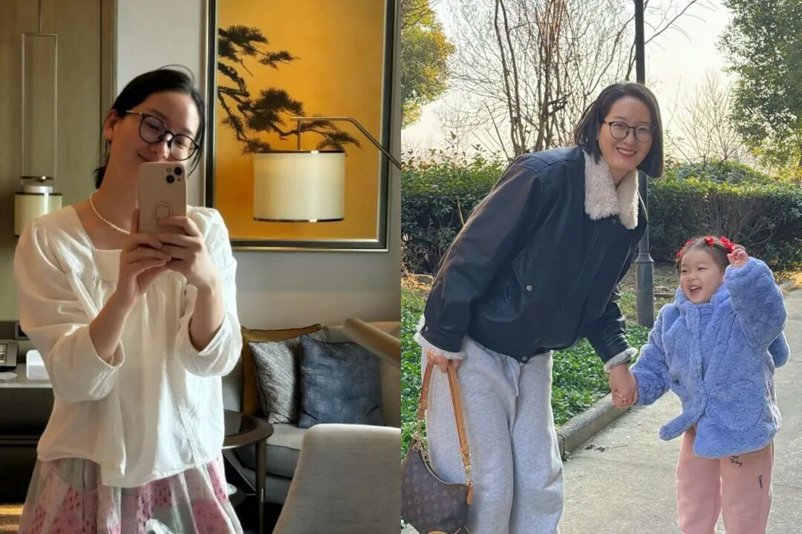

# 从月薪3000到年入100w，一定要大量读书，书读多了，人生真的会开挂！
> 💡 备注属性未写入，可能是备注属性名称或者类型被修改了，建议将字段类型设置为 rich_text，可以在小程序-操作-修改文章数据库页面进行调整
> 💡 原文链接:[https://mp.weixin.qq.com/s?__biz=MzkwNjEyMjEzNA==&mid=2247499488&idx=1&sn=528c50030d9f44937b89fc56b4fdf29b&chksm=c1dfb3cc202b3868aab13ad303edb2e35753173807fe4699334558fde45d966b6ae8898f9538#rd](https://mp.weixin.qq.com/s?__biz=MzkwNjEyMjEzNA%3D%3D&mid=2247499488&idx=1&sn=528c50030d9f44937b89fc56b4fdf29b&chksm=c1dfb3cc202b3868aab13ad303edb2e35753173807fe4699334558fde45d966b6ae8898f9538#rd)
**—点击上方卡片关注我—**
大家好，我是勋妈，不上班姐姐俱乐部主理人，**全网30W粉博主**，2020年开始做自媒体，**7年持续年入百万**，引领1万＋妈妈开启自媒体副业之路，希望我的内容带你看见光亮。

我三本毕业，起点很低。
以前在国企坐办公室，听起来还不错，但我是劳务派遣工，一个月工资只有3000块。
2020年，我开始做自媒体，实现了年入百万。一直做到今天，光是文字，就已经写了几百万字。
从月薪3000，到年入100w，从坐在办公室等着发工资，到靠自己的内容和产品赚钱，这中间，读书对我的影响非常大。
**我很清楚，如果没有持续读书，我很难走到今天。**
2018年，我花了365块钱，开始听樊登读书。当时生活里有育儿的问题，也有婚姻的问题，很多事情，我不知道怎么办。
于是就去听，去学，去找答案。
**现在回头看，那365块钱，是我为未来的自己做的一次非常值得的投入。**
那个时候，我还不知道，原来从书里找到一个办法，真的能解决生活里的一个问题；解决了一个问题，人会更有信心，然后又愿意继续学，继续往前走。
我的人生，就是这样慢慢变的。
所以，我为什么一直劝普通人，一定要**大量读书**？
**因为书读多了，你会慢慢知道，这个世界到底是怎么回事。**
**当然，你也会知道，赚钱到底是怎么回事。**
**1**
大部分人最熟悉的赚钱方式，就是拿时间换钱。
每天去上班，完成工作，到时间发工资。
能力强一点，时间就卖得贵一点；资历深一点，职位就往上走一点。很多人对赚钱的全部想象，就停在这里。
**但人的时间是有限的。**
一个人一天只有24小时，不能因为想多赚一点，就再长出一个自己，替自己去上班。
就算工资已经很高，也要看这份收入能给你换来多大的自由。
比如，假设你在一线城市月薪三四万，买了一套总价500万的房子。工资看起来不错，但扣掉生活开销、养育孩子的支出，还要长期承担房贷，你依然可能不敢停、不敢换工作。
辛苦挣来的钱，很大一部分，都要用来维持已经建立起来的生活。
**这时候你会发现，收入提高了，自己能自由支配的人生，却未必增加了多少。**
问题出在哪里？
**你一直在提高时间的售价，却很少想过，能不能让同一份付出，产生更多次价值。**
《纳瓦尔宝典》让我对这件事有了更清楚的认识。
书里讲到一种普通人也能使用的杠杆：代码和媒体。文章、书籍、视频，都可以成为能够**反复传播、低成本复制**的成果。
怎么理解？
同一个问题，你当面给一个人讲，需要花一次时间；再给另一个人讲，又要花一次时间。
但如果你把它写成一篇文章，讲清楚了，这篇文章就有机会被很多人看到。
你不用坐到每一个读者面前，再把同样的话讲一遍。
你去吃饭，去休息，文章依然可以被阅读、被转发。别人通过你的内容认识你，理解你能解决什么问题，再决定要不要进一步找你。
当然，发出去不等于有人看，有人看也不等于有人付钱。你还得有真正的内容，能解决问题的产品，以及持续积累的信任。
但至少，你已经看见了另一种赚钱方式。
**你的劳动，有机会留下来，继续发挥作用。**
这也是我为什么会铁了心做自媒体。
从2020年到现在，我一直在思考、学习、读书、写作。在公众号输出，在小红书输出，在自己的社群里输出。
几百万字，就是这样一点一点写出来的。
读到《纳瓦尔宝典》里的杠杆思想，我更加理解了自己在做什么，也更加坚定了继续做下去的方向。
**一个人知道自己为什么要走这条路，才有可能走得足够久。**
否则，今天觉得这个赚钱，明天又觉得那个赚钱，一直换，一直急，一直不知道自己的付出究竟在积累什么。
**读书给我的，就是这种重新理解赚钱的能力。**

**2**
读书还改变了我对上班这件事的认识。
以前在国企坐办公室，我也觉得挺好的。
当好一个牛马，当好一个打工人，把分内的事情做完，到时间发工资，很安逸。
偶尔开一个没什么必要的会，写一些无聊的周报，觉得有点浪费生命，但也就这样过去了。
大家不都这样吗？
可是，读书多了以后，我慢慢发现，有些以前能忍受的东西，越来越难忍受了。
为什么？
**因为脑子里已经装进了更好的方法。**
同一个问题，你知道可以怎样解决；同一件事情，你知道可以怎样做得更有效。但你每天还是要花时间，重复那些并没有多少价值的动作。
以前只是觉得烦，现在你能看清，自己究竟在为什么消耗时间。
这个变化很关键。
**当你知道自己的时间还能用来做什么，再让你随随便便把它耗掉，你就不甘心了。**
你开始想，能不能换一种工作方式？能不能去一个更重视结果、更能发挥自己能力的地方？能不能把自己会的东西，拿出去直接帮助别人？
这时候，环境和你之间的关系，就开始变化了。
我想到法拉第的经历。
他14岁开始做装订学徒，阅读经手的科学书籍，逐渐产生了兴趣。后来，他获得了听科学家戴维讲座的机会，整理笔记，主动争取工作，最终进入英国皇家研究所。
**最初，他的工作是把书装订起来。**
**后来，书里的知识，让他走进了实验室。**
这个转变，多有意思。
他接触到了一个原本不属于自己生活范围的世界，又通过学习和行动，一步步走了进去。
**读书的力量，就在这里。**
你原来只知道眼前这一种活法，觉得人生大概就是这样。后来你知道了更多东西，开始有了新的兴趣、新的能力，也开始对自己提出新的要求。
原来的地方，可能就不够你施展了。
你会主动去找，去试，去争取一个更适合自己的位置。
所以我一直觉得，普通人要持续学习，持续进化自己。
否则，你很容易把已经习惯的环境，当成人生唯一的可能。
而当你变得不一样，你能解决的问题更多，能创造的价值更大，你才更有条件，去争取更好的环境和更高的收入。
这条路，要靠自己一步一步走。
**但读书，会先让你看见，原来还有路。**
**3**
接下来，我想分享几个自己的读书建议和核心方法。
**第一个，带着问题去读书。**
尤其是已经走上社会、正在被具体生活问题困住的人，先从自己最需要解决的事情读起。
有育儿问题，就去看育儿的书。
婚姻过得很痛苦，就去看讲关系的书。
工作遇到了瓶颈，就去看工作、商业、个人成长方面的书。跟人沟通总出问题，就去学习怎么沟通。
**不要觉得自己的问题太小，不值得专门读一本书。**
很多时候，恰恰是这些每天都在发生的小问题，消耗掉了你大量的心力。
**而你一直想不出办法，可能只是因为，你还没有接触过更好的解法。**
至于小说、文学类的书，我也觉得值得读。
年轻的时候，读《平凡的世界》这样的作品，去理解人的处境、善良、尊严和苦难，对一个人内心的成长很有价值。
但如果你眼下最着急的是解决一个现实问题，我建议先找能直接帮助你理解这个问题的书。
还有一种阅读，就是单纯图个爽，追着情节看，消磨时间。
娱乐当然也可以。但如果你期待靠阅读改变生活，就要再往前走一步：看看读到的东西，跟你现实中的困境有什么关系。
对我来说，2018年开始听书，就是从育儿和婚姻里的问题出发的。
我需要答案，也愿意尝试新的办法。
当你真的从书里找到一个有用的东西，你对读书的态度会发生变化。
以前觉得“读书有用”只是一句大道理。
后来你会发现，这句话跟自己有关。
**只要有过一次，靠学习解决实际问题的体验，你就更容易相信，下一次遇到问题，自己还能找到办法。**
这种信心，非常重要。
它会让你遇事以后，多一个反应：
**这件事，我能不能去学一学？**
**4**
**第二个，优先选高分的书。**
现在书太多了，人的时间又有限，选书本身就很重要。
我一般会参考微信读书上的推荐比例。
80%以上，我会愿意点进去看看；90%以上，我会更有兴趣，看看它到底好在哪里。
豆瓣上的评分和评论，也可以作为参考。
当然，这是我的筛选方法。高分给我一个先看看的理由，至于这本书适不适合我，还要看它到底在讲什么，能不能回应我现在的问题。
很多人买书的时候，容易被一个标题吸引。
标题很厉害，封面上的推荐语也很厉害，但翻开以后，发现自己根本不需要。
所以我觉得，看口碑之后，还可以看看目录、试读几页。
**你要找的是一本现在能跟你说上话的书。**
有些书再好，你目前用不上，也未必要急着读完。先把眼前最困扰你的问题解决掉，你对阅读的兴趣，自然会越来越强。

**5**
**第三个，读完一本书，只要求自己记住一句话，然后把它用进生活里。**
**这是我的绝招。**
很多人对读书有一个误解：读完了，应该记住很多东西。过段时间忘了，就觉得白读了。
我从来不这么要求自己。
读的时候，我会认真理解，也会记笔记。但一本书那么多内容，我不可能全部记住。
记不住，就记不住。
那些认真思考过的东西，有时会在后来遇事的时候重新浮现。更重要的是，我会主动留下一句话，让它持续跟自己的生活产生联系。
比如，《纳瓦尔宝典》里关于杠杆的讨论，我给自己留下的就是一个提醒：
去做能够放大自己劳动成果的内容。
这件事，我一直记着，也一直在做。
再比如，读《亲密关系》，我记住的一句话是：
婚姻是一个人的事。
这句话对我的影响很大。
我把注意力放回自己身上，去看自己的反应、自己的期待，以及自己能做出的改变。关系里的另一个人有他的责任，而我也有自己可以开始修的部分。
这比一直等对方先改变，要有力量得多。
你看，一本书真正进入生活，往往就发生在这样的地方。
下次遇到同样的问题，你想起了那句话，于是换了一个做法。
一次，两次，很多次。
慢慢地，你处理事情的方式变了，跟别人相处的方式变了，选择的方向也变了。
所以，很多人说，自己读了不少书，生活却没有变化。
我觉得可以问问自己：
**你读过的书，有没有让你在某一件具体的事情上，换过一种做法？**
哪怕只有一件。
**有了这一件，书就开始跟你的人生发生关系了。**

**6**
**第四个，慢慢走向经典。**
**我觉得，经典应该是我们读书最终会走向的一个方向。**
**但这个过程，不用急。**
一开始读不懂，读不进去，也不感兴趣，都很正常。有些东西，你还没有经历过，书里说得再深，你也接不住。
先从自己读得进去、用得上的书开始。
我很早就知道《了凡四训》，也很早就知道曾国藩这个人。但知道了三四年以后，我才真正开始读《曾国藩传》，开始看《了凡四训》。
**同样的书，放在不同的人生阶段，感受是不一样的。**
以前可能只是知道它很有名。
后来自己经历了一些事情，有了一些困惑，才开始想知道：这些人到底是怎么想的？他们怎样面对困境，又怎样一点一点改变自己？
这时候再读，很多话就能读进去了。
所以，你现在看不懂经典，没有关系。
对它保留一份敬意，也给自己的成长留一点时间。
**先开始读，先让一本书帮助到自己。**
你从中得到了一点力量，解决了一个问题，做成了一件事，就更愿意继续读，继续往深处走。
我非常庆幸，自己踏上了这个成长的旅程。
最早的那一步，其实很小。
就是生活里有问题，我开始去找书，去学习，并且亲自体会到，读书对生活是有实际帮助的。
**后来，一本书带来一个新认识，一个新认识改变一个选择，再把这个选择落实到每天的行动里。**
从月薪3000的国企劳务派遣工，到年入百万的自由职业者，我就是这样，一个台阶一个台阶爬上来的。
**当年那365块钱买来的，是一个开始。**
**而我读进去、用起来的那些东西，后来一点一点，变成了我现在的自由生活。**
**ps：如果你想近距离围观我**，欢迎来结个善缘
xunma18 关注勋妈，领取我1.8万字的《改命课程》

我是勋妈，89年37岁，2020年开始不上班，三本毕业，年入百万，还是个二胎妈妈，喜欢搞钱和个人成长，**连续七年年入百万**，分享自媒体搞钱、个人成长、改命。
**不做过多介绍了，对我感兴趣的姐妹，可以多看看我的文章~**
**我不认可一辈子上班的人生叙事，我喜欢尝试和探索，尤其喜欢探索“如何不上班”。**
**我不信命，持续践行改命。**
**从工资3000的国企临时工，到成为年入百万的自由职业者；从离婚边缘，到手握稳稳的幸福。**
**人生拼什么，都不如拼自己的成长。**
**2026年，“不上班姐姐”自媒体社群已经创建一年多，已有1万+同频姐妹跟我一起在做自媒体。关于我和不上班姐姐可见这两篇文章~**
[**写给想要不上班的姐妹**](https://mp.weixin.qq.com/s?__biz=Mzk3NTQ4NTgxNA%3D%3D&mid=2247483938&idx=1&sn=057e92db2ce9ea77dc07c1e6da94801a&scene=21#wechat_redirect)
[**我的个人品牌故事-让你快速认识我**](https://mp.weixin.qq.com/s?__biz=MzkwNjEyMjEzNA%3D%3D&mid=2247492988&idx=1&sn=efa3ed7f5b8710510a7731829171bc15&scene=21#wechat_redirect)
▼
