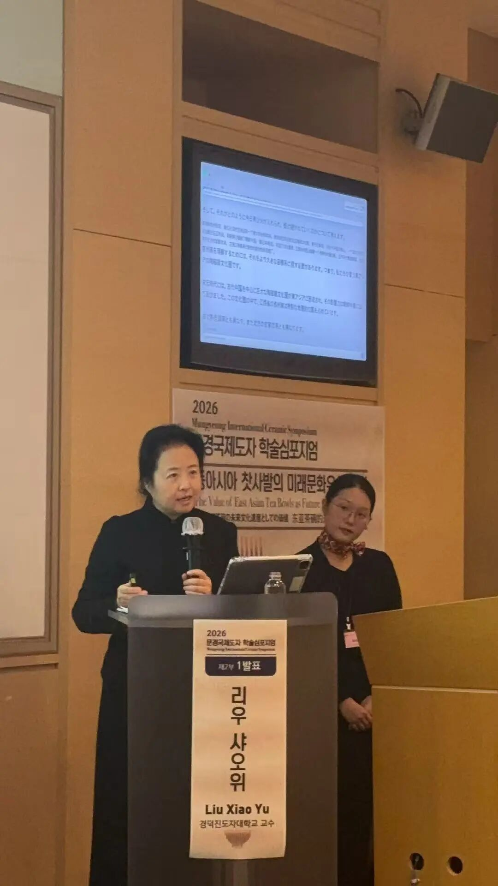
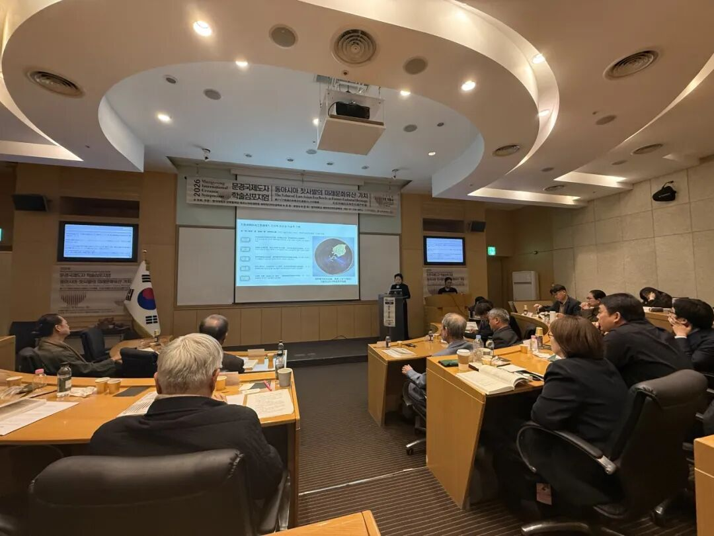
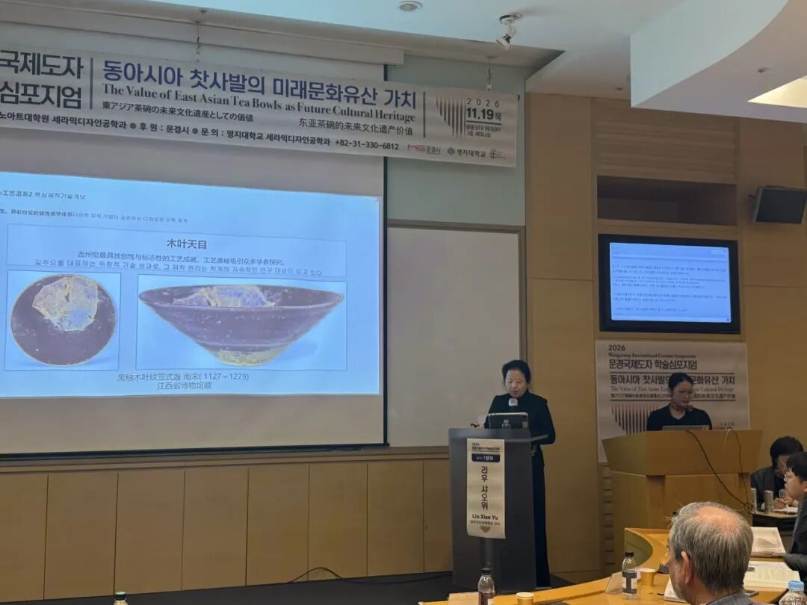
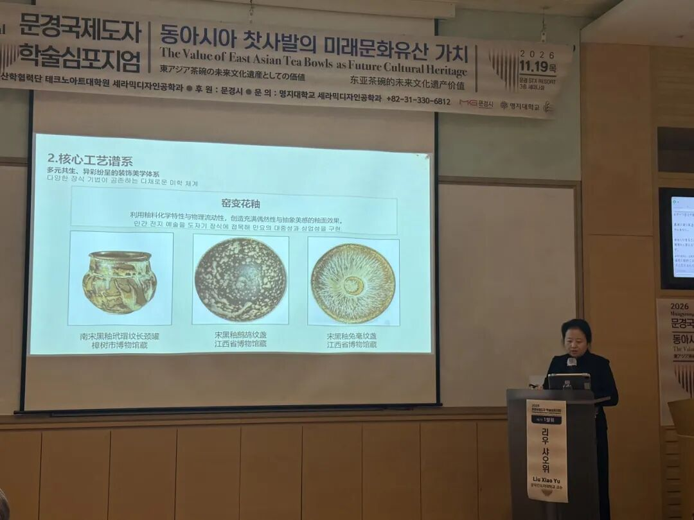
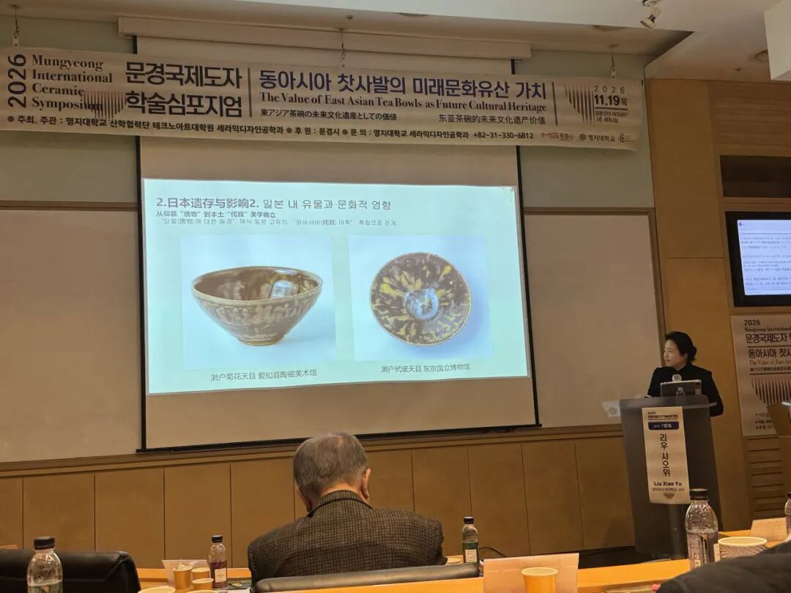
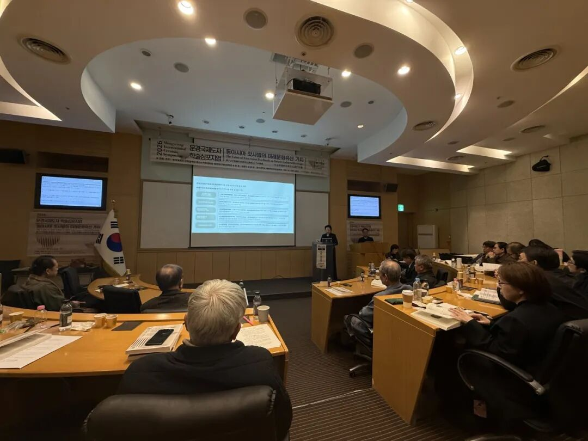
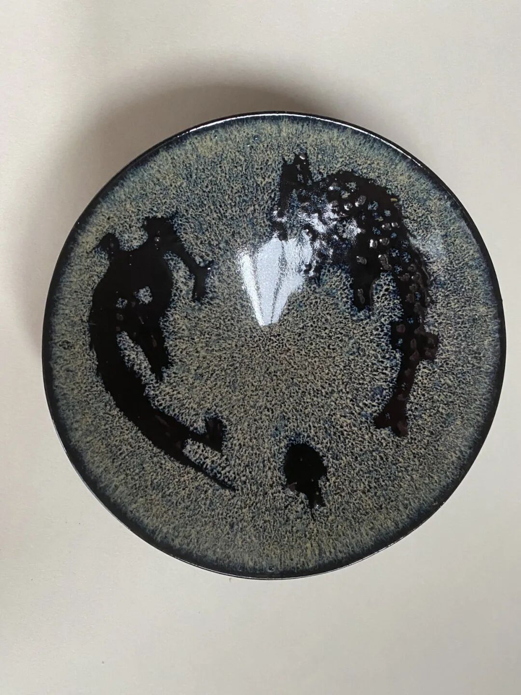
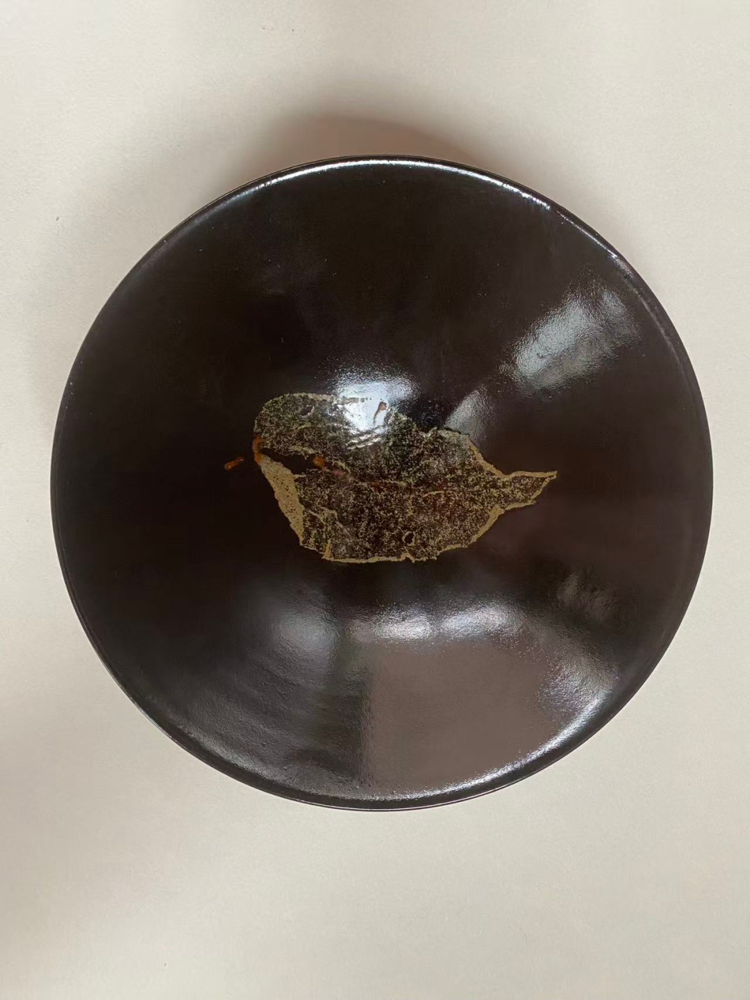

# 从江南到东亚——刘晓玉教授谈吉州窑的保护与传承
> 💡 备注属性未写入，可能是备注属性名称或者类型被修改了，建议将字段类型设置为 rich_text，可以在小程序-操作-修改文章数据库页面进行调整
> 💡 原文链接:[https://mp.weixin.qq.com/s?__biz=MzI3NjIyMTk5Mg==&mid=2650104955&idx=1&sn=1eeaa90862c720788f2e4e4ad0a07466&chksm=f2516883b15a6d7ef1c798495d7859dda91dbef5ac651f5f5cb6c0175f20538ce239f04ac8e6#rd](https://mp.weixin.qq.com/s?__biz=MzI3NjIyMTk5Mg%3D%3D&mid=2650104955&idx=1&sn=1eeaa90862c720788f2e4e4ad0a07466&chksm=f2516883b15a6d7ef1c798495d7859dda91dbef5ac651f5f5cb6c0175f20538ce239f04ac8e6#rd)
从江南到东亚
一只茶碗的远行

一座古窑的当代回响
一片木叶，如何在高温中留下清晰的脉络？一只茶碗，如何跨越山海，成为不同文化之间的对话媒介？千年吉州窑的故事，既在器物之中，也在今天仍然延续的窑火里。
2026年11月19日，由韩国明知大学主办的“东亚茶碗的未来文化遗产价值”国际学术研讨会在韩国闻庆市举行。景德镇陶瓷大学美术学院教授、博士生导师，江西省非物质文化遗产吉州窑陶瓷烧制技艺代表性传承人，江西省非物质文化遗产景德镇传统颜色釉瓷烧制技艺传承人刘晓玉教授受邀参加会议，并作题为**《从江南到东亚：吉州窑宋元黑釉瓷的历史流变、当代保护与非遗传承新径》**的学术报告。
报告以吉州窑宋元黑釉瓷为中心，将器物、技艺与文化交流联系起来，从历史流变、跨域传播、当代保护与未来路径等方面展开讨论，回应一个贯穿始终的问题：**如何让吉州窑从历史遗产转化为持续生长的文化资源？**

图1 学术报告现场
**从永和窑火出发**
**在交流中形成独特面貌**
理解吉州窑，需要将它放回东亚陶瓷文化交流的视野。位于江西吉安永和镇的吉州窑，依托赣江水运、当地原料与燃料资源发展起来，在江南民间窑业中形成了鲜明的工艺特色。

图2 会议现场
在报告中，刘晓玉教授梳理了吉州窑自身艺术面貌的过程。它的创造力，体现于人工装饰与自然窑变的结合：既尊重材料在火中的变化，也将民间艺术与日常经验引入器表，让深沉的黑釉呈现出丰富而自由的表达。
其中，木叶天目、剪纸贴花与窑变花釉构成了报告重点讨论的三条工艺线索。木叶天目将真实树叶的形态与脉络留在盏心；剪纸贴花将民间剪纸转化为陶瓷装饰；以玳瑁釉为代表的窑变花釉，则借助釉料特性与烧成变化，形成流动、交融的釉面效果。

图3 木叶天目讲解

图4 窑变花釉讲解
这些工艺并非孤立的装饰手段。它们共同呈现了吉州窑对自然意象、民间生活与茶事文化的吸收，也为理解中国民窑的审美创造提供了具体的器物依据。
**随茶碗跨越山海**
**看见东亚文化的相遇**
从江南走向东亚，吉州窑器物的流动，既与海上贸易有关，也与僧侣往来、茶事交流及文化馈赠相联系。器物在不同地区被使用、珍藏和重新理解，其意义也随之发生变化。
报告将日本与朝鲜半岛放在比较视野中，讨论吉州窑黑釉瓷在不同文化环境中的接受方式。在日本，围绕木叶天目等茶器形成的收藏与审美实践，展现了中国陶瓷与当地茶文化之间的联系；在朝鲜半岛，刘晓玉则结合不同历史时期的陶瓷传统，讨论工艺表达与民间审美之间可以相互参照的线索。
这一比较的重点，在于透过器物理解文化如何相遇。吉州窑所承载的自然意趣、手工痕迹与窑变之美，为东亚陶瓷文化的交流提供了一个具体而生动的观察窗口。

图5 东亚茶碗文化交流
**遗址需要守护
**
**技艺更需要在人身上延续**
历史研究最终要回到当下。报告将吉州窑遗址保护与技艺传承并置讨论：遗址公园、博物馆展示和解说系统，让窑业历史获得更清晰的呈现；而支撑技艺延续的，则是一代代制瓷者长期的实践与坚守。
刘晓玉教授特别谈到刘品三先生复原吉州窑技艺的探索。他长期投入木叶天目等工艺的复烧，在反复试验中积累经验，使传统工艺重新进入可操作、可传授的实践过程。
在此基础上，刘晓玉教授结合自身研究与教学，介绍了**“学术研究—技艺复原—国际传播—产教融合”**的实践思路：通过文献、器物与实验相互印证，理解传统工艺的形成；通过展览与交流，让研究成果进入更广阔的文化语境；通过课程与实训，把技艺经验转化为学生能够学习和延续的知识。
报告还涉及VR辅助教学，以及吉州窑与金缮技艺结合的探索。在刘晓玉教授的实践中，保护不仅指向器物本身，也指向知识如何被记录、经验如何被传递、年轻一代如何与传统建立联系。
**让传统进入当代
**
**探索传承的四条路径**
围绕吉州窑的未来，刘晓玉教授提出了四个相互衔接的方向，将工艺、数字资源、地方生活与区域交流联系起来。相关研究同时也是2025年国家文化和旅游科技创新研发项目《AI驱动下吉州窑非遗技艺智能生成技术研究及文旅融合创新示范应用》的阶段性成果，为探索吉州窑非遗技艺的数字化传承与文旅融合提供了研究支撑。
**01 工艺的创造性转化**
从木叶、剪纸与窑变等核心视觉语言出发，探索其在当代设计、建筑空间与艺术装置中的表达，让传统工艺获得新的使用场景。
**02 数字化记录与传播**
以三维扫描、纹饰资源整理和线上数字博物馆保存与共享资料，结合VR、AR等方式呈现烧造过程，拓展公众理解传统技艺的途径。
**03 文旅融合与社区协同**
围绕吉州窑生活美学发展研学与工艺体验，吸引青年陶艺从业者参与，推动匠人社区、民俗活动与地方文化生态的共同生长。
**04 东亚区域文化联动**
以吉州窑博物馆为核心，联合日韩机构成立"东亚黑釉瓷研究联盟"，推动三国陶艺家驻留创作与交流。

图6 吉州窑传承路径分享
**以茶碗为媒**
**延续跨越山海的对话**
从一只茶碗出发，报告进一步提出**“东亚茶碗文明共同体”**的愿景，倡议围绕研究、交流、标准与传承开展合作，探索以茶碗文化连接中日韩的共同记忆。
这一构想仍有待在持续研究与机构协作中推进。它所强调的，是以具体器物为起点，尊重不同地区的文化经验，在比较与交流中建立更深入的理解。
在这次国际交流活动中，刘晓玉教授及刘品三先生的陶瓷作品被韩国陶泉陶瓷美术馆所收藏，为此次赴韩学术交流增添了艺术实践的成果，也为中韩陶瓷文化交流留下了实物见证。

图7刘晓玉教授作品被韩国陶泉陶瓷美术馆收藏

图8 刘品三先生作品被韩国陶泉陶瓷美术馆收藏
吉州窑的当代价值既在器物之美，也在连接人与人的可能。对非遗的保护，应当让技艺在使用、教学和创作中持续生长，让传统在新的生活与文化关系中焕发活力。
**陶瓷，是最懂对话的语言。**
从永和镇的窑火，到课堂、展厅与数字空间，再到今天跨越山海的茶事交流，吉州窑的故事仍在延续。此次赴韩交流，也将为这一持续展开的文化对话带来新的思考。

图9 参会嘉宾合影
