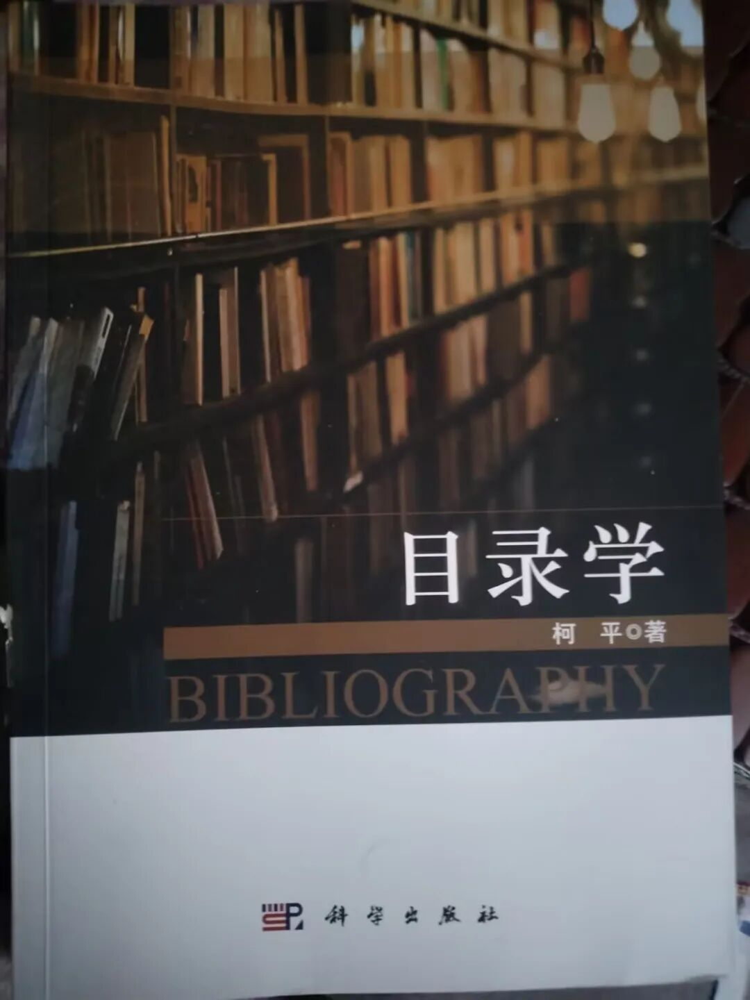

# 从纸质阅读到数字阅读
> 💡 备注属性未写入，可能是备注属性名称或者类型被修改了，建议将字段类型设置为 rich_text，可以在小程序-操作-修改文章数据库页面进行调整
> 💡 原文链接:[https://mp.weixin.qq.com/s?__biz=Mzg2Mzg4MDY1Mw==&mid=2247484305&idx=1&sn=53c3e90befa8d9fb5cef5e931ff6f07b&chksm=cf0e36dc52680a06829df409b51d4483a9cddbc0b894d2801a3eb609369b270c087707f3fd29#rd](https://mp.weixin.qq.com/s?__biz=Mzg2Mzg4MDY1Mw%3D%3D&mid=2247484305&idx=1&sn=53c3e90befa8d9fb5cef5e931ff6f07b&chksm=cf0e36dc52680a06829df409b51d4483a9cddbc0b894d2801a3eb609369b270c087707f3fd29#rd)

阅读的发展背景

阅读从纸质阅读发展到数字阅读，源于信息技术的发展和网络世代的兴起。
美国数字未来学家DonTapscott的《数字化成长：网络世代的崛起》论述了网络世代（netgeneration）由广播式学习到互动式学习的8种转变：
- 由线性思考转变为电脑媒体的学习
- 从指导到构建和发现
- 从以老师为中心到以学习者为中心的教育
- 从吸收内容到学习如何探索、如何学习
- 从学校到终身学习；从一体适用到量身定做的学习
- 从痛苦的学习到快乐的学习
- 老师从传播者到协助者的角色

数字阅读的定义

数字阅读（digitalreading）是数字化社会基于数字文本知识和数字媒介信息获取的一种阅读活动和文化现象，涉及电子阅读、网络阅读、虚拟阅读、泛在阅读、屏幕阅读、数字媒体阅读等相关概念。
数字阅读表现为阅读的数字化，具体包括：
1. 阅读对象的数字化，也就是阅读的内容是以数字化的方式呈的，如电子书、网络小说、电子地图、数码照片、博客、网页等
1. 阅读方式的数字化，就是阅读的载体、终端不是平面的纸张，而是带屏幕显示的电子设备，如PC电脑、PDA、MP3、MP4、笔记本电脑、手机、阅读器等
与传统的纸质出版物相比，数字化电子出版物具有存储量大、检索便捷、便于保存、成本低廉等优点。

数字阅读的基本特征

数字阅读的基本特征有5个方面：
一是数字化
主要表现为阅读内容的数字化呈现，阅读载体的数字化工具依赖，以及阅读方式的数字化形态，是数字阅读区别于传统阅读的本质特征。
二是媒体化
主要表现为多媒体环境、全媒体环境，以及受自媒体时代媒体文化的强烈影响，是数字阅读的时代特征。
三是动态化
传统的纸本阅读以“静”为主要特征，阅读对象是静态的纸张、静态的文字和图像及其他静态符号。而数字阅读充分体现“动”感，阅读的对象是动态的屏幕、动态的文字、图像及其他符号，读者可感受到符号的流动。这是数字阅读不同于传统阅读的最鲜明的特征。
四是交互化
读者与作者的交流互动在传统阅读中非常困难，但这正是数字阅读的突出优势。数字阅读能够实现读者与作者的双向互动、即时交流，有利于知识自由与知识共享。
五是体验化
传统阅读除了阅读环境的改变，无法实现阅读内容与形式的不断变化，而数字阅读通过相关技术设备，实现阅读过程中人的各种体验，将阅读内容融入场景之中，从体验中获得历险、愉悦、成就感等阅读感受。

数字阅读的发展性

数字阅读还具有发展性。在数字阅读时代，以电脑阅读、手机阅读、电纸书阅读为主体，新型多样化的阅读载体和工具、平台不断产生，表现为多媒体、立体化、交互性、体验性、多变化阅读等发展趋势，阅读习惯从“阅读”发展为“倾听”（吴志攀，2004），数字阅读将阅读从狭义推向了广义，与学习、信息、知识、创新等的边界越来越模糊。
往期推荐
[柯平：阅读的功能](https://mp.weixin.qq.com/s?__biz=Mzg2Mzg4MDY1Mw%3D%3D&mid=2247484295&idx=2&sn=6c2b7a0c9d8ae4c24330bc9953d580d0&scene=21#wechat_redirect)
