# 从雅尔塔到深圳
> 💡 备注属性未写入，可能是备注属性名称或者类型被修改了，建议将字段类型设置为 rich_text，可以在小程序-操作-修改文章数据库页面进行调整
> 原文链接:[https://mp.weixin.qq.com/s/zYSeDfo4PnNMUd-ZCPDEeA](https://mp.weixin.qq.com/s/zYSeDfo4PnNMUd-ZCPDEeA)
**01**
今天的我们都生活在和平的年代，
然而和平在长期以来，都不是社会的主流。
从公元前3000年到20世纪，人类的大小战争至少发生过14000次，完全没有战争的年份，只有290年。
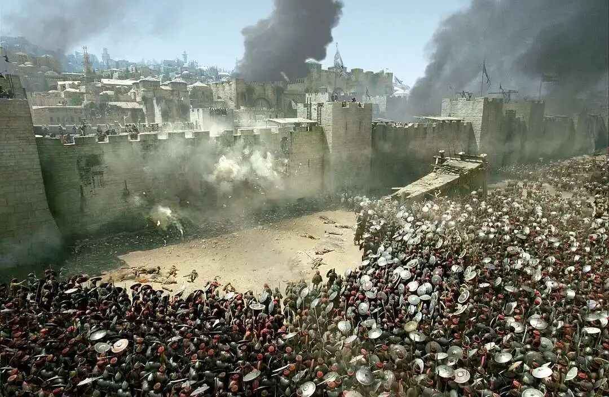
我们这代人所享受的70多年的大国和平，
是1940年代两个三巨头会议所框定的架构。
主要的是1945年的雅尔塔会议，美苏英在处置德国、划定欧洲、划分战后势力范围等问题取得了一致，
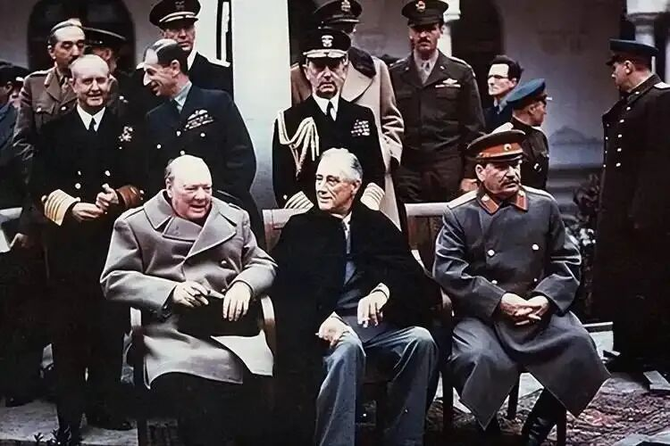
如果再加一个资料片，那是之前的开罗会议。
主要谈的是东亚和日本问题等。
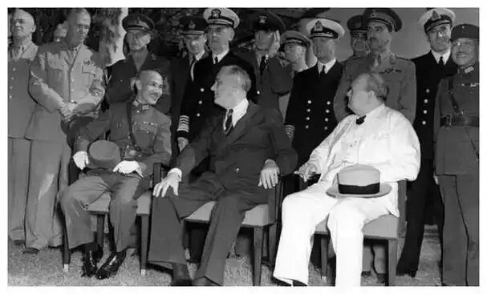
今天我们所体会到的全球化、联合国框架、安理会五常、国际社会、人道主义援助等公共产品，均起源于那个时代。
**02**
八十一年后，
物是人非，格局动荡，城头变换大王旗，
三大国再次聚集在深圳，
发布了一份“和平宣言”，
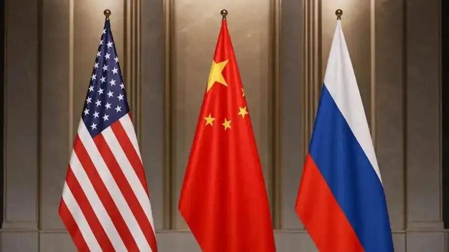
短短四条，但字字金贵。
**第一条**，推动联合国改革。三国作为安理会常任理事国，承诺让联合国更有效应对全球性挑战。
之前我们讲过，当今世界是从“春秋时代”转向“战国时代”的关口，
各路野心家和地区霸主总想跳起来拆掉“周天子”的架构。
甚至部分五常也一度觉得，可以踢开周王闹革命，懂王甚至一度扬言要退出联合国。
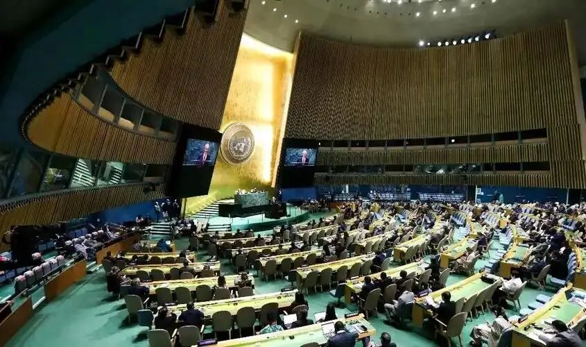
然而，不管是俄乌还是中东的不顺，都让美俄深刻意识到，道义这个东西，看不见，却真实存在，联合国可是他们合法性的基础，最宝贵的资产之一。
于是回到东大的倡议，对王室进行改革。联合国是效率问题，不是框架问题。
而对东大来说，联合国框架下的法定利益还没交付完整呢。
就比如说，《联合国宪章》第53条等规定，德意日等法西斯或军国主义国家的任何一国，有再次实施侵略政策的任何步骤，五常有权对其直接实施军事行动，无需安理会授权。
再比如，日本的领土问题，联合国有明确规定，
> 日本的法定领土范围确实应局限于本州、北海道、九州、四国及同盟国决定的其他小岛之内。冲绳的主权需要中美英三国一致确认后才能生效。
> 
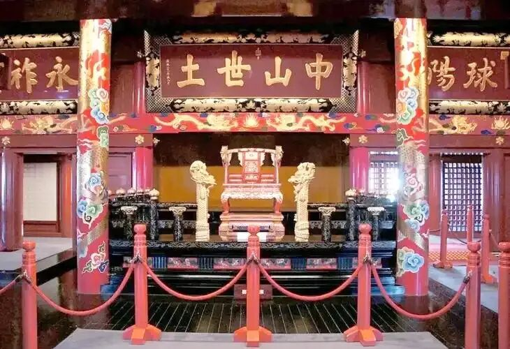
就算不讲冲绳，琉球怎么说?
**第二条**，稳定能源供应。承诺增加精炼石油产品生产和供应，重申能源稳定流动的重要性。
石油是全球工业的血液，也是民生的基石，美国为什么通胀这么高，油价涨的，俄罗斯为什么国库这么空，石油出口闹的，对更多的中小国家来说，油一断那直接影响上班通勤和讨生活了。
一方面是让中美俄有个物理性利益链条，另一方面更是讲，大国们博弈归博弈，不要拿全球的供应链和民生问题当筹码。
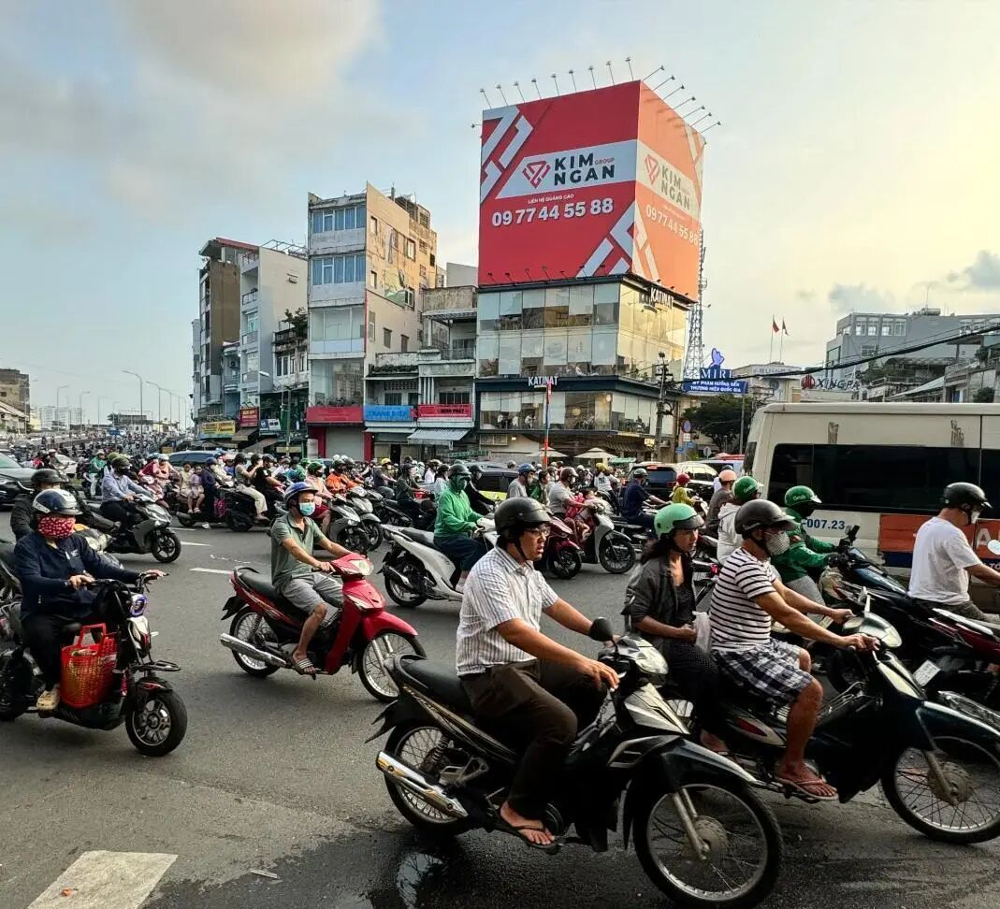
**第三条**，限制国际刑事法院管辖权。三国一致认为国际刑事法院等机构不得滥用管辖权，并强调国家官员享有豁免。
众所周知，二战结束时，英国已经被炸烂了，而法国早就投降了，
五常拉上英法，不能说是凑数，但主要也是考虑到英法人民的牺牲和为了更好的向国际新秩序过渡，要说实力，
早在1946年，为了接受日本投降，龙云的滇军就在越南海防一战毙伤法军500余人、逼降3000人、击沉炮舰一艘，俘虏三艘，而中国军队仅伤亡30多人。
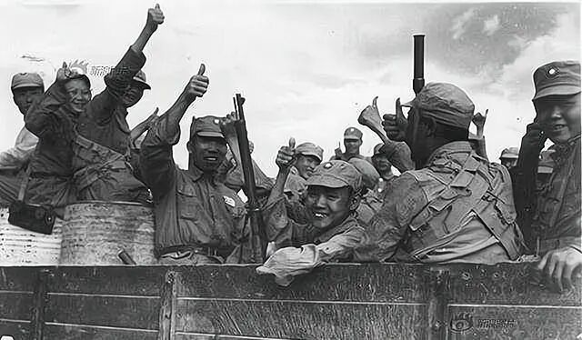
几十年过去后，欧洲人是好了伤疤忘了疼，掂量不清自己斤两，搞了一群什么国际刑事法院之类的东西，一会抓了菲律宾的杜特尔特，一会又要通缉大京子，一会还想搞出什么南海仲裁，
既缺乏实力也缺乏公正，几个菜啊喝成这样。
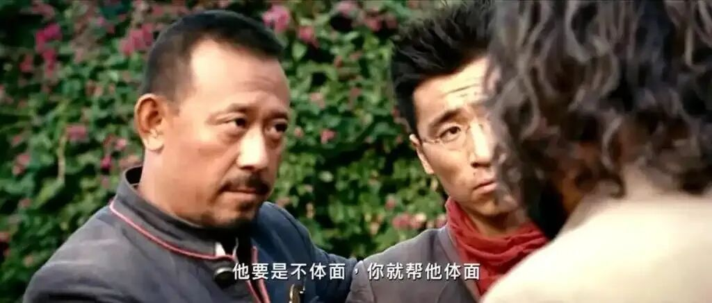
**第四条**，核风险管控。重申核战争打不赢也打不得，并就减少核风险、防止核扩散进行对话。
小国和小霸们如何在成熟的体系中最大化利益？答案是等大国互殴，好浑水摸鱼，从中渔利。
但现在三巨头告诉尔等，趁早死了这份心，大国们的博弈有底线，你们也不要搞什么非分之想，试图通过核武器弯道超车。
不完美的秩序，远远好过于没有秩序。
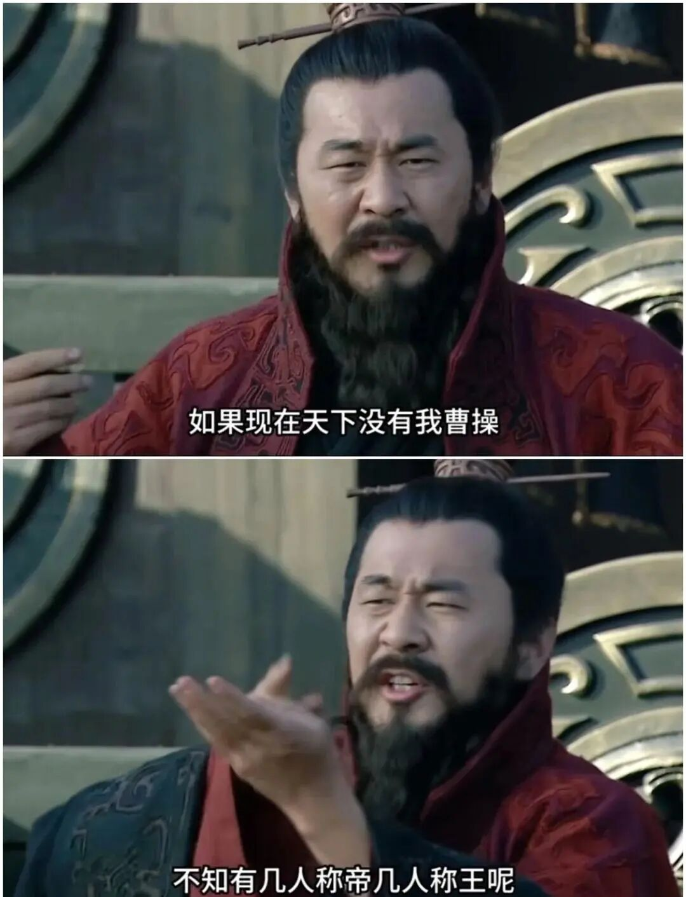
**03**
看完四条宣言，有人可能会觉得，怎么就这么点，关于俄乌、中东、芯片等问题为什么不深谈一下。
亲，很多深层次的矛盾不是人力可以解决的，这次能谈出维护秩序、维持供应、驱逐野路子，不打核大战，已经是三巨头最大限度的给出底线保证了。
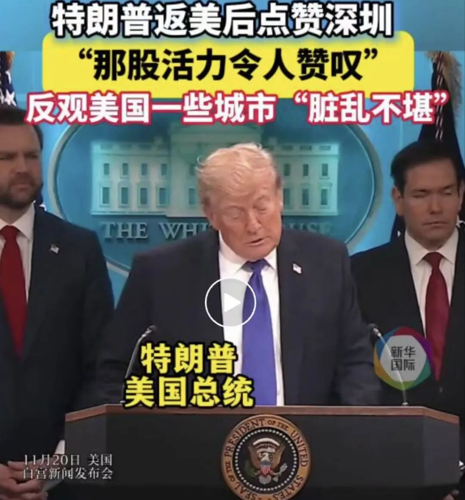
以前每一次国际格局变化，都爆发了惨烈战争，西班牙崛起有美洲血泪，英国崛起有英荷战争，德国崛起有两次世界大战，美国崛起有冷战和美元潮汐，
而当这次中国人站在十字路口的时候，
给大家带来的是秩序，是和平与发展，
这是这个古老而又新兴大国根据自己的智慧和慈悲，给全人类最宝贵的礼物。
“劲大是本事，可这劲往哪使，可得想明白”
-摘自《人们的雷神所儿》

世界人民大团队万岁！
---
[你不知道1945年，中国丢了多大的好处](https://mp.weixin.qq.com/s?__biz=Mzg5NjcwMjgyNg%3D%3D&mid=2247493566&idx=1&sn=0a6b51d0c79b318d87971f76e1fc6a87&scene=21#wechat_redirect)
[**牛魔王辞职：我算个什么东西？**](https://mp.weixin.qq.com/s?__biz=Mzg5NjcwMjgyNg%3D%3D&mid=2247527124&idx=1&sn=d98d1bb59234291ae9a096a31f2c5f24&scene=21#wechat_redirect)
[**这届中登老登，已经备战2027年高考了**](https://mp.weixin.qq.com/s?__biz=Mzg5NjcwMjgyNg%3D%3D&mid=2247527070&idx=1&sn=521dd83b7b03a18bad825a645c77a85a&scene=21#wechat_redirect)
