# 从韩国政治题材电影看韩国军政时期历史
> 💡 备注属性未写入，可能是备注属性名称或者类型被修改了，建议将字段类型设置为 rich_text，可以在小程序-操作-修改文章数据库页面进行调整
> 💡 原文链接:[https://mp.weixin.qq.com/s?__biz=MzU0NjQyNjEyMg==&mid=2247485423&idx=1&sn=be9bc31cd174879c9d8b5b4feb6692b0&chksm=fa8a2efe9f8dc74ad37e514c57b724c45a179fd97ec4ce953f7e1f17592a3c4332f89953772c#rd](https://mp.weixin.qq.com/s?__biz=MzU0NjQyNjEyMg%3D%3D&mid=2247485423&idx=1&sn=be9bc31cd174879c9d8b5b4feb6692b0&chksm=fa8a2efe9f8dc74ad37e514c57b724c45a179fd97ec4ce953f7e1f17592a3c4332f89953772c#rd)
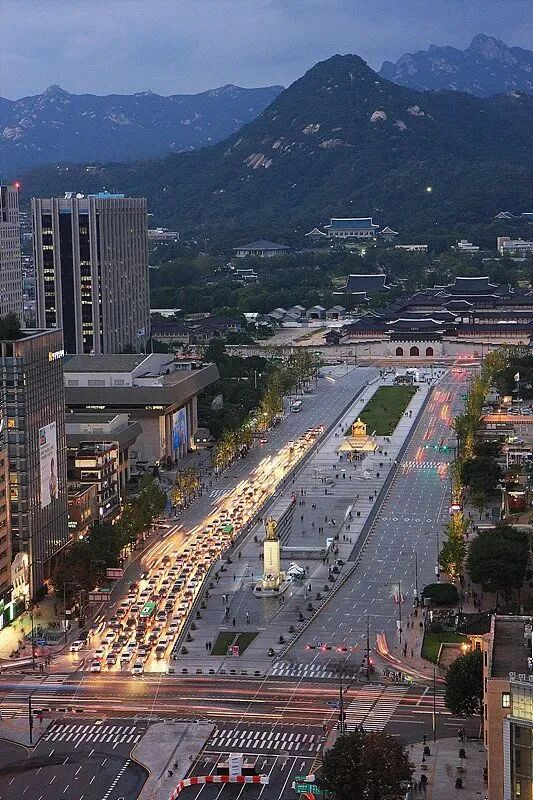
韩国军政时期是指1961年至1987年韩国军事独裁时期，这一时期是从朴正熙发动军事政变窃取总统宝座开始到同样靠军事政变窃取总统宝座的全斗焕下台为止，历时26年。
在韩国军政时期，一方面是军人大权独揽实行独裁统治，另一方面又是经济实现腾飞跻身亚洲四小龙的“汉江奇迹”。与此同时，对北朝鲜蛮触相争和对民间强权压制从未停止。
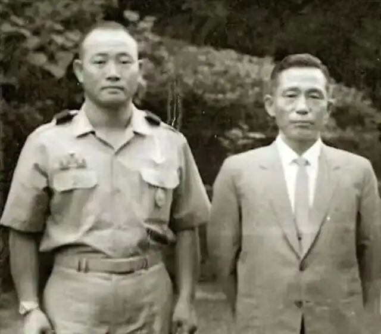
（全斗焕与时任总统朴正熙合影）
上世纪末，韩国政府取消电影审查制改为分级制。随着思想的松绑解放，进入21世纪，韩国电影在取材自由、表达自由方面几乎无所禁忌。
电影类型百花齐放，其中政治题材电影更为出彩，敢于挖掘历史污点，敢于揭露历史罪恶，敢于深刻剖析人性，故事写实，主题深刻，令人折服。
众多的韩国政治题材电影中，以下五部电影可以一窥韩国军政时期的真实历史。
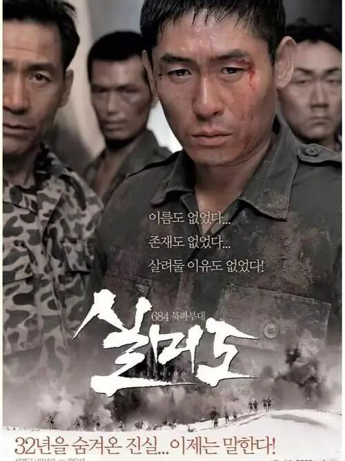
**《实尾岛》：被国家出卖的死囚特训部队**
1968年，朝鲜派出一支31人的敢死队越过三八线，意图斩首时任韩国总统朴正熙。
袭击事件发生后，朴正熙下令中情局在实尾岛成立以牙还牙的684特工部队，该部队由在死囚中招募的31名成员组成。
随着朝韩关系缓和，刺杀行动取消，这支严密特训的684部队失去存在意义。原为死囚的特训队员何去何从成为摆在当权者面前一道棘手的难题。
为了不被人间蒸发，得知消息的特训队员在岛上发起暴动，在仁川登陆后劫持一辆大巴车准备冲进总统府讨要说法。最终在军警的围追堵截下，特训队员拉响手雷引爆身亡。
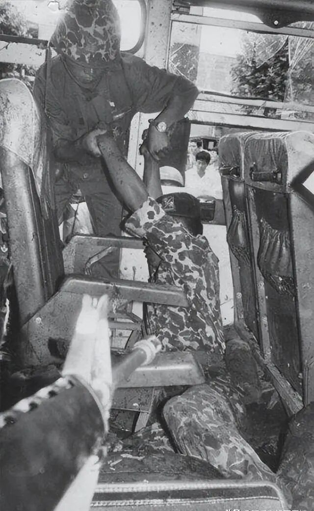
（士兵在清理爆炸后汽车内尸体）
《实尾岛》于2003年在韩国公映，是韩国影史上第一部观影人数超过千万电影。
电影热映带来的社会广泛质疑迫使韩国国防部首次官方承认了电影历史的真实性，公布了684部队队员名单和事件报告书，向家属道歉。
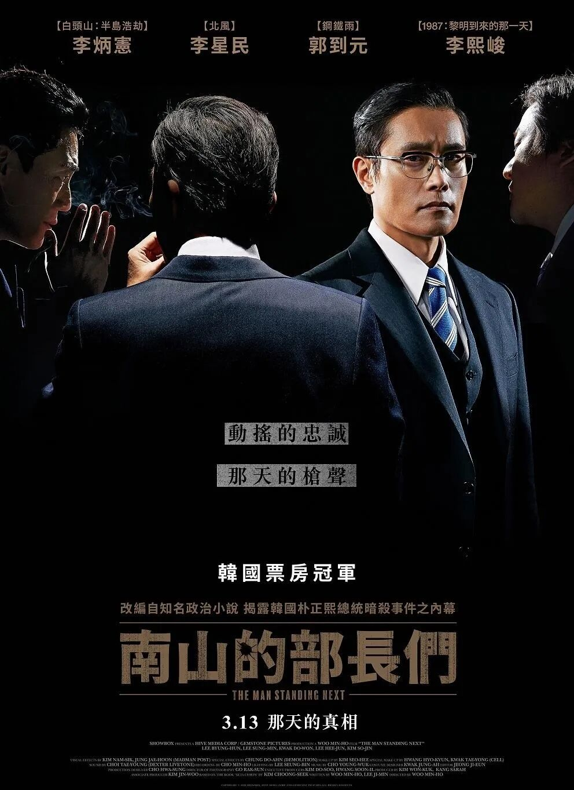
**《南山的部长们》：还原总统朴正熙被刺杀身亡的全过程**
1979年10月26日，韩国发生了朴正熙遇刺身亡事件，这一事件的始作俑者是韩国第二掌权者，中央情报部的部长金载圭。
影片聚焦暗杀事件发生前40天内，情报部长金载圭复杂的心路历程变化。
国内，民间民主呼声高涨，总统朴正熙主张强势镇压，更有总统卫队长车智澈奴才般阿谀奉承表忠心，试图排斥情报部长取而代之。国外，前任情报部长金炯旭逃亡美国并在听证会上揭露朴正熙总统执政黑幕，甚至著书发表，严重损毁朴正熙总统的国际形象。
身为情报部长，金载圭本是总统心腹，但在政治局势恶化的情况下，二人在应对措施上产生分歧。从政治分岐到关系裂痕再到彼此失去信任，最终双方都产生杀机。
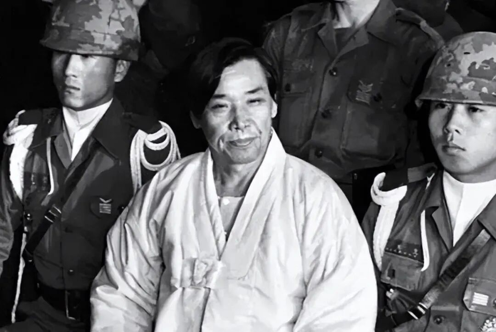
（金载圭受审时相片）
导演禹民镐还原刺杀事件的过程几近写实，在编导这部影片以前，他自称一直认为金载圭部长刺杀总统是正义之举，是顺应民主化潮流。深入了解这一事件之后，对刺杀事件的认识变得复杂多元。
《南山的部长们》是一部惊悚政治片，金载圭的情绪和思想变化很有看头。
金载圭与总统卫队长车智澈从争宠到失宠，从个人政治野心到时局变化产生的无力无助直至刺杀总统，从人性的角度去理解，也就是那么一回事。
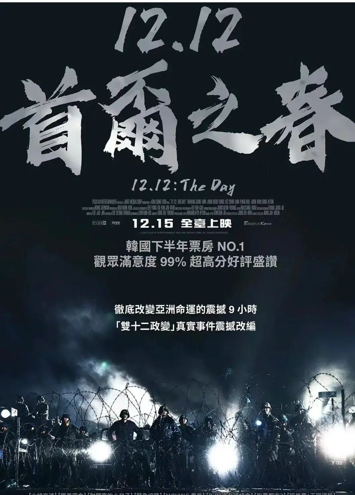
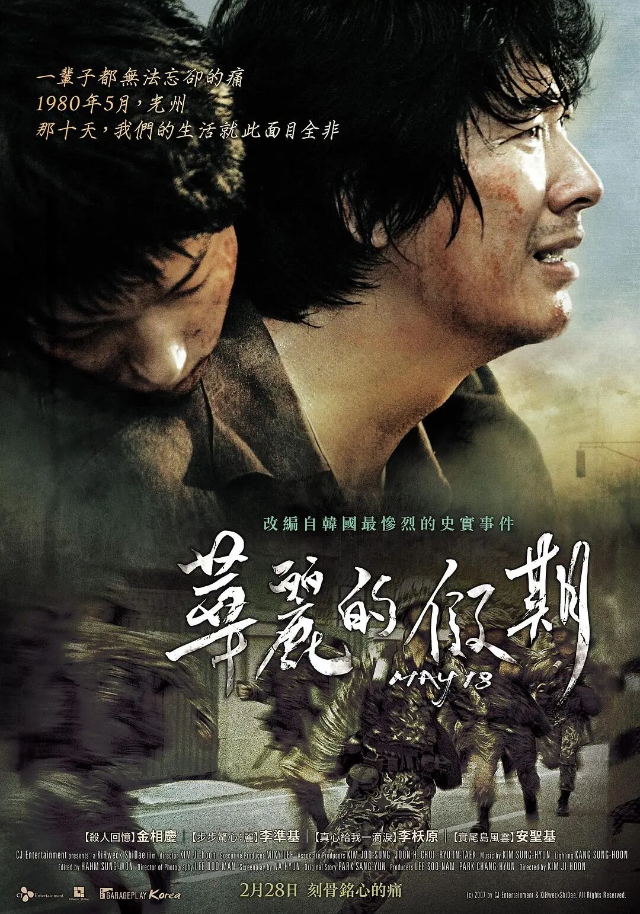
**从《首尔之春》到《华丽的假期》：全斗焕变身总统和光州屠夫**
朴正熙总统遇刺身亡之后，国务总理崔圭夏经过短暂代理总统后正式当选。崔总统承诺进行民主化改革并释放了金大中等民主人士，韩国历史上出现了史称为“首尔之春”的政治开明期。
时任保安司令官全斗焕在兼任朴正熙遇刺案联合调查本部长后，趁机扩大势力，凭借掌控部队通信线路和“一心会”嫡系军人组织，在总统遇刺后不足两个月的12月12日发动了著名了“双十二政变”，攫取军权。
电影《首尔之春》讲述的就是朴正熙遇刺之后到“双十二政变”近两个月内发生的故事，由于不了解真实的历史细节，影片在故事上有多少戏剧化处理不做也不必深究。
影片取得2023年韩国票房冠军，足见其受观众好评程度。
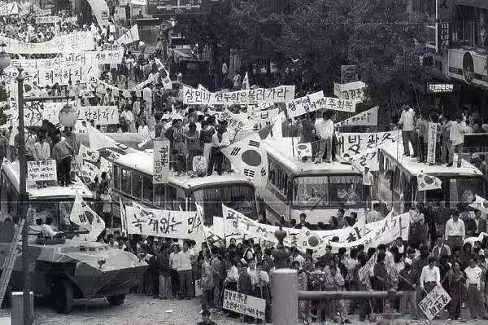
（光州民众抗争现场）
“双十二政变”引发更大的民主抗争运动，全国范围内爆发民众的游行示威活动。
1980年5月17日，全斗焕宣布扩大戒严，拘捕金大中和金泳三等知名民主领袖，打击异己，史称“5.17政变”。
“5.17政变”后的第二天，光州民众发起抗议，史称“5.18民主化运动”，全斗焕派出武装部队进行镇压。
镇压的过程有多么残酷，双方的对抗有多么激烈，伤亡的人数有多么庞大，影片《华丽的假期》对事件经过有充满血腥味的还原。
《华丽的假期》于2007年上映，刷新2007年首周最佳电影票房纪录。
**1997年始，韩国将每年的5月18日定为国家纪念日。**
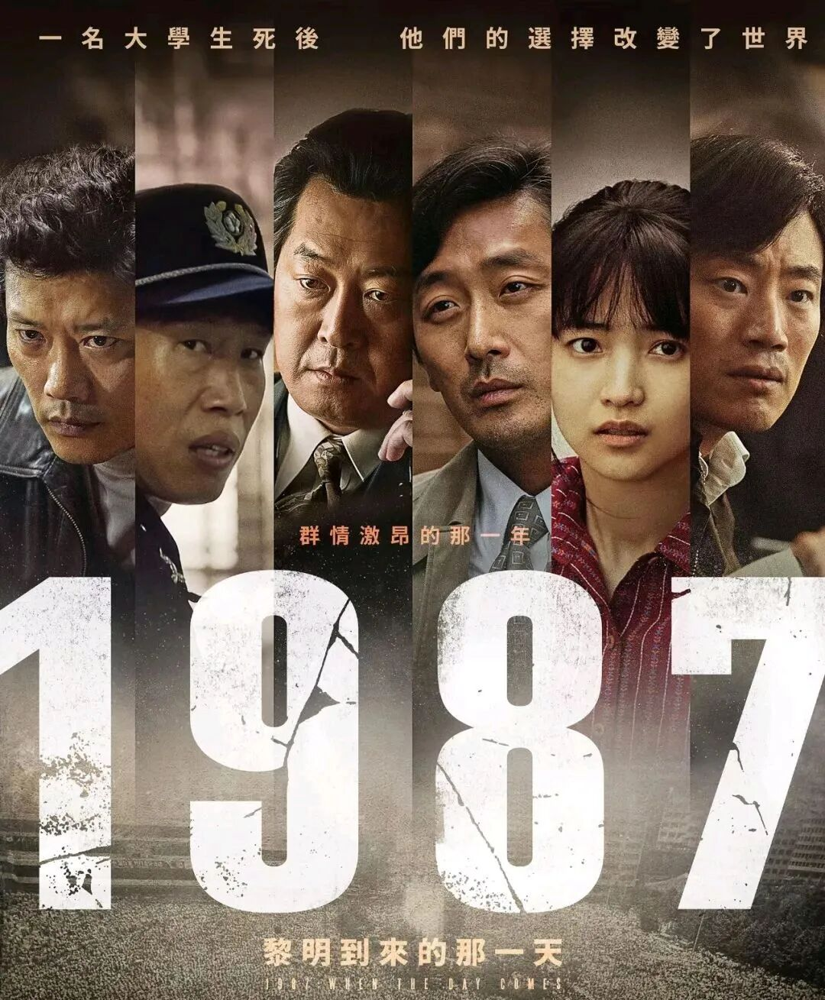
**《1987：黎明到来的那一天》：时代大势终不可逆**
全斗焕执政从开始的兵变夺权不合法，到即后发生的光州事件，使其成为韩国人民最不信任最为反对的总统。为了应对抗争民众，全斗焕执政也只能靠铁腕统治和白色恐怖维系。
1987年1月，学生领袖朴钟哲被警察刑讯致死，引发群众游行示威。
同年6月，大学生李韩烈在示威中被警察的催泪弹击中身亡，激发全国性的民众大游行。
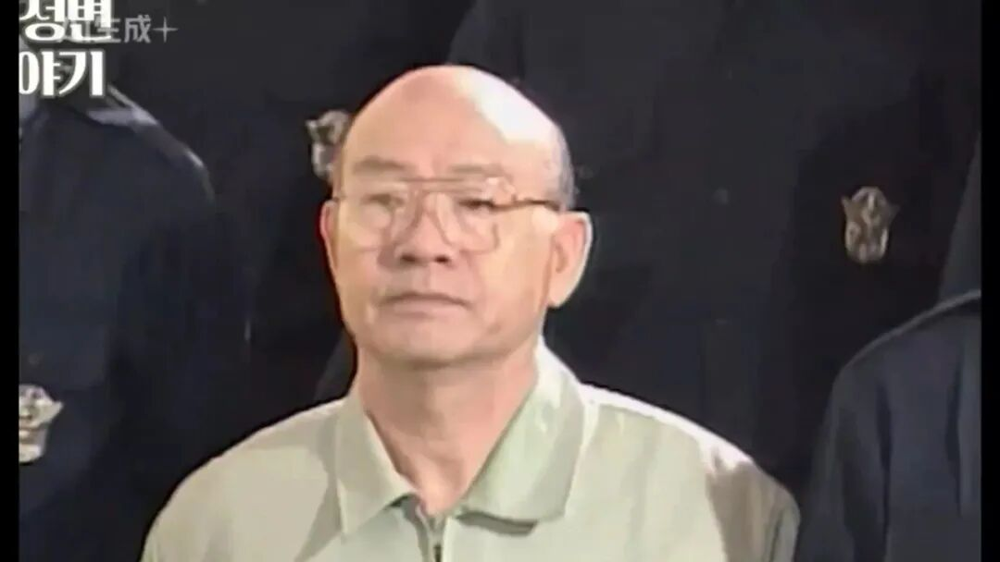
（全斗焕退休后受审时相片）
“六月抗争”在韩国史上具有里程碑意义，迫于压力和终不可违的时代大势，全斗焕政府发表“6.29宣言”，颁布实行总统直选、释放金大中、落实地方自治以及新闻自由等民主化措施。
1987年12月，卢泰愚当选韩国第13届总统。虽然卢泰愚之前参与全斗焕的政变夺权，底子并不干净，但其在位期间促成与苏联、东欧国家以及中国建交，使韩国更快更好融入国际社会。
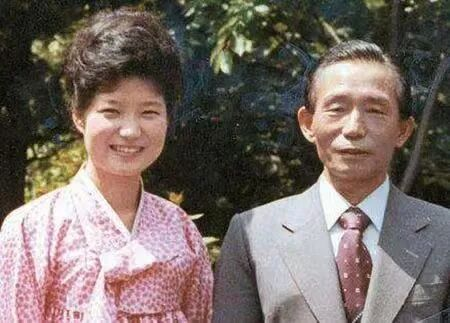
 （两代总统，父亲被刺杀，女儿被判刑）
综合以上，观影顺序，按照历史的时间轴，依次为《实尾岛》、《南山的部长们》、《首尔之春》、《华丽的假期》、《1987：黎明到来的那一天》。
看完唏嘘，权力在历史的进程中，如果深扒，尽是血泪，坑坑洼洼。
